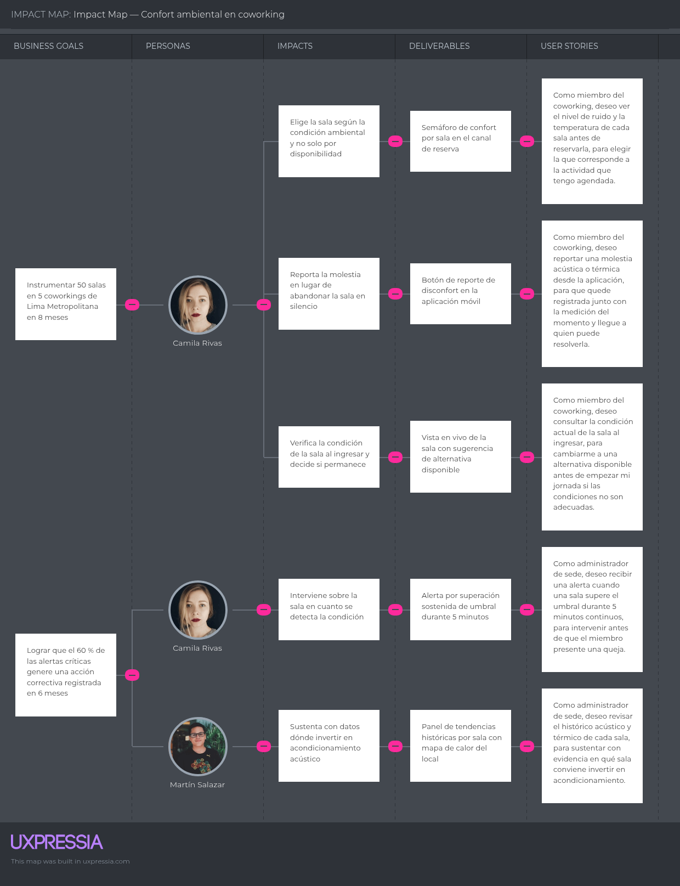
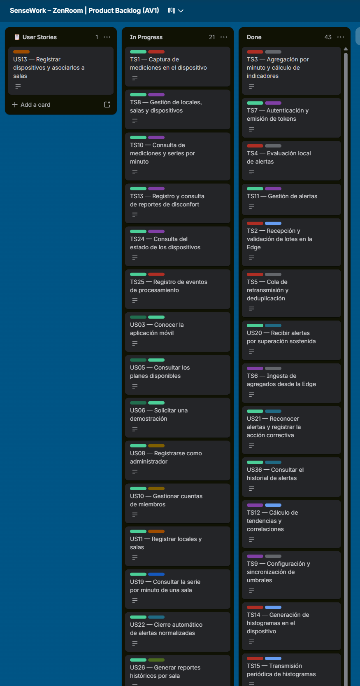

<!-- nav:start -->

<a href="capitulo-2.md">← Capítulo II</a> · <a href="README.md#contenido">Contenido</a> · <a href="capitulo-4.md">Capítulo IV →</a>

<!-- nav:end -->

# Capítulo III: Requirements Specification

## 3.1. User Stories.

En esta sección se presentan las Epics y User Stories que reflejan las necesidades y expectativas de los miembros y administradores de los espacios de trabajo compartidos.

#### Epics

| Epic / Story ID | Título | Descripción | Criterios de aceptación |
|:----|:----|:----|:----|
| EP1 | Landing Page | Como visitante Quiero conocer la propuesta de valor, funcionalidades y modelo de contratación de ZenRoom Para evaluar si la solución resuelve la problemática de confort de mi espacio de trabajo | **Escenario 1: Presentar la propuesta de valor** Dado que soy un visitante en el sitio web Cuando accedo a la página principal Entonces veo el nombre del producto, un mensaje de propuesta de valor y una llamada a la acción, sin requerir registro  **Escenario 2: Conocer el problema que resuelve** Dado que estoy interesado en la solución Cuando reviso el contenido de la página principal Entonces comprendo la problemática del confort acústico y térmico en espacios de trabajo compartidos |
| EP2 | Gestión de Identidad y Acceso | Como administrador o miembro del coworking Quiero crear una cuenta e iniciar sesión en la plataforma Para acceder únicamente a las funciones correspondientes a mi rol | **Escenario 1: Registro de cuenta** Dado que soy un nuevo usuario Cuando completo el registro con datos válidos Entonces el sistema crea mi cuenta y habilita el acceso  **Escenario 2: Inicio de sesión con rol** Dado que ya tengo una cuenta registrada Cuando ingreso mis credenciales correctamente Entonces el sistema emite un token de acceso con mi rol y habilita únicamente las funciones que me corresponden |
| EP3 | Configuración del Espacio | Como administrador de coworking Quiero registrar locales, salas, tipos de sala, dispositivos y umbrales de confort Para que la plataforma refleje la estructura física de mi espacio y vigile cada sala desde su alta | **Escenario 1: Registro de locales y salas** Dado que soy un administrador autenticado Cuando registro un local y sus salas con datos válidos Entonces las salas quedan disponibles para el monitoreo y la configuración  **Escenario 2: Umbrales por defecto de una sala sin clasificar** Dado que registro una sala sin clasificar Cuando el sistema la incorpora Entonces la sala recibe los umbrales por defecto de una sala de concentración (nivel sonoro por debajo de 45 dB y temperatura entre 20 °C y 23 °C) y queda vigilada desde su alta |
| EP4 | Captura y Procesamiento en el Borde | Como developer Quiero que el módulo IoT y la capa Edge capturen, agreguen y evalúen las mediciones localmente Para mantener la vigilancia y las alertas del local sin depender de la conexión a internet | **Escenario 1: Agregación por minuto con indicadores normalizados** Dado que la capa Edge recibió las mediciones de un minuto para una sala Cuando el minuto cierra por la llegada de datos de un minuto posterior Entonces la Edge publica el agregado con los indicadores acústicos (LAeq, L10, L50, L90 conforme a ISO 1996) y térmicos (PMV, PPD conforme a ISO 7730)  **Escenario 2: Operación sin conexión** Dado que el enlace con la nube está caído Cuando la capa Edge procesa los agregados Entonces la evaluación de umbrales continúa operando en el local y los agregados quedan encolados para su retransmisión |
| EP5 | Servicios Cloud (API RESTful) | Como developer Quiero disponer de endpoints RESTful para la ingesta de agregados, la configuración del espacio, las mediciones, las alertas, los insights y los reportes de disconfort Para soportar la aplicación móvil y el panel de gestión web | **Escenario 1: Ingesta de agregados con deduplicación** Dado que la capa Edge envía un lote de agregados con credenciales válidas Cuando la API procesa la petición Entonces la API registra los agregados y deduplica los reenvíos por la pareja sala e instante  **Escenario 2: Manejo de errores estándar** Dado que un cliente consulta un recurso inexistente o envía datos inválidos Cuando la API procesa la petición Entonces la API responde con el código de estado correspondiente e identifica los campos rechazados |
| EP6 | Monitoreo de Confort en Tiempo Real | Como miembro o administrador del coworking Quiero consultar el estado ambiental actual de las salas Para elegir la sala adecuada antes de reservarla o supervisar la instalación de un vistazo | **Escenario 1: Semáforo de confort actualizado** Dado que existen salas instrumentadas con mediciones recientes Cuando el miembro consulta el mapa de salas Entonces cada sala presenta su estado de confort: verde (adecuada), amarillo (aceptable) o rojo (no recomendada)  **Escenario 2: Mapa de calor del local** Dado que el administrador consulta el mapa de calor de su local Cuando el sistema lo presenta Entonces cada sala aparece coloreada según su condición ambiental actual |
| EP7 | Gestión de Alertas | Como administrador de coworking Quiero recibir, reconocer y dar seguimiento a las alertas ambientales Para intervenir sobre las salas antes de que los problemas se manifiesten como quejas | **Escenario 1: Generación por superación sostenida** Dado que un indicador permanece fuera del umbral durante 5 minutos continuos Cuando el sistema evalúa la condición Entonces el sistema genera una alerta con la sala, el indicador y la severidad correspondientes  **Escenario 2: Ciclo de vida de la alerta** Dado que existe una alerta abierta Cuando el administrador la reconoce y registra su acción correctiva Entonces el sistema registra el responsable y el instante, y cierra la alerta automáticamente cuando la condición se normaliza |
| EP8 | Analítica e Insights | Como administrador de coworking Quiero analizar las tendencias históricas y la correlación con el clima exterior Para sustentar decisiones de inversión en acondicionamiento con evidencia | **Escenario 1: Tendencias por sala** Dado que una sala acumula suficiente histórico Cuando el administrador consulta sus tendencias para un período Entonces el sistema presenta la evolución de los indicadores acústicos y térmicos del período  **Escenario 2: Correlación con el clima exterior** Dado que existe histórico suficiente y la observación meteorológica externa está disponible Cuando el administrador solicita la correlación Entonces el sistema presenta la relación entre las condiciones interiores y el clima exterior |
| EP9 | Reportes de Disconfort | Como miembro del coworking Quiero reportar molestias acústicas o térmicas desde la aplicación Para que el administrador conozca el problema aunque la medición no lo refleje | **Escenario 1: Registro contrastado con la medición** Dado que el miembro envía un reporte con sala, tipo de molestia e instante válidos Cuando el sistema lo procesa Entonces el sistema registra el reporte y lo contrasta con la medición registrada en ese instante  **Escenario 2: Discrepancia entre percepción y medición** Dado que la medición del instante reportado se encuentra dentro del umbral Cuando el sistema registra el reporte Entonces el sistema lo marca como discrepancia entre percepción y medición |

#### User Stories

| Story ID | Título | Descripción | Criterios de Aceptación | Relacionado con Epic ID |
|:----|:----|:----|:----|:----|
| US01 | Comprender la propuesta de valor | Como visitante del segmento administrador, quiero comprender la propuesta de valor de ZenRoom al ingresar al sitio, para determinar si resuelve la problemática de confort de mi espacio de trabajo. | **Escenario 1: Presentación inicial del producto** Dado que el visitante accede al sitio web Cuando la página principal carga Entonces el sistema presenta el nombre del producto, un mensaje de propuesta de valor y una llamada a la acción dentro de los primeros elementos visibles  **Escenario 2: Problemática sin registro** Dado que el visitante permanece en la página principal Cuando revisa el contenido sin registrarse Entonces el sistema presenta la problemática del confort acústico y térmico en espacios de trabajo compartidos | 1 |
| US02 | Explorar funcionalidades del producto | Como visitante del segmento administrador, quiero explorar las funcionalidades de la solución, para evaluar qué aporta a la operación de mi local. | **Escenario 1: Descripción de las funcionalidades** Dado que el visitante navega a la sección de funcionalidades Cuando el contenido se presenta Entonces el sistema describe el monitoreo acústico y térmico por sala, las alertas y la analítica histórica  **Escenario 2: Detalle de una funcionalidad** Dado que el visitante selecciona una funcionalidad Cuando el sistema despliega su detalle Entonces el sistema presenta la descripción completa de la funcionalidad seleccionada | 1 |
| US03 | Conocer la aplicación móvil | Como visitante del segmento miembro, quiero conocer las capacidades de la aplicación móvil, para entender cómo me ayuda a encontrar una sala adecuada antes de reservar. | **Escenario 1: Capacidades de la aplicación** Dado que el visitante accede a la sección de la aplicación móvil Cuando el contenido se presenta Entonces el sistema describe el mapa de salas con el semáforo de confort y el histórico de tranquilidad por hora  **Escenario 2: Garantía de privacidad en la aplicación** Dado que el visitante revisa la sección de la aplicación móvil Cuando consulta el contenido Entonces el sistema indica que la aplicación no graba audio y solo muestra el nivel de ruido medido | 1 |
| US04 | Verificar el compromiso de privacidad | Como visitante, quiero conocer el tratamiento que la solución da a las conversaciones, para evaluar la privacidad antes de adoptar el producto. | **Escenario 1: Declaración de privacidad** Dado que el visitante accede a la sección de privacidad Cuando el contenido se presenta Entonces el sistema indica que el audio se procesa dentro del propio dispositivo y nunca se graba, almacena ni transmite  **Escenario 2: Accesibilidad permanente de la declaración** Dado que el visitante consulta cualquier sección del sitio Cuando revisa el contenido Entonces el sistema mantiene la declaración de privacidad accesible desde el pie de página | 1 |
| US05 | Consultar los planes disponibles | Como visitante del segmento administrador, quiero consultar los planes y el modelo de contratación, para estimar la inversión por sala antes de contactar al equipo comercial. | **Escenario 1: Presentación de los planes** Dado que el visitante accede a la sección de planes Cuando el contenido se presenta Entonces el sistema muestra los planes disponibles con sus características y condiciones de contratación  **Escenario 2: Comparación entre planes** Dado que el visitante compara los planes presentados Cuando revisa cada uno Entonces el sistema identifica qué funcionalidades incluye cada plan | 1 |
| US06 | Solicitar una demostración | Como visitante del segmento administrador, quiero solicitar una demostración del producto, para recibir un diagnóstico de las condiciones reales de mi local. | **Escenario 1: Solicitud registrada** Dado que el visitante completa el formulario de contacto con datos válidos Cuando envía la solicitud Entonces el sistema registra la solicitud y confirma su recepción  **Escenario 2: Solicitud con datos inválidos** Dado que el visitante envía el formulario con un correo con formato inválido o campos obligatorios vacíos Cuando confirma el envío Entonces el sistema informa el error, no registra la solicitud y conserva los datos ingresados | 1 |
| US07 | Resolver dudas frecuentes | Como visitante, quiero consultar las preguntas frecuentes del producto, para resolver dudas de instalación, costo y privacidad sin contactar al equipo comercial. | **Escenario 1: Agrupación por temática** Dado que el visitante accede a la sección de preguntas frecuentes Cuando el contenido se presenta Entonces el sistema agrupa las preguntas por temática (instalación, costo, privacidad y medición)  **Escenario 2: Respuesta desplegada** Dado que el visitante selecciona una pregunta Cuando el sistema despliega la respuesta Entonces el sistema muestra el texto completo de la respuesta correspondiente | 1 |
| US08 | Registrarse como administrador | Como administrador de coworking, quiero registrarme en la plataforma con los datos de mi organización, para acceder al panel de gestión de mi espacio. | **Escenario 1: Registro exitoso** Dado que el administrador envía un registro con datos válidos Cuando el sistema procesa la solicitud Entonces el sistema crea la cuenta, confirma el registro y habilita el acceso al panel de gestión  **Escenario 2: Registro rechazado** Dado que el administrador envía un registro con un correo ya registrado o con campos obligatorios incompletos Cuando el sistema procesa el registro Entonces el sistema rechaza el registro e informa la causa sin crear la cuenta | 2 |
| US09 | Iniciar sesión en la plataforma | Como administrador o miembro del coworking, quiero iniciar sesión con mis credenciales, para acceder únicamente a las funciones correspondientes a mi rol. | **Escenario 1: Inicio de sesión exitoso** Dado que el usuario envía credenciales válidas Cuando el sistema las verifica Entonces el sistema emite un token de acceso con el rol del usuario y habilita las funciones de su rol  **Escenario 2: Credenciales inválidas** Dado que el usuario envía credenciales inválidas Cuando el sistema las verifica Entonces el sistema rechaza el acceso sin revelar cuál credencial es incorrecta  **Escenario 3: Token expirado** Dado que el usuario presenta un token expirado Cuando solicita un recurso protegido Entonces el sistema rechaza la solicitud y exige una nueva autenticación | 2 |
| US10 | Gestionar cuentas de miembros | Como administrador de coworking, quiero invitar a los miembros de mi espacio y desactivar sus cuentas, para controlar quién consulta la información de mi local. | **Escenario 1: Invitación de un miembro** Dado que el administrador invita a un miembro con un correo válido Cuando el sistema procesa la invitación Entonces el miembro puede completar su registro y queda asociado al local del administrador  **Escenario 2: Desactivación de una cuenta** Dado que el administrador desactiva la cuenta de un miembro Cuando el miembro intenta acceder con su token Entonces el sistema rechaza sus solicitudes posteriores a la desactivación | 2 |
| US11 | Registrar locales y salas | Como administrador de coworking, quiero registrar mis locales y sus salas, para reflejar la estructura física de mi espacio en la plataforma. | **Escenario 1: Registro exitoso** Dado que el administrador registra un local y sus salas con datos válidos Cuando el sistema procesa el registro Entonces las salas quedan disponibles para las funciones de monitoreo y configuración  **Escenario 2: Umbrales por defecto** Dado que el administrador registra una sala sin clasificar Cuando el sistema la incorpora Entonces la sala recibe los umbrales por defecto de una sala de concentración y queda vigilada desde su alta  **Escenario 3: Nombre duplicado** Dado que el administrador registra una sala con un nombre ya existente en el mismo local Cuando el sistema procesa el registro Entonces el sistema rechaza la operación e informa la duplicidad | 3 |
| US12 | Clasificar salas por tipo | Como administrador de coworking, quiero clasificar cada sala según su uso previsto (cabina de llamadas, sala de reuniones o área abierta), para que se apliquen los umbrales de confort correspondientes a su actividad. | **Escenario 1: Asignación de tipo** Dado que el administrador asigna un tipo a una sala Cuando el sistema procesa la clasificación Entonces los umbrales del tipo quedan aplicados a las evaluaciones posteriores de esa sala  **Escenario 2: Cambio de tipo** Dado que el administrador cambia el tipo de una sala Cuando el sistema procesa el cambio Entonces los umbrales vigentes se actualizan para las evaluaciones siguientes sin alterar el histórico registrado | 3 |
| US13 | Registrar dispositivos y asociarlos a salas | Como administrador de coworking, quiero registrar cada dispositivo IoT y asociarlo a una sala, para habilitar la medición continua del ambiente. | **Escenario 1: Asociación exitosa** Dado que el administrador registra un dispositivo y lo asocia a una sala Cuando el sistema procesa el registro Entonces el dispositivo queda identificado y su sala habilitada para recibir mediciones  **Escenario 2: Reemplazo de dispositivo** Dado que el administrador reemplaza un dispositivo de una sala Cuando asocia el nuevo dispositivo Entonces el sistema preserva el histórico de mediciones de la sala  **Escenario 3: Dispositivo ya vinculado** Dado que el administrador intenta asociar un dispositivo ya vinculado a otra sala Cuando el sistema procesa la solicitud Entonces el sistema informa la situación actual antes de permitir el reasignado | 3 |
| US14 | Configurar umbrales de confort | Como administrador de coworking, quiero configurar los umbrales de nivel sonoro y temperatura de cada sala, para adaptar las alertas al uso real del espacio. | **Escenario 1: Configuración vigente** Dado que el administrador configura umbrales válidos para una sala Cuando el sistema los registra Entonces los umbrales rigen las evaluaciones posteriores y quedan disponibles para su descarga por la capa Edge  **Escenario 2: Configuración inválida** Dado que el administrador envía una configuración en la que el límite mínimo supera al máximo Cuando el sistema la valida Entonces el sistema rechaza la configuración e informa el error | 3 |
| US15 | Consultar el semáforo de confort de las salas | Como miembro del coworking, quiero ver el estado actual de cada sala en el semáforo de confort, para elegir una sala adecuada antes de reservarla. | **Escenario 1: Estado de confort por sala** Dado que existen salas instrumentadas con mediciones recientes Cuando el miembro consulta el mapa de salas Entonces el sistema presenta cada sala con su estado de confort: verde (adecuada), amarillo (aceptable) o rojo (no recomendada)  **Escenario 2: Actualización del estado** Dado que una sala cambia de estado de confort Cuando el miembro consulta nuevamente el mapa Entonces el sistema presenta el estado actualizado de esa sala  **Escenario 3: Sala sin datos recientes** Dado que una sala dejó de recibir datos recientes Cuando el miembro consulta el mapa Entonces el sistema distingue esa sala de una sala genuinamente en condición verde | 6 |
| US16 | Filtrar salas por condiciones ambientales | Como miembro del coworking, quiero filtrar las salas por nivel de ruido y temperatura, para encontrar rápidamente una sala que cumpla mis condiciones de trabajo. | **Escenario 1: Filtros aplicados** Dado que el miembro aplica filtros de ruido o temperatura Cuando el sistema procesa la consulta Entonces el sistema presenta únicamente las salas cuyas condiciones actuales cumplen los filtros  **Escenario 2: Sin coincidencias** Dado que ninguna sala cumple los filtros aplicados Cuando el sistema procesa la consulta Entonces el sistema informa que no existen coincidencias | 6 |
| US17 | Consultar el histórico de tranquilidad por hora | Como miembro del coworking, quiero consultar el comportamiento histórico de una sala por franjas horarias, para decidir el mejor momento de reservarla. | **Escenario 1: Comportamiento por hora** Dado que una sala acumula histórico Cuando el miembro consulta su comportamiento por hora Entonces el sistema presenta la evolución típica del nivel sonoro por franja horaria  **Escenario 2: Sin histórico suficiente** Dado que una sala carece de histórico suficiente Cuando el miembro la consulta Entonces el sistema informa que no existe información suficiente para esa sala | 6 |
| US18 | Visualizar el mapa de calor del local | Como administrador de coworking, quiero ver el estado ambiental actual de todas mis salas en el mapa de calor, para supervisar toda la instalación de un vistazo. | **Escenario 1: Condición por sala** Dado que el administrador consulta el mapa de calor de su local Cuando el sistema lo presenta Entonces cada sala aparece representada según su condición ambiental actual  **Escenario 2: Sala con dispositivo fuera de línea** Dado que un dispositivo de una sala está fuera de línea Cuando el administrador consulta el mapa Entonces el sistema distingue esa sala de las salas con medición activa | 6 |
| US19 | Consultar la serie por minuto de una sala | Como administrador de coworking, quiero consultar la serie por minuto de los indicadores de una sala, para diagnosticar un problema puntual con detalle. | **Escenario 1: Serie del rango consultado** Dado que el administrador consulta una sala con un rango temporal válido Cuando el sistema procesa la consulta Entonces el sistema presenta la serie por minuto con los indicadores acústicos y térmicos del rango  **Escenario 2: Rango inválido** Dado que el administrador consulta un rango temporal inválido Cuando el sistema procesa la consulta Entonces el sistema informa el error y no presenta resultados | 6 |
| US20 | Recibir alertas por superación sostenida | Como administrador de coworking, quiero recibir una alerta cuando un indicador supere el umbral de forma sostenida, para intervenir antes de que los clientes se quejen. | **Escenario 1: Alerta generada** Dado que un indicador de una sala permanece fuera del umbral durante 5 minutos continuos Cuando el sistema evalúa la condición Entonces el sistema genera una alerta con la sala, el indicador y la severidad correspondientes  **Escenario 2: Pico momentáneo** Dado que un indicador supera el umbral solo momentáneamente Cuando el sistema evalúa la condición Entonces el sistema no genera alerta | 7 |
| US21 | Reconocer alertas y registrar la acción correctiva | Como administrador de coworking, quiero tomar conocimiento de una alerta y registrar la intervención realizada, para dar seguimiento a la atención del problema. | **Escenario 1: Reconocimiento registrado** Dado que existe una alerta abierta Cuando el administrador la reconoce Entonces el sistema registra el reconocimiento con el responsable y el instante  **Escenario 2: Acción correctiva asociada** Dado que el administrador registra una acción correctiva sobre una alerta Cuando el sistema procesa la acción Entonces la intervención queda asociada a la alerta y consultable en su detalle | 7 |
| US22 | Cierre automático de alertas normalizadas | Como administrador de coworking, quiero que las alertas se cierren automáticamente cuando la condición se normalice, para operar únicamente con alertas vigentes. | **Escenario 1: Cierre automático** Dado que el indicador de una alerta abierta retorna al rango de forma sostenida Cuando el sistema evalúa la condición Entonces el sistema cierra la alerta automáticamente  **Escenario 2: Alerta fuera de la lista de abiertas** Dado que una alerta se encuentra cerrada Cuando el administrador consulta las alertas abiertas Entonces la alerta cerrada no figura en la lista | 7 |
| US23 | Detección de dispositivos fuera de línea | Como administrador de coworking, quiero enterarme cuando un dispositivo deje de reportar, para distinguir una sala silenciosa de un fallo de medición. | **Escenario 1: Desconexión notificada** Dado que el broker notifica la desconexión de un dispositivo Cuando el sistema procesa la notificación Entonces el sistema marca el dispositivo como fuera de línea e informa al administrador  **Escenario 2: Sala sin datos vigentes** Dado que una sala dejó de recibir datos de su dispositivo Cuando el administrador consulta su estado Entonces el sistema la presenta sin datos vigentes y no como una sala en silencio | 7 |
| US24 | Consultar tendencias históricas por sala | Como administrador de coworking, quiero consultar la evolución de los indicadores de cada sala a lo largo del tiempo, para sustentar decisiones de inversión en acondicionamiento. | **Escenario 1: Tendencias del período** Dado que una sala acumula suficiente histórico Cuando el administrador consulta sus tendencias para un período Entonces el sistema presenta la evolución de los indicadores acústicos y térmicos del período  **Escenario 2: Datos insuficientes** Dado que el período consultado no alcanza el mínimo de datos Cuando el sistema procesa la consulta Entonces el sistema informa que no existe información suficiente | 8 |
| US25 | Correlacionar condiciones interiores con el clima exterior | Como administrador de coworking, quiero correlacionar las condiciones de mis salas con el clima exterior, para identificar fallas reales de aislamiento en mis instalaciones. | **Escenario 1: Correlación presentada** Dado que existe histórico suficiente y la observación meteorológica externa está disponible Cuando el administrador solicita la correlación Entonces el sistema presenta la relación entre las condiciones interiores y el clima exterior  **Escenario 2: Servicio meteorológico no disponible** Dado que el servicio meteorológico externo no responde Cuando el sistema procesa la consulta Entonces el sistema informa la falta de contexto meteorológico y mantiene operativas las demás funciones | 8 |
| US26 | Generar reportes históricos por sala | Como administrador de coworking, quiero generar un reporte histórico por sala, para evidenciar las condiciones del espacio ante clientes o dirección. | **Escenario 1: Reporte generado** Dado que el administrador solicita un reporte de una sala para un período con datos Cuando el sistema lo genera Entonces el reporte incluye los indicadores del período y la comparación contra los umbrales configurados  **Escenario 2: Exportación del reporte** Dado que el reporte fue generado Cuando el administrador lo requiere Entonces el sistema permite exportarlo para su distribución | 8 |
| US27 | Reportar una molestia ambiental | Como miembro del coworking, quiero reportar una molestia acústica o térmica desde la aplicación, para que el administrador conozca el problema aunque la medición no lo refleje. | **Escenario 1: Reporte registrado** Dado que el miembro envía un reporte con la sala, el tipo de molestia y el instante Cuando el sistema lo procesa Entonces el sistema registra el reporte y lo contrasta con la medición registrada en ese instante  **Escenario 2: Reporte marcado como discrepancia** Dado que la medición del instante reportado se encuentra dentro del umbral Cuando el sistema registra el reporte Entonces el sistema lo marca como discrepancia entre percepción y medición  **Escenario 3: Reporte incompleto** Dado que el reporte carece de campos obligatorios Cuando el sistema lo valida Entonces el sistema rechaza el envío e informa el error | 9 |
| US28 | Consultar los reportes de disconfort del local | Como administrador de coworking, quiero consultar los reportes de disconfort de mi local, para priorizar las intervenciones según la experiencia real de los miembros. | **Escenario 1: Reportes presentados** Dado que existen reportes de disconfort en el local Cuando el administrador los consulta Entonces el sistema presenta cada reporte con su sala, tipo de molestia, instante y la medición contrastada  **Escenario 2: Filtrado de reportes** Dado que el administrador filtra los reportes por sala o por estado de discrepancia Cuando el sistema procesa el filtro Entonces el sistema presenta únicamente los reportes que cumplen el criterio | 9 |
| US29 | Consultar la ocupación de una sala | Como miembro del coworking, quiero conocer la cantidad de personas presentes en una sala, para elegir un espacio adecuado para mi actividad. | **Escenario 1: Ocupación disponible** Dado que una sala dispone de una medición vigente de ocupación Cuando el miembro consulta el estado de la sala Entonces el sistema informa la cantidad de personas detectadas  **Escenario 2: Actualización de ocupación** Dado que cambia la cantidad de personas presentes en una sala Cuando el sistema recibe una nueva medición válida Entonces el sistema actualiza la cantidad de personas registrada  **Escenario 3: Ocupación no disponible** Dado que una sala no dispone de una medición vigente de ocupación Cuando el miembro consulta el estado de la sala Entonces el sistema informa que la ocupación no está disponible | 6 |
| US30 | Consultar las condiciones ambientales actuales | Como miembro del coworking, quiero consultar las condiciones ambientales actuales de una sala, para determinar si el espacio es adecuado para mi actividad. | **Escenario 1: Mediciones disponibles** Dado que una sala dispone de mediciones recientes Cuando el miembro consulta sus condiciones ambientales Entonces el sistema informa el nivel sonoro, la temperatura y la humedad registrados  **Escenario 2: Datos no vigentes** Dado que una medición supera el período establecido de vigencia Cuando el miembro consulta las condiciones de la sala Entonces el sistema identifica la medición como no vigente  **Escenario 3: Sin mediciones** Dado que una sala no dispone de mediciones registradas Cuando el miembro consulta sus condiciones Entonces el sistema informa que no existen datos disponibles | 6 |
| US31 | Consultar el detalle de una sala | Como miembro del coworking, quiero consultar el detalle de una sala, para evaluar sus condiciones antes de utilizarla. | **Escenario 1: Información completa** Dado que la sala dispone de mediciones vigentes Cuando el miembro consulta su detalle Entonces el sistema informa sus indicadores acústicos, térmicos, de humedad y ocupación  **Escenario 2: Información parcial** Dado que uno de los indicadores no dispone de una medición vigente Cuando el miembro consulta el detalle Entonces el sistema identifica dicho indicador como no disponible | 6 |
| US32 | Consultar salas según ocupación | Como miembro del coworking, quiero consultar las salas según su nivel de ocupación, para seleccionar un espacio compatible con mi actividad. | **Escenario 1: Condición de ocupación** Dado que existen salas con información vigente de ocupación Cuando el miembro establece una condición de ocupación Entonces el sistema presenta las salas que cumplen dicha condición  **Escenario 2: Sin coincidencias** Dado que ninguna sala cumple la condición de ocupación Cuando el sistema procesa la consulta Entonces el sistema informa que no existen salas coincidentes | 6 |
| US33 | Supervisar la ocupación del local | Como administrador de coworking, quiero conocer la cantidad de personas presentes en las salas de mi local, para supervisar el uso de los espacios. | **Escenario 1: Ocupación registrada** Dado que las salas disponen de mediciones vigentes de ocupación Cuando el administrador consulta el estado del local Entonces el sistema informa la cantidad de personas registrada para cada sala  **Escenario 2: Cambio de ocupación** Dado que cambia la cantidad de personas de una sala Cuando el sistema recibe una nueva medición Entonces el sistema actualiza la ocupación registrada  **Escenario 3: Datos no vigentes** Dado que una sala deja de recibir mediciones dentro del período establecido Cuando el administrador consulta su ocupación Entonces el sistema identifica la información como no vigente | 6 |
| US34 | Consultar el estado de los dispositivos | Como administrador de coworking, quiero conocer el estado operativo de los dispositivos IoT, para detectar fallas de medición en las salas. | **Escenario 1: Dispositivo operativo** Dado que un dispositivo continúa enviando mediciones válidas Cuando el sistema verifica su estado Entonces el sistema identifica el dispositivo como operativo  **Escenario 2: Dispositivo desconectado** Dado que un dispositivo deja de enviar información durante el período establecido Cuando el sistema verifica su estado Entonces el sistema identifica el dispositivo como fuera de línea  **Escenario 3: Dispositivo recuperado** Dado que un dispositivo fuera de línea vuelve a enviar mediciones válidas Cuando el sistema recibe la nueva comunicación Entonces el sistema actualiza el estado del dispositivo como operativo | 7 |
| US35 | Consultar el estado de conectividad de una sala | Como administrador de coworking, quiero conocer si una sala recibe mediciones correctamente, para distinguir un problema ambiental de una falla de comunicación. | **Escenario 1: Comunicación activa** Dado que el dispositivo asociado a la sala envía mediciones vigentes Cuando el administrador consulta el estado de la sala Entonces el sistema identifica la comunicación como activa  **Escenario 2: Comunicación interrumpida** Dado que el dispositivo deja de reportar durante el período establecido Cuando el sistema evalúa su estado Entonces el sistema identifica la comunicación como interrumpida | 7 |
| US36 | Consultar el historial de alertas | Como administrador de coworking, quiero consultar las alertas ocurridas en mis salas, para identificar problemas recurrentes y evaluar su atención. | **Escenario 1: Historial disponible** Dado que existen alertas registradas para un local Cuando el administrador consulta el historial Entonces el sistema informa las alertas con su sala, indicador, período y estado  **Escenario 2: Sin alertas** Dado que un local no tiene alertas registradas para el período consultado Cuando el administrador consulta el historial Entonces el sistema informa que no existen alertas | 7 |
| US37 | Consultar acciones correctivas realizadas | Como administrador de coworking, quiero consultar las acciones correctivas realizadas sobre las alertas, para verificar cómo se atendieron los problemas ambientales. | **Escenario 1: Acción registrada** Dado que una alerta tiene una acción correctiva registrada Cuando el administrador consulta su historial Entonces el sistema informa la acción, el responsable y el instante registrado  **Escenario 2: Sin acción registrada** Dado que una alerta no tiene una acción correctiva asociada Cuando el administrador consulta su información Entonces el sistema informa que no existe una acción registrada | 7 |
| US38 | Comparar condiciones entre salas | Como administrador de coworking, quiero comparar las condiciones ambientales de mis salas, para identificar cuáles requieren atención prioritaria. | **Escenario 1: Comparación disponible** Dado que varias salas tienen mediciones vigentes Cuando el administrador solicita una comparación Entonces el sistema permite determinar las diferencias entre sus indicadores ambientales  **Escenario 2: Datos insuficientes** Dado que una sala no dispone de mediciones suficientes Cuando el sistema realiza la comparación Entonces el sistema identifica la ausencia de datos suficientes para esa sala | 8 |
| US39 | Consultar el historial de ocupación | Como administrador de coworking, quiero consultar la evolución de la ocupación de una sala, para conocer cómo se utiliza el espacio a lo largo del tiempo. | **Escenario 1: Histórico disponible** Dado que una sala dispone de registros históricos de ocupación Cuando el administrador consulta un período determinado Entonces el sistema informa la evolución de la ocupación durante el período  **Escenario 2: Histórico insuficiente** Dado que una sala no tiene suficientes registros para el período solicitado Cuando el administrador consulta el histórico Entonces el sistema informa que los datos disponibles son insuficientes | 8 |
| US40 | Consultar el estado general del local | Como administrador de coworking, quiero conocer el estado ambiental general de mi local, para identificar rápidamente las salas que requieren atención. | **Escenario 1: Salas con mediciones vigentes** Dado que las salas cuentan con mediciones vigentes Cuando el administrador consulta el estado general del local Entonces el sistema determina el estado ambiental de cada sala  **Escenario 2: Salas fuera de condición** Dado que una o más salas presentan indicadores fuera de sus umbrales Cuando el sistema determina el estado general Entonces el sistema identifica las salas que requieren atención | 6 |
| US41 | Recuperar acceso a la cuenta | Como administrador o miembro, quiero restablecer mi contraseña mediante mi correo registrado, para recuperar el acceso sin revelar mis credenciales. | **Escenario 1: Solicitud privada** Dado que una persona solicita recuperación con un correo válido Cuando el sistema procesa la solicitud Entonces confirma la recepción con el mismo mensaje exista o no la cuenta, y solo remite el enlace al correo registrado.  **Escenario 2: Restablecimiento válido** Dado que el enlace contiene un token de un solo uso con vigencia de 15 minutos Cuando la persona establece una contraseña válida dentro de su vigencia Entonces se actualiza el hash, se invalida el token y la contraseña anterior deja de autenticar.  **Escenario 3: Token inválido** Dado que el token está vencido, fue usado o no existe Cuando se solicita el restablecimiento Entonces el sistema rechaza la operación sin cambiar la contraseña. | 2 |
| TS1 | Captura de mediciones en el dispositivo | Como developer, quiero que el dispositivo capture muestras de sonido, temperatura y humedad y consolide las ventanas de muestreo, para disponer de mediciones estables por sala. | **Escenario 1: Ventana de muestreo consolidada** Dado que el dispositivo opera instalado en una sala Cuando completa una ventana de muestreo Entonces el dispositivo calcula el nivel sonoro de la ventana y descarta la muestra de audio en el propio dispositivo  **Escenario 2: El audio nunca se transmite** Dado que el dispositivo procesa cualquier muestra de audio Cuando calcula el nivel sonoro Entonces ningún contenido de audio se transmite fuera del dispositivo | 4 |
| TS2 | Recepción y validación de lotes en la Edge | Como developer, quiero que la capa Edge reciba y valide los lotes de mediciones enviados por el dispositivo, para asegurar la calidad del dato antes de agregarlo. | **Escenario 1: Lote válido** Dado que el dispositivo envía un lote de mediciones con formato válido Cuando la capa Edge lo recibe Entonces la Edge responde con confirmación de recepción y consolida las mediciones para su agregación  **Escenario 2: Lote inválido** Dado que el dispositivo envía un lote con campos ausentes o valores fuera de rango físico Cuando la capa Edge lo valida Entonces la Edge rechaza el lote, informa el error y no lo incorpora a la agregación | 4 |
| TS3 | Agregación por minuto y cálculo de indicadores | Como developer, quiero que la capa Edge consolide el agregado por minuto y calcule los indicadores normalizados, para producir LAeq y percentiles L10, L50 y L90 conforme a ISO 1996, y PMV y PPD conforme a ISO 7730. | **Escenario 1: Cierre del minuto por marca de agua** Dado que la Edge recibió las mediciones de un minuto para una sala Cuando el minuto cierra por la llegada de datos de un minuto posterior Entonces la Edge publica el agregado con los indicadores acústicos y térmicos calculados conforme a las normas  **Escenario 2: Minuto sin cerrar** Dado que un minuto no completó el cierre por marca de agua Cuando el sistema evalúa su estado Entonces la Edge no publica el agregado hasta que el minuto queda cerrado | 4 |
| TS4 | Evaluación local de alertas | Como developer, quiero que la capa Edge evalúe los umbrales y levante las alertas localmente, para mantener la vigilancia del local sin depender de la conexión a internet. | **Escenario 1: Alerta local por superación sostenida** Dado que la Edge mantiene los umbrales sincronizados de una sala Cuando un indicador permanece fuera del umbral durante 5 minutos continuos Entonces la Edge levanta la alerta en el local sin requerir conexión con la nube  **Escenario 2: Pico momentáneo** Dado que un indicador supera el umbral solo de forma momentánea Cuando la Edge evalúa la condición Entonces la Edge no levanta alerta  **Escenario 3: Evaluación sin conexión** Dado que el enlace con la nube está caído Cuando la Edge procesa los agregados Entonces la evaluación de umbrales continúa operando en el local | 4 |
| TS5 | Cola de retransmisión y deduplicación | Como developer, quiero que la capa Edge encole los agregados ante fallos de transmisión y los retransmita, para no perder información ante cortes de conectividad. | **Escenario 1: Encolado ante fallo** Dado que falla la transmisión de un agregado hacia la nube Cuando la Edge detecta el fallo Entonces el agregado queda encolado y se retransmite automáticamente  **Escenario 2: Deduplicación del reenvío** Dado que una retransmisión duplica un agregado ya registrado Cuando la nube lo recibe Entonces el receptor deduplica el agregado por la pareja sala e instante sin duplicar el registro | 4 |
| TS6 | Ingesta de agregados desde la Edge | Como developer, quiero exponer un endpoint de ingesta de agregados por minuto, para consolidar en la nube la información producida por las capas Edge de los locales. | **Escenario 1: Ingesta exitosa** Dado que la capa Edge envía una petición con credenciales válidas y un lote de agregados bien formado Cuando la API procesa la petición Entonces la API responde con estado 202, confirma la aceptación y registra los agregados  **Escenario 2: Entrega at-least-once** Dado que la petición reenvía un agregado ya registrado Cuando la API lo procesa Entonces la API deduplica por la pareja sala e instante y no genera registros duplicados  **Escenario 3: Credenciales inválidas** Dado que la petición presenta credenciales inválidas Cuando la API la procesa Entonces la API responde con estado 401 sin procesar el lote  **Escenario 4: Lote inválido** Dado que el lote presenta campos ausentes o valores fuera de rango Cuando la API lo valida Entonces la API responde con estado 400 e identifica los campos rechazados | 5 |
| TS7 | Autenticación y emisión de tokens | Como developer, quiero exponer los endpoints de registro y autenticación con emisión de token y roles, para proteger los recursos de la plataforma según el rol del emisor. | **Escenario 1: Registro exitoso** Dado que un cliente envía un registro con datos válidos Cuando la API procesa la petición Entonces la API crea la cuenta y responde con estado 201  **Escenario 2: Autenticación exitosa** Dado que un cliente envía credenciales válidas Cuando la API las verifica Entonces la API responde con estado 200 y un token de acceso que declara el rol del usuario  **Escenario 3: Credenciales o token inválidos** Dado que un cliente envía credenciales inválidas o un token expirado Cuando la API procesa la petición Entonces la API responde con estado 401 | 5 |
| TS8 | Gestión de locales, salas y dispositivos | Como developer, quiero exponer los endpoints de administración de locales, salas, tipos de sala y dispositivos, para soportar la configuración del espacio desde el panel de gestión. | **Escenario 1: Creación exitosa** Dado que un administrador autenticado envía una petición de creación con datos válidos Cuando la API la procesa Entonces la API responde con estado 201, el recurso creado y este queda disponible para su consulta  **Escenario 2: Recurso inexistente** Dado que un cliente consulta un recurso inexistente Cuando la API procesa la petición Entonces la API responde con estado 404  **Escenario 3: Petición no autorizada o inválida** Dado que una petición carece de token o presenta datos inválidos Cuando la API la procesa Entonces la API responde con el estado 401 o 400 correspondiente sin alterar los datos | 5 |
| TS9 | Configuración y sincronización de umbrales | Como developer, quiero exponer los endpoints de configuración de umbrales y su versión vigente, para que las capas Edge descarguen la configuración que rige la evaluación local. | **Escenario 1: Configuración vigente** Dado que un administrador autenticado registra una configuración de umbrales válida Cuando la API la procesa Entonces la API la marca como vigente y queda disponible para su descarga por la Edge de ese local  **Escenario 2: Descarga por la capa Edge** Dado que la capa Edge solicita la configuración vigente de sus salas Cuando la API procesa la petición Entonces la API responde con estado 200 y los umbrales vigentes por sala  **Escenario 3: Configuración inválida** Dado que la configuración enviada incumple las reglas de validación Cuando la API la valida Entonces la API responde con estado 400 sin modificar la configuración vigente | 5 |
| TS10 | Consulta de mediciones y series por minuto | Como developer, quiero exponer los endpoints de consulta de agregados por sala y rango temporal, para soportar el semáforo de confort, el mapa de calor y las vistas de diagnóstico. | **Escenario 1: Consulta exitosa** Dado que un cliente autenticado consulta una sala existente con un rango temporal válido Cuando la API procesa la petición Entonces la API responde con estado 200 y la serie de agregados por minuto dentro del rango solicitado  **Escenario 2: Rango temporal inválido** Dado que la consulta presenta un rango temporal inválido Cuando la API la valida Entonces la API responde con estado 400  **Escenario 3: Sala inexistente o ajena** Dado que la consulta referencia una sala inexistente o ajena al local del solicitante Cuando la API la procesa Entonces la API responde con estado 404 | 5 |
| TS11 | Gestión de alertas | Como developer, quiero exponer los endpoints de consulta, reconocimiento y cierre de alertas, para soportar el flujo de atención desde el panel de gestión. | **Escenario 1: Alertas abiertas** Dado que un administrador autenticado consulta las alertas abiertas de su local Cuando la API procesa la petición Entonces la API responde con estado 200 y las alertas abiertas con su sala, indicador y severidad  **Escenario 2: Reconocimiento registrado** Dado que el administrador reconoce una alerta abierta Cuando la API procesa la petición Entonces la API registra el reconocimiento con el responsable y el instante  **Escenario 3: Cierre por normalización** Dado que el indicador de una alerta retorna al rango de forma sostenida Cuando la API procesa la normalización Entonces la API actualiza el estado de la alerta a cerrada | 5 |
| TS12 | Cálculo de tendencias y correlaciones | Como developer, quiero exponer los endpoints de tendencias históricas y correlación con el clima exterior, para soportar la analítica de decisiones del administrador. | **Escenario 1: Tendencias con suficiente histórico** Dado que un administrador autenticado solicita las tendencias de una sala con suficiente histórico Cuando la API procesa la petición Entonces la API responde con estado 200 y la evolución de los indicadores del período  **Escenario 2: Datos insuficientes** Dado que la sala no alcanza el mínimo de datos para el período solicitado Cuando la API procesa la petición Entonces la API responde indicando que no existe información suficiente  **Escenario 3: Servicio meteorológico no disponible** Dado que la API solicita la observación meteorológica externa para contextualizar las mediciones Cuando el servicio externo no responde Entonces la API responde indicando la falta de contexto meteorológico sin degradar el resto de la respuesta | 5 |
| TS13 | Registro y consulta de reportes de disconfort | Como developer, quiero exponer los endpoints de registro y consulta de reportes de disconfort, para capturar la percepción de los miembros y contrastarla con la medición. | **Escenario 1: Registro exitoso** Dado que un miembro autenticado envía un reporte con sala, tipo de molestia e instante válidos Cuando la API lo procesa Entonces la API responde con estado 201, registra el reporte y lo contrasta con la medición registrada en ese instante  **Escenario 2: Reporte como discrepancia** Dado que el reporte indica una molestia cuya medición se encuentra dentro del umbral Cuando la API lo registra Entonces la API almacena el reporte marcado como discrepancia entre percepción y medición  **Escenario 3: Reporte inválido** Dado que el reporte carece de campos obligatorios Cuando la API lo valida Entonces la API responde con estado 400 sin registrarlo | 5 |
| TS14 | Generación de histogramas en el dispositivo | Como developer, quiero que el dispositivo genere histogramas de las muestras acústicas, para reducir el volumen de datos enviados hacia la capa Edge. | **Escenario 1: Histograma generado** Dado que el dispositivo recibe muestras acústicas durante una ventana de medición Cuando finaliza la ventana de muestreo Entonces el dispositivo genera un histograma con la distribución de las mediciones  **Escenario 2: Muestras de audio descartadas** Dado que el dispositivo ha calculado el histograma correspondiente Cuando finaliza el procesamiento de la ventana Entonces el dispositivo descarta las muestras de audio utilizadas para el cálculo | 4 |
| TS15 | Transmisión periódica de histogramas | Como developer, quiero que el dispositivo transmita los histogramas cada 10 segundos a la capa Edge, para reducir el consumo de ancho de banda respecto al envío de datos crudos. | **Escenario 1: Transmisión cada 10 segundos** Dado que el dispositivo dispone de un histograma generado Cuando transcurren 10 segundos desde la última transmisión Entonces el dispositivo publica el histograma correspondiente hacia la capa Edge  **Escenario 2: Datos agregados** Dado que el dispositivo realiza una transmisión Cuando genera el mensaje de datos Entonces el mensaje contiene el histograma y las mediciones ambientales requeridas y no contiene audio crudo | 4 |
| TS16 | Recepción de histogramas mediante broker | Como developer, quiero que la capa Edge reciba los histogramas mediante un broker de mensajería, para centralizar las mediciones antes de procesarlas. | **Escenario 1: Mensaje válido** Dado que un dispositivo publica un histograma válido en el canal correspondiente Cuando la Edge recibe el mensaje Entonces la Edge acepta el mensaje y asocia los datos con el dispositivo y la sala correspondiente  **Escenario 2: Mensaje inválido** Dado que el mensaje no contiene los campos requeridos Cuando la Edge procesa el mensaje Entonces la Edge rechaza el mensaje y registra la causa del rechazo | 4 |
| TS17 | Fusión de histogramas en la Edge | Como developer, quiero que la capa Edge fusione los histogramas recibidos de una misma sala y período, para producir una distribución consolidada antes del cálculo de indicadores. | **Escenario 1: Histogramas de una sala** Dado que la Edge recibe varios histogramas correspondientes a una misma sala y período Cuando procesa los histogramas Entonces la Edge los fusiona en una distribución consolidada  **Escenario 2: Histogramas de diferentes salas** Dado que la Edge recibe histogramas correspondientes a distintas salas Cuando procesa los datos Entonces la Edge mantiene las distribuciones separadas por sala | 4 |
| TS18 | Consolidación de mediciones por minuto | Como developer, quiero que la Edge consolide los histogramas recibidos durante un minuto, para generar un único agregado por sala antes de enviarlo a la nube. | **Escenario 1: Minuto consolidado** Dado que la Edge ha recibido los histogramas correspondientes al período de una sala Cuando finaliza el período de un minuto Entonces la Edge genera un agregado único para esa sala y minuto  **Escenario 2: Datos incompletos** Dado que el período contiene datos incompletos Cuando la Edge consolida el minuto Entonces la Edge genera el agregado disponible e identifica la condición de datos incompletos | 4 |
| TS19 | Cálculo de indicadores acústicos desde histogramas | Como developer, quiero calcular los indicadores acústicos a partir de los histogramas consolidados, para evitar transmitir y almacenar muestras acústicas individuales. | **Escenario 1: Histograma válido** Dado que existe un histograma consolidado de una sala Cuando la Edge calcula los indicadores acústicos Entonces la Edge obtiene el LAeq y los percentiles L10, L50 y L90 definidos por el sistema  **Escenario 2: Histograma insuficiente** Dado que el histograma no contiene información suficiente para el cálculo Cuando la Edge intenta calcular los indicadores Entonces la Edge rechaza el cálculo y registra la causa | 4 |
| TS20 | Procesamiento local ante pérdida de conectividad | Como developer, quiero que la capa Edge continúe procesando mediciones y evaluando alertas cuando no existe conexión con la nube, para mantener la vigilancia del local. | **Escenario 1: Conexión con la nube interrumpida** Dado que la Edge pierde la conexión con la nube Cuando recibe nuevas mediciones Entonces la Edge continúa procesando los datos y evaluando los umbrales localmente  **Escenario 2: Recuperación de conexión** Dado que existen agregados pendientes de sincronización Cuando se recupera la conexión con la nube Entonces la Edge transmite los agregados pendientes según el mecanismo de reintento configurado | 4 |
| TS21 | Procesamiento de mediciones de humedad y ocupación | Como developer, quiero que la plataforma procese las mediciones de humedad y ocupación asociadas a cada sala, para mantener actualizada la información ambiental y de uso. | **Escenario 1: Datos válidos** Dado que la Edge recibe mediciones válidas de humedad y ocupación Cuando procesa el agregado Entonces la Edge almacena los valores asociados a la sala y al instante correspondiente  **Escenario 2: Valor inválido** Dado que una medición contiene un valor fuera del rango permitido Cuando la Edge valida el dato Entonces la Edge rechaza la medición inválida y conserva los datos válidos restantes | 4 |
| TS22 | Actualización del estado de ocupación | Como developer, quiero actualizar el estado de ocupación de cada sala a partir de las mediciones recibidas, para proporcionar información vigente a los consumidores de la plataforma. | **Escenario 1: Nueva medición** Dado que una sala recibe una nueva medición válida de ocupación Cuando la API procesa el dato Entonces la API actualiza el estado de ocupación de la sala  **Escenario 2: Medición duplicada** Dado que la API recibe nuevamente una medición ya registrada Cuando procesa la solicitud Entonces la API evita crear un registro duplicado | 5 |
| TS23 | Consulta del estado actual de una sala | Como developer, quiero exponer un endpoint para consultar el estado actual de una sala, para permitir que los consumidores obtengan sus indicadores ambientales y de ocupación. | **Escenario 1: Sala existente** Dado que un cliente autenticado consulta una sala existente Cuando la API procesa la petición Entonces la API responde con estado 200 y los indicadores vigentes de la sala  **Escenario 2: Sala inexistente** Dado que un cliente consulta una sala inexistente Cuando la API procesa la petición Entonces la API responde con estado 404  **Escenario 3: Cliente no autenticado** Dado que un cliente no autenticado solicita información protegida Cuando la API procesa la petición Entonces la API responde con estado 401 sin entregar los datos | 5 |
| TS24 | Consulta del estado de los dispositivos | Como developer, quiero exponer un endpoint para consultar el estado de los dispositivos IoT, para permitir la detección de dispositivos fuera de línea. | **Escenario 1: Dispositivos registrados** Dado que existen dispositivos asociados a un local Cuando un cliente autorizado consulta su estado Entonces la API responde con estado 200 y el estado operativo de cada dispositivo  **Escenario 2: Local inexistente** Dado que se solicita el estado de un local inexistente Cuando la API procesa la petición Entonces la API responde con estado 404 | 5 |
| TS25 | Registro de eventos de procesamiento | Como developer, quiero registrar los eventos relevantes del procesamiento de mediciones, para facilitar la trazabilidad y el diagnóstico de fallos del sistema. | **Escenario 1: Procesamiento exitoso** Dado que la Edge procesa correctamente un lote de mediciones Cuando finaliza el procesamiento Entonces la Edge registra el evento con la sala y el período correspondiente  **Escenario 2: Error de procesamiento** Dado que ocurre un error durante el procesamiento Cuando el sistema detecta el error Entonces el sistema registra el evento con la causa correspondiente | 4 |
| TS26 | Evaluación y consolidación de eventos de alerta | Como developer, quiero consolidar eventos de alerta producidos en Edge y evaluar su persistencia temporal, para mantener un estado de alerta coherente entre borde y nube. | **Escenario 1: Apertura sostenida** Dado que cinco minutos consecutivos completos superan el umbral vigente de una sala y métrica Cuando la Edge evalúa la condición y el cloud recibe su evento mediante el contrato de eventos de alerta Entonces responde 202 y conserva una alerta con event_id, sala, métrica, valor, umbral e instante.  **Escenario 2: Idempotencia** Dado que el mismo event_id se reenvía Cuando el receptor lo procesa Entonces responde 202 sin crear otra alerta ni otra notificación.  **Escenario 3: Normalización** Dado que existen cinco minutos consecutivos dentro del umbral Cuando se recibe el evento de normalización Entonces se cierra la alerta preservando su historial; un evento antiguo no reabre una alerta cerrada.  **Escenario 4: Fallo de contrato** Dado que el request omite campos o carece de autorización de máquina Cuando se valida Entonces devuelve 400 para datos inválidos, 401 sin autenticación o 403 sin scope, sin cambiar el estado. | 7 |
| TS27 | Emisión fiable de notificaciones de alerta | Como developer, quiero emitir notificaciones a partir de alertas persistidas con una cola transaccional, para informar al administrador sin pérdidas ni duplicados por reintento. | **Escenario 1: Emisión** Dado que se confirma la creación de una alerta Cuando el handler de AlertRaised registra la notificación pendiente y el despachador la procesa Entonces el administrador destinatario recibe una notificación con sala, métrica, severidad, instante y alert_id.  **Escenario 2: Fallo de entrega** Dado que el proveedor no confirma el envío Cuando se ejecuta el intento Entonces la notificación permanece pendiente, conserva su identificador y registra el error para reintento; no se marca entregada.  **Escenario 3: Repetición** Dado que el evento ya tiene una notificación confirmada Cuando se vuelve a consumir Entonces no se registra una segunda notificación lógica. | 7 |
| TS28 | API y token de recuperación de contraseña | Como developer, quiero implementar la solicitud y confirmación de recuperación con tokens de un solo uso, para soportar US41 sin exponer cuentas ni contraseñas. | **Escenario 1: Solicitud** Dado que POST /api/v1/auth/password-reset-requests recibe un correo sintácticamente válido Cuando el handler procesa la solicitud Entonces devuelve 202 exista o no la cuenta; para una cuenta existente almacena solo el hash de un token con vigencia de 15 minutos y solicita su envío.  **Escenario 2: Confirmación** Dado que POST /api/v1/auth/password-resets recibe token vigente y contraseña válida Cuando se confirma el cambio Entonces devuelve 204, persiste el hash de la contraseña e invalida el token en una misma transacción.  **Escenario 3: Rechazo** Dado que el token es inválido, vencido o reutilizado Cuando se confirma Entonces devuelve 400 sin cambiar la cuenta; el envío fallido queda pendiente de reintento y los logs no contienen el token en claro. | 2 |
| TS29 | Rotación y revocación de credenciales de máquina | Como developer, quiero sustituir y revocar credenciales API con control de scopes, para renovar el acceso de Edge sin mantener una clave comprometida. | **Escenario 1: Rotación autorizada** Dado que un ADMIN solicita POST /api/v1/credentials/{id}/rotations para una credencial existente Cuando el handler confirma la operación Entonces devuelve 201, revela la nueva clave una única vez, persiste solo su hash y conserva scopes sin ampliarlos.  **Escenario 2: Revocación** Dado que la nueva credencial se activó Cuando se completa la sustitución transaccional Entonces la clave anterior queda inactiva y su uso devuelve 401, mientras la nueva funciona solo con sus scopes.  **Escenario 3: Acceso o identidad inválidos** Dado que el solicitante no es ADMIN o la credencial no existe Cuando intenta rotarla Entonces recibe 403 o 404 respectivamente y no se emite ninguna clave. | 2 |

## 3.2. Impact Mapping.

El Impact Mapping conecta las metas del negocio con las funcionalidades que se construyen, pasando por las personas que pueden hacerlas posibles y por el cambio de comportamiento que se espera de ellas. Se elabora a partir de las fichas de User Persona de la sección 2.3.1, y su lectura es siempre la misma cadena de preguntas: **por qué** perseguimos esta meta, **quién** puede ayudarnos a alcanzarla, **cómo** tendría que comportarse de forma distinta, y **qué** podemos construir para provocar ese cambio.

<em>Figura 9.</em> Impact Map de la solución ZenRoom, elaborado en UXPressia.

  

### Business Goals

Las metas se enuncian siguiendo los criterios SMART, de modo que cada una indica qué se mide, cuánto y en qué plazo. Se toma como origen del plazo la puesta en operación de la primera sede instalada.

| ID | Business Goal (SMART) | Específico | Medible | Plazo |
|:---|:---|:---|:---|:---|
| **BG1** | Instalar ZenRoom en 15 sedes de coworking de Lima Metropolitana durante los primeros 12 meses de operación. | Sedes con al menos una sala instrumentada | Número de sedes con contrato activo | 12 meses |
| **BG2** | Reducir en un 40 % las quejas por disconfort acústico y térmico en las sedes instaladas, dentro de los 6 meses siguientes a su instalación. | Quejas registradas por la administración de cada sede | Comparación contra la línea base del mes previo a la instalación | 6 meses |
| **BG3** | Lograr que el 60 % de los miembros de las sedes instaladas consulte las condiciones de una sala antes de reservarla, en un plazo de 8 meses. | Consultas previas a la reserva | Proporción de reservas precedidas por una consulta | 8 meses |
| **BG4** | Incrementar en un 25 % la tasa de ocupación de las salas peor valoradas de cada sede, en los 6 meses posteriores a la primera intervención correctiva. | Salas identificadas como problemáticas por la propia medición | Reservas por sala antes y después de la intervención | 6 meses |

### Mapa de impacto

| Business Goal | Actor (User Persona) | Impact — ¿cómo tendría que comportarse? | Deliverable — ¿qué construimos? | User Stories |
|:---|:---|:---|:---|:---|
| **BG1** | Martín Salazar, administrador de sede | Que reconozca el problema como medible y no como una percepción subjetiva, y solicite una demostración | Landing Page con la propuesta de valor, el modelo de contratación y un formulario de contacto | **US01:** Como visitante del segmento administrador, quiero comprender la propuesta de valor de ZenRoom al ingresar al sitio, para determinar si resuelve la problemática de confort de mi espacio de trabajo.  **US02:** Como visitante del segmento administrador, quiero explorar las funcionalidades de la solución, para evaluar qué aporta a la operación de mi local.  **US05:** Como visitante del segmento administrador, quiero consultar los planes y el modelo de contratación, para estimar la inversión por sala antes de contactar al equipo comercial.  **US06:** Como visitante del segmento administrador, quiero solicitar una demostración del producto, para recibir un diagnóstico de las condiciones reales de mi local.  **US07:** Como visitante, quiero consultar las preguntas frecuentes del producto, para resolver dudas de instalación, costo y privacidad sin contactar al equipo comercial. |
| **BG1** | Martín Salazar | Que confíe en que la solución no graba conversaciones | Declaración del compromiso de privacidad en el Landing Page y en las aplicaciones, sustentada en el procesamiento en el borde | **US04:** Como visitante, quiero conocer el tratamiento que la solución da a las conversaciones, para evaluar la privacidad antes de adoptar el producto. |
| **BG2** | Martín Salazar | Que actúe sobre una sala cuando la condición aparece, y no cuando llega la queja | Panel con semáforo de confort por sala, mapa de calor del local y alertas por superación sostenida | **US15:** Como miembro del coworking, quiero ver el estado actual de cada sala en el semáforo de confort, para elegir una sala adecuada antes de reservarla.  **US16:** Como miembro del coworking, quiero filtrar las salas por nivel de ruido y temperatura, para encontrar rápidamente una sala que cumpla mis condiciones de trabajo.  **US18:** Como administrador de coworking, quiero ver el estado ambiental actual de todas mis salas en el mapa de calor, para supervisar toda la instalación de un vistazo.  **US20:** Como administrador de coworking, quiero recibir una alerta cuando un indicador supere el umbral de forma sostenida, para intervenir antes de que los clientes se quejen.  **US21:** Como administrador de coworking, quiero tomar conocimiento de una alerta y registrar la intervención realizada, para dar seguimiento a la atención del problema.  **US22:** Como administrador de coworking, quiero que las alertas se cierren automáticamente cuando la condición se normalice, para operar únicamente con alertas vigentes. |
| **BG2** | Martín Salazar | Que distinga el ruido de fondo permanente de los picos aislados, porque exigen intervenciones distintas | Indicadores acústicos normalizados según ISO 1996 y confort térmico según ISO 7730 | **US19:** Como administrador de coworking, quiero consultar la serie por minuto de los indicadores de una sala, para diagnosticar un problema puntual con detalle.  **US30:** Como miembro del coworking, quiero consultar las condiciones ambientales actuales de una sala, para determinar si el espacio es adecuado para mi actividad.  **US31:** Como miembro del coworking, quiero consultar el detalle de una sala, para evaluar sus condiciones antes de utilizarla. |
| **BG2** | Camila Rivas, miembro del coworking | Que informe de una molestia en el momento en que la sufre, en lugar de abandonar la sala | Registro de reportes de disconfort desde la aplicación móvil, contrastado con la medición del instante | **US27:** Como miembro del coworking, quiero reportar una molestia acústica o térmica desde la aplicación, para que el administrador conozca el problema aunque la medición no lo refleje.  **US28:** Como administrador de coworking, quiero consultar los reportes de disconfort de mi local, para priorizar las intervenciones según la experiencia real de los miembros. |
| **BG3** | Camila Rivas | Que consulte el estado de una sala antes de reservarla, en lugar de descubrirlo al ocuparla | Consulta de condiciones actuales y del histórico de tranquilidad por franja horaria | **US17:** Como miembro del coworking, quiero consultar el comportamiento histórico de una sala por franjas horarias, para decidir el mejor momento de reservarla.  **US29:** Como miembro del coworking, quiero conocer la cantidad de personas presentes en una sala, para elegir un espacio adecuado para mi actividad.  **US30:** Como miembro del coworking, quiero consultar las condiciones ambientales actuales de una sala, para determinar si el espacio es adecuado para mi actividad.  **US32:** Como miembro del coworking, quiero consultar las salas según su nivel de ocupación, para seleccionar un espacio compatible con mi actividad.  **US40:** Como administrador de coworking, quiero conocer el estado ambiental general de mi local, para identificar rápidamente las salas que requieren atención. |
| **BG4** | Martín Salazar | Que identifique la causa de que una sala se reserve menos, en lugar de atribuirla a la casualidad | Analítica de tendencias, correlación entre ruido y ocupación, y contraste con el clima exterior | **US24:** Como administrador de coworking, quiero consultar la evolución de los indicadores de cada sala a lo largo del tiempo, para sustentar decisiones de inversión en acondicionamiento.  **US25:** Como administrador de coworking, quiero correlacionar las condiciones de mis salas con el clima exterior, para identificar fallas reales de aislamiento en mis instalaciones.  **US26:** Como administrador de coworking, quiero generar un reporte histórico por sala, para evidenciar las condiciones del espacio ante clientes o dirección.  **US38:** Como administrador de coworking, quiero comparar las condiciones ambientales de mis salas, para identificar cuáles requieren atención prioritaria.  **US39:** Como administrador de coworking, quiero consultar la evolución de la ocupación de una sala, para conocer cómo se utiliza el espacio a lo largo del tiempo. |
| **BG4** | Martín Salazar | Que verifique si su intervención mejoró la sala, en lugar de suponerlo | Comparación entre salas y series históricas por periodo, con el tamaño de muestra que las respalda | **US26:** Como administrador de coworking, quiero generar un reporte histórico por sala, para evidenciar las condiciones del espacio ante clientes o dirección.  **US36:** Como administrador de coworking, quiero consultar las alertas ocurridas en mis salas, para identificar problemas recurrentes y evaluar su atención.  **US37:** Como administrador de coworking, quiero consultar las acciones correctivas realizadas sobre las alertas, para verificar cómo se atendieron los problemas ambientales.  **US38:** Como administrador de coworking, quiero comparar las condiciones ambientales de mis salas, para identificar cuáles requieren atención prioritaria. |

La cadena se lee en las dos direcciones, y esa es su utilidad: de la meta a la funcionalidad para decidir qué construir, y de la funcionalidad a la meta para justificar por qué. Una historia que no se deja rastrear hasta un Business Goal es candidata a salir del alcance; una meta sin historias que la sostengan señala una funcionalidad que falta.

## 3.3. Product Backlog.

El Product Backlog reúne las 70 historias del catálogo, 41 de usuario y 29 técnicas, estimadas y ordenadas. La línea base de la primera entrega tiene 65 historias y 246 Story Points, y US41 y TS26 a TS29, incorporadas al refinar Alerting e IAM, agregan 23 Story Points. El orden lo determina **el valor para el negocio**, no la dependencia técnica ni la comodidad de construcción, y se sostiene en la cadena trazada en el Impact Mapping: cada historia ocupa su posición por la meta a la que contribuye.

Tres criterios explican el orden resultante. Las historias del **Landing Page abren el backlog**, porque es el único producto que genera captación y debe estar disponible desde el primer sprint. A continuación se sitúa la **cadena de telemetría completa**, desde la captura en el dispositivo hasta la primera consulta útil, porque sin un dato que mostrar ninguna otra funcionalidad tiene sentido. La **autenticación aparece después**, cuando ya existe algo que proteger: anteponerla ordenaría el backlog por dependencia técnica y no por valor, que es precisamente lo que el enunciado señala como incorrecto.

La estimación se expresa en Story Points de la sucesión 1, 2, 3, 5 y 8. Mide esfuerzo y complejidad relativos, no horas: una historia de 8 no cuesta ocho veces una de 1, sino que arrastra incertidumbre suficiente como para no poder descomponerse con confianza. Las historias del firmware y del cálculo estadístico concentran las estimaciones altas, porque combinan trabajo sobre hardware o matemática con una verificación costosa.

| # Orden | User Story Id | Título | Descripción | Story Points |
|:---|:---|:---|:---|:---|
| 1 | US01 | Comprender la propuesta de valor | Como visitante del segmento administrador, quiero comprender la propuesta de valor de ZenRoom al ingresar al sitio, para determinar si resuelve la problemática de confort de mi espacio de trabajo. | 1 |
| 2 | US02 | Explorar funcionalidades del producto | Como visitante del segmento administrador, quiero explorar las funcionalidades de la solución, para evaluar qué aporta a la operación de mi local. | 1 |
| 3 | US04 | Verificar el compromiso de privacidad | Como visitante, quiero conocer el tratamiento que la solución da a las conversaciones, para evaluar la privacidad antes de adoptar el producto. | 2 |
| 4 | US05 | Consultar los planes disponibles | Como visitante del segmento administrador, quiero consultar los planes y el modelo de contratación, para estimar la inversión por sala antes de contactar al equipo comercial. | 1 |
| 5 | US07 | Resolver dudas frecuentes | Como visitante, quiero consultar las preguntas frecuentes del producto, para resolver dudas de instalación, costo y privacidad sin contactar al equipo comercial. | 1 |
| 6 | US06 | Solicitar una demostración | Como visitante del segmento administrador, quiero solicitar una demostración del producto, para recibir un diagnóstico de las condiciones reales de mi local. | 2 |
| 7 | US03 | Conocer la aplicación móvil | Como visitante del segmento miembro, quiero conocer las capacidades de la aplicación móvil, para entender cómo me ayuda a encontrar una sala adecuada antes de reservar. | 1 |
| 8 | TS1 | Captura de mediciones en el dispositivo | Como developer, quiero que el dispositivo capture muestras de sonido, temperatura y humedad y consolide las ventanas de muestreo, para disponer de mediciones estables por sala. | 8 |
| 9 | TS14 | Generación de histogramas en el dispositivo | Como developer, quiero que el dispositivo genere histogramas de las muestras acústicas, para reducir el volumen de datos enviados hacia la capa Edge. | 5 |
| 10 | TS15 | Transmisión periódica de histogramas | Como developer, quiero que el dispositivo transmita los histogramas cada 10 segundos a la capa Edge, para reducir el consumo de ancho de banda respecto al envío de datos crudos. | 3 |
| 11 | TS2 | Recepción y validación de lotes en la Edge | Como developer, quiero que la capa Edge reciba y valide los lotes de mediciones enviados por el dispositivo, para asegurar la calidad del dato antes de agregarlo. | 5 |
| 12 | TS16 | Recepción de histogramas mediante broker | Como developer, quiero que la capa Edge reciba los histogramas mediante un broker de mensajería, para centralizar las mediciones antes de procesarlas. | 3 |
| 13 | TS17 | Fusión de histogramas en la Edge | Como developer, quiero que la capa Edge fusione los histogramas recibidos de una misma sala y período, para producir una distribución consolidada antes del cálculo de indicadores. | 5 |
| 14 | TS3 | Agregación por minuto y cálculo de indicadores | Como developer, quiero que la capa Edge consolide el agregado por minuto y calcule los indicadores normalizados, para producir LAeq y percentiles L10, L50 y L90 conforme a ISO 1996, y PMV y PPD conforme a ISO 7730. | 8 |
| 15 | TS19 | Cálculo de indicadores acústicos desde histogramas | Como developer, quiero calcular los indicadores acústicos a partir de los histogramas consolidados, para evitar transmitir y almacenar muestras acústicas individuales. | 5 |
| 16 | TS18 | Consolidación de mediciones por minuto | Como developer, quiero que la Edge consolide los histogramas recibidos durante un minuto, para generar un único agregado por sala antes de enviarlo a la nube. | 5 |
| 17 | TS21 | Procesamiento de mediciones de humedad y ocupación | Como developer, quiero que la plataforma procese las mediciones de humedad y ocupación asociadas a cada sala, para mantener actualizada la información ambiental y de uso. | 3 |
| 18 | TS5 | Cola de retransmisión y deduplicación | Como developer, quiero que la capa Edge encole los agregados ante fallos de transmisión y los retransmita, para no perder información ante cortes de conectividad. | 5 |
| 19 | TS25 | Registro de eventos de procesamiento | Como developer, quiero registrar los eventos relevantes del procesamiento de mediciones, para facilitar la trazabilidad y el diagnóstico de fallos del sistema. | 2 |
| 20 | TS6 | Ingesta de agregados desde la Edge | Como developer, quiero exponer un endpoint de ingesta de agregados por minuto, para consolidar en la nube la información producida por las capas Edge de los locales. | 5 |
| 21 | TS8 | Gestión de locales, salas y dispositivos | Como developer, quiero exponer los endpoints de administración de locales, salas, tipos de sala y dispositivos, para soportar la configuración del espacio desde el panel de gestión. | 5 |
| 22 | US11 | Registrar locales y salas | Como administrador de coworking, quiero registrar mis locales y sus salas, para reflejar la estructura física de mi espacio en la plataforma. | 3 |
| 23 | US12 | Clasificar salas por tipo | Como administrador de coworking, quiero clasificar cada sala según su uso previsto (cabina de llamadas, sala de reuniones o área abierta), para que se apliquen los umbrales de confort correspondientes a su actividad. | 2 |
| 24 | US13 | Registrar dispositivos y asociarlos a salas | Como administrador de coworking, quiero registrar cada dispositivo IoT y asociarlo a una sala, para habilitar la medición continua del ambiente. | 3 |
| 25 | TS10 | Consulta de mediciones y series por minuto | Como developer, quiero exponer los endpoints de consulta de agregados por sala y rango temporal, para soportar el semáforo de confort, el mapa de calor y las vistas de diagnóstico. | 5 |
| 26 | TS23 | Consulta del estado actual de una sala | Como developer, quiero exponer un endpoint para consultar el estado actual de una sala, para permitir que los consumidores obtengan sus indicadores ambientales y de ocupación. | 3 |
| 27 | US15 | Consultar el semáforo de confort de las salas | Como miembro del coworking, quiero ver el estado actual de cada sala en el semáforo de confort, para elegir una sala adecuada antes de reservarla. | 5 |
| 28 | US30 | Consultar las condiciones ambientales actuales | Como miembro del coworking, quiero consultar las condiciones ambientales actuales de una sala, para determinar si el espacio es adecuado para mi actividad. | 3 |
| 29 | US31 | Consultar el detalle de una sala | Como miembro del coworking, quiero consultar el detalle de una sala, para evaluar sus condiciones antes de utilizarla. | 3 |
| 30 | US40 | Consultar el estado general del local | Como administrador de coworking, quiero conocer el estado ambiental general de mi local, para identificar rápidamente las salas que requieren atención. | 3 |
| 31 | US08 | Registrarse como administrador | Como administrador de coworking, quiero registrarme en la plataforma con los datos de mi organización, para acceder al panel de gestión de mi espacio. | 2 |
| 32 | US09 | Iniciar sesión en la plataforma | Como administrador o miembro del coworking, quiero iniciar sesión con mis credenciales, para acceder únicamente a las funciones correspondientes a mi rol. | 2 |
| 33 | TS7 | Autenticación y emisión de tokens | Como developer, quiero exponer los endpoints de registro y autenticación con emisión de token y roles, para proteger los recursos de la plataforma según el rol del emisor. | 5 |
| 34 | US41 | Recuperar acceso a la cuenta | Como administrador o miembro, quiero restablecer mi contraseña mediante mi correo registrado, para recuperar el acceso sin revelar mis credenciales. | 3 |
| 35 | TS28 | API y token de recuperación de contraseña | Como developer, quiero implementar la solicitud y confirmación de recuperación con tokens de un solo uso, para soportar US41 sin exponer cuentas ni contraseñas. | 5 |
| 36 | TS29 | Rotación y revocación de credenciales de máquina | Como developer, quiero sustituir y revocar credenciales API con control de scopes, para renovar el acceso de Edge sin mantener una clave comprometida. | 5 |
| 37 | US10 | Gestionar cuentas de miembros | Como administrador de coworking, quiero invitar a los miembros de mi espacio y desactivar sus cuentas, para controlar quién consulta la información de mi local. | 3 |
| 38 | US16 | Filtrar salas por condiciones ambientales | Como miembro del coworking, quiero filtrar las salas por nivel de ruido y temperatura, para encontrar rápidamente una sala que cumpla mis condiciones de trabajo. | 3 |
| 39 | US19 | Consultar la serie por minuto de una sala | Como administrador de coworking, quiero consultar la serie por minuto de los indicadores de una sala, para diagnosticar un problema puntual con detalle. | 3 |
| 40 | US18 | Visualizar el mapa de calor del local | Como administrador de coworking, quiero ver el estado ambiental actual de todas mis salas en el mapa de calor, para supervisar toda la instalación de un vistazo. | 5 |
| 41 | US17 | Consultar el histórico de tranquilidad por hora | Como miembro del coworking, quiero consultar el comportamiento histórico de una sala por franjas horarias, para decidir el mejor momento de reservarla. | 5 |
| 42 | US14 | Configurar umbrales de confort | Como administrador de coworking, quiero configurar los umbrales de nivel sonoro y temperatura de cada sala, para adaptar las alertas al uso real del espacio. | 3 |
| 43 | TS9 | Configuración y sincronización de umbrales | Como developer, quiero exponer los endpoints de configuración de umbrales y su versión vigente, para que las capas Edge descarguen la configuración que rige la evaluación local. | 5 |
| 44 | TS4 | Evaluación local de alertas | Como developer, quiero que la capa Edge evalúe los umbrales y levante las alertas localmente, para mantener la vigilancia del local sin depender de la conexión a internet. | 5 |
| 45 | TS26 | Evaluación y consolidación de eventos de alerta | Como developer, quiero consolidar eventos de alerta producidos en Edge y evaluar su persistencia temporal, para mantener un estado de alerta coherente entre borde y nube. | 5 |
| 46 | US20 | Recibir alertas por superación sostenida | Como administrador de coworking, quiero recibir una alerta cuando un indicador supere el umbral de forma sostenida, para intervenir antes de que los clientes se quejen. | 5 |
| 47 | TS27 | Emisión fiable de notificaciones de alerta | Como developer, quiero emitir notificaciones a partir de alertas persistidas con una cola transaccional, para informar al administrador sin pérdidas ni duplicados por reintento. | 5 |
| 48 | US21 | Reconocer alertas y registrar la acción correctiva | Como administrador de coworking, quiero tomar conocimiento de una alerta y registrar la intervención realizada, para dar seguimiento a la atención del problema. | 3 |
| 49 | US22 | Cierre automático de alertas normalizadas | Como administrador de coworking, quiero que las alertas se cierren automáticamente cuando la condición se normalice, para operar únicamente con alertas vigentes. | 5 |
| 50 | TS11 | Gestión de alertas | Como developer, quiero exponer los endpoints de consulta, reconocimiento y cierre de alertas, para soportar el flujo de atención desde el panel de gestión. | 5 |
| 51 | US27 | Reportar una molestia ambiental | Como miembro del coworking, quiero reportar una molestia acústica o térmica desde la aplicación, para que el administrador conozca el problema aunque la medición no lo refleje. | 3 |
| 52 | US28 | Consultar los reportes de disconfort del local | Como administrador de coworking, quiero consultar los reportes de disconfort de mi local, para priorizar las intervenciones según la experiencia real de los miembros. | 3 |
| 53 | TS13 | Registro y consulta de reportes de disconfort | Como developer, quiero exponer los endpoints de registro y consulta de reportes de disconfort, para capturar la percepción de los miembros y contrastarla con la medición. | 5 |
| 54 | TS22 | Actualización del estado de ocupación | Como developer, quiero actualizar el estado de ocupación de cada sala a partir de las mediciones recibidas, para proporcionar información vigente a los consumidores de la plataforma. | 3 |
| 55 | US29 | Consultar la ocupación de una sala | Como miembro del coworking, quiero conocer la cantidad de personas presentes en una sala, para elegir un espacio adecuado para mi actividad. | 2 |
| 56 | US32 | Consultar salas según ocupación | Como miembro del coworking, quiero consultar las salas según su nivel de ocupación, para seleccionar un espacio compatible con mi actividad. | 3 |
| 57 | US33 | Supervisar la ocupación del local | Como administrador de coworking, quiero conocer la cantidad de personas presentes en las salas de mi local, para supervisar el uso de los espacios. | 3 |
| 58 | US24 | Consultar tendencias históricas por sala | Como administrador de coworking, quiero consultar la evolución de los indicadores de cada sala a lo largo del tiempo, para sustentar decisiones de inversión en acondicionamiento. | 5 |
| 59 | TS12 | Cálculo de tendencias y correlaciones | Como developer, quiero exponer los endpoints de tendencias históricas y correlación con el clima exterior, para soportar la analítica de decisiones del administrador. | 8 |
| 60 | US25 | Correlacionar condiciones interiores con el clima exterior | Como administrador de coworking, quiero correlacionar las condiciones de mis salas con el clima exterior, para identificar fallas reales de aislamiento en mis instalaciones. | 8 |
| 61 | US26 | Generar reportes históricos por sala | Como administrador de coworking, quiero generar un reporte histórico por sala, para evidenciar las condiciones del espacio ante clientes o dirección. | 5 |
| 62 | US38 | Comparar condiciones entre salas | Como administrador de coworking, quiero comparar las condiciones ambientales de mis salas, para identificar cuáles requieren atención prioritaria. | 5 |
| 63 | US39 | Consultar el historial de ocupación | Como administrador de coworking, quiero consultar la evolución de la ocupación de una sala, para conocer cómo se utiliza el espacio a lo largo del tiempo. | 3 |
| 64 | US34 | Consultar el estado de los dispositivos | Como administrador de coworking, quiero conocer el estado operativo de los dispositivos IoT, para detectar fallas de medición en las salas. | 3 |
| 65 | TS24 | Consulta del estado de los dispositivos | Como developer, quiero exponer un endpoint para consultar el estado de los dispositivos IoT, para permitir la detección de dispositivos fuera de línea. | 3 |
| 66 | US23 | Detección de dispositivos fuera de línea | Como administrador de coworking, quiero enterarme cuando un dispositivo deje de reportar, para distinguir una sala silenciosa de un fallo de medición. | 5 |
| 67 | US35 | Consultar el estado de conectividad de una sala | Como administrador de coworking, quiero conocer si una sala recibe mediciones correctamente, para distinguir un problema ambiental de una falla de comunicación. | 3 |
| 68 | TS20 | Procesamiento local ante pérdida de conectividad | Como developer, quiero que la capa Edge continúe procesando mediciones y evaluando alertas cuando no existe conexión con la nube, para mantener la vigilancia del local. | 5 |
| 69 | US36 | Consultar el historial de alertas | Como administrador de coworking, quiero consultar las alertas ocurridas en mis salas, para identificar problemas recurrentes y evaluar su atención. | 3 |
| 70 | US37 | Consultar acciones correctivas realizadas | Como administrador de coworking, quiero consultar las acciones correctivas realizadas sobre las alertas, para verificar cómo se atendieron los problemas ambientales. | 3 |

**Total estimado: 269 Story Points** distribuidos en 70 historias.

El tablero público del Product Backlog se puede consultar en https://trello.com/b/nn477GGQ. Contiene las 65 historias de la línea base, ordenadas en las listas User Stories, In Progress y Done y etiquetadas por épica y por sprint. Al cierre del Sprint 3 registra 43 historias en Done, 21 en In Progress y una, US13, sin iniciar. US41 y TS26 a TS29 no se asignaron a ningún sprint.

<em>Figura 10.</em> Estado del Product Backlog al cierre del Sprint 3.

<!-- nav:start -->

<a href="capitulo-2.md">← Capítulo II</a> · <a href="README.md#contenido">Contenido</a> · <a href="capitulo-4.md">Capítulo IV →</a>

<!-- nav:end -->
