<!-- nav:start -->

<a href="capitulo-3.md">← Capítulo III</a> · <a href="README.md#contenido">Contenido</a> · <a href="capitulo-5.md">Capítulo V →</a>

<!-- nav:end -->

# Capítulo IV: Solution Software Design

## 4.1. Strategic-Level Domain-Driven Design.

En esta sección se describe el procedimiento con el que el equipo identificó y delimitó los bounded contexts de la plataforma. Partiendo del Big Picture EventStorming de la sección 2.4, se aplicaron el EventStorming a nivel de diseño, el Candidate Context Discovery, el modelado de los flujos de mensajes y el Bounded Context Canvas de cada contexto. El resultado se recoge en el context map y se traduce en la arquitectura de la solución.

### 4.1.1. Design-Level EventStorming.

El equipo trabajó sobre un único board, añadiendo una capa por paso y dejando constancia de cada una antes de continuar. La secuencia recorrió nueve pasos.

**Paso 1: Collect Domain Events**

Se recogieron treinta eventos del dominio sobre post-its naranjas, desde la captura de una muestra en el sensor hasta la revocación de una credencial.

<em>Figura 11.</em> Los treinta domain events recogidos sin orden.

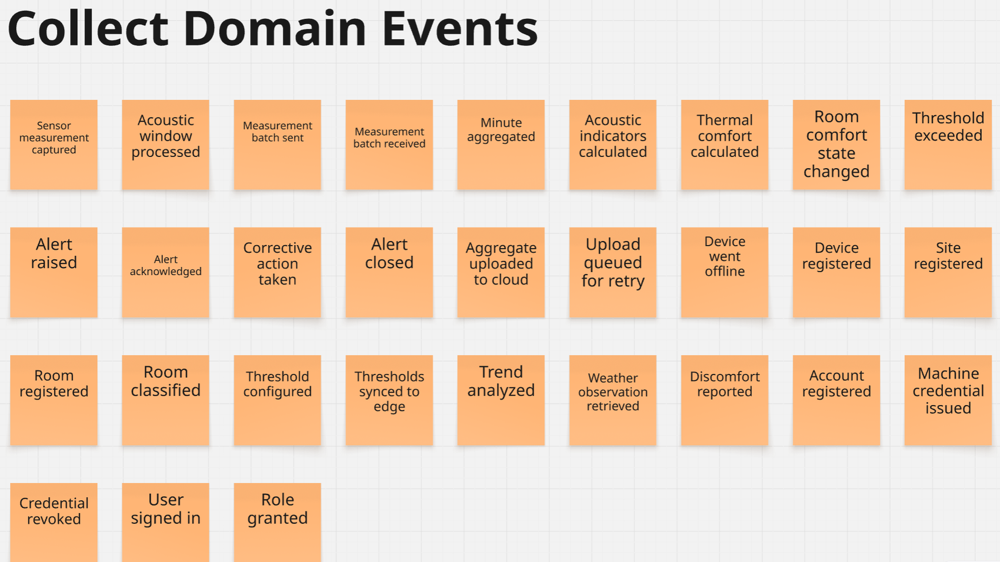

**Paso 2: Timeline**

Los eventos se ordenaron cronológicamente y quedaron agrupados en cuatro tramos: la estructura del local y su telemetría, la política de alertas, la analítica y la identidad.

<em>Figura 12.</em> Línea temporal del área de Monitoring, que concentra la estructura del local y la telemetría.

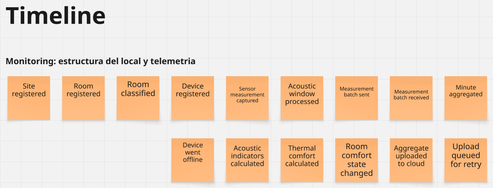

<em>Figura 13.</em> Línea temporal del área de Alerting.

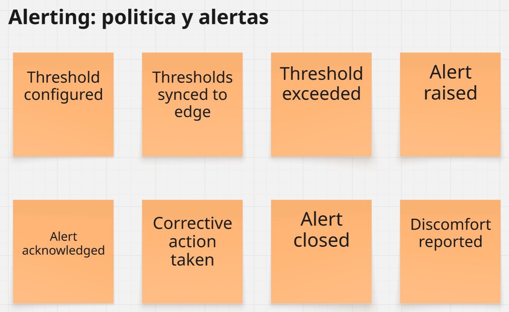

<em>Figura 14.</em> Línea temporal de Insights e IAM.

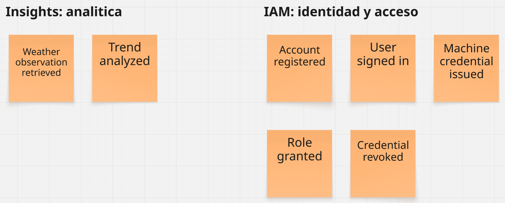

**Paso 3: Pain and Pivotal Points**

Se marcaron cuatro pivotal events: Minute aggregated, Threshold exceeded, Room classified y Trend analyzed. Los pain points detectados fueron seis: no se distingue una sala silenciosa de un dispositivo caído, el reintento del Edge puede duplicar un agregado, una sala nueva sin clasificar quedaría sin vigilancia, un miembro puede reportar disconfort con la medición dentro de rango, el reloj sin sincronizar desordena el minuto y la privacidad del audio debe poder demostrarse.

<em>Figura 15.</em> Pivotal events y pain points del área de Monitoring.

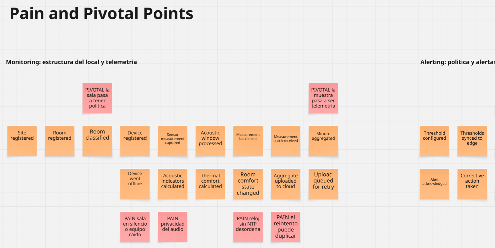

<em>Figura 16.</em> Pivotal events y pain points de Alerting, Insights e IAM.

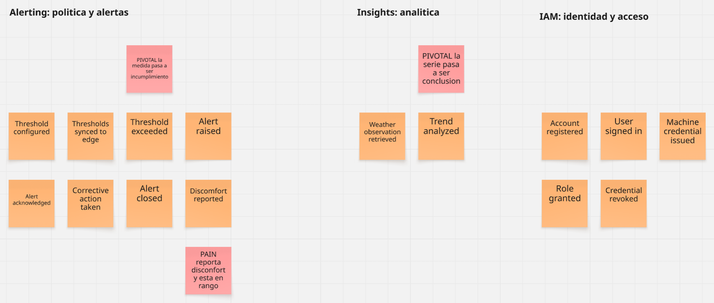

**Paso 4: Commands**

Se incorporaron los comandos sobre post-its azules, cada uno junto al evento que produce. El dispositivo IoT aparece como actor no humano: ejecuta Send measurement batch sin intervención de nadie, de modo que su autenticación no puede ser la de una persona.

<em>Figura 17.</em> Cada comando junto al evento que produce, y los actores que los ejecutan.

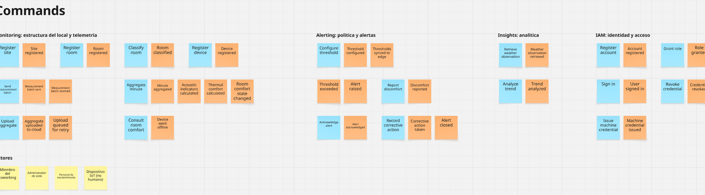

<em>Figura 18.</em> Detalle del área de Monitoring, donde se aprecia el emparejamiento entre cada comando y su evento.

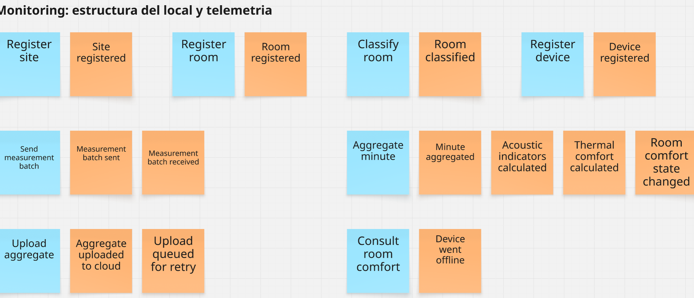

<em>Figura 19.</em> Detalle de Alerting, Insights e IAM con el mismo emparejamiento.

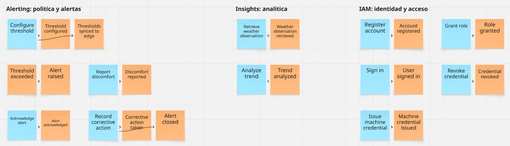

**Paso 5: Policies**

Se establecieron las políticas sobre post-its morados. Cuatro de ellas resuelven un pain point del paso anterior: el cierre por marca de agua corrige el reloj sin sincronizar, la entrega at-least-once absorbe la duplicación del reintento, el umbral por defecto cubre la sala recién registrada y el descarte del audio en el propio dispositivo sostiene la garantía de privacidad.

<em>Figura 20.</em> Políticas de Monitoring, intercaladas entre el evento que las dispara y el que producen.

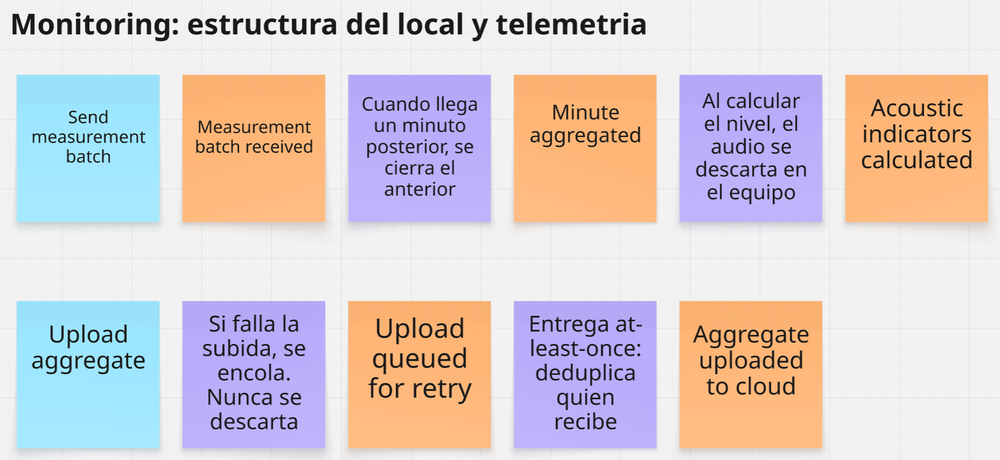

<em>Figura 21.</em> Políticas de Alerting, entre el evento que las dispara y el que producen.

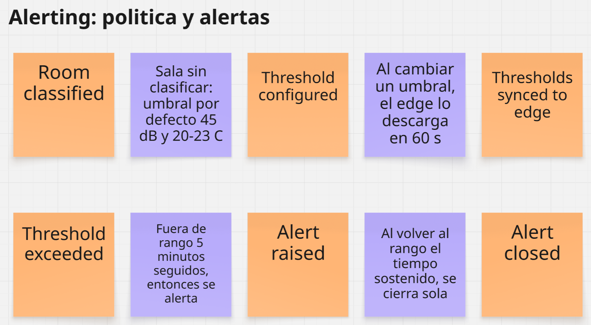

<em>Figura 22.</em> Políticas de Insights e IAM.

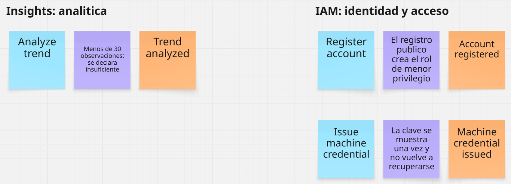

**Paso 6: Read Models**

Se identificaron seis read models sobre post-its verdes, desde el semáforo que consulta el miembro antes de reservar hasta el reporte histórico que sustenta una decisión de inversión. Cada uno tiene un actor que lo mira y una decisión que depende de él.

<em>Figura 23.</em> Read models de Monitoring, bajo los eventos que los alimentan.

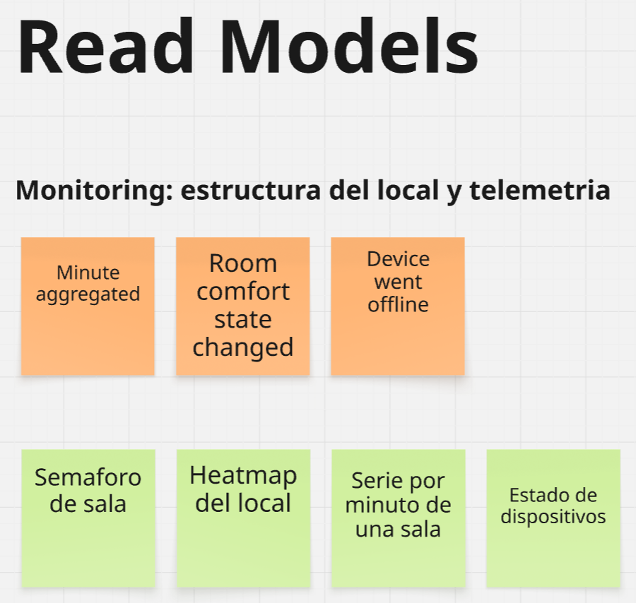

<em>Figura 24.</em> Read models de Alerting e Insights.

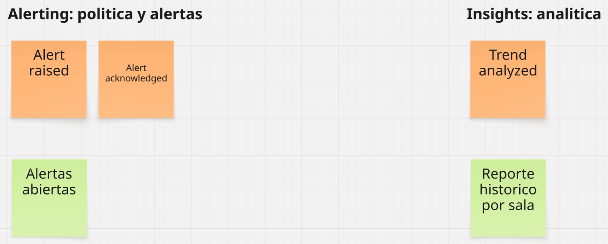

**Paso 7: External Systems**

Se señalaron tres sistemas externos sobre post-its rosados: el proveedor meteorológico, el broker MQTT y el servicio de notificaciones. Cada uno marca un punto de la frontera donde hará falta un adaptador que traduzca su lenguaje al propio.

<em>Figura 25.</em> Sistemas externos en los puntos de integración de Monitoring.

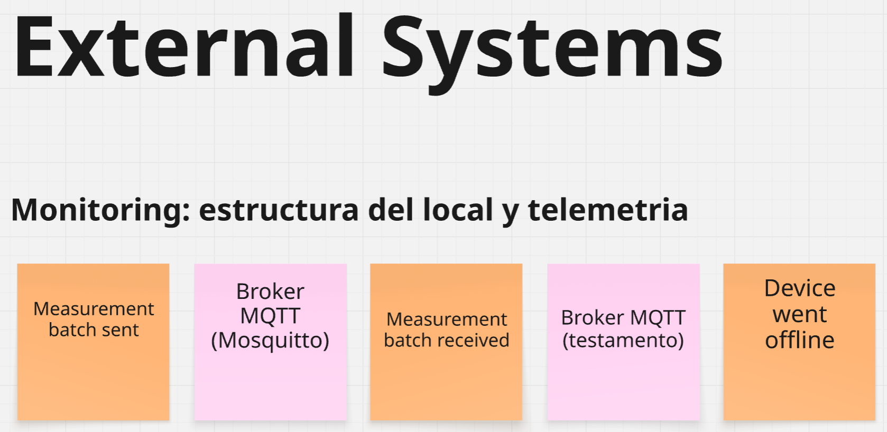

<em>Figura 26.</em> Sistemas externos de Alerting e Insights.

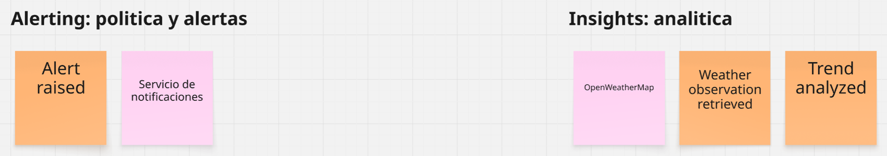

**Paso 8: Aggregates**

Resultaron ocho agregados sobre post-its amarillos: Site, Room, Device, RoomReading, Threshold, Alert, Analysis y Account. Los cuatro primeros comparten la estructura física del local como raíz, y por eso terminan juntos en el paso siguiente.

<em>Figura 27.</em> Los agregados de Monitoring rotulando los eventos que encapsulan.

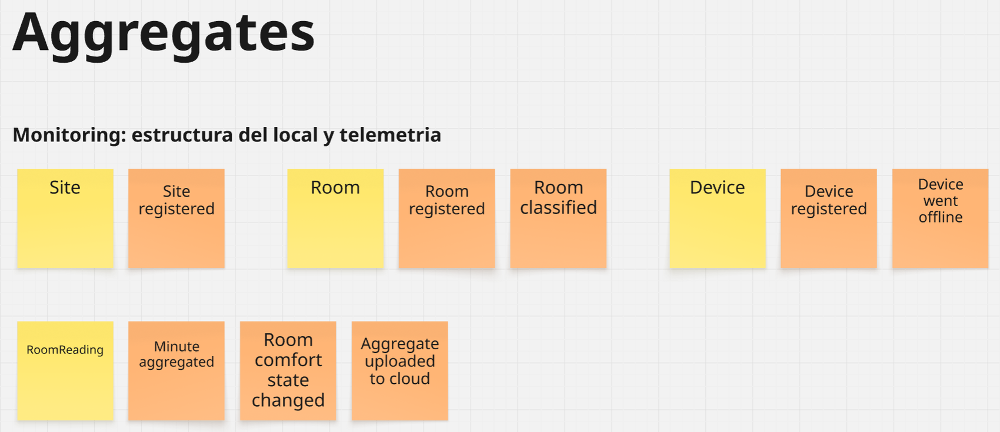

<em>Figura 28.</em> Los agregados de Alerting, Insights e IAM.

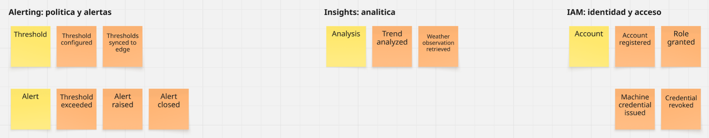

**Paso 9: Bounded Contexts**

Por último se trazaron las fronteras sobre los agregados, siguiendo los pivotal events del paso 3, y se unieron los contextos que dependen entre sí. El resultado son cuatro bounded contexts: Monitoring e Insights como núcleo, Alerting como soporte e IAM como subdominio genérico. Alerting e Insights dependen de Monitoring a través de una capa anticorrupción, los tres aceptan el modelo de autorización de IAM, y los sistemas externos quedan fuera de toda frontera.

<em>Figura 29.</em> Los cuatro bounded contexts con su clasificación estratégica y las relaciones que los unen.

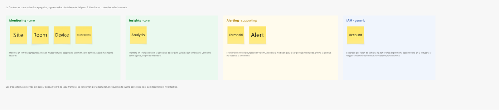

<em>Figura 30.</em> Detalle del bounded context Monitoring con los agregados, comandos, eventos, políticas y read models que encierra.

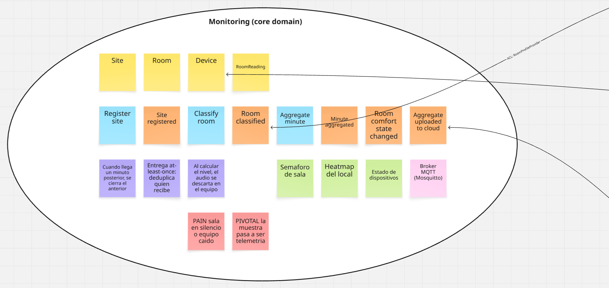

<em>Figura 31.</em> Detalle del bounded context Alerting.

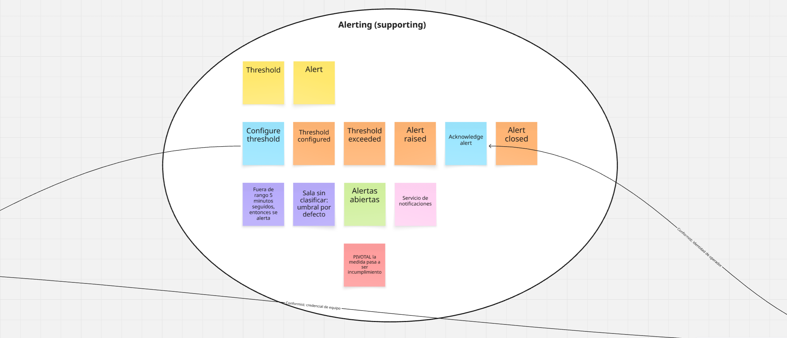

<em>Figura 32.</em> Detalle del bounded context Insights.

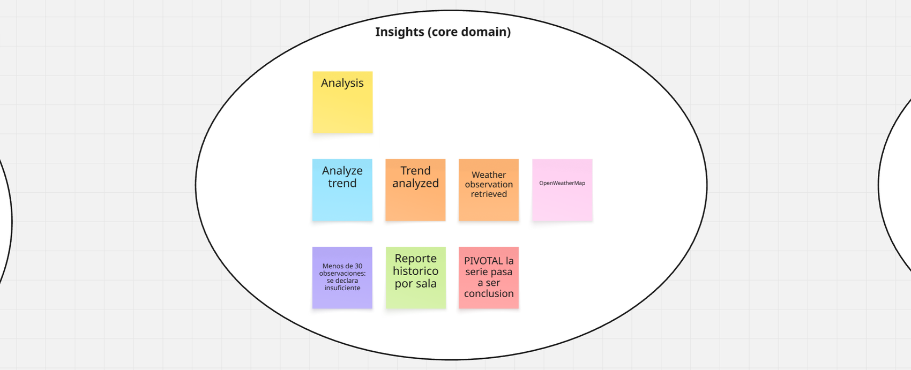

<em>Figura 33.</em> Detalle del bounded context IAM.

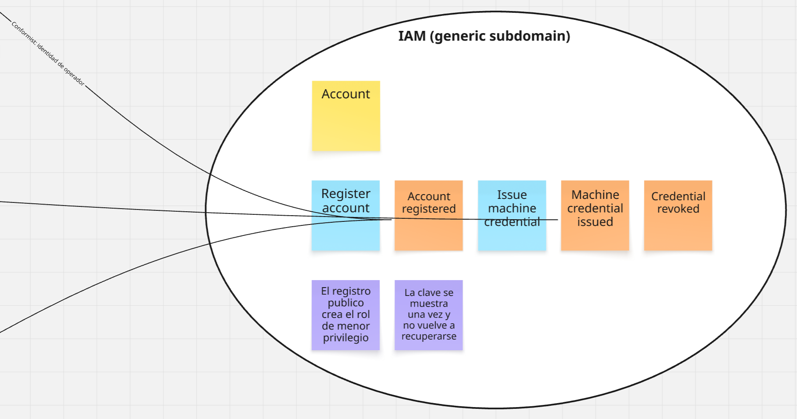

#### <i>**4.1.1.1 Candidate Context Discovery.**</i>

A partir del EventStorming refinado, el equipo realizó una sesión de Candidate Context Discovery aplicando las tres técnicas de forma encadenada, de modo que las tres coincidieran antes de dar una frontera por buena.

La identificación empezó revisando el modelo de la sección anterior, con la atención puesta en los pivotal events y en los agregados, y sobre esa base se detectaron las agrupaciones naturales de comandos, eventos y políticas que operan sobre la misma entidad.

<em>Figura 34.</em> Agrupaciones naturales: los comandos, eventos y políticas que operan sobre cada entidad.

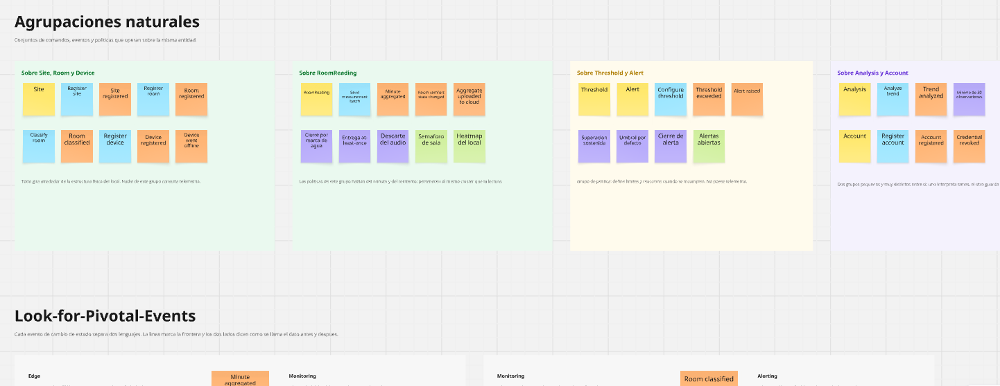

**1. Start-with-Value**

Se empezó clasificando por aporte al negocio. Monitoring es core porque sin medición objetiva no hay producto que vender, e Insights también lo es porque es lo que separa la solución de un termómetro con memoria. Alerting es supporting, ya que resulta necesario para que la medición sirva de algo pero no es donde reside la ventaja competitiva. IAM es un subdominio genérico, con el problema ya resuelto en la industria. Esa clasificación es la que rotula cada frontera en la Figura 29.

**2. Start-with-Simple**

Para no perderse en la complejidad se descompuso el recorrido en seis pasos secuenciales, que son medir, agregar, comparar con la política, avisar, responder y explicar, y se preguntó a quién corresponde cada uno. Medir y agregar pertenecen a quien posee la estructura del local; comparar y avisar dependen de una política que alguien configura por separado; explicar necesita historia acumulada y no el instante. Son tres responsabilidades que no cambian por las mismas razones, y en las Figuras 11, 12 y 13 ya aparecen separadas por áreas.

**3. Look-for-Pivotal-Events**

Los pivotal events marcados en el paso 3 se leyeron como fronteras, citando en cada caso los dos lados que separan:

- Minute aggregated es la frontera entre el Edge y Monitoring: antes es muestra cruda y después es telemetría del dominio.
- Room classified es la frontera entre Monitoring y Alerting, porque la sala pasa a tener una política aplicable.
- Threshold exceeded es la frontera entre Alerting y Monitoring, ya que la medición pasa a ser política incumplida.
- Trend analyzed es la frontera entre Monitoring e Insights: la serie deja de ser dato y pasa a ser conclusión.

Los cuatro quedan marcados sobre la línea temporal en la Figura 15. Para decidir si cada uno separa de verdad dos contextos, se comprobó cómo se llama el dato a cada lado de la frontera.

<em>Figura 35.</em> Cada pivotal event con el nombre que recibe el dato antes y después de cruzar la frontera.

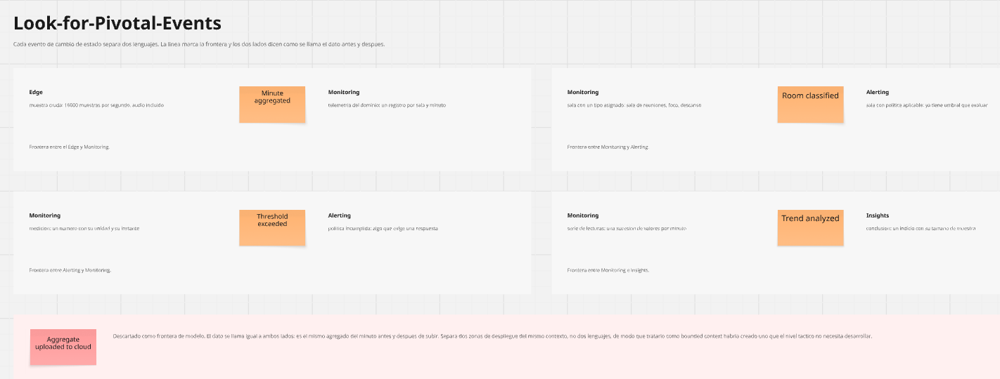

El evento Aggregate uploaded to cloud se descartó como frontera de modelo. Separa dos zonas de despliegue del mismo contexto y no dos lenguajes distintos, de modo que tratarlo como bounded context habría creado uno que el nivel táctico no necesita desarrollar.

**Agrupamientos y consolidación**

El primer agrupamiento reunió lo evidente: IAM alrededor de Account, y Alerting alrededor de Threshold y Alert. Son los dos contextos cuya responsabilidad no se discute, y cerrarlos primero deja a la vista lo que todavía falta por repartir.

<em>Figura 36.</em> Primer agrupamiento: IAM y Alerting cerrados, y los agregados que quedan sin repartir.

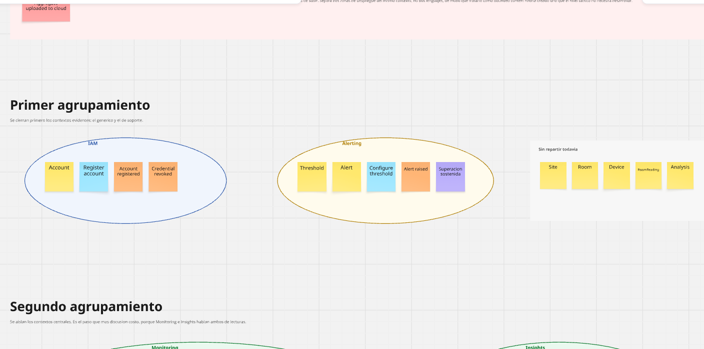

El segundo aisló los contextos centrales y fue el que más discusión costó, porque Monitoring e Insights hablan ambos de lecturas. Se separaron por dos razones: cambian por motivos distintos, uno por cómo se captura el dato y otro por cómo se interpreta, y además Insights puede estar caído sin que la medición se detenga.

<em>Figura 37.</em> Segundo agrupamiento: Monitoring e Insights separados pese a compartir el vocabulario de las lecturas.

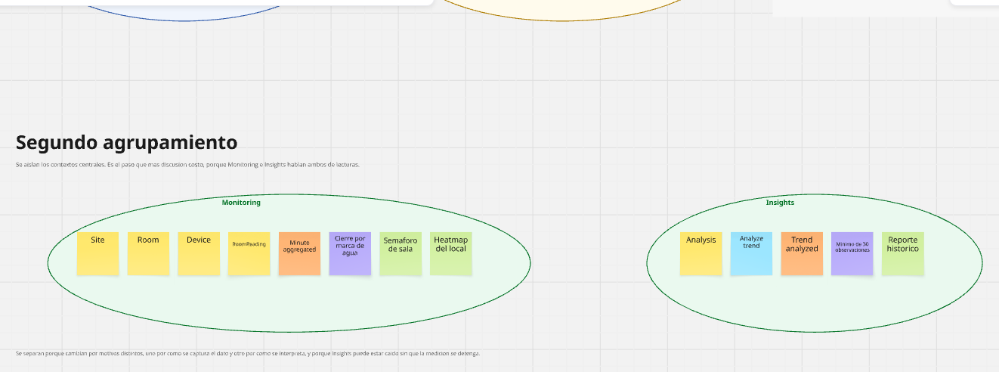

El resultado de ambas rondas es el que encierra cada frontera en la Figura 29.

La consolidación final deja cuatro bounded contexts, que son Monitoring, Insights, Alerting e IAM, y coinciden exactamente con los que desarrolla el nivel táctico en la sección 4.2.

#### <i>**4.1.1.2 Domain Message Flows Modeling.**</i>

La colaboración entre los cuatro contextos se modeló con Domain Storytelling, en tres escenarios: el principal de operación, el de instalación y el de fallo. Cada diagrama lleva su propia leyenda de notación.

**Escenario 1. Disconfort acústico en una sala**

<em>Figura 38.</em> Domain Storytelling del escenario de disconfort acústico.

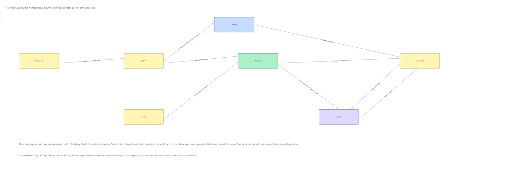

El flujo deja ver tres decisiones de reparto. La primera es que el Edge evalúa los umbrales y no el cloud: consulta los límites y decide localmente, de modo que una caída de internet no deja la sala sin vigilancia. La segunda es que Monitoring es el único que recibe telemetría y el único al que los demás preguntan, lo que lo convierte en el proveedor del que dependen Alerting e Insights. La tercera es que el administrador recorre tres contextos en una sola tarea, porque ve el estado, entiende la causa y ajusta la política, y esa continuidad obliga a que las fronteras sean invisibles para él aunque sean estrictas por dentro.

**Escenario 2. Alta de un local y sus salas**

<em>Figura 39.</em> Domain Storytelling del escenario de instalación de un local.

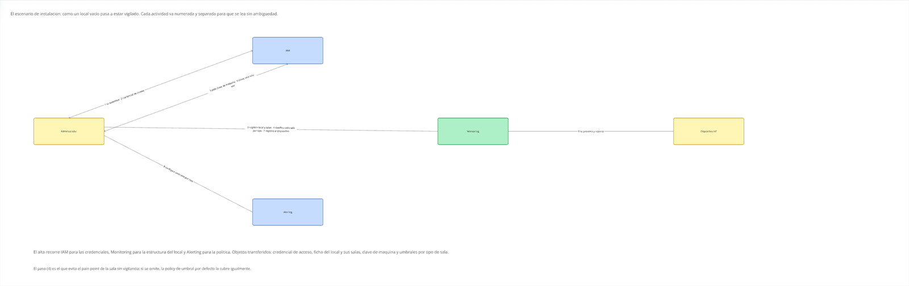

La instalación recorre los tres contextos que el administrador toca: IAM para las credenciales propias y la clave de máquina del dispositivo, Monitoring para la estructura del local y Alerting para la política. El paso de clasificar cada sala es el que evita el pain point de la sala sin vigilancia, y si se omite la política de umbral por defecto la cubre igualmente, lo que hace que el sistema nunca quede ciego por un olvido durante la instalación.

**Escenario 3. Pérdida de conexión del Edge**

<em>Figura 40.</em> Domain Storytelling del escenario de pérdida de conexión del Edge.

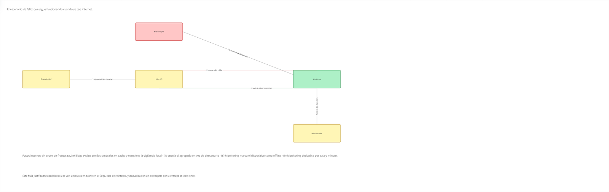

Este escenario justifica tres decisiones de diseño a la vez. El Edge conserva los umbrales en caché y mantiene la vigilancia local mientras no hay internet; el agregado que no consigue subir se encola en lugar de descartarse; y, como la entrega es at-least-once, la deduplicación por sala y minuto corresponde a quien recibe. El testamento de desconexión del broker es lo que permite distinguir una sala silenciosa de un dispositivo caído, que era el primero de los pain points sin resolver.

#### <i>**4.1.1.3 Bounded Context Canvases.**</i>

Cada contexto se diseñó con su propio Bounded Context Canvas. Los cuatro se presentan por orden de importancia para el negocio, primero como canvas y después como tabla de detalle.

**Bounded Context: Monitoring** (core domain)

<em>Figura 41.</em> Bounded Context Canvas de Monitoring.

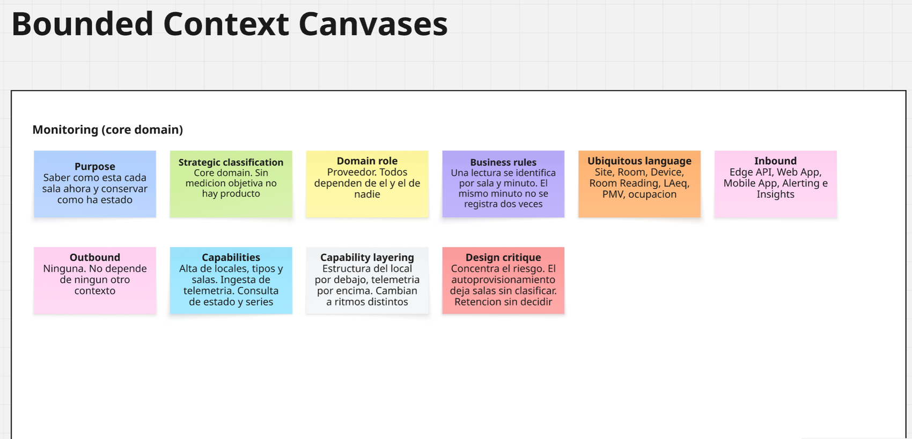

| Elemento | Contenido |
|---|---|
| **Propósito** | Saber cómo está cada sala ahora mismo, y conservar el registro de cómo ha estado. |
| **Clasificación estratégica** | Core domain. Es la razón por la que el producto existe: sin medición objetiva no hay nada que vender. |
| **Rol de dominio** | Proveedor de la estructura del local y de la telemetría. Todos los demás contextos dependen de él; él no depende de ninguno. |
| **Lenguaje ubicuo** | Site, Room, Room Type, Device, Room Reading, LAeq, L10, L90, PMV, PPD, ocupación, calidad del dato. |
| **Reglas de negocio** | Una lectura se identifica por sala y minuto, y el mismo minuto no se registra dos veces. Una sala desconocida se da de alta sola cuando un dispositivo reporta por ella. Un minuto incompleto se guarda, pero no es fiable para promediar. Sustituir un dispositivo no altera el historial de la sala. |
| **Capacidades** | Alta y clasificación de locales, tipos y salas · ingesta de telemetría · consulta del estado actual y de series históricas. |
| **Estratificación de capacidades** | Estructura del local por debajo y telemetría por encima: cambian a ritmos distintos, de modo que la ingesta puede evolucionar sin tocar el alta de salas. |
| **Dependencias entrantes** | Edge API (telemetría) · Web App y Mobile App (consulta) · Alerting e Insights (a través de la fachada). |
| **Dependencias salientes** | Ninguna. |
| **Crítica del diseño** | Al ser el proveedor del que dependen todos, concentra el riesgo: un cambio en su modelo de sala obliga a revisar las dos capas anticorrupción que lo traducen. El autoprovisionamiento facilita la instalación, pero genera salas sin clasificar que solo una persona puede resolver, de modo que el sistema acumula trabajo pendiente si nadie lo atiende. La tabla de lecturas crece un registro por sala y minuto, y su política de retención está sin decidir. |

**Bounded Context: Insights** (core domain)

<em>Figura 42.</em> Bounded Context Canvas de Insights.

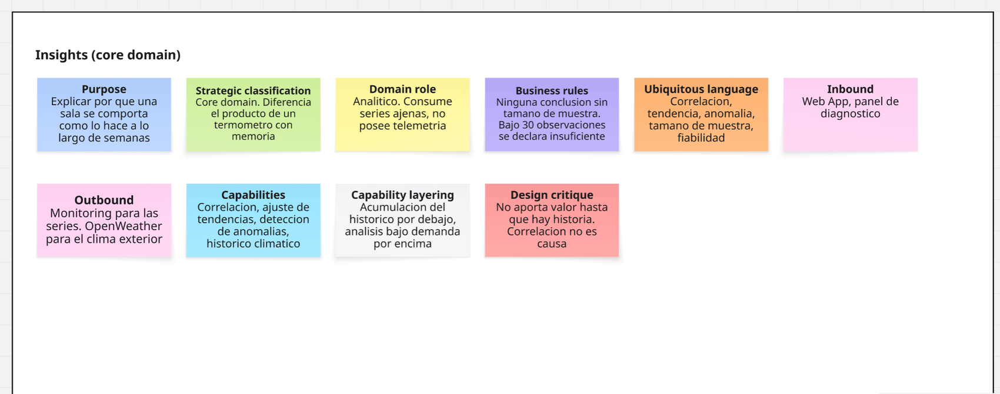

| Elemento | Contenido |
|---|---|
| **Propósito** | Explicar por qué una sala se comporta como lo hace, a lo largo de semanas. |
| **Clasificación estratégica** | Core domain. Es lo que diferencia el producto de un termómetro con memoria. |
| **Rol de dominio** | Analítico. Consume series ajenas y produce conclusiones, sin poseer telemetría propia. |
| **Lenguaje ubicuo** | Correlación, tendencia, deriva térmica, anomalía, tamaño de muestra, fiabilidad, observación meteorológica. |
| **Reglas de negocio** | Ninguna conclusión se emite sin el tamaño de muestra que la respalda. Por debajo de treinta observaciones el resultado se declara insuficiente en lugar de estimarse. Si el servicio meteorológico externo no responde, el resto del análisis se entrega igual. |
| **Capacidades** | Correlación entre variables · ajuste de tendencias · detección de anomalías · acumulación del histórico climático exterior. |
| **Estratificación de capacidades** | La acumulación del histórico va por debajo y el análisis bajo demanda por encima, lo que permite cambiar el cálculo sin rehacer lo ya acumulado. |
| **Dependencias entrantes** | Web App (panel de diagnóstico). |
| **Dependencias salientes** | Monitoring (series de lecturas) · OpenWeather (clima exterior). |
| **Crítica del diseño** | No aporta valor hasta que existe historia suficiente, por lo que un local recién instalado ve el contexto vacío durante semanas. La correlación con el exterior depende de que el muestreo periódico haya venido acumulando observaciones: si el proveedor estuvo caído, el hueco no se recupera hacia atrás. Correlación no es causa, y los resultados deben presentarse como indicios y no como diagnósticos. |

**Bounded Context: Alerting** (supporting)

<em>Figura 43.</em> Bounded Context Canvas de Alerting.

| Elemento | Contenido |
|---|---|
| **Propósito** | Convertir la política de confort del negocio en límites que una máquina pueda evaluar. |
| **Clasificación estratégica** | Supporting. Necesario para que la medición sirva de algo, pero no es donde reside la ventaja competitiva. |
| **Rol de dominio** | Definidor de política. Publica umbrales y los resuelve por sala; no observa la telemetría. |
| **Lenguaje ubicuo** | Umbral, valor de aviso, valor crítico, minutos sostenidos, métrica, tipo de sala. |
| **Reglas de negocio** | El valor de aviso siempre es inferior al crítico. Un umbral se configura por tipo de sala, nunca por sala individual. Superar el límite un instante no basta: debe sostenerse el tiempo configurado. La configuración es idempotente. |
| **Capacidades** | Configuración de umbrales por tipo · resolución de umbrales aplicables a cada sala. |
| **Estratificación de capacidades** | Definir la política va por debajo y resolverla para cada sala por encima, de forma que el catálogo de umbrales evoluciona sin tocar la evaluación. |
| **Dependencias entrantes** | Web App (configuración) · Edge API (consulta para evaluar). |
| **Dependencias salientes** | Monitoring (qué salas existen y de qué tipo son). |
| **Crítica del diseño** | El contexto está incompleto: hoy define y publica umbrales, pero no evalúa ni emite alertas, de modo que su nombre promete más de lo que cumple. Al no existir clave foránea hacia Monitoring, borrar un tipo de sala dejaría umbrales huérfanos, y corresponde al caso de uso de borrado cubrirlo. Configurar solo por tipo de sala es lo que el negocio pide hoy, pero impide la excepción de una sala concreta. |

**Bounded Context: IAM** (generic subdomain)

<em>Figura 44.</em> Bounded Context Canvas de IAM.

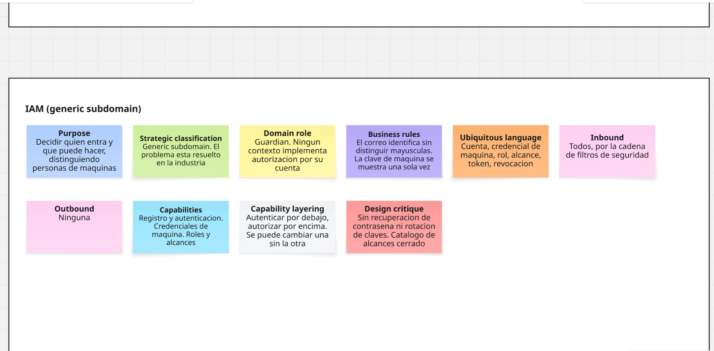

| Elemento | Contenido |
|---|---|
| **Propósito** | Decidir quién entra y qué puede hacer, distinguiendo personas de máquinas. |
| **Clasificación estratégica** | Generic subdomain. El problema está resuelto en la industria; no se innova aquí. |
| **Rol de dominio** | Guardián. Ningún otro contexto implementa autorización por su cuenta. |
| **Lenguaje ubicuo** | Cuenta, credencial de máquina, rol, alcance, token, revocación. |
| **Reglas de negocio** | El correo identifica una cuenta sin distinguir mayúsculas. El registro público siempre crea cuentas con el rol de menor privilegio. La clave de una máquina se muestra una sola vez y no vuelve a ser recuperable. Una credencial revocada se rechaza indicando la revocación, no como si no existiera. |
| **Capacidades** | Registro y autenticación de personas · emisión y verificación de credenciales de máquina · concesión de roles y alcances. |
| **Estratificación de capacidades** | Autenticar va por debajo y autorizar por encima, lo que permite cambiar el mecanismo de acceso sin rehacer el modelo de roles. |
| **Dependencias entrantes** | Todos los contextos, a través de la cadena de filtros de seguridad. |
| **Dependencias salientes** | Ninguna. |
| **Crítica del diseño** | No contempla recuperación de contraseña ni rotación de credenciales de máquina, dos necesidades que aparecerán en cuanto el sistema salga de pruebas. El catálogo de alcances es cerrado y ampliarlo exige modificar código, lo que basta con dos alcances pero no escalaría. Al ser un subdominio genérico, conviene vigilar que no absorba reglas que pertenecen a otros contextos. |

### 4.1.2. Context Mapping.

El context map recoge las relaciones estructurales entre los cuatro bounded contexts y con el servicio externo, indicando para cada una el patrón de Domain-Driven Design que la gobierna y quién manda en el contrato.

<em>Figura 45.</em> Context map de la solución, con el patrón que gobierna cada relación.

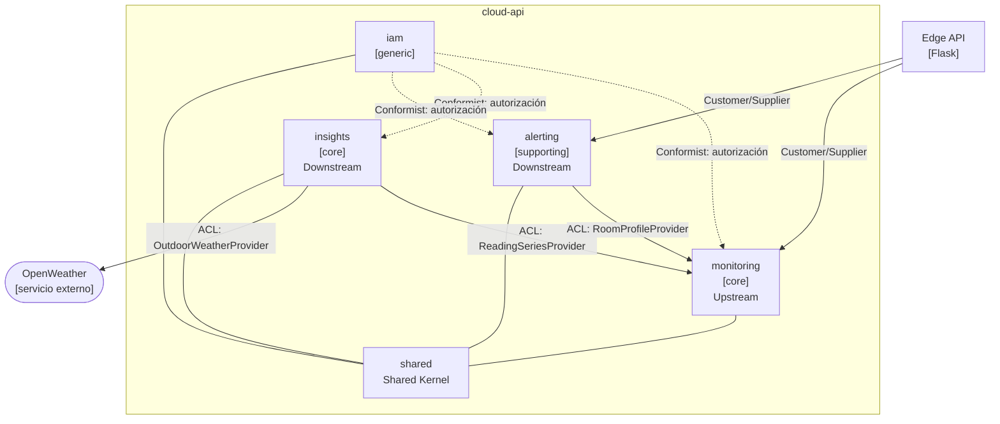

**Anti-corruption Layer.** Es el patrón que protege las tres dependencias salientes. Insights y Alerting no conocen el modelo de Monitoring: declaran puertos con su propio vocabulario —`ReadingSeriesProvider` pide una serie de `ReadingPoint`, `RoomProfileProvider` pide una lista de `RoomProfile`— y un único componente traduce. La sala de Monitoring tiene aforo, planta, superficie y última lectura; en Alerting una sala es un código y un tipo, y nada más. Esa reducción es la que impide que un cambio en el modelo del proveedor se propague a sus consumidores. El mismo patrón aísla a Insights de OpenWeather: `OutdoorWeatherProvider` expresa la necesidad de clima exterior, y el adaptador absorbe el formato del proveedor.

**Customer/Supplier.** La relación entre el Edge y el cloud es de cliente y proveedor con contrato negociado: el Edge consume los umbrales que publica Alerting y entrega telemetría a Monitoring en un formato acordado. Monitoring es el *upstream* de toda la solución —quien define el contrato— y tanto el Edge como los dos contextos analíticos son *downstream*.

**Conformist.** Los contextos de negocio no negocian con IAM: aceptan su modelo de roles y alcances tal como es, aplicado por la cadena de filtros de seguridad antes de que la petición llegue a un controlador. Ninguno implementa autorización propia ni traduce el modelo de identidad, y por eso la relación es de conformidad y no de anti-corrupción: aquí no hay nada de lo que protegerse, porque IAM es un subdominio genérico cuyo modelo no aporta ambigüedad al dominio.

**Shared Kernel.** El paquete `shared` es el único código que los cuatro contextos comparten deliberadamente, y se mantiene reducido a propósito: el catálogo de errores, la excepción de dominio, la clasificación de errores en tipos, la base de auditoría de las entidades y el manejador global de excepciones. Es un núcleo compartido y no una biblioteca de utilidades, lo que significa que modificarlo obliga a comprobar los cuatro contextos, y por eso todo lo que puede vivir en un solo contexto vive allí.

**Alternativas consideradas y por qué se descartaron.** El reparto actual no fue el primero: se llegó a él descartando otros tres, y conviene dejar constancia de cada uno porque las razones siguen vigentes.

*¿Y si Monitoring e Insights fueran un solo contexto?* Ambos trabajan sobre las mismas lecturas, de modo que unirlos evitaría la capa anticorrupción y una traducción. Se descartó porque responden a preguntas con horizontes distintos —una es el estado de ahora, la otra el patrón de tres semanas— y esa diferencia arrastra todo lo demás: Monitoring optimiza la escritura continua y la consulta del último minuto, mientras que Insights recorre series largas y tolera latencia. Unirlos obligaría a un solo modelo a servir a dos cargas opuestas, y el producto vende las dos cosas por separado.

*¿Y si `Threshold` viviera en Monitoring?* Fue así al principio. Se movió a Alerting porque un umbral existe únicamente para disparar una alerta: sin ese contexto no significa nada, y tenerlo junto a la telemetría mezclaba la medición con la política sobre la medición. El cambio se hizo cuando todavía era barato —nada lo usaba, ni caso de uso ni endpoint—; con la pantalla de administración ya construida encima habría costado mucho más.

*¿Y si se duplicara el tipo de sala en Alerting para romper la dependencia?* Eliminaría la única dependencia saliente del contexto y lo dejaría autónomo. Se descartó porque obligaría a mantener sincronizadas dos copias de la misma clasificación, y una discrepancia entre ellas se manifestaría como umbrales que no se aplican, un fallo silencioso y difícil de diagnosticar. Se prefirió pagar la dependencia y aislarla con la capa anticorrupción, que es reducida: un puerto con un solo método.

*¿Y si se añadieran más contextos?* Cuatro es el techo que el equipo consideró sensato. Cada bounded context obliga a repetir por completo el diseño táctico —cuatro capas, tres diagramas y su esquema propio—, de modo que dividir más aumenta el coste de documentación y de mantenimiento sin que el dominio lo pida. Un quinto contexto tendría que justificarse por una frontera de negocio real, no por conveniencia técnica.

**La frontera es física, no solo conceptual.** Cada contexto tiene su propio esquema de PostgreSQL y su propia migración de Flyway con historial independiente, de modo que todos empiezan por `V1` y evolucionan sin coordinarse. No existe ninguna clave foránea que cruce de un esquema a otro: los contextos se referencian por identificador y cada uno responde de su integridad. La contrapartida queda anotada como deuda: borrar un tipo de sala dejaría umbrales huérfanos en Alerting, y es el caso de uso de borrado el que deberá cubrirlo.

### 4.1.3. Software Architecture.

La arquitectura de software se representa aplicando el modelo C4, que describe el sistema en niveles de detalle decrecientes: el panorama de sistemas, el contexto del sistema con sus usuarios y sistemas externos, la descomposición en containers desplegables y, por último, el despliegue sobre la infraestructura. El nivel de componentes se presenta dentro de cada bounded context, en la sección 4.2.

La solución es distribuida por exigencia del problema, no por elección de estilo: el procesamiento se reparte entre el dispositivo, una capa de borde dentro del local y la nube, porque el micrófono muestrea a 16 kHz y transmitir esas muestras sería, además de inviable en ancho de banda, grabar conversaciones de personas que no han dado su consentimiento.

#### <i>**4.1.3.1. Software Architecture System Landscape Diagram.**</i>

El panorama sitúa la solución entre los actores del negocio y los sistemas con los que convive.

<em>Figura 46.</em> System Landscape Diagram de la solución ZenRoom.

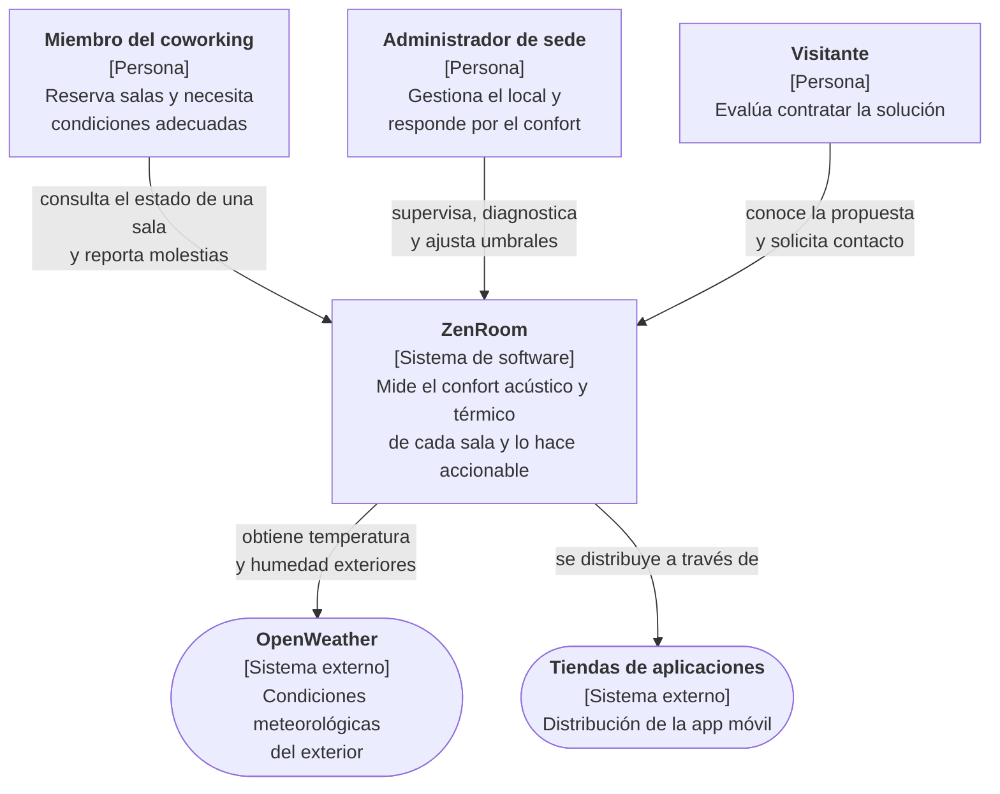

Los tres actores se corresponden con los segmentos objetivo del capítulo I. El visitante no es un usuario del producto sino del Landing Page, y se incluye porque la conversión forma parte del alcance evaluado. OpenWeather es el servicio externo de terceros que la arquitectura de la solución exige consumir, y sostiene la correlación entre temperatura interior y exterior.

#### <i>**4.1.3.2. Software Architecture Context Level Diagrams.**</i>

El diagrama de contexto muestra el sistema como una única caja, rodeado de quienes lo usan y de aquello con lo que se comunica, sin revelar todavía su estructura interna.

<em>Figura 47.</em> Software Architecture Context Level Diagram.

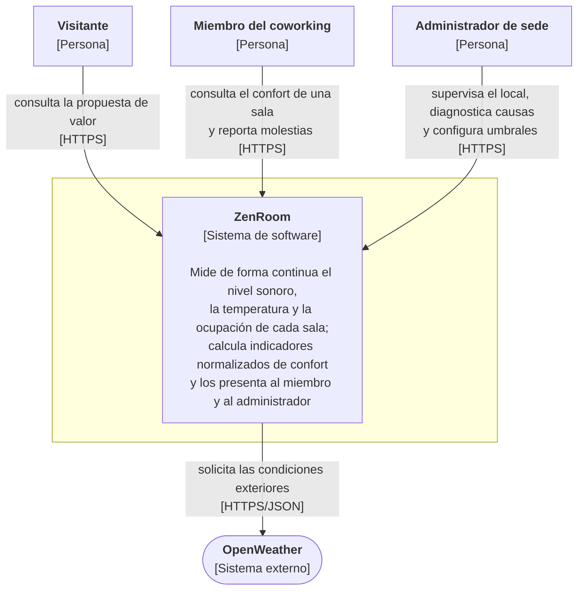

Desde fuera, el sistema es una sola cosa que responde a tres preguntas: si una sala está en condiciones ahora, por qué no lo está cuando falla, y qué hay que cambiar para que deje de fallar. El único sistema externo del que depende es el proveedor meteorológico, y esa dependencia es degradable: si no responde, la solución sigue funcionando y solo pierde la correlación con el exterior.

#### <i>**4.1.3.2. Software Architecture Container Level Diagrams.**</i>

El diagrama de containers descompone el sistema en las unidades que se despliegan por separado, con la tecnología de cada una y el protocolo por el que se comunican.

<em>Figura 48.</em> Software Architecture Container Level Diagram.

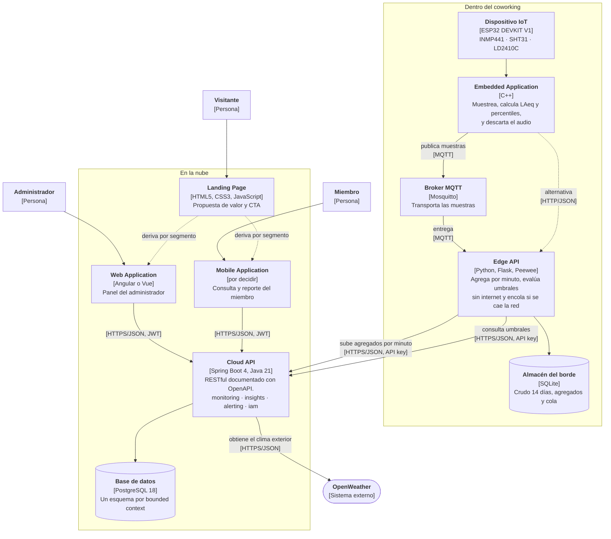

El reparto entre las tres capas responde a tres restricciones distintas. El **dispositivo** calcula los indicadores acústicos en el propio microcontrolador porque el audio no puede salir de la sala. El **Edge** agrega por minuto y evalúa los umbrales localmente, de modo que una caída de internet no deja el local sin vigilancia, y encola lo que no ha podido subir. El **cloud** guarda la historia larga y resuelve lo que exige varias salas o varias semanas, que es donde vive la analítica.

La entrega entre el Edge y el cloud es *at-least-once*: la cola reintenta hasta confirmar, de modo que el mismo minuto puede llegar repetido y el cloud lo deduplica por sala e instante. Esa decisión traslada la complejidad al servidor a cambio de que el borde pueda ser simple y tolerante a fallos.

El transporte entre el dispositivo y el Edge admite MQTT a través de Mosquitto y, como alternativa, HTTP directo. La segunda vía existe porque el simulador del dispositivo la usa y porque permite depurar sin levantar el broker.

#### <i>**4.1.3.3. Software Architecture Deployment Diagrams.**</i>

El diagrama de despliegue muestra sobre qué infraestructura se ejecuta cada container en el entorno de desarrollo y pruebas, tal como lo define la composición de contenedores del repositorio `cloud-api`.

<em>Figura 49.</em> Software Architecture Deployment Diagram del entorno de desarrollo.

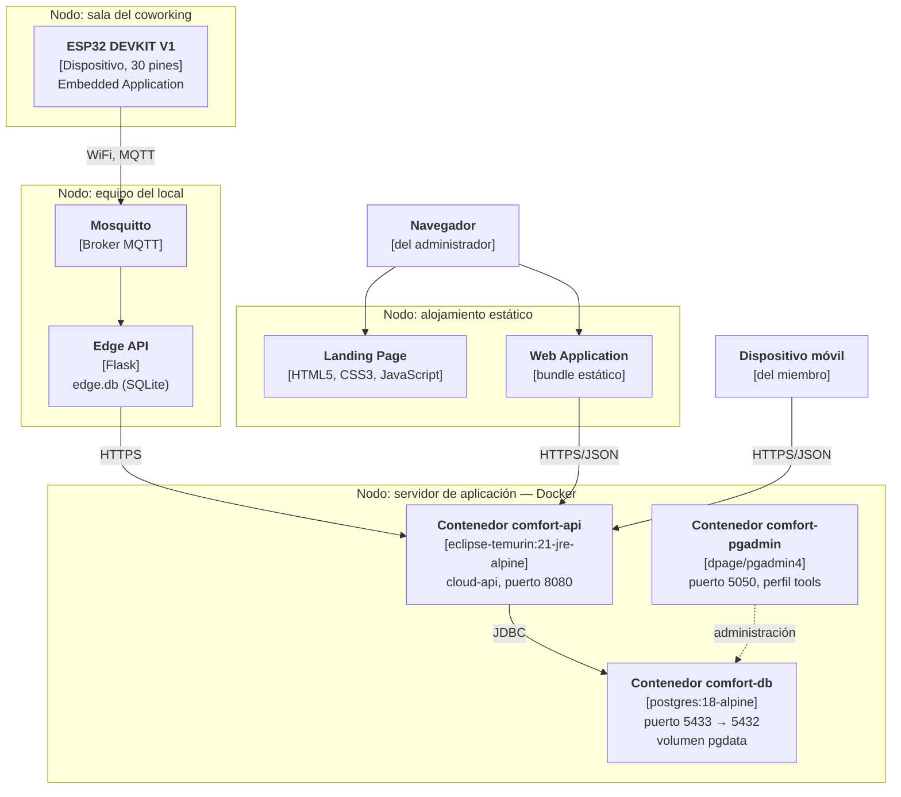

La aplicación se empaqueta con un `Dockerfile` de dos etapas: la primera compila con el JDK 21 y resuelve las dependencias en una capa separada del código fuente, de modo que un cambio en el código no obliga a volver a descargarlas; la segunda parte de una imagen de solo ejecución y copia únicamente el artefacto, ejecutándolo con un usuario sin privilegios. La memoria se limita por porcentaje del contenedor en lugar de por un valor fijo, para que la misma imagen sirva en máquinas distintas.

La base de datos expone el puerto 5433 en la máquina anfitriona para no chocar con una instalación local de PostgreSQL, y persiste en un volumen con nombre. El contenedor de administración queda tras un perfil de Docker Compose, de modo que no se levanta salvo que se pida expresamente. El arranque de la aplicación depende de que la base de datos supere su comprobación de salud, porque Flyway aplica las migraciones de los cuatro esquemas antes de que la aplicación acepte peticiones.

## 4.2. Tactical-Level Domain-Driven Design

El diseño táctico desarrolla cada bounded context por dentro: las clases que representan su modelo, la organización en capas y los diagramas que las describen. La solución aplica una arquitectura por capas con inversión de dependencias, de modo que el dominio no conoce ni la persistencia ni el transporte: declara puertos, y la infraestructura los implementa.

Cada contexto se presenta en su propia sección, en el orden de importancia establecido en el context map, y todas siguen la misma estructura: las cuatro capas, el diagrama de componentes y los diagramas de nivel de código.

### 4.2.1. Bounded Context: Alerting

Es el contexto encargado de traducir la política de confort en vigilancia accionable: administra los umbrales configurables por tipo de sala (nivel sonoro, temperatura, ocupación, PPD) y los resuelve sala por sala para que la capa Edge pueda evaluarlos sin conocer la taxonomía de tipos que maneja Monitoring. No almacena telemetría ni la interpreta; solo decide, a partir de un valor y de cuánto tiempo se sostiene, cuándo una condición deja de ser tolerable. El servicio en la nube registra además las alertas que la Edge API abre y cierra al evaluar esos umbrales, y la acción correctiva con la que el administrador las atiende.

#### <i>**4.2.1.1. Domain Layer.**</i>

Este contexto concentra las reglas de configuración y evaluación de los umbrales que disparan alertas sobre la telemetría de las salas.

**Entities:**

* `Threshold`: Entidad raíz que representa un límite configurable para una métrica de un tipo de sala, con propiedades `id`, `roomTypeId`, `metric`, `warnValue`, `criticalValue`, `sustainedMinutes` y `enabled`. Expone comportamiento de negocio propio: `isBreachedBy(value)` determina si una medida supera el valor de aviso, e `isCriticalFor(value)` si supera el valor crítico.

**Value Objects:**

* `ThresholdMetric`: Enum cerrado de las magnitudes sobre las que se puede configurar un umbral (`LAEQ`, `L10`, `PPD`, `OCCUPIED_PCT`, `TEMP_C`), con conversión a/desde su representación persistida en minúsculas.
* `RoomProfile`: Representación mínima de una sala (código y tipo) usada exclusivamente dentro de este contexto; es la traducción anticorrupción de lo que Monitoring expone como sala.

**Aggregates:**

* `Threshold` actúa a la vez como entidad y como raíz de agregado, porque no tiene entidades hijas que requieran una consistencia transaccional adicional.
* `Alert`: agregado que representa una alerta de una sala, identificada por la clave de origen (`sourceKey`) que envía la Edge API. Guarda la regla, la severidad, el mensaje, el valor medido, los instantes de apertura y cierre, y el responsable, el instante y la acción correctiva del reconocimiento. Sus reglas son que solo se reconoce una alerta abierta, que la acción correctiva tiene entre 3 y 500 caracteres, que un evento repetido no crea otra alerta y que el cierre es idempotente.

**Value Objects de las alertas:** `AlertStatus` (`OPEN`, `ACKNOWLEDGED`, `CLOSED`), `AlertSeverity` (`INFO`, `WARNING`, `CRITICAL`) y `AlertClosure` (`AUTO`, `MANUAL`).

**Domain Services:**

* No se define ningún servicio de dominio propio; la lógica de evaluación vive en los métodos del propio `Threshold`.

**Repositories (Interfaces):**

* `ThresholdRepository`: Puerto de persistencia con `save`, `findEnabledByRoomTypeId` y `findByRoomTypeIdAndMetric`.
* `RoomProfileProvider`: Puerto de salida que declara la necesidad de conocer las salas y su tipo, sin saber que quien la satisface es Monitoring (capa anticorrupción).

* `AlertRepository`: Puerto de persistencia de las alertas con `save`, `findById`, `findBySourceKey` y `search`.
* `RoomDirectory`: Puerto de salida que traduce el código del local y de la sala que envía la Edge API al identificador de la sala.

**Domain Errors:**

* `AlertingError`: Catálogo de errores del contexto (`UNKNOWN_THRESHOLD_METRIC`, `INVALID_THRESHOLD_RANGE`, `ALERT_NOT_FOUND`, `ALERT_NOT_OPEN`, `CORRECTIVE_ACTION_REQUIRED`, `ALERT_BATCH_EMPTY`, `ALERT_CLOSED_BEFORE_OPENED`, `UNKNOWN_ALERT_SEVERITY`, `UNKNOWN_ALERT_STATUS`, `INVALID_ALERT_RULE`, `RANGE_INVERTED`).

#### <i>**4.2.1.2. Interface Layer.**</i>

Controllers:

* `ThresholdsController`: Expone `/api/v1/room-types/{roomTypeId}/thresholds` para configurar (`PUT /{metric}`, protegido a `ADMIN`) y listar (`GET`, `ADMIN`/`MEMBER`) los umbrales de un tipo de sala.
* `RoomThresholdsController`: Expone `GET /api/v1/room-thresholds`, resuelto por sala (no por tipo) para que el Edge pueda consultar sin conocer la taxonomía de tipos; protegido con el scope de máquina `SCOPE_thresholds:read`.
* `AlertEventsController`: Expone `POST /api/v1/alerts/events`, por el que la Edge API informa las alertas que abre y cierra, protegido con el scope de máquina `SCOPE_alerts:write`.
* `AlertsController`: Expone `GET /api/v1/alerts`, `GET /api/v1/alerts/{alertId}` y `PATCH /api/v1/alerts/{alertId}/acknowledge`, reservados a `ADMIN`.

#### <i>**4.2.1.3. Application Layer.**</i>

**Command Services:**

* `ConfigureThresholdUseCaseImpl`: Crea o reajusta el umbral de una métrica para un tipo de sala; la operación es idempotente.
* `RecordAlertEventsUseCaseImpl`: Registra el lote de eventos de la Edge API. Un evento con una clave conocida actualiza la alerta, y un evento con instante de cierre la cierra. Si una sala del lote no existe, no se guarda ningún evento.
* `AcknowledgeAlertUseCaseImpl`: Reconoce una alerta abierta con su acción correctiva y toma el responsable del token del usuario.

**Query Services:**

* `ListThresholdsUseCaseImpl`: Lista los umbrales activos de un tipo de sala.
* `ListAlertsUseCaseImpl` y `GetAlertUseCaseImpl`: Listan las alertas con filtros por estado, sala, fechas y presencia de acción correctiva, y consultan una alerta.
* `ResolveRoomThresholdsUseCaseImpl`: Traduce los umbrales configurados por tipo a los umbrales aplicables por sala concreta, cacheando por tipo para no repetir consultas.

**Outbound Services (ACL):**

* `ExternalMonitoringService`: Único punto del contexto que conoce a Monitoring; implementa `RoomProfileProvider` traduciendo las salas del otro contexto a `RoomProfile`.

#### <i>**4.2.1.4. Infrastructure Layer.**</i>

**Persistence/Repositories:**

* `ThresholdRepositoryImpl`: Implementación JPA de `ThresholdRepository`, apoyada en `ThresholdEntity`, `ThresholdMapper` y `ThresholdJpaRepository`.
* `AlertRepositoryImpl`: Implementación JPA de `AlertRepository`, apoyada en `AlertEntity`, `AlertMapper` y `AlertJpaRepository`.

**Configuration:**

* `AlertingErrorCatalogConfiguration`: Publica el catálogo `AlertingError` como bean `ErrorCatalogSource` para que los códigos de error del contexto sean resolubles globalmente.

#### <i>**4.2.1.5. Bounded Context Software Architecture Component Level Diagrams.**</i>

La solución despliega un único container para los servicios en la nube —la aplicación `cloud-api`, construida con Spring Boot 4 sobre Java 21—, dentro del cual cada bounded context ocupa su propio paquete y no comparte clases con los demás. El diagrama descompone ese container en los componentes de Alerting, agrupados por la capa a la que pertenecen, e indica para cada uno su tecnología y su responsabilidad.

<em>Figura 50.</em> Diagrama de componentes del bounded context Alerting dentro del container cloud-api.

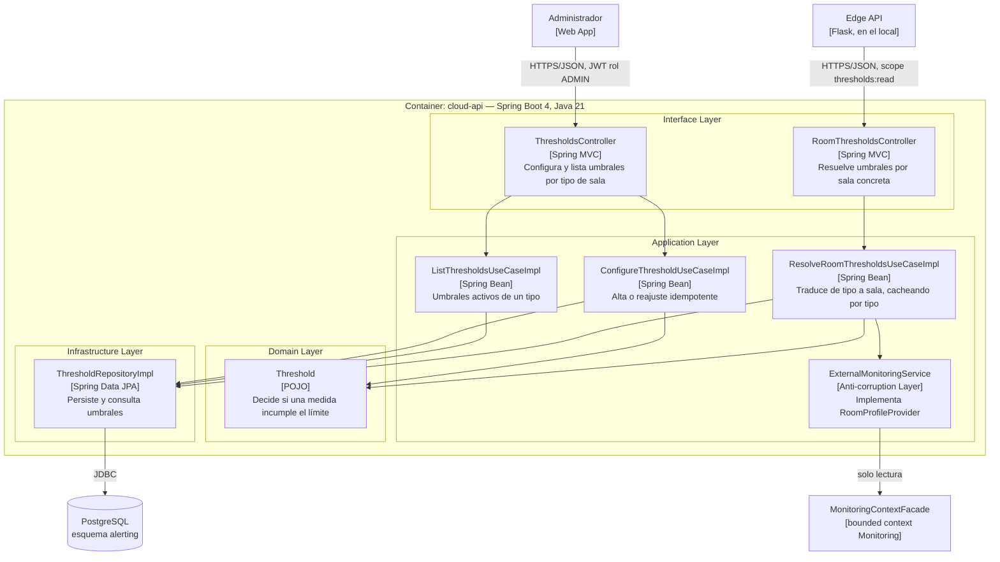

El contexto expone dos controladores porque atiende a dos consumidores con necesidades distintas. El administrador configura umbrales **por tipo de sala**, que es como se razona el negocio: todas las cabinas de llamadas comparten límite. El Edge, en cambio, evalúa **por sala concreta** y no conoce la taxonomía de tipos, de modo que `ResolveRoomThresholdsUseCaseImpl` hace la traducción y cachea por tipo para no repetir la consulta una vez por sala. `ExternalMonitoringService` es el único componente que conoce la existencia de Monitoring, y lo hace a través de su fachada, nunca de sus repositorios.

#### <i>**4.2.1.6. Bounded Context Software Architecture Code Level Diagrams.**</i>

El nivel de código detalla la implementación del contexto en dos diagramas: el de clases del Domain Layer, que describe el modelo y sus relaciones, y el de base de datos, que describe cómo se persiste.

##### <i>**4.2.1.6.1. Bounded Context Domain Layer Class Diagrams.**</i>

El diagrama recoge las clases del Domain Layer de Alerting, con sus atributos, sus métodos y el ámbito de cada miembro. La entidad `Threshold` concentra el comportamiento —decidir si una medida incumple— y el resto del modelo son value objects, comandos y los puertos que el dominio declara para no depender de la infraestructura ni de otros contextos.

<em>Figura 51.</em> Diagrama de clases del Domain Layer del bounded context Alerting.

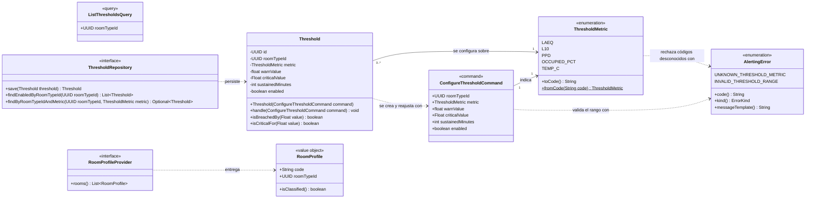

`Threshold` es a la vez entidad y raíz de agregado: no contiene entidades hijas, y su identidad y su tipo de sala son inmutables, porque cambiar cualquiera de los dos significa que el umbral es otro. Los métodos `isBreachedBy` e `isCriticalFor` responden únicamente por el valor; la comprobación de que el incumplimiento se sostenga durante `sustainedMinutes` no vive en la entidad, ya que un umbral conoce su propio límite pero no la serie temporal que lo pone a prueba.

Los dos puertos de salida separan responsabilidades distintas. `ThresholdRepository` abstrae la persistencia del propio contexto. `RoomProfileProvider`, en cambio, declara una necesidad que satisface otro contexto: Alerting necesita saber qué salas existen y de qué tipo son, y lo expresa con `RoomProfile`, un vocabulario reducido a lo que aquí significa algo. La sala de Monitoring tiene aforo, planta y superficie; ninguno de esos atributos interviene en la evaluación de un umbral, y copiarlos convertiría la capa anticorrupción en un trámite.

##### <i>**4.2.1.6.2. Bounded Context Database Design Diagram.**</i>

El bounded context persiste en el esquema Alerting de PostgreSQL, con dos tablas, `threshold` y `alert`. Los umbrales viven en la base de datos y no en el código para que la administración pueda ajustarlos desde la aplicación web sin volver a desplegar el servicio.

<em>Figura 52.</em> Diagrama de base de datos del bounded context Alerting.

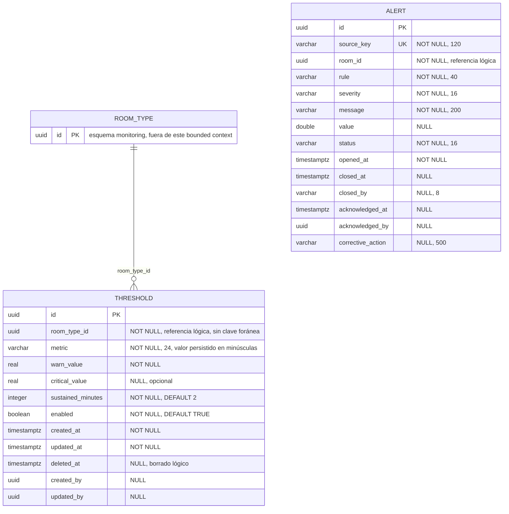

La columna `room_type_id` es la única referencia de la tabla y **no lleva clave foránea**, a diferencia del resto del modelo de datos de la solución. La tabla a la que apunta, `room_type`, pertenece al esquema Monitoring, y declarar una restricción física entre ambos esquemas ataría los dos bounded contexts a nivel de base de datos: cualquier cambio en la estructura de salas obligaría a coordinar un despliegue conjunto, y el límite entre contextos dejaría de ser real. La integridad se mantiene en la capa de aplicación, a través del puerto `RoomProfileProvider` descrito en el Domain Layer, que es la única vía por la que este contexto conoce las salas.

El par `room_type_id` y `metric` identifica un umbral de forma única en la práctica: el caso de uso de configuración es idempotente y reajusta el umbral existente en lugar de crear uno nuevo. Las columnas de auditoría —`created_at`, `updated_at`, `deleted_at`, `created_by` y `updated_by`— las gestiona Spring Data JPA Auditing, razón por la cual no llevan valor por defecto en el esquema, y `deleted_at` implementa el borrado lógico que preserva el histórico de configuración.

La tabla `alert` tiene una restricción de unicidad sobre `source_key`, que evita duplicados cuando la Edge API reintenta el envío, y dos índices, por sala y fecha de apertura y por estado y fecha de apertura. Su columna `room_id` tampoco lleva clave foránea, porque la sala pertenece al esquema Monitoring y se valida a través de su fachada.

### 4.2.2. Bounded Context: IAM

Gestiona la identidad y el acceso de los dos tipos de consumidores de la plataforma: las personas (administradores y miembros del coworking, autenticados por email y contraseña con emisión de JWT) y las máquinas (el Edge de cada local, autenticado mediante API keys con *scopes* como `readings:write` o `thresholds:read`). Es el contexto que hace cumplir la separación de responsabilidades entre quien configura el sistema y quien únicamente sube o consume telemetría.

#### <i>**4.2.2.1. Domain Layer.**</i>

Contiene las reglas de identidad, autenticación y credenciales de acceso, tanto para personas como para máquinas (el Edge).

**Aggregates:**

* `User`: Representa una persona con acceso al sistema, con `id`, `email`, `passwordHash`, `displayName`, `active` y `roles`. Encapsula `ensureCanSignIn()`, que lanza error de negocio si la cuenta está desactivada.
* `ApiCredential`: Representa la credencial de una máquina (el Edge), con `id`, `code`, `tokenHash`, `active` y `scopes`. Encapsula `ensureUsable()`, que rechaza credenciales revocadas.

**Value Objects:**

* `Role`: Enum de lo que puede hacer una persona (`MEMBER`, `ADMIN`).
* `Scope`: Enum de lo que puede hacer una máquina (`READINGS_WRITE`, `THRESHOLDS_READ`).
* `IssuedToken`: Token recién emitido junto a su tiempo de expiración en segundos.

**Domain Services (Ports out):**

* `PasswordHasher`: Contrato para cifrar y comparar contraseñas en tiempo constante.
* `ApiKeyHasher`: Contrato para generar claves de máquina y reducirlas a un hash determinista (indexable, sin sal).
* `TokenIssuer`: Contrato para emitir la credencial (JWT) con la que un usuario demuestra su identidad en peticiones subsecuentes.

**Repositories (Interfaces):**

* `UserRepository`: `save`, `findById`, `findByEmail`, `existsByEmail`.
* `ApiCredentialRepository`: `save`, `findByTokenHash`, `existsByCode`.

**Domain Errors:**

* `IamError`: Catálogo de errores (`EMAIL_ALREADY_USED`, `USER_NOT_FOUND`, `INVALID_CREDENTIALS`, `ACCOUNT_DISABLED`, `CREDENTIAL_CODE_ALREADY_USED`, `CREDENTIAL_REVOKED`, `UNKNOWN_SCOPE`).

#### <i>**4.2.2.2. Interface Layer.**</i>

**Controllers:**

* `AuthController`: Expone `POST /api/v1/auth/login`; el mismo error de credenciales cubre email inexistente o contraseña incorrecta, para no revelar qué cuentas existen.
* `UsersController`: Expone `POST /api/v1/users` para el registro público, que siempre crea la cuenta con rol `MEMBER`, `GET /api/v1/users` y `PATCH /api/v1/users/{userId}`, con el que un `ADMIN` desactiva o reactiva una cuenta.
* `CredentialsController`: Expone `POST /api/v1/credentials`, protegido a `ADMIN`, para emitir credenciales de máquina; la clave en claro se devuelve una única vez.

#### <i>**4.2.2.3. Application Layer.**</i>

**Command Services:**

* `RegisterUserUseCaseImpl`: Registra una cuenta, validando unicidad de correo y delegando el hash de la contraseña.
* `CreateApiCredentialUseCaseImpl`: Genera y persiste una credencial de máquina con sus scopes.

**Query/Authentication Services:**

* `AuthenticateUserUseCaseImpl`: Valida email y contraseña y emite el `IssuedToken` (login).
* `AuthenticateApiKeyUseCaseImpl`: Resuelve el dueño de una API key a partir de su hash, filtrando credenciales inactivas.

#### <i>**4.2.2.4. Infrastructure Layer.**</i>

**Persistence/Repositories:**

* `UserRepositoryImpl` / `ApiCredentialRepositoryImpl`: Implementaciones JPA sobre `UserEntity`/`ApiCredentialEntity`, con sus respectivos mappers y repositorios Spring Data.

**External/Security Services:**

* `BCryptPasswordHasher`: Implementación de `PasswordHasher` sobre BCrypt.
* `Sha256ApiKeyHasher`: Implementación determinista de `ApiKeyHasher` para claves de máquina.
* `ActiveAccountJwtConverter` y `UserStatusCache`: Comprueban en cada petición que la cuenta del token sigue activa y responden 401 `IAM_ACCOUNT_DISABLED` en caso contrario. El estado se guarda en caché durante 30 segundos.
* `JwtTokenIssuer`: Implementación de `TokenIssuer`, emite JWT firmados (RS256) con claims de email, nombre y roles.
* `ApiKeyAuthenticationFilter`, `SecurityConfiguration`, `JwtConfiguration`: Configuración de Spring Security para autenticar tanto usuarios (JWT) como máquinas (API key) sobre la misma cadena de filtros.

**Configuration:**

* `IamErrorCatalogConfiguration`: Publica el catálogo `IamError`.

#### <i>**4.2.2.5. Bounded Context Software Architecture Component Level Diagrams.**</i>

La solución despliega un único container para los servicios en la nube —la aplicación `cloud-api`, construida con Spring Boot 4 sobre Java 21—, dentro del cual cada bounded context ocupa su propio paquete y no comparte clases con los demás. El diagrama descompone ese container en los componentes de IAM, agrupados por la capa a la que pertenecen, e indica para cada uno su tecnología y su responsabilidad.

<em>Figura 53.</em> Diagrama de componentes del bounded context IAM dentro del container cloud-api.

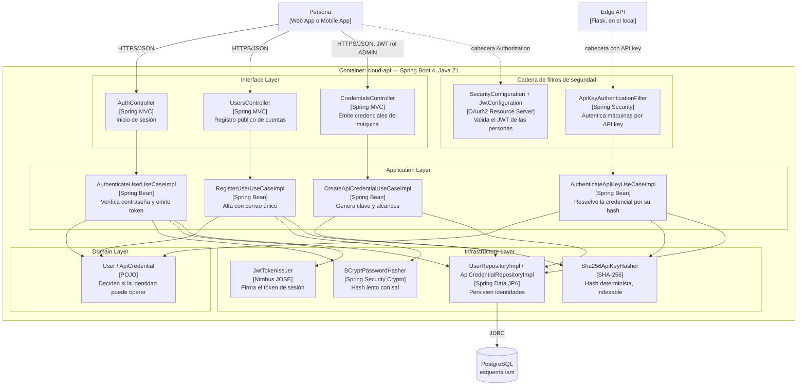

Los dos caminos de autenticación conviven en la misma cadena de filtros y terminan en el mismo modelo de dominio, pero no comparten mecanismo de verificación. La persona presenta correo y contraseña una vez y recibe un token firmado que acompaña a las peticiones siguientes; la máquina presenta su clave en cada petición, y por eso su hash debe ser determinista e indexable. Esa asimetría es la que justifica que `BCryptPasswordHasher` y `Sha256ApiKeyHasher` sean componentes distintos y no dos usos de uno solo.

#### <i>**4.2.2.6. Bounded Context Software Architecture Code Level Diagrams.**</i>

El nivel de código detalla la implementación del contexto en dos diagramas: el de clases del Domain Layer, que describe el modelo y sus relaciones, y el de base de datos, que describe cómo se persiste.

##### <i>**4.2.2.6.1. Bounded Context Domain Layer Class Diagrams.**</i>

El Domain Layer de IAM modela dos identidades que el sistema trata por separado: la persona, representada por `User`, y la máquina, representada por `ApiCredential`. Cada una tiene su propio catálogo de permisos —`Role` para lo que puede hacer una persona, `Scope` para lo que puede hacer el Edge— y su propio mecanismo de verificación, declarado como puerto para que el dominio no dependa de una biblioteca criptográfica concreta.

<em>Figura 54.</em> Diagrama de clases del Domain Layer del bounded context IAM.

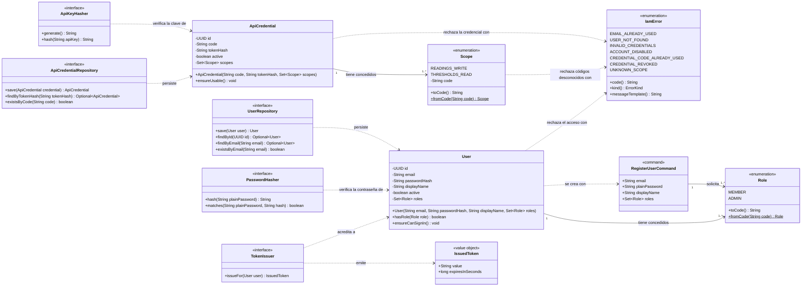

La separación entre persona y máquina no es cosmética: determina cómo se guarda cada secreto. La contraseña de una persona se cifra con un algoritmo lento y con sal, de modo que dos cuentas con la misma contraseña producen hashes distintos; la clave del Edge, en cambio, se reduce a un hash determinista, porque el sistema necesita localizar la credencial a partir de la clave que llega en cada petición, y eso exige una columna indexable. Esa diferencia justifica que existan dos puertos, `PasswordHasher` y `ApiKeyHasher`, en lugar de uno solo.

Ambos agregados guardan su identificador y su código de forma inmutable y exponen un método que decide si la credencial sirve: `ensureCanSignIn` en el caso de la persona y `ensureUsable` en el de la máquina. La comprobación vive en el dominio y no en la capa de seguridad para que una cuenta desactivada o una credencial revocada se rechacen por la misma regla, con independencia de por dónde llegue la petición.

##### <i>**4.2.2.6.2. Bounded Context Database Design Diagram.**</i>

El bounded context persiste en el esquema IAM, con cuatro tablas: una por cada identidad y una tabla de unión por cada catálogo de permisos, ya que tanto los roles de una persona como los alcances de una máquina son conjuntos.

<em>Figura 55.</em> Diagrama de base de datos del bounded context IAM.

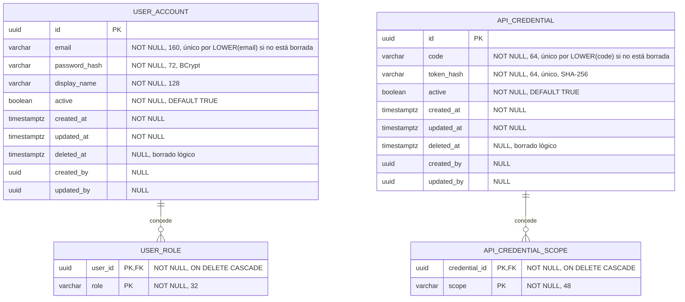

Las dos tablas de unión llevan clave primaria compuesta —`(user_id, role)` y `(credential_id, scope)`—, lo que impide conceder dos veces el mismo permiso sin necesidad de una restricción adicional, y se borran en cascada con su identidad: un rol sin persona a la que pertenecer no significa nada.

Los índices únicos son parciales y merecen atención. `ux_user_account_email` se declara sobre `LOWER(email)` y solo sobre las filas cuyo `deleted_at` es nulo: el correo no distingue mayúsculas a efectos de identidad, y una cuenta dada de baja no debe bloquear el alta de otra con el mismo correo. `ux_api_credential_token`, en cambio, es total y sin condición, porque el hash del token se consulta en cada petición del Edge y debe resolverse por índice aunque la credencial esté revocada; solo así el rechazo de una credencial revocada puede explicarse con el error correspondiente en lugar de confundirse con una clave inexistente.

El tamaño de `password_hash` está fijado en 72 caracteres, que es la longitud de un hash BCrypt, y el de `token_hash` en 64, la de un SHA-256 en hexadecimal. Ninguna de las dos columnas guarda el secreto en claro: la clave de máquina se muestra una sola vez, en la respuesta a su creación, y no vuelve a ser recuperable.

### 4.2.3. Bounded Context: Insights

Es el contexto analítico: no captura telemetría, sino que la recibe ya calculada desde Monitoring a través de una capa anticorrupción y le aplica estadística (correlación de Pearson, regresión lineal, detección de anomalías por z-score) para responder preguntas que requieren historia larga, como si el ruido de una sala proviene de la ocupación o del ambiente, o si su temperatura sigue a la del exterior por un mal aislamiento. Complementa esa serie con observaciones periódicas del clima externo (OpenWeather) para poder correlacionar interior y exterior, y siempre acompaña cada conclusión con el tamaño de muestra que la respalda, rechazando períodos con datos insuficientes.

#### <i>**4.2.3.1. Domain Layer.**</i>

Este contexto no gestiona telemetría cruda; consume series ya calculadas y produce conclusiones estadísticas sobre el confort de una sala.

**Aggregates:**

* `WeatherObservation`: Medición histórica del clima exterior, con `observedAt`, `tempC`, `rhPct` y `condition`.

**Value Objects:**

* `ReadingPoint`: Un punto reducido de la serie temporal de una sala (`ts`, `laeq`, `backgroundNoise`, `tempC`, `ppd`, `occupiedPct`); es el vocabulario propio del contexto, independiente del agregado `RoomReading` de Monitoring.
* `Correlation`: Coeficiente de Pearson entre dos series junto al tamaño de muestra, con `isReliable()` y `strength()` (negligible/weak/moderate/strong).
* `Trend`: Recta ajustada por mínimos cuadrados (`slopePerHour`, `rSquared`, `sampleSize`), con criterio propio de fiabilidad.
* `RoomAnalytics`: Resultado agregado del análisis de una sala en un periodo (ruido vs. ocupación, deriva térmica, interior vs. exterior, anomalías de ruido).

**Domain Services:**

* `ComfortAnalyticsService`: Servicio de dominio puro (sin persistencia) que calcula correlaciones de Pearson, regresión lineal simple y detección de anomalías por z-score sobre una serie de `ReadingPoint`.

**Repositories/Ports (Interfaces):**

* `WeatherObservationRepository`: Persistencia del histórico de clima exterior.
* `ReadingSeriesProvider`: Puerto de salida (ACL) que declara la necesidad de series de lecturas, sin saber que las provee Monitoring.
* `OutdoorWeatherProvider`: Puerto de salida (ACL) que declara la necesidad del clima actual, sin saber que lo sirve OpenWeather.

**Domain Errors:**

* `InsightsError`: Catálogo de errores (`RANGE_INVERTED`, `RANGE_TOO_SHORT`).

#### <i>**4.2.3.2. Interface Layer.**</i>

**Controllers:**

* `RoomAnalyticsController`: Expone `GET /api/v1/insights/rooms/{roomId}`, con rango `from`/`to` obligatorio; responde `422` cuando no hay suficientes datos para un análisis confiable.

#### <i>**4.2.3.3. Application Layer.**</i>

**Query Services:**

* `AnalyzeRoomUseCaseImpl`: Orquesta la obtención de la serie de lecturas y del clima exterior, y delega el cálculo estadístico en `ComfortAnalyticsService`; rechaza rangos con muestra insuficiente.

**Command/Scheduled Services:**

* `SampleOutdoorWeatherUseCaseImpl`: Toma una muestra puntual del proveedor de clima y la persiste, construyendo el histórico necesario para correlacionar hacia atrás.

**Outbound Services (ACL):**

* `ExternalMonitoringService`: Único punto del contexto que conoce a Monitoring; implementa `ReadingSeriesProvider` traduciendo `RoomReading` a `ReadingPoint`.

#### <i>**4.2.3.4. Infrastructure Layer.**</i>

**Persistence/Repositories:**

* `WeatherObservationRepositoryImpl`: Implementación JPA de `WeatherObservationRepository`.

**External Services:**

* `OpenWeatherAdapter` / `OpenWeatherClient`: Implementan `OutdoorWeatherProvider` consumiendo la API de OpenWeather, con DTOs de respuesta (`CurrentWeatherResponse`, `MainResponse`, `WeatherResponse`).
* `OutdoorWeatherSampler`: Tarea programada que invoca periódicamente `SampleOutdoorWeatherUseCase`.

**Configuration:**

* `InsightsErrorCatalogConfiguration`: Publica el catálogo `InsightsError`.

#### <i>**4.2.3.5. Bounded Context Software Architecture Component Level Diagrams.**</i>

La solución despliega un único container para los servicios en la nube —la aplicación `cloud-api`, construida con Spring Boot 4 sobre Java 21—, dentro del cual cada bounded context ocupa su propio paquete y no comparte clases con los demás. El diagrama descompone ese container en los componentes de Insights, agrupados por la capa a la que pertenecen, e indica para cada uno su tecnología y su responsabilidad.

<em>Figura 56.</em> Diagrama de componentes del bounded context Insights dentro del container cloud-api.

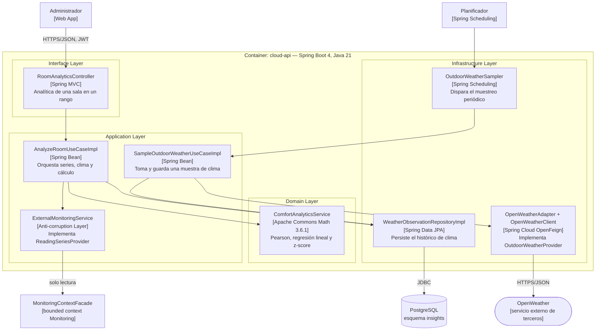

Este contexto es el que consume el **servicio externo de terceros** exigido por la arquitectura de la solución. La correlación entre temperatura interior y exterior solo puede calcularse hacia atrás si el histórico exterior existe, y OpenWeather sirve el clima actual, no el pasado; por eso `OutdoorWeatherSampler` acumula observaciones periódicamente en lugar de consultarlas en el momento del análisis. Si el servicio externo no responde, la analítica se degrada de forma controlada: el resto de indicadores se calcula igual y solo la correlación interior-exterior se declara sin datos suficientes.

#### <i>**4.2.3.6. Bounded Context Software Architecture Code Level Diagrams.**</i>

El nivel de código detalla la implementación del contexto en dos diagramas: el de clases del Domain Layer, que describe el modelo y sus relaciones, y el de base de datos, que describe cómo se persiste.

##### <i>**4.2.3.6.1. Bounded Context Domain Layer Class Diagrams.**</i>

El Domain Layer de Insights no contiene telemetría, sino los resultados de interpretarla. Su única pieza persistente es `WeatherObservation`; todo lo demás son value objects que expresan una conclusión estadística junto con la evidencia que la sostiene, y un servicio de dominio puro que los calcula.

<em>Figura 57.</em> Diagrama de clases del Domain Layer del bounded context Insights.

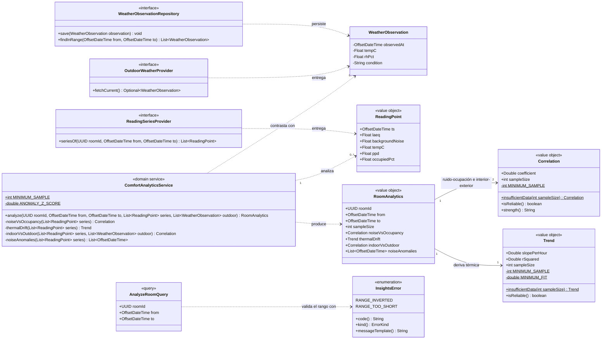

`Correlation` y `Trend` comparten un rasgo que ordena todo el contexto: **ninguna conclusión viaja sin su tamaño de muestra**. Ambos exponen `isReliable()` y un constructor estático `insufficientData`, de modo que la falta de datos es un resultado legítimo y no una excepción. Un coeficiente de correlación calculado sobre cinco minutos de lecturas es aritméticamente válido y estadísticamente inútil; obligar a que el valor viaje acompañado del número de muestras impide presentarlo como si significara algo. Por eso `Correlation.strength()` devuelve `insufficient_data` antes que una etiqueta cualitativa cuando no se alcanza el mínimo de treinta observaciones.

`ReadingPoint` es la traducción anticorrupción de la lectura de Monitoring: seis campos frente a los más de veinte del agregado original, porque el análisis estadístico solo necesita el instante y las magnitudes que correlaciona. `ComfortAnalyticsService` es un servicio de dominio puro —no consulta repositorios ni conoce la persistencia— y recibe las dos series ya resueltas, lo que permite ejercitarlo con datos sintéticos sin levantar la infraestructura.

##### <i>**4.2.3.6.2. Bounded Context Database Design Diagram.**</i>

El bounded context persiste en el esquema Insights una sola tabla, y no es telemetría propia: es el histórico del clima exterior que el sistema va acumulando para poder correlacionarlo hacia atrás con las lecturas de cada sala.

<em>Figura 58.</em> Diagrama de base de datos del bounded context Insights.

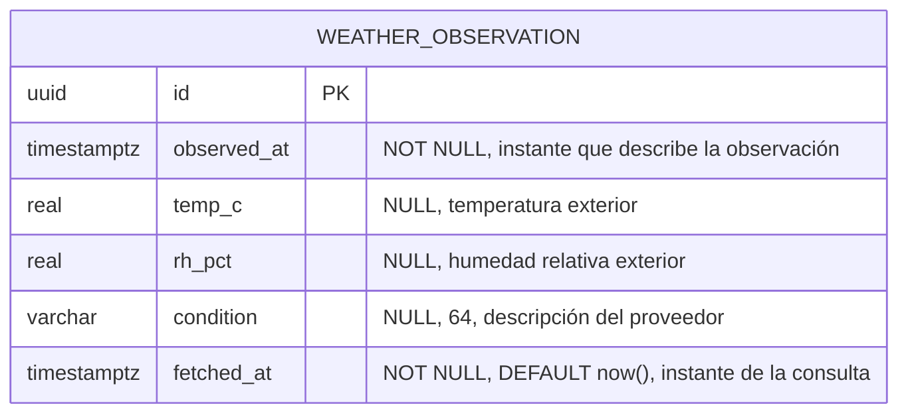

La tabla no guarda ninguna referencia a salas ni a locales, y es deliberado: el clima exterior no pertenece a ninguna sala en particular, sino al momento. La correlación entre temperatura interior y exterior se resuelve en la capa de aplicación, emparejando cada observación con la lectura más próxima en el tiempo a través del puerto `ReadingSeriesProvider`. Persistir aquí una clave de Monitoring ataría los dos contextos sin ganar nada.

`observed_at` y `fetched_at` responden a preguntas distintas y por eso conviven: la primera es el instante que la observación describe, la segunda el instante en que el sistema la pidió al proveedor externo. Cuando el servicio meteorológico devuelve un dato con retraso o repite la última medición disponible, la diferencia entre ambas columnas lo delata, y permite descartar observaciones obsoletas sin perderlas.

La tabla tampoco lleva columnas de auditoría, por el mismo criterio que la telemetría de Monitoring: nadie edita ni borra una observación meteorológica, de modo que `created_by` y `updated_by` estarían vacías en todas las filas. Su trazabilidad es precisamente el par de marcas de tiempo.

### 4.2.4. Bounded Context: Monitoring

Es el *core domain* de la plataforma: administra la estructura física del negocio (locales, salas y sus tipos), los dispositivos IoT que reportan por cada sala, y recibe la telemetría agregada por minuto que sube el Edge, deduplicándola y autoprovisionando salas y dispositivos desconocidos. Expone además una fachada de anticorrupción (`MonitoringContextFacade`) que es la única puerta por la que Alerting e Insights acceden a sus datos, de modo que ningún otro contexto conoce sus repositorios ni su modelo interno.

#### <i>**4.2.4.1. Domain Layer.**</i>

**Aggregates:**

* `Site`: Local físico (coworking) donde se instalan los dispositivos; modelado desde el inicio para soportar múltiples locales aunque hoy exista uno solo.
* `RoomType`: Clasifica las salas por actividad (p. ej. cabina de llamadas, zona común), que es lo que da sentido a los umbrales de Alerting.
* `Room`: Sala instrumentada, identificada por el `code` que reporta el firmware; nace activa y sin clasificar, y se autorregistra la primera vez que un dispositivo desconocido reporta por ella.
* `RoomReading`: Agregado por minuto de una sala (acústica, clima, confort, ocupación y calidad del dato), con `isReliable()` para excluir minutos incompletos de los cálculos estadísticos.

**Entities:**

* `Device`: Módulo ESP32 que reporta por una sala, con `lastSeen`, `lastSeq` y `lostBatches`; se mantiene separado de `Room` para que sustituir un módulo no le cueste a la sala su historial.

**Value Objects:**

* `AcousticMetrics`: Niveles de presión sonora ISO 1996 (`laeq`, `l10`, `l50`, `l90`, `lmax`, `lmin`), con `backgroundNoise()` e `intrusivePeaks()`.
* `Climate`: Temperatura y humedad relativa del sensor SHT31.
* `ThermalComfort`: Confort térmico ISO 7730 / Fanger (`pmv`, `ppd`, `verdict`), con `isAcceptable()` según ASHRAE 55.
* `Occupancy`: Porcentaje de ocupación y transiciones detectadas por el sensor de presencia mmWave.
* `DataQuality`: Lotes recibidos vs. esperados, para distinguir un minuto sólido de uno construido con datos incompletos.

**Domain Services:**

* No se define un servicio de dominio propio: los cálculos acústicos y de confort ya llegan resueltos desde el Edge, y el cloud solo agrega lo que necesita historia larga o varias salas (eso vive en Insights).

**Repositories (Interfaces):**

* `SiteRepository`, `RoomTypeRepository`, `RoomRepository`, `RoomReadingRepository`, `DeviceRepository`.

**Domain Errors:**

* `MonitoringError`: Catálogo de errores del contexto (`ROOM_NOT_FOUND`, `SITE_NOT_FOUND`, `ROOM_TYPE_FROM_ANOTHER_SITE`, `READING_BATCH_EMPTY`, `NO_SITE_AVAILABLE`, entre otros).

**Reportes de incomodidad:**

* `DiscomfortReport`: agregado que registra la molestia de un miembro en una sala (`DiscomfortCategory`: `NOISE`, `WARM`, `COLD`), con un comentario opcional y una copia de la última lectura de la sala si no tiene más de diez minutos. El mismo usuario puede informar la misma categoría en la misma sala una vez cada diez minutos.
* `DiscomfortReportRepository`: puerto de persistencia con `save`, `findLatest`, `search` y `findByUserId`.

#### <i>**4.2.4.2. Interface Layer.**</i>

**Controllers:**

* `SitesController`: Expone `/api/v1/sites` para dar de alta y listar locales y sus tipos de sala.
* `RoomsController`: Expone `/api/v1/rooms` para listar salas (incluyendo las no clasificadas), consultarlas, obtener su serie temporal o su última lectura, y clasificarlas.
* `ReadingsController`: Expone `POST /api/v1/readings`, único punto de entrada de la telemetría subida por el Edge, protegido con el scope de máquina `SCOPE_readings:write`.

**Anti-Corruption Layer (saliente, hacia otros contextos):**

* `MonitoringContextFacade` / `MonitoringContextFacadeImpl`: Única superficie pública de este contexto hacia Alerting e Insights; delega en los casos de uso, nunca en los repositorios directamente.
* `DiscomfortReportsController`: Expone `POST /api/v1/discomfort-reports` y `GET /api/v1/discomfort-reports/mine` para `ADMIN` y `MEMBER`, y `GET /api/v1/discomfort-reports` y `/summary` para `ADMIN`.

#### <i>**4.2.4.3. Application Layer.**</i>

**Command Services:**

* `CreateSiteUseCaseImpl`, `CreateRoomTypeUseCaseImpl`, `ClassifyRoomUseCaseImpl`: Altas y clasificación, validando pertenencia al mismo local.
* `IngestReadingsUseCaseImpl`: Procesa el lote del Edge con tres responsabilidades: deduplica lecturas (entrega *at-least-once*), autoprovisiona salas y dispositivos desconocidos, y refleja el estado del dispositivo sin recalcular sus contadores.

**Query Services:**

* `ListSitesUseCaseImpl`, `ListRoomTypesUseCaseImpl`, `ListRoomsUseCaseImpl`, `ListUnclassifiedRoomsUseCaseImpl`, `GetRoomUseCaseImpl`, `GetLatestReadingUseCaseImpl`, `GetReadingsInRangeUseCaseImpl`.

`FileDiscomfortReportUseCaseImpl` registra el reporte con la lectura del momento, y `ListDiscomfortReportsUseCaseImpl` lista los reportes y los cuenta por sala y categoría.

#### <i>**4.2.4.4. Infrastructure Layer.**</i>

**Persistence/Repositories:**

* `SiteRepositoryImpl`, `RoomTypeRepositoryImpl`, `RoomRepositoryImpl`, `RoomReadingRepositoryImpl`, `DeviceRepositoryImpl`: Implementaciones JPA con sus entidades (`SiteEntity`, `RoomEntity`, `RoomReadingEntity`, `RoomTypeEntity`, `DeviceEntity`), mappers y repositorios Spring Data correspondientes.

**Configuration:**

* `DiscomfortReportRepositoryImpl`: Implementación JPA de `DiscomfortReportRepository`, apoyada en `DiscomfortReportEntity`, `DiscomfortReportMapper` y `DiscomfortReportJpaRepository`.

* `MonitoringErrorCatalogConfiguration`: Publica el catálogo `MonitoringError`.

#### <i>**4.2.4.5. Bounded Context Software Architecture Component Level Diagrams.**</i>

La solución despliega un único container para los servicios en la nube —la aplicación `cloud-api`, construida con Spring Boot 4 sobre Java 21—, dentro del cual cada bounded context ocupa su propio paquete y no comparte clases con los demás. El diagrama descompone ese container en los componentes de Monitoring, agrupados por la capa a la que pertenecen, e indica para cada uno su tecnología y su responsabilidad.

<em>Figura 59.</em> Diagrama de componentes del bounded context Monitoring dentro del container cloud-api.

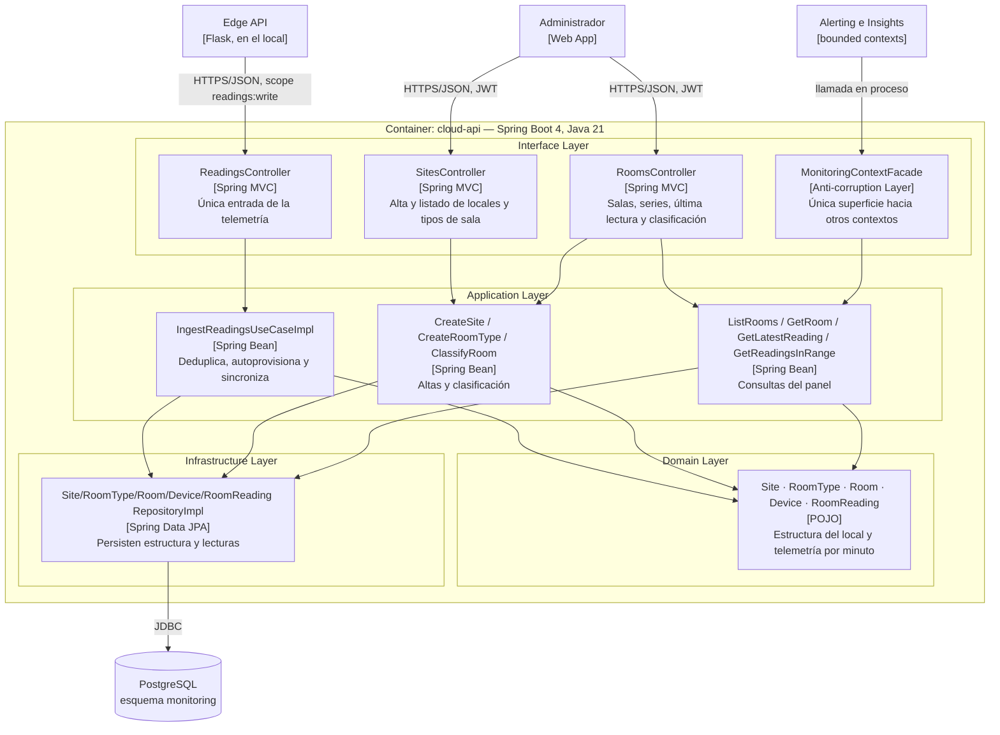

`ReadingsController` es el único punto por el que entra telemetría, y `IngestReadingsUseCaseImpl` concentra las tres responsabilidades que hacen tolerante la ingesta: deduplica por sala y minuto, porque el Edge entrega con garantía *at-least-once*; autoprovisiona la sala y el dispositivo cuando reportan por primera vez, de modo que instalar un módulo no exige configurar nada por adelantado; y refleja el estado del dispositivo descartando los lotes que llegan fuera de orden.

`MonitoringContextFacade` merece atención por su ubicación: vive en la Interface Layer, junto a los controladores REST, y no en la de aplicación. La razón es que cumple la misma función que un controlador —exponer el contexto al exterior— solo que su protocolo es una llamada en proceso en lugar de HTTP. Delega en los casos de uso y nunca en los repositorios, con lo que Alerting e Insights quedan sujetos a las mismas reglas de negocio que cualquier consumidor externo.

#### <i>**4.2.4.6. Bounded Context Software Architecture Code Level Diagrams.**</i>

El nivel de código detalla la implementación del contexto en dos diagramas: el de clases del Domain Layer, que describe el modelo y sus relaciones, y el de base de datos, que describe cómo se persiste.

##### <i>**4.2.4.6.1. Bounded Context Domain Layer Class Diagrams.**</i>

Monitoring es el bounded context más extenso de la solución, por lo que su Domain Layer se presenta en dos diagramas complementarios: el primero recoge los agregados, la entidad y los value objects que componen el modelo; el segundo, los puertos de persistencia que el dominio declara.

<em>Figura 60.</em> Modelo del Domain Layer del bounded context Monitoring.

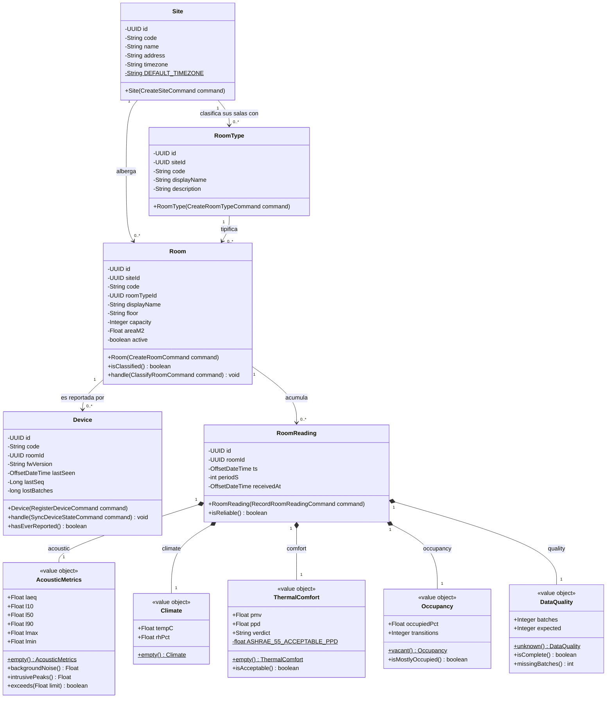

<em>Figura 61.</em> Puertos de persistencia y catálogo de errores del bounded context Monitoring.

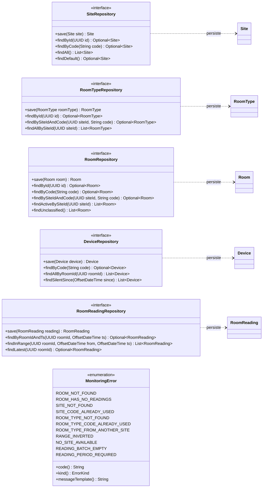

`RoomReading` compone cinco value objects en lugar de aplanar veinte campos sueltos, y cada uno responde por una dimensión del confort con su propio vocabulario: `AcousticMetrics` expone `backgroundNoise()` e `intrusivePeaks()`, que devuelven los percentiles L90 y L10 de la norma ISO 1996 bajo el nombre que usa el negocio; `ThermalComfort` conoce el umbral de PPD del 10 % que la norma ASHRAE 55 considera aceptable. Los cinco ofrecen un constructor estático para el caso vacío —`empty()`, `vacant()`, `unknown()`—, de modo que una lectura a la que le falta un sensor se representa sin recurrir a valores nulos dispersos por el agregado.

`DataQuality` merece mención aparte porque sostiene la fiabilidad de todo lo que se calcula después: compara los lotes recibidos con los esperados en el minuto, y `RoomReading.isReliable()` delega en él. Un minuto construido con la mitad de las muestras es un dato legítimo para mostrar en el panel, pero no para promediar en una serie histórica, y esa distinción se decide aquí y no en Insights.

La entidad `Device` se mantiene separada de `Room` con una razón concreta: sustituir un módulo ESP32 averiado no puede costarle a la sala su historial de lecturas. Su método `handle` descarta los lotes que llegan con un número de secuencia inferior al último visto, lo que hace idempotente la sincronización de estado ante los reenvíos de una entrega *at-least-once*.

##### <i>**4.2.4.6.2. Bounded Context Database Design Diagram.**</i>

El bounded context persiste en el esquema Monitoring, con las tablas que reproducen la estructura física del negocio (local, tipos de sala, salas y dispositivos), la telemetría que estos reportan y los reportes de incomodidad de los miembros.

<em>Figura 62.</em> Diagrama de base de datos del bounded context Monitoring.

Las cuatro tablas de estructura llevan auditoría completa y borrado lógico porque las edita una persona. **`room_reading` no lleva ninguna de esas columnas, y es deliberado**: es telemetría inmutable generada por máquina, nadie edita ni borra la lectura de un sensor, y esas cinco columnas estarían vacías en cientos de miles de filas. Su trazabilidad es el par `ts` y `received_at` —el minuto que describe frente al instante en que llegó—, cuya diferencia delata cortes de red y relojes desincronizados en el dispositivo.

Dos claves foráneas son deliberadamente opcionales. `room.room_type_id` nace nula porque la sala se da de alta sola la primera vez que un dispositivo desconocido reporta por ella, y es el administrador quien la clasifica después desde la aplicación web. `device.room_id` lo es por la misma razón: un módulo puede estar registrado antes de asignarse a una sala. Ambas nulabilidades sostienen el autoprovisionamiento descrito en el Application Layer, que permite instalar un dispositivo sin configurar nada por adelantado.

Los identificadores que maneja el firmware no son UUID: viajan en la columna `code` —`sala-01`, `esp32-sala-01`— y el dispositivo nunca ve la clave primaria. Las claves primarias son UUID versión 7, ordenados cronológicamente en sus 48 bits altos, de modo que ordenar por `id` equivale a ordenar por creación y las inserciones caen al final del índice en lugar de dispersarlo, lo que importa especialmente en `room_reading`, que crece un registro por sala y minuto.

El par `room_id` y `ts` identifica una lectura de forma única en la práctica, y es la base de la deduplicación: el Edge entrega con garantía *at-least-once*, de modo que el mismo minuto puede llegar más de una vez y el caso de uso de ingesta lo reconoce por esa pareja antes de insertarlo.

Los reportes de incomodidad se guardan en la tabla `discomfort_report`, con `room_id` como clave foránea hacia `room`, el identificador del usuario como referencia lógica a IAM, la categoría, el comentario, el instante del reporte y las columnas de la lectura copiada (`reading_ts`, `laeq`, `temp_c`, `rh_pct` y `occupied_pct`).

<!-- nav:start -->

<a href="capitulo-3.md">← Capítulo III</a> · <a href="README.md#contenido">Contenido</a> · <a href="capitulo-5.md">Capítulo V →</a>

<!-- nav:end -->
