<!-- nav:start -->
<p align="center"><a href="capitulo-4.md">← Capítulo IV</a> · <a href="README.md#contenido">Contenido</a> · <a href="capitulo-6.md">Capítulo VI →</a></p>
<!-- nav:end -->

<a id="capítulo-v-solution-uiux-design"></a>
# Capítulo V: Solution UI/UX Design

## 5.1. Style Guidelines.

### _5.1.1. General Style Guidelines._

Las guías de estilo reúnen en un solo lugar las decisiones visuales y de comunicación que comparten todos los productos de ZenRoom: la Landing Page, la Web Application, la Mobile Application y el dispositivo IoT. El objetivo es que un administrador que pasa de la web al celular, o un miembro que mira la luz de la puerta de una sala, reconozca el mismo producto y lea los estados de la misma manera.

El sistema de diseño de SenseWork se construye sobre **Material Design 3**, el lenguaje de diseño de la Landing Page y de las aplicaciones. De Material se toman la escala tipográfica, la rejilla de 8 px, los componentes base y los íconos; sobre esa base se adaptan los colores a la identidad de la startup y se agregan los componentes propios del dominio, como el chip de estado de confort y la tarjeta de sala.

El repositorio central de recursos tiene dos partes. El archivo de Figma contiene los componentes, los estilos de color y texto y las pantallas:

https://www.figma.com/design/xYSodRNszkA9kbobfyR6X2

Los recursos que usan los repositorios de código —logotipo, isotipo y favicon— se versionan en la carpeta `assets/brand` de este repositorio, de modo que todos los productos toman el mismo archivo.

#### Principios de diseño

| Principio | Qué significa en ZenRoom | Cómo se aplica |
|:---|:---|:---|
| Claridad antes que detalle | El usuario debe saber en segundos si una sala está bien o no. | Cada pantalla abre con el estado y los indicadores; las series y tablas van debajo. |
| El estado nunca depende solo del color | El 8 % de los hombres tiene alguna deficiencia en la percepción del color. | Cada estado de confort lleva color, forma y palabra. En el dispositivo, color y patrón de luz. |
| Consistencia entre productos | La misma etiqueta y el mismo color significan lo mismo en la web, el celular y la puerta de la sala. | Los tokens de color y las etiquetas son únicos y se comparten entre los productos. |
| Calma | El producto trata de confort; la interfaz no debe generar alarma innecesaria. | El rojo se reserva para lo que exige acción. Las superficies son claras y los fondos de estado, suaves. |
| Privacidad visible | Los usuarios temen que un sensor acústico grabe conversaciones. | Los textos y la interfaz del dispositivo explican que solo se envía el nivel sonoro, nunca audio. |

#### Branding

SenseWork es el nombre de la startup y ZenRoom, el del producto. El logotipo de SenseWork combina el isotipo con el nombre, y el isotipo se usa solo cuando el espacio es reducido: el menú lateral de la web, la pantalla de inicio de sesión, el ícono de la aplicación móvil y el favicon.

| Recurso | Archivo | Uso |
|:---|:---|:---|
| Logotipo | `assets/brand/sensework-logo.svg` | Encabezado y pie de la Landing Page, documentos y presentaciones. |
| Isotipo | `assets/brand/sensework-isotipo.svg` | Menú lateral, inicio de sesión, ícono de la aplicación y favicon. |

Las reglas de uso son tres: el logotipo conserva su proporción y no se deforma, se coloca sobre fondos claros o sobre el azul marino de la marca, y se deja alrededor un margen libre igual a la altura del isotipo. El nombre del producto se escribe siempre **ZenRoom**, con R mayúscula, y en las aplicaciones aparece acompañado de *by SenseWork*.

#### Typography

La tipografía de las aplicaciones es **Roboto**, la familia de Material Design. Se eligió por su legibilidad en tamaños pequeños, en los que se leen los valores de las tarjetas, y porque tiene números tabulares, que mantienen alineadas las columnas de las tablas de lecturas. Se usan dos pesos: Regular para el texto y Bold para títulos y valores.

| Estilo | Tamaño · peso | Uso |
|:---|:---|:---|
| Display | 30 px · Bold | Valor principal de una tarjeta de indicador. |
| Headline | 26 px · Bold (web) · 22 px (móvil) | Título de la pantalla. |
| Title | 18 px · Bold | Título de una tarjeta o sección. |
| Subtitle | 16 px · Bold | Nombre de una sala y títulos menores. |
| Body | 14 px · Regular | Texto general, tablas y formularios. |
| Caption | 12 px · Regular | Texto secundario, unidades y leyendas de gráficos. |

Las unidades se escriben siempre junto al valor, en tamaño menor y color secundario: **62** dB(A), **24,5** °C, **48** %.

#### Colors

Los colores salen del logotipo de SenseWork: el azul representa la dimensión acústica, el ámbar la térmica y el azul marino da el contraste para el texto y la navegación. Los colores de estado son independientes de los de marca para que una alerta nunca se confunda con un botón.

| Token | Valor | Uso | Contraste |
|:---|:---:|:---|:---:|
| Navy | #0F2A3D | Texto principal, títulos y menú lateral | 14,8:1 sobre blanco |
| Acoustic blue | #2E86C1 | Íconos, series de los gráficos, pestaña activa y bordes de foco | 3,97:1 sobre blanco |
| Acoustic blue dark | #2477AF | Fondo de botones con texto blanco y enlaces | 4,85:1 sobre blanco |
| Thermal amber | #F5A623 | Acento: valor máximo de un gráfico y elementos térmicos | Solo sobre Navy (7,3:1) |
| Gray | #5C7080 | Texto secundario y etiquetas | 5,1:1 sobre blanco |
| Surface | #FFFFFF | Tarjetas, tablas y formularios | — |
| Background | #F4F7FA | Fondo de las pantallas | — |
| Border | #D9E1E8 | Bordes de tarjetas, campos y tablas | — |

Los estados de confort usan un color oscuro para el texto y un fondo claro del mismo tono:

| Estado | Texto | Fondo | Forma | Contraste |
|:---|:---:|:---:|:---:|:---:|
| Optimal | #1E7A3A | #E3F4E8 | Círculo | 4,7:1 |
| Moderate | #8A5A00 | #FFF1D6 | Triángulo | 5,3:1 |
| Not recommended | #B3261E | #FDE3E3 | Cuadrado | 5,4:1 |
| No data | #526F82 | #E8F0F5 | Círculo vacío | 4,6:1 |

Todas las combinaciones de texto cumplen el nivel AA de las WCAG 2.1, que pide 4,5:1 para texto normal. Las dos excepciones se resuelven con reglas de uso: el **azul acústico** no se usa como fondo de texto blanco, porque llega a 3,97:1, y para eso existe su variante oscura; y el **ámbar** nunca se usa como color de texto sobre fondos claros, porque llega a 2,0:1.

#### Spacing

El espaciado sigue la rejilla de 8 px de Material Design, con 4 px para los ajustes finos. Usar siempre los mismos valores hace que las pantallas se vean ordenadas sin necesidad de líneas divisorias.

| Token | Valor | Uso |
|:---|:---:|:---|
| xs | 4 px | Separación entre un ícono y su texto. |
| sm | 8 px | Separación entre elementos de un grupo, como los botones de una barra. |
| md | 12–16 px | Separación entre tarjetas y relleno de campos. |
| lg | 20–24 px | Relleno interior de las tarjetas y separación entre secciones. |
| xl | 32 px | Márgenes laterales de la pantalla en escritorio. |

Los radios de borde distinguen el tipo de elemento: 12 px para las tarjetas, 5–6 px para los campos de formulario y forma de píldora para los botones y los chips de estado. Las zonas táctiles miden al menos 44 × 44 px en la web y 48 × 48 px en el celular.

#### Iconografía

Los íconos son **Material Symbols Outlined** de 24 px, con trazo uniforme. Cada sensor tiene un ícono fijo que se repite en todos los productos: altavoz para el ruido, termómetro para la temperatura, gota para la humedad y persona para la presencia. Un ícono nunca aparece solo cuando representa una acción: va con su etiqueta o con un `aria-label` que la reemplace.

#### Tono de comunicación

El tono se define con las cuatro dimensiones de Nielsen Norman Group. ZenRoom habla con administradores que toman decisiones sobre su local y con miembros que quieren concentrarse, así que la voz es la de un asesor tranquilo que conoce el tema.

| Dimensión | Posición | Por qué | Ejemplo |
|:---|:---|:---|:---|
| Divertido ↔ Serio | Más serio | Los datos ambientales sustentan decisiones de negocio y quejas de clientes. | *Noise above 60 dB(A)* en lugar de *Wow, it's loud in here!* |
| Formal ↔ Casual | Intermedio, cercano | El miembro es un usuario cotidiano; un tono burocrático lo alejaría. En español se tutea. | *Cuéntale al equipo de la sede qué te incomoda.* |
| Respetuoso ↔ Irreverente | Respetuoso | Un reporte de incomodidad es una queja legítima, no un error del usuario. | *Tell the site team what bothers you.* |
| Entusiasta ↔ Sereno | Sereno | El producto promete calma; los mensajes no exageran ni alarman. | *All rooms look calm.* |

Las reglas de redacción que se derivan son: frases cortas en voz activa, el dato antes que el adjetivo (*Max 67 dB(A)*, no *Muy ruidoso*), mensajes de error que dicen qué pasó y qué hacer, y la misma palabra para el mismo concepto en todos los productos.

### _5.1.2. Web, Mobile and IoT Style Guidelines._

Las guías generales se concretan de manera distinta en cada superficie. La web se lee en pantallas grandes con ratón y teclado, el celular se usa con una mano y de paso, y el dispositivo IoT no tiene pantalla: se comunica con luz y desde lejos.

#### Web Style Guidelines

Las interfaces web son *responsive* y se diseñan primero para escritorio, porque es donde el administrador revisa el local, y después se adaptan al celular. Se definen cuatro rangos de ancho:

| Rango | Ancho | Comportamiento |
|:---|:---|:---|
| Escritorio | más de 1100 px | Menú lateral fijo de 240 px, cuatro tarjetas de indicador por fila y contenido con columna lateral. |
| Tablet | 761–1100 px | Dos tarjetas de indicador por fila; la columna lateral pasa debajo del contenido. |
| Celular | 501–760 px | El menú lateral se convierte en un *drawer* que se abre con el botón de menú; el mapa de calor pasa a dos columnas. |
| Celular pequeño | hasta 500 px | Una sola columna; el selector de sede se mueve al *drawer*. |

La Landing Page usa los cortes de 1100, 800 y 520 px, y por debajo de 800 px agrupa la navegación en un menú desplegable.

Los estándares de interacción en la web son estos:

1. **Un solo botón relleno por pantalla.** La acción principal usa el botón relleno en Acoustic blue dark; las secundarias, el botón con borde. Así el usuario sabe siempre cuál es el siguiente paso.
2. **Lo clicable se reconoce.** Las tarjetas de sala y las filas de las tablas cambian de fondo al pasar el ratón y llevan al detalle. Los enlaces van en azul.
3. **Foco visible.** Todo control muestra un contorno de 2–3 px al recibir el foco con el teclado, y el orden de tabulación sigue el orden visual.
4. **Retroalimentación inmediata.** Los botones cambian su texto mientras trabajan (*Saving…*), las acciones terminadas se confirman con un aviso breve en la esquina inferior y los errores aparecen junto al campo que los causa.
5. **Accesibilidad.** Los controles llevan atributos ARIA, como `aria-expanded` en el menú y `aria-selected` en las pestañas; las imágenes tienen texto alternativo, y la animación se desactiva si el sistema pide movimiento reducido.

#### Mobile Style Guidelines

La Mobile Application se construye con Flutter sobre los componentes de Material 3 y comparte los tokens de color y la tipografía de la web.

1. **Navegación inferior.** El miembro tiene tres pestañas: Rooms, Report y Profile. El administrador tiene Overview, Alerts, Rooms y More, y en More se agrupan las funciones de configuración, que usa con menos frecuencia. La pestaña activa se marca con un fondo azul claro detrás del ícono, además del color.
2. **Zonas táctiles de 48 px.** Las pestañas, las filas de las listas y los botones miden al menos 48 px de alto, para tocarlos con el pulgar sin errores.
3. **Una columna.** El contenido se apila en una sola columna y los formularios ocupan todo el ancho. La acción principal va al final del formulario, al alcance del pulgar.
4. **Detalle con regreso.** Toda pantalla de detalle tiene la flecha para volver a la lista desde la que se entró, y conserva los filtros aplicados.
5. **Confirmación explícita.** Después de enviar un reporte o atender una alerta, se muestra una pantalla que dice qué pasó y adónde volver, como *Report sent* o *Action saved*.
6. **Idioma.** El idioma por defecto es inglés (`en_US`) y se puede cambiar a español latinoamericano (`es_419`) desde el perfil.

#### IoT Style Guidelines

El dispositivo ZenRoom no tiene pantalla, y su interfaz de software es la que muestran las aplicaciones. En la Web Application, la sección Devices presenta cada dispositivo con su código, la sala que monitorea, la hora de la última lectura y su estado de conexión, con el mismo chip de estado del resto del producto. Un dispositivo que deja de enviar lecturas no desaparece de la lista: su sala pasa a *No data* y el chip indica desde cuándo.

#### Interfaz física del dispositivo IoT

El dispositivo se comunica con quien está frente a la sala mediante dos indicadores luminosos, porque su función es dar una respuesta inmediata sin abrir ninguna aplicación.

**Luz de la puerta.** Se monta junto a la entrada de la sala, a la altura de la vista, y repite el estado de confort que muestran las aplicaciones. Para que no dependa solo del color, cada estado tiene también un patrón de luz:

| Estado | Color | Patrón | Significado para quien llega |
|:---|:---|:---|:---|
| Optimal | Verde | Fija | La sala está en buenas condiciones. |
| Moderate | Ámbar | Fija | Se puede usar, pero hay ruido o temperatura fuera de lo ideal. |
| Not recommended | Rojo | Pulso lento, de 2 s | Mejor elegir otra sala. |
| No data | Apagada | — | El dispositivo no tiene una lectura reciente. |

El pulso se reserva para el estado que pide una acción, de modo que una persona que no distingue el rojo del verde reconozca igual la diferencia. La luz tiene un brillo moderado para no molestar a quienes trabajan dentro de la sala. El administrador puede fijarla en modo manual desde la aplicación, por ejemplo para marcar una sala reservada, y la aplicación muestra el modo actual (*Door light: green · Auto*).

**Indicador de estado del equipo.** Es un LED pequeño en la carcasa, pensado para quien instala o revisa el dispositivo y no para los miembros:

| Situación | Indicación |
|:---|:---|
| Conectándose a la red | Azul intermitente |
| Conectado y enviando lecturas | Azul fijo durante 3 s y luego apagado |
| Sin conexión con el Edge | Ámbar intermitente |
| Modo de configuración de red | Azul y ámbar alternados |

**Botón de configuración.** El único control físico es un botón empotrado. Si se mantiene presionado 5 segundos, el dispositivo entra en modo de configuración de red. Está empotrado para evitar que se active por accidente.

**Privacidad.** La carcasa lleva impresa la leyenda *Measures sound level only. No audio is recorded.*, en coherencia con el principio de privacidad visible: el micrófono calcula el nivel sonoro dentro del dispositivo y nunca envía audio.

## 5.2. Information Architecture.

### _5.2.1. Organization Systems._

El contenido de ZenRoom se organiza a partir de sus dos audiencias. El administrador supervisa un local con varias salas y necesita comparar y priorizar; el miembro busca una sola sala para trabajar ahora. Por eso el primer criterio de organización es **según audiencia**: cada rol entra con la misma cuenta, pero ve solo sus secciones. Dentro de cada sección se elige la organización visual y el esquema de categorización según la tarea.

#### Organización visual

| Organización | Dónde se aplica | Por qué |
|:---|:---|:---|
| **Jerárquica** | Overview, Room Detail y las tarjetas de sala | Va de lo general a lo particular: primero el estado y los indicadores, después la serie de tiempo, al final el detalle. El administrador decide si debe profundizar sin leer toda la pantalla. |
| **Secuencial** | Registro de cuenta, Report discomfort, atención de una alerta y el recorrido de la Landing Page | Son tareas con un orden fijo. El reporte sigue *elegir sala → elegir problema → comentar → enviar*, y la Landing Page lleva al visitante de la propuesta de valor a la solicitud de demostración. |
| **Matricial** | Mapa de calor del Overview y Comfort Thresholds | El mapa de calor cruza salas y estados en una rejilla para ver el local de un vistazo. Los umbrales cruzan tipo de sala, variable medida y nivel (Warning y Critical) en una tabla editable. |

#### Esquemas de categorización

| Esquema | Grupo de información | Aplicación |
|:---|:---|:---|
| **Según audiencia** | Menú de navegación | Administrador: Overview, Rooms, Devices, Alerts, Insights, Reports, Members y Thresholds. Miembro: Rooms, Report discomfort y Profile. En la Landing Page, las pestañas *For members* y *For managers*. |
| **Por tópicos** | Salas, análisis y preguntas frecuentes | Las salas se agrupan por sede y por tipo de sala. Insights separa sus análisis por tema: anomalías de ruido, variación térmica y correlaciones. Las preguntas frecuentes se filtran por instalación, costo, privacidad y medición. |
| **Cronológico** | Alertas, reportes, lecturas e historial | Las alertas se ordenan de la más reciente a la más antigua y se separan por estado: Active, Acknowledged y Closed. Las series de tiempo se leen de izquierda a derecha y los reportes históricos se filtran por período. |
| **Alfabético** | Miembros, sedes y dispositivos | Son listas que se consultan buscando un nombre conocido, así que se ordenan por nombre y tienen un campo de búsqueda. |
| **Por estado** | Salas que requieren atención | En el Overview, la lista lateral muestra primero las salas Not recommended y después las Moderate, porque es el orden en que el administrador debe actuar. |

En la Mobile Application se aplican los mismos esquemas, con una diferencia: como el miembro suele buscar una sala disponible en ese momento, la lista de salas permite filtrar por *Quiet*, *Cool* y *Free now* antes de ordenar.

### _5.2.2. Labeling Systems._

Las etiquetas son de una o dos palabras, describen el contenido y no la tecnología, y son las mismas en la web, en el celular y en los mensajes del dispositivo. Todas existen en inglés (`en_US`), el idioma por defecto, y en español latinoamericano (`es_419`). Las etiquetas que se presentan son las implementadas en los archivos de traducción de las aplicaciones.

#### Navegación

| Etiqueta (en_US) | Etiqueta (es_419) | Información que agrupa | Rol |
|:---|:---|:---|:---|
| Overview | Resumen | Indicadores del local, mapa de calor y salas que requieren atención | Administrador |
| Rooms | Salas | Lista de salas con su estado y sus valores actuales | Ambos |
| Alerts | Alertas | Alertas activas, atendidas y cerradas | Administrador |
| Devices | Dispositivos | Dispositivos instalados, su sala y su conexión | Administrador |
| Thresholds | Umbrales | Límites de confort por tipo de sala | Administrador |
| Insights | Análisis | Anomalías, variación térmica y correlaciones | Administrador |
| Reports | Reportes | Reportes de incomodidad e históricos | Administrador |
| Members | Miembros | Cuentas del coworking y sus roles | Administrador |
| Report discomfort | Reportar incomodidad | Formulario para avisar de una molestia | Miembro |
| Profile | Perfil | Datos de la cuenta, idioma y notificaciones | Ambos |
| More | Más | Funciones de configuración en el celular | Administrador |

#### Estados y valores

| Etiqueta (en_US) | Etiqueta (es_419) | Representación |
|:---|:---|:---|
| Optimal | Óptima | Chip verde con círculo · luz verde fija |
| Moderate | Moderada | Chip ámbar con triángulo · luz ámbar fija |
| Not recommended | No recomendada | Chip rojo con cuadrado · luz roja pulsante |
| No data | Sin datos | Chip gris con círculo vacío · luz apagada |
| Noise | Ruido | Valor en dB(A) |
| Temperature | Temperatura | Valor en °C, con una cifra decimal |
| Humidity | Humedad | Valor en % |
| Presence | Presencia | *Free* / *Occupied* (*Libre* / *Ocupada*) |
| Warning · Critical | Advertencia · Crítico | Los dos niveles de un umbral |

Las etiquetas de estado describen la sala desde el punto de vista de quien va a usarla —*Not recommended*, no *Error* ni *Fail*—, en coherencia con el tono sereno del producto. Los valores siempre llevan su unidad, y el estado de confort va acompañado de la aclaración *Comfort status is an estimate based on the latest values*, para que el usuario sepa de dónde sale.

#### Acciones

| Etiqueta (en_US) | Etiqueta (es_419) | Asociación |
|:---|:---|:---|
| Sign in | Iniciar sesión | Acceso con la misma cuenta en la web y en el celular |
| Send report | Enviar reporte | Cierra el formulario de incomodidad y lleva a la confirmación |
| Acknowledge and save | Atender y guardar | Registra la acción correctiva y cambia la alerta a *Acknowledged* |
| Save thresholds | Guardar umbrales | Guarda la tabla de umbrales y los envía al Edge |
| Generate key | Generar clave | Crea la credencial con la que un Edge se autentica ante el cloud |
| Sign out | Cerrar sesión | Termina la sesión en el dispositivo actual |

Cada etiqueta funciona como asociación hacia el lugar donde está el resto de la información. Por ejemplo, el indicador con el número de alertas en la barra superior de la web lleva a Alerts, sin necesidad de mostrar las alertas en todas las pantallas. Del mismo modo, More agrupa en el celular las funciones de configuración que en la web tienen su propia entrada en el menú lateral.

### _5.2.3. SEO Tags and Meta Tags_

Los metadatos de ZenRoom describen la propuesta de valor del producto e identifican a SenseWork como la startup responsable. Su contenido se relaciona con el monitoreo acústico y térmico en espacios de coworking.

La landing page utiliza inglés como idioma inicial y permite seleccionar español latinoamericano. El cambio de idioma actualiza el título, la descripción y los metadatos sociales del documento.

#### Metadatos de la landing page

| Elemento | Valor implementado | Propósito |
|---|---|---|
| `title` | ZenRoom — Workspace comfort by SenseWork | Identificar el producto y su finalidad en la pestaña del navegador. |
| `description` | Find a comfortable coworking room with ZenRoom. Explore noise and thermal monitoring, room insights and privacy-first IoT by SenseWork. | Resumir la propuesta de valor. |
| `keywords` | ZenRoom, SenseWork, coworking, IoT, noise monitoring, thermal comfort, room monitoring | Registrar los términos temáticos solicitados en el proyecto. |
| `author` | SenseWork | Identificar a la startup responsable. |
| `charset` | UTF-8 | Permitir la representación de caracteres de ambos idiomas. |
| `viewport` | width=device-width, initial-scale=1 | Adaptar la visualización al ancho del dispositivo. |
| `robots` | index, follow | Permitir que los buscadores indexen la landing page y sigan sus enlaces. |
| `theme-color` | #174D3C | Definir el color principal de la interfaz del navegador cuando sea compatible. |
| `og:type` | website | Identificar el contenido como un sitio web. |
| `og:site_name` | ZenRoom by SenseWork | Identificar el sitio en plataformas que utilizan Open Graph. |
| `og:title` | ZenRoom — Make room for focus | Presentar un título para compartir el contenido. |
| `og:description` | A clearer view of noise and thermal comfort in your coworking. A solution by SenseWork. | Describir el contenido compartido. |
| `og:locale` | en_US | Indicar el idioma inicial de los metadatos sociales. |
| `og:locale:alternate` | es_419 | Identificar el español latinoamericano como idioma alternativo. |
| `twitter:card` | summary | Definir una presentación resumida del contenido compartido. |

**Nota:** En el código, los títulos utilizan una barra vertical (`|`) como separador entre el nombre del producto y su descripción.

Para la versión en español se utilizan los siguientes valores:

| Elemento | Valor |
|---|---|
| Título | ZenRoom — Confort en coworkings por SenseWork |
| Descripción | Encuentra una sala confortable con ZenRoom. Explora el monitoreo de ruido y confort térmico para coworkings, con privacidad, por SenseWork. |
| Palabras clave | ZenRoom, SenseWork, coworking, IoT, monitoreo de ruido, confort térmico, monitoreo de salas |
| Idioma del documento | es-419 |

La etiqueta `keywords` se incorpora para cumplir con la especificación del proyecto. No se considera un factor de posicionamiento en Google, ya que este buscador no la utiliza para indexar o clasificar resultados.

La versión publicada permite la indexación con `index, follow`, porque la landing page es la puerta de entrada de los visitantes y enlaza la Web Application y la descarga de la Mobile Application.

El cambio de idioma mediante JavaScript no constituye, por sí solo, dos páginas localizadas independientes para los buscadores.

#### Metadatos propuestos para la aplicación web

Las vistas de gestión tendrán títulos y descripciones relacionados con la tarea del administrador. Estas definiciones constituyen una propuesta para la aplicación web y no representan páginas implementadas dentro de la landing.

| Vista | Título propuesto | Descripción propuesta | Palabras clave |
|---|---|---|---|
| Inicio de sesión | Sign in — ZenRoom | Sign in to your ZenRoom workspace management account. | ZenRoom, sign in, workspace management |
| Resumen | Workspace overview — ZenRoom | Review room comfort, recent readings and alerts across your coworking. | ZenRoom, dashboard, room comfort |
| Salas | Rooms and comfort — ZenRoom | Find rooms and inspect their acoustic and thermal conditions. | ZenRoom, rooms, noise, temperature |
| Alertas | Environmental alerts — ZenRoom | Review and follow up on acoustic and thermal alerts in your workspace. | ZenRoom, alerts, environmental monitoring |
| Históricos | Comfort insights — ZenRoom | Explore historical room conditions to support workspace improvements. | ZenRoom, insights, historical trends |

Para estas vistas se propone `author="SenseWork"` y `robots="noindex, nofollow"`. La privacidad de los datos deberá protegerse mediante autenticación y autorización; los metadatos no reemplazan estos controles.

#### Elementos ASO propuestos para la aplicación móvil

La propuesta de App Store Optimization se dirige a miembros de coworkings que necesitan consultar las condiciones ambientales antes de elegir una sala.

| Elemento | Inglés | Español |
|---|---|---|
| App Title | ZenRoom: Workspace Comfort | ZenRoom: Confort de trabajo |
| App subtitle | Find your space to focus | Encuentra tu sala ideal |
| App keywords | coworking,noise,temperature,focus,rooms,comfort | coworking,ruido,temperatura,salas,confort |
| App description | Find a comfortable place to work with ZenRoom. Check room noise and thermal conditions, explore quieter hours and report discomfort to your coworking manager. ZenRoom is designed to share environmental indicators without recording conversations. Requires a coworking equipped with the ZenRoom solution. | Encuentra un lugar confortable para trabajar con ZenRoom. Consulta el ruido y las condiciones térmicas, explora horas tranquilas y reporta molestias al administrador. ZenRoom está diseñado para compartir indicadores ambientales sin grabar conversaciones. Requiere un coworking equipado con la solución ZenRoom. |

### _5.2.4. Searching Systems._

Los sistemas de búsqueda de ZenRoom permiten localizar información según las necesidades de los visitantes, miembros y administradores de coworkings.

En la landing page, la búsqueda textual se concentra en las preguntas frecuentes. El visitante puede escribir términos relacionados con su consulta y seleccionar una categoría: instalación, costo, privacidad o medición. Las coincidencias se presentan como preguntas desplegables.

La búsqueda ignora diferencias entre mayúsculas, minúsculas y tildes. Cuando se ingresan varios términos, estos deben aparecer en el contenido de la pregunta o su respuesta. La categoría seleccionada se combina con la consulta textual.

La landing también incorpora un explorador de salas con datos ilustrativos para representar la experiencia de búsqueda del producto.

| Experiencia | Búsqueda y filtros | Presentación de resultados | Alcance |
|---|---|---|---|
| Preguntas frecuentes | Texto libre y categoría temática. | Preguntas desplegables y cantidad de coincidencias. | Implementado en la landing. |
| Explorador de salas | Nombre, estado de confort, ruido máximo y temperatura. | Lista con nombre, decibelios, temperatura y estado textual. | Implementado con datos de ejemplo. |
| Aplicación móvil | Sala, nivel de ruido y condiciones térmicas. | Lista o mapa con semáforo y acceso al detalle de la sala. | Propuesta para la aplicación. |
| Gestión de salas | Nombre o código, local, tipo de sala y estado. | Tabla o mapa con condiciones ambientales y última lectura. | Propuesta para la aplicación web. |
| Gestión de alertas | Sala, indicador, estado y periodo. | Listado con fecha, indicador y acceso al seguimiento. | Propuesta para la aplicación web. |
| Consulta de históricos | Sala, indicador y rango temporal. | Gráficos y valores del periodo seleccionado. | Propuesta para la aplicación web. |

#### Filtros del explorador de salas

| Filtro | Opciones |
|---|---|
| Nombre | Búsqueda textual sobre el nombre de la sala. |
| Estado de confort | Todas las salas, óptimo, moderado y requiere atención. |
| Ruido máximo | Cualquier nivel, hasta 45 dB o hasta 55 dB. |
| Temperatura | Cualquier temperatura o rango de 20–23 °C. |

Los filtros se aplican de manera conjunta y los resultados se actualizan sin recargar la página. Se muestra la cantidad de salas encontradas y se ofrece una acción para restablecer los filtros.

Cuando una búsqueda no produce coincidencias, se presenta un mensaje que invita a modificar los criterios. En las preguntas frecuentes, la opción “Clear search / Limpiar búsqueda” elimina el texto y restablece la categoría general.

Los campos incluyen etiquetas visibles y los estados de confort combinan color y texto. Los cambios en los resultados se anuncian mediante regiones de estado accesibles.

Las mediciones y los estados de las salas de la landing son ilustrativos. En el producto final, los umbrales deberán corresponder a la configuración del coworking y las lecturas desactualizadas deberán identificarse explícitamente.

### _5.2.5. Navigation Systems._

La navegación de ZenRoom se organiza según los objetivos de sus dos segmentos: miembros que desean encontrar ambientes confortables y administradores que necesitan supervisar las condiciones del coworking.

La landing utiliza navegación por secciones dentro de una misma página. El encabezado presenta los accesos principales y una llamada a la acción para solicitar una demostración.

| Elemento de navegación | Destino o comportamiento |
|---|---|
| Logotipo de SenseWork | Regresa al inicio de la landing. |
| The solution / La solución | Presenta las funcionalidades del producto. |
| For your space / Para tu espacio | Explica los beneficios para miembros y administradores. |
| Plans / Planes | Describe el modelo de contratación propuesto. |
| FAQs / Preguntas | Permite consultar y buscar preguntas frecuentes. |
| Request a demo / Solicitar demo | Dirige al formulario de preparación de una solicitud. |
| Selector EN / ES | Cambia el idioma de la interfaz. |
| Privacy / Privacidad | Dirige a la explicación del tratamiento del audio. |
| Prototype terms / Condiciones del prototipo | Abre un diálogo con el alcance de la demostración. |
| Back to top / Volver al inicio | Regresa a la parte superior de la página. |

El recorrido principal sigue la secuencia:

**Propuesta de valor → funcionalidades → experiencia por audiencia → funcionamiento → privacidad → contratación → preguntas frecuentes → solicitud de demostración.**

En dispositivos móviles, los enlaces del encabezado se agrupan en un menú desplegable. Su estado se comunica mediante `aria-expanded`, y el menú se cierra al seleccionar un destino.

La sección por audiencia utiliza pestañas para alternar entre miembros y administradores. Las pestañas admiten interacción con el teclado mediante flechas, Inicio y Fin.

#### Navegación propuesta para las aplicaciones

| Producto | Organización | Recorrido principal |
|---|---|---|
| Aplicación móvil | Navegación inferior con Salas, Reportes y Perfil. | Buscar una sala, revisar sus condiciones y reportar disconfort. |
| Aplicación web | Menú lateral con Resumen, Salas, Alertas, Históricos y Configuración. | Supervisar condiciones, inspeccionar alertas y consultar tendencias. |

Estas estructuras corresponden a propuestas para las aplicaciones. El retorno desde una vista de detalle deberá conservar el contexto y los filtros utilizados.

Para favorecer la accesibilidad, la landing incluye un enlace para saltar al contenido, una jerarquía de encabezados, indicadores de foco visibles y controles operables mediante teclado. También respeta la preferencia de movimiento reducido.

La navegación orienta la consulta de condiciones ambientales. Las reservas de salas permanecen fuera del alcance de la landing y siguen el procedimiento propio del coworking.

## 5.3. Landing Page UI Design.

La landing page presenta ZenRoom, el producto desarrollado por SenseWork, mediante una experiencia dirigida a miembros y administradores de coworkings. Su diseño permite comprender la problemática del confort ambiental, explorar las funcionalidades y evaluar la utilidad de la solución.

El encabezado y el pie de página incorporan el logotipo de SenseWork. Su tamaño se adapta al dispositivo y su presentación se integra visualmente con el fondo crema. El símbolo de la startup se utiliza como favicon.

La composición utiliza fondos claros, verde oscuro y acentos suaves. Los colores propios del logotipo se conservan para mantener la identidad de la startup.

La página se organiza en los siguientes bloques:

| Bloque | Objetivo |
|---|---|
| Encabezado | Identificar la startup y facilitar el acceso a las secciones. |
| Propuesta de valor | Explicar el beneficio principal y presentar las acciones iniciales. |
| Funcionalidades | Describir el monitoreo acústico, el confort térmico y la gestión basada en información. |
| Experiencia por audiencia | Diferenciar los beneficios para miembros y administradores. |
| Funcionamiento | Explicar el recorrido desde la medición hasta la toma de decisiones. |
| Privacidad | Comunicar que el producto está diseñado para no grabar, almacenar ni transmitir audio. |
| Contratación | Presentar el modelo de hardware y suscripción por sala. |
| Preguntas frecuentes | Resolver dudas de instalación, costo, privacidad y medición. |
| Formulario | Preparar una solicitud de demostración. |
| Pie de página | Mantener accesibles la privacidad y las condiciones del prototipo. |

La implementación utiliza HTML5, CSS3 y JavaScript. Incluye inglés como idioma inicial y español latinoamericano como alternativa, con una distribución adaptable a escritorio y móvil.

La landing se encuentra publicada en:

[ZenRoom — Landing Page](https://grupo03-iot.github.io/zenroom-landing/)

### _5.3.1. Landing Page Wireframe._

Los wireframes representan la estructura de la landing antes de aplicar su tratamiento visual final. Su propósito es definir la ubicación de los contenidos, la jerarquía de información y las acciones disponibles para el visitante.

#### Desktop Web Browser

La propuesta de escritorio utiliza un ancho de referencia de 1440 píxeles. El encabezado contiene la identidad de la startup, la navegación principal, el selector de idioma y la llamada a la acción.

El bloque inicial se organiza en dos columnas: la propuesta de valor y las acciones se presentan a la izquierda, mientras que la representación del espacio monitoreado se ubica a la derecha.

Las funcionalidades se distribuyen en tres columnas. La sección por audiencia combina información explicativa con el explorador de salas. Los bloques posteriores presentan el funcionamiento, la privacidad, el modelo de contratación, las preguntas frecuentes y el formulario.

<p align="center">
  
</p>

<p align="center">
  <em>Figura 63. Wireframe de la landing page de ZenRoom para escritorio. Fuente: elaboración propia en Figma.</em>
</p>

<p align="center">
  <a href="https://www.figma.com/design/rDwmYJJ0D3Gt9JOK8aKIvl?node-id=3-59">
    Ver wireframe de escritorio en Figma
  </a>
</p>
#### Mobile Web Browser

La propuesta móvil utiliza un ancho de referencia de 390 píxeles. El contenido principal se organiza en una columna y la navegación se concentra en un menú desplegable.

La propuesta de valor y el CTA aparecen antes de la ilustración. Las funcionalidades se apilan verticalmente y los campos del formulario se ajustan al espacio disponible.

La versión móvil conserva el orden de información de escritorio para mantener una experiencia consistente entre dispositivos.

<p align="center">
  
</p>

<p align="center">
  <em>Figura 64. Wireframe de la landing page de ZenRoom para dispositivos móviles. Fuente: elaboración propia en Figma.</em>
</p>

<p align="center">
  <a href="https://www.figma.com/design/rDwmYJJ0D3Gt9JOK8aKIvl?node-id=3-60">
    Ver wireframe móvil en Figma
  </a>
</p>

| Elemento | Escritorio | Móvil |
|---|---|---|
| Encabezado | Navegación visible y CTA principal. | Logotipo, selector de idioma y menú desplegable. |
| Propuesta de valor | Texto e ilustración en dos columnas. | Texto seguido de la ilustración. |
| Funcionalidades | Tres columnas. | Bloques apilados. |
| Experiencia por audiencia | Explicación y explorador de salas en paralelo. | Explicación seguida del explorador. |
| Preguntas frecuentes | Búsqueda, categorías y acordeones. | Controles adaptados al ancho disponible. |
| Formulario | Campos distribuidos según el espacio. | Campos principalmente verticales. |

#### Principios de diseño aplicados

| Principio | Aplicación |
|---|---|
| Jerarquía visual | Priorizar la propuesta de valor y las acciones principales. |
| Proximidad | Agrupar etiquetas, controles y contenido relacionado. |
| Alineación | Mantener un recorrido visual ordenado. |
| Consistencia | Conservar etiquetas y secuencia entre dispositivos. |
| Diseño inclusivo | Incorporar etiquetas visibles, acceso por teclado y estados expresados con texto. |
| Recuperación | Ofrecer mensajes sin resultados y acciones para restablecer filtros. |

Los wireframes orientan la distribución del contenido y sirven como base para elaborar los mock-ups. Su organización deberá mantenerse alineada con los sistemas de navegación y búsqueda definidos anteriormente.

### _5.3.2. Landing Page Mock-up._

Los mock-ups aplican color, tipografía, espaciado e identidad visual a la estructura de los wireframes. Permiten representar la apariencia de la landing y evaluar la relación entre sus componentes.

La propuesta incorpora el logotipo de SenseWork en el encabezado y el pie de página. Se conserva su proporción y se ajusta su tamaño para acompañar la navegación sin desplazar el contenido principal.

#### Identidad visual propuesta

| Elemento | Especificación | Aplicación |
|---|---|---|
| Logotipo | Identidad gráfica proporcionada por el equipo de SenseWork. | Encabezado y pie de página. |
| Favicon | Símbolo de SenseWork. | Identificación del sitio en el navegador. |
| Color principal | #174D3C | Botones principales y sección de privacidad. |
| Texto principal | #213E34 | Encabezados y contenido destacado. |
| Texto secundario | #53645B | Descripciones y textos de apoyo. |
| Fondo general | #F8F8F0 | Superficie principal de la landing. |
| Superficie secundaria | #EEF1E6 | Bloques de apoyo. |
| Acento | #DCEBBA | Detalles relacionados con el confort. |
| Tipografía de títulos | Manrope | Encabezados y mensajes principales. |
| Tipografía de lectura | DM Sans | Párrafos, navegación y formularios. |
| Acento tipográfico de la web | Georgia en cursiva | Palabra destacada de la propuesta de valor. |

#### Desktop Web Browser

El mock-up de escritorio utiliza un título de gran tamaño para destacar el beneficio principal. El CTA presenta un fondo verde oscuro y se diferencia de la acción secundaria, que permite explorar la experiencia.

La ilustración del coworking relaciona las salas con los indicadores de ruido, temperatura y estado. Su identificación como contenido ilustrativo permite distinguirla de un sistema conectado a sensores reales.

Las secciones mantienen una jerarquía tipográfica consistente y utilizan espacios amplios para separar temas. La experiencia por audiencia, el explorador y las preguntas frecuentes permiten examinar información de forma progresiva.

<p align="center">
  
</p>

<p align="center">
  <em>Figura 65. Mock-up de la landing page de ZenRoom para escritorio. Fuente: elaboración propia en Figma.</em>
</p>

<p align="center">
  <a href="https://www.figma.com/design/rDwmYJJ0D3Gt9JOK8aKIvl?node-id=3-61">
    Ver mock-up de escritorio en Figma
  </a>
</p>

#### Mobile Web Browser

El mock-up móvil conserva la identidad gráfica y reorganiza los contenidos en una columna. El logotipo se adapta al ancho del encabezado, junto con el selector de idioma y el control del menú.

Los componentes mantienen etiquetas legibles y separación entre acciones. Los estados de confort incluyen texto además de color, y el formulario conserva los datos ingresados cuando se requiere corregir un campo.

<p align="center">
  
</p>

<p align="center">
  <em>Figura 66. Mock-up de la landing page de ZenRoom para dispositivos móviles. Fuente: elaboración propia en Figma.</em>
</p>

<p align="center">
  <a href="https://www.figma.com/design/rDwmYJJ0D3Gt9JOK8aKIvl?node-id=3-62">
    Ver mock-up móvil en Figma
  </a>
</p>

#### Componentes y estados de interacción

| Componente | Representación o comportamiento |
|---|---|
| Botón principal | Fondo verde oscuro y texto claro para destacar la acción. |
| Acción secundaria | Enlace que permite explorar contenido relacionado. |
| Pestañas por audiencia | Identificación de la opción seleccionada y cambio de contenido. |
| Filtros de salas | Campos etiquetados y actualización de resultados. |
| Estado de confort | Etiqueta textual acompañada de color. |
| Preguntas frecuentes | Acordeones con estados expandido y contraído. |
| Búsqueda sin resultados | Mensaje explicativo y opción para limpiar los criterios. |
| Formulario | Validación de campos y mensaje sobre el resultado de la acción. |
| Menú móvil | Estados abierto y cerrado. |
| Condiciones del prototipo | Diálogo accesible desde el pie de página. |

#### Alcance de la implementación

La landing permite comprobar la navegación, el cambio de idioma, las pestañas por audiencia, los filtros de salas y la búsqueda de preguntas frecuentes.

El formulario valida los datos y genera una solicitud descargable en el dispositivo. No envía la información a SenseWork ni confirma una reserva de demostración.

Las salas utilizan datos ilustrativos. Las tarifas y los paquetes comerciales se mantienen pendientes de definición, por lo que se presenta únicamente el modelo de contratación descrito en el proyecto.

La adaptación de los componentes se revisó en escritorio y móvil. Estas comprobaciones no equivalen a una auditoría completa de accesibilidad ni a una validación de integración con sensores IoT.

## 5.4. Applications UX/UI Design.

### _5.4.1. Applications Wireframes._

ZenRoom tiene dos aplicaciones: la Web Application, que usa sobre todo el administrador del coworking, y la Mobile Application, que usa sobre todo el miembro. En las dos entran ambos roles con la misma cuenta, cada uno ve solo sus secciones. Los wireframes son de baja fidelidad, en escala de grises, con los textos como barras y los gráficos como una caja con una X, para discutir la estructura sin que el color distraiga.

Las pantallas de la Web Application se dibujaron en 1440 px para el navegador de escritorio y en 390 px para el navegador del celular, y la Mobile Application tiene las mismas funciones. Además de las pantallas principales están los estados que no son el camino feliz: error al iniciar sesión, búsqueda sin resultados, sala sin lecturas recientes, umbrales inválidos y sesión expirada. Aquí se muestran las pantallas que cubren las historias del core business; el resto está en el archivo de Figma.

Las decisiones que se repiten en todas las pantallas son estas:

1. Principios de diseño. Cada pantalla tiene una sola tarea principal y su acción principal es el único botón relleno. Los indicadores van arriba y el detalle abajo, de lo general a lo particular, y lo que se relaciona va dentro de la misma tarjeta.
2. Elementos de diseño. Se usan pocos componentes y siempre los mismos: tarjeta de indicador, tarjeta de sala, tabla, chip de estado, gráfico de serie y formulario corto. Por ejemplo, la tarjeta de sala de Site Overview es la misma que se usa en Rooms.
3. Diseño inclusivo. El estado de confort no se muestra solo con color, cada chip lleva también una forma y una palabra: círculo para Optimal, triángulo para Moderate, cuadrado para Not recommended y círculo vacío para No data. La forma ya está dibujada en el wireframe, antes de poner color. Los campos tienen su etiqueta visible encima, y las pestañas de la barra inferior del celular miden 48 px de alto para tocarlas sin errores.
4. Arquitectura de información. La organización sigue a las dos audiencias de la sección 5.2.5. El administrador navega con un menú lateral (Overview, Rooms, Devices, Alerts, Insights, Reports, Members y Thresholds) y el miembro con tres secciones (Rooms, Report discomfort y Profile), que en el celular son una barra inferior. La configuración se separó en Devices, Thresholds y Members porque cada una responde a historias distintas. Las etiquetas son de una o dos palabras y son las mismas en la web y en el celular.

<p align="center"><a href="https://www.figma.com/design/xYSodRNszkA9kbobfyR6X2">Ver los wireframes completos en Figma</a></p>

#### Web Application · Desktop Web Browser

##### Sign In

Es la entrada de los dos roles. A la izquierda va la propuesta de valor y a la derecha el formulario con correo y contraseña, el enlace para crear una cuenta y el aviso de aceptación de los Terms of Service y la Privacy Policy (US09).

<p align="center"><em>Figura 67.</em> Wireframe de Sign In de la Web Application.</p>

<p align="center">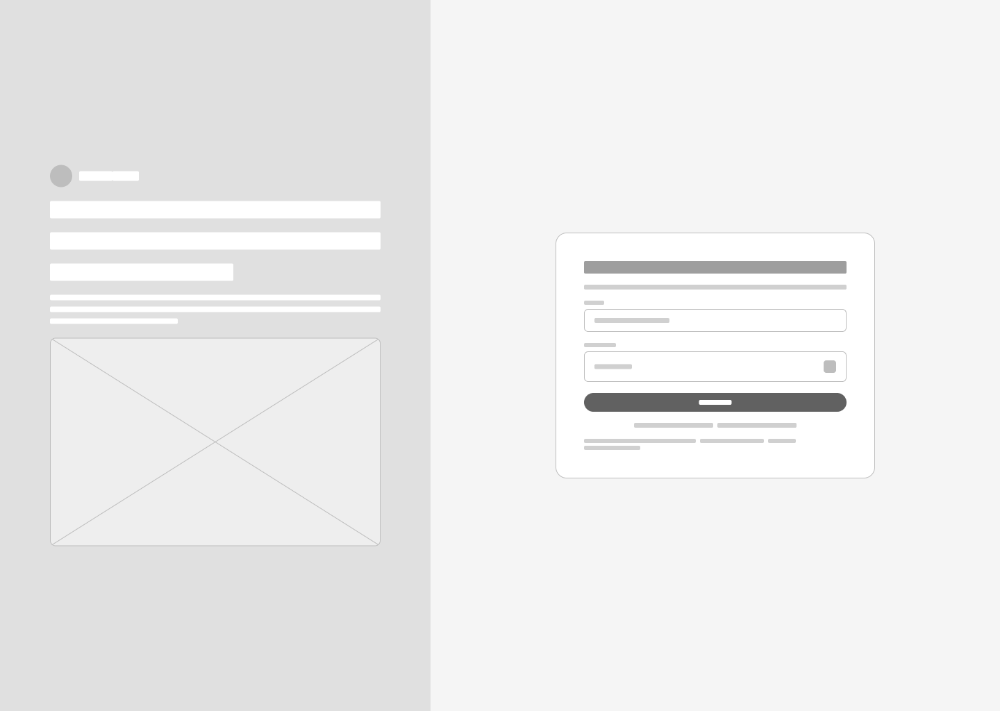</p>

##### Site Overview

Es la primera pantalla del administrador y muestra cómo está el local en ese momento. Arriba van cuatro indicadores (salas monitoreadas, salas en estado óptimo, alertas activas y salas ocupadas), en el centro el mapa de calor del piso con una tarjeta por sala, y a la derecha las salas que necesitan atención y el tiempo ocupado de la última hora (US40, US18 y US33).

<p align="center"><em>Figura 68.</em> Wireframe de Site Overview de la Web Application.</p>

<p align="center">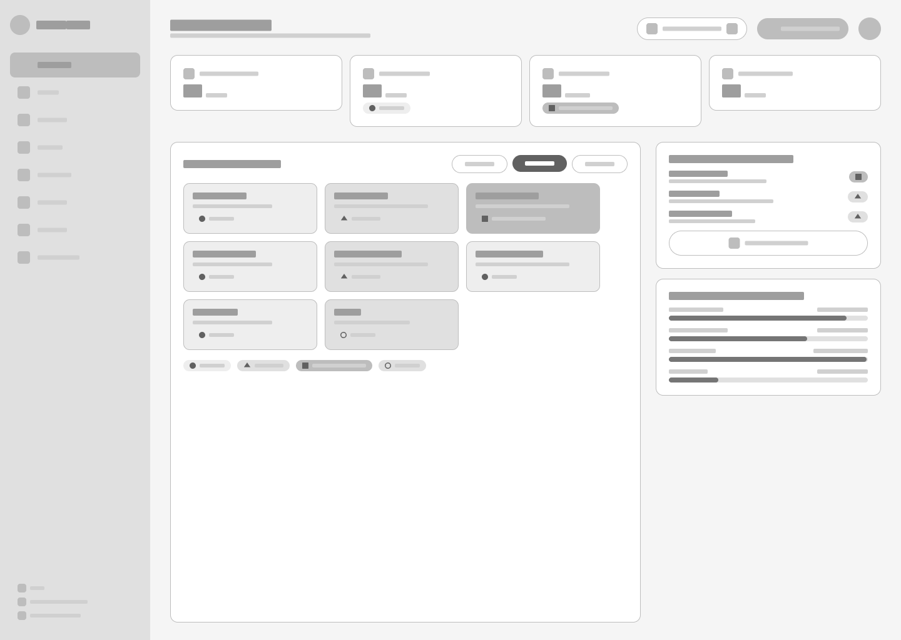</p>

##### Room Detail

Muestra una sala. Los indicadores de ruido, picos, temperatura, humedad, disconfort (PPD) y presencia van en una fila, debajo está la serie por minuto de la última hora con su umbral y a la derecha el control del indicador de la puerta y la conectividad del dispositivo (US19 y US35).

<p align="center"><em>Figura 69.</em> Wireframe de Room Detail de la Web Application.</p>

<p align="center">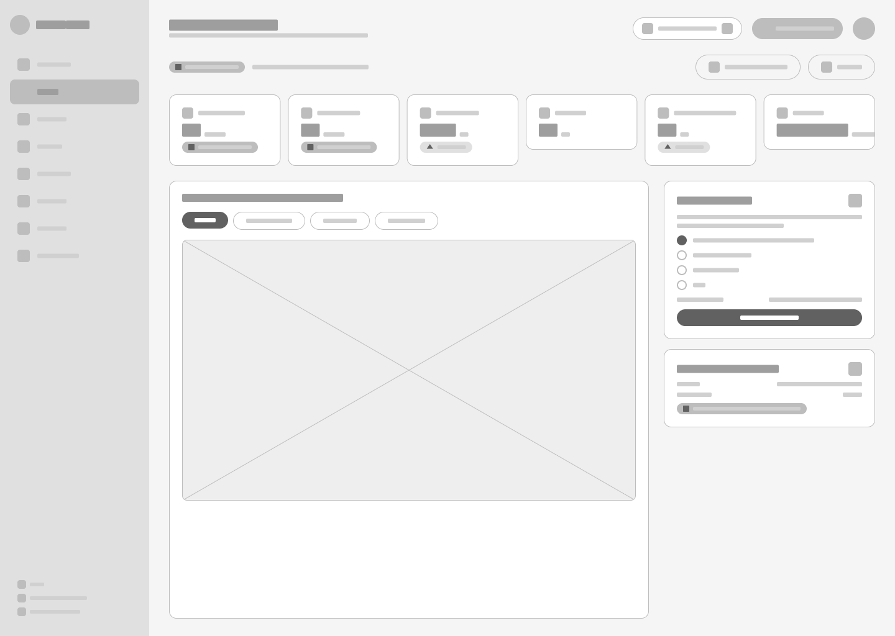</p>

##### Alerts

La lista de alertas se separa en tres pestañas: activas, reconocidas y cerradas. Al elegir una alerta se abre a la derecha su detalle con el campo para registrar la acción correctiva, y debajo quedan las últimas acciones del local (US20, US21, US22, US36 y US37).

<p align="center"><em>Figura 70.</em> Wireframe de Alerts de la Web Application.</p>

<p align="center">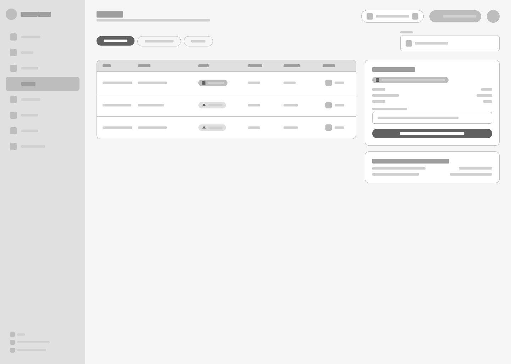</p>

##### Sites & Rooms

Aquí el administrador registra sus locales y salas y clasifica cada sala por tipo. Un aviso arriba de la tabla indica cuántas salas no tienen tipo, porque una sala sin tipo no tiene umbrales (US11 y US12).

<p align="center"><em>Figura 71.</em> Wireframe de Sites & Rooms de la Web Application.</p>

<p align="center">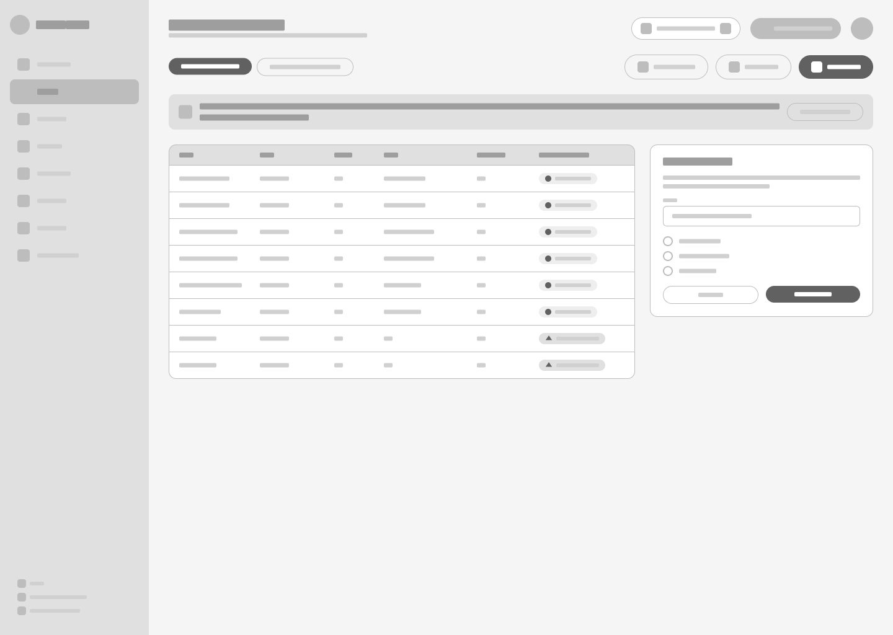</p>

##### Devices

Lista los dispositivos IoT con su sala, estado, última conexión y firmware, y tiene el formulario para registrar uno nuevo con el código impreso en el equipo. La acción Identify enciende el indicador del dispositivo para ubicarlo en la sala (US13, US34 y US23).

<p align="center"><em>Figura 72.</em> Wireframe de Devices de la Web Application.</p>

<p align="center">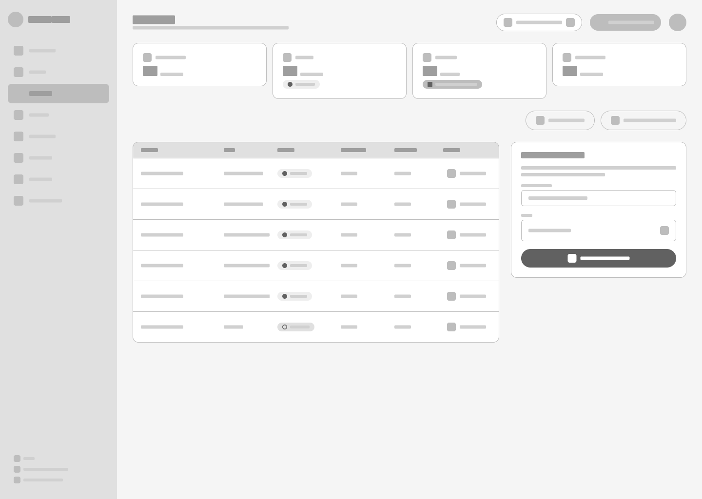</p>

##### Comfort Thresholds

Los umbrales se editan por tipo de sala en una tabla de una fila por métrica, con nivel de advertencia, nivel crítico y minutos sostenidos. A la derecha se explica en dos frases cómo se abre y se cierra una alerta (US14).

<p align="center"><em>Figura 73.</em> Wireframe de Comfort Thresholds de la Web Application.</p>

<p align="center">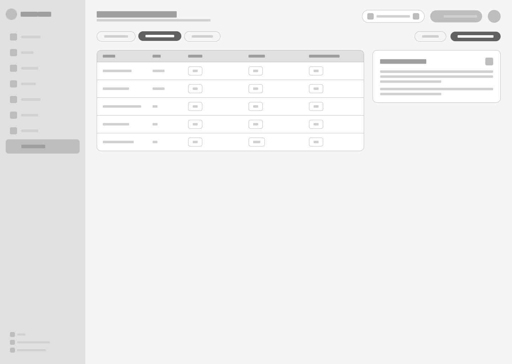</p>

##### Insights

Junta las tendencias de una sala en un periodo, la relación entre la temperatura interior y la exterior, la correlación entre ruido y ocupación y la comparación entre salas (US24, US25, US38 y US39).

<p align="center"><em>Figura 74.</em> Wireframe de Insights de la Web Application.</p>

<p align="center">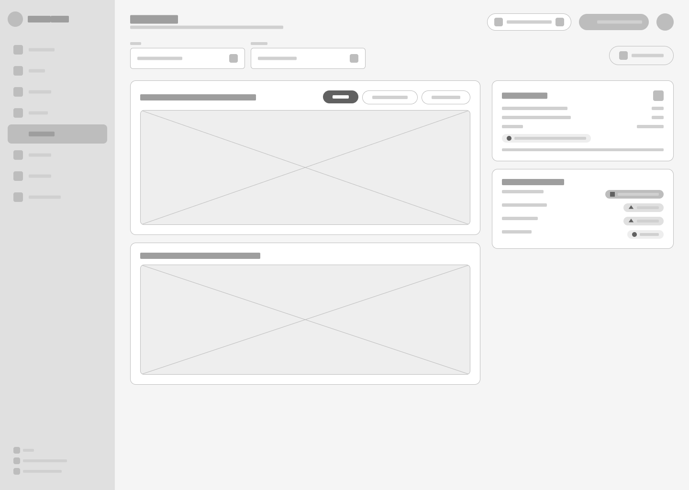</p>

##### Reports

Tiene dos pestañas: los reportes de disconfort que mandan los miembros, cada uno con la medición de la sala en ese momento, y el formulario para generar reportes históricos por sala y periodo (US26 y US28).

<p align="center"><em>Figura 75.</em> Wireframe de Reports de la Web Application.</p>

<p align="center">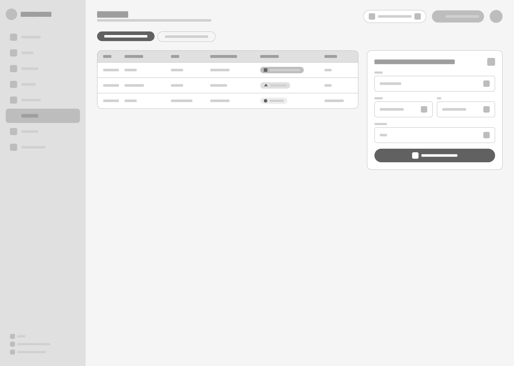</p>

##### Members

Lista a las personas del coworking con su rol y estado, y permite invitar, desactivar y reactivar cuentas (US10).

<p align="center"><em>Figura 76.</em> Wireframe de Members de la Web Application.</p>

<p align="center">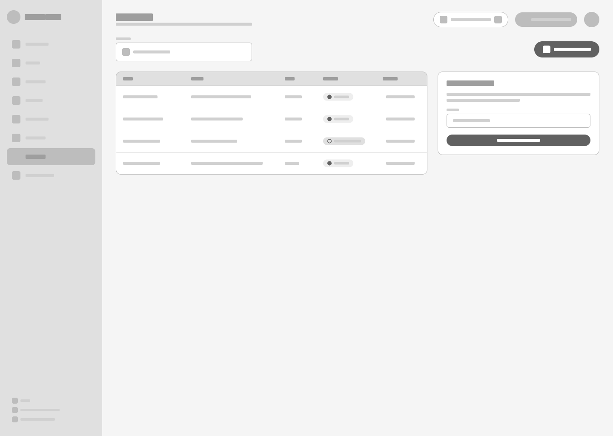</p>

##### Member · Rooms

Es la pantalla inicial del miembro. Tiene una búsqueda, filtros rápidos por silencio, temperatura, disponibilidad y piso, y una tarjeta por sala con ruido, temperatura y presencia (US15, US16, US29 y US32).

<p align="center"><em>Figura 77.</em> Wireframe de Rooms del miembro en la Web Application.</p>

<p align="center">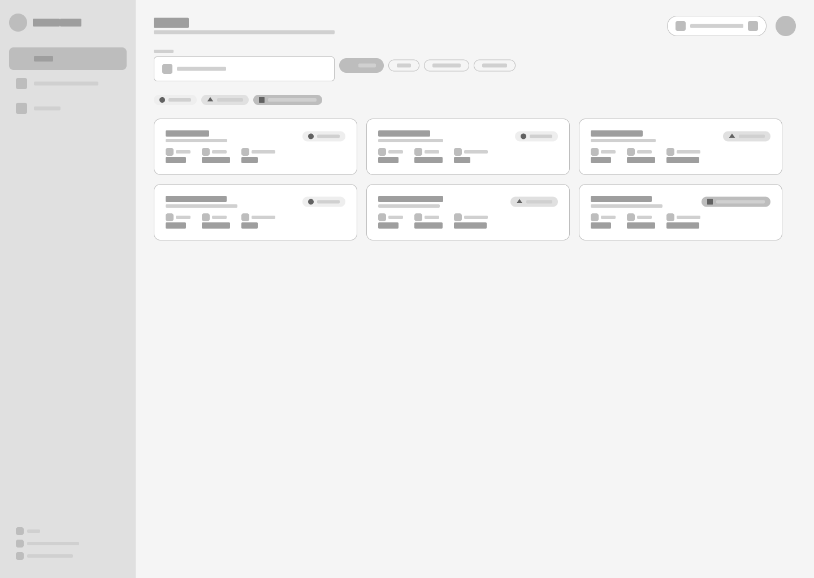</p>

##### Member · Room Detail

Muestra las condiciones actuales de la sala y el ruido habitual por hora, para que el miembro decida a qué hora ir. El botón para reportar una molestia queda arriba a la derecha (US30, US31 y US17).

<p align="center"><em>Figura 78.</em> Wireframe de Room Detail del miembro en la Web Application.</p>

<p align="center">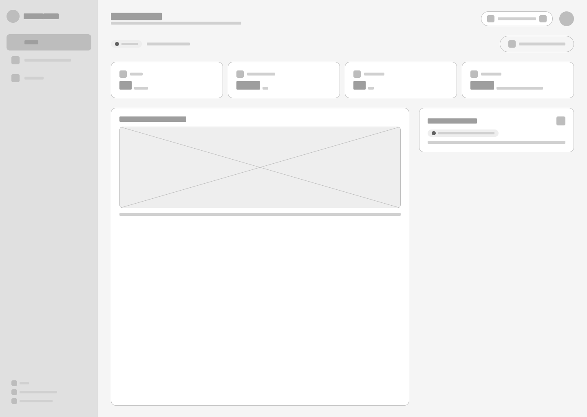</p>

##### Member · Report Discomfort

Es un formulario corto: la sala ya viene elegida, el miembro marca el problema y puede agregar un comentario. A la derecha ve sus reportes anteriores y su estado (US27).

<p align="center"><em>Figura 79.</em> Wireframe de Report Discomfort del miembro en la Web Application.</p>

<p align="center">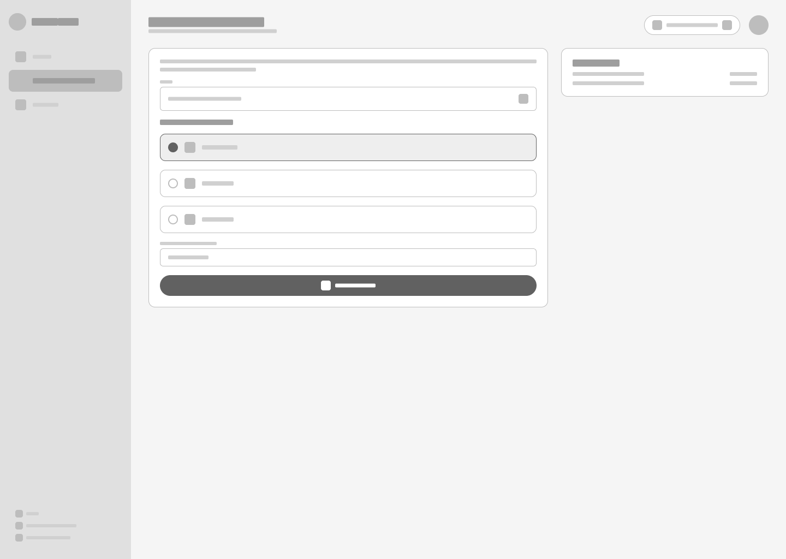</p>

#### Web Application · Mobile Web Browser

En 390 px la web conserva las mismas pantallas y el mismo orden de contenido. El menú lateral pasa a un drawer que se abre desde el ícono de menú, los indicadores se acomodan en dos columnas y las tablas se convierten en tarjetas que se leen de arriba hacia abajo.

<p align="center"><em>Figura 80.</em> Wireframes de la Web Application en el navegador del celular.</p>

<p align="center">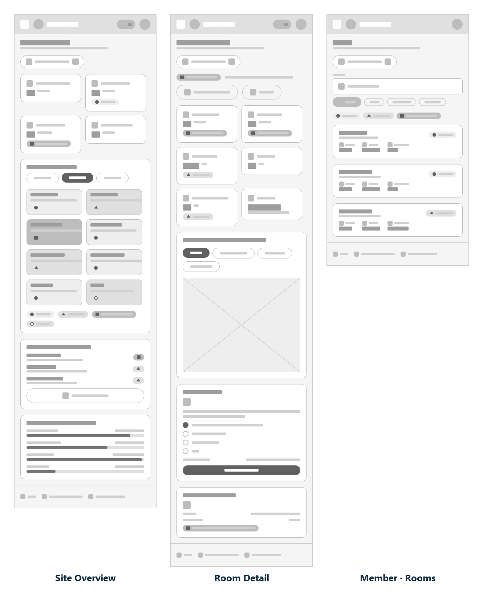</p>

#### Mobile Application

##### Recorrido del miembro

El miembro entra a Rooms, abre una sala, revisa sus condiciones y, si algo le molesta, lo reporta. La barra inferior con Rooms, Report y Profile está siempre visible, así que cualquier sección queda a un toque (US09, US15, US16, US17, US27, US30, US31 y US32).

<p align="center"><em>Figura 81.</em> Wireframes del recorrido del miembro en la Mobile Application.</p>

<p align="center">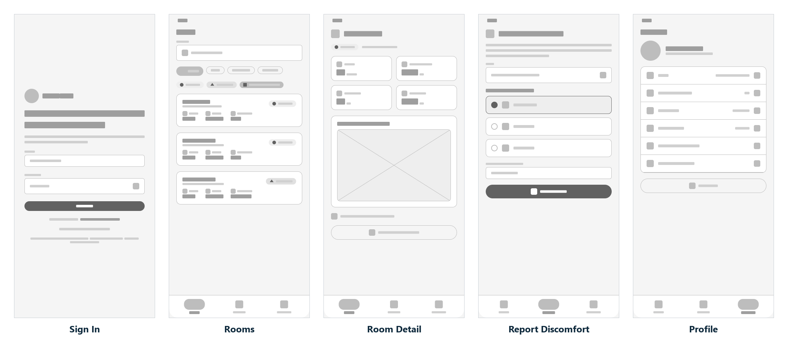</p>

##### Recorrido del administrador

El administrador tiene otra barra inferior: Overview, Alerts, Rooms y More. Las tres primeras cubren lo que se atiende en el momento, que es ver el local, atender una alerta y controlar una sala. En More están el resto de las secciones de la web, para que el administrador no dependa de la computadora (US40, US20, US21, US35 y US34).

<p align="center"><em>Figura 82.</em> Wireframes del recorrido del administrador en la Mobile Application.</p>

<p align="center">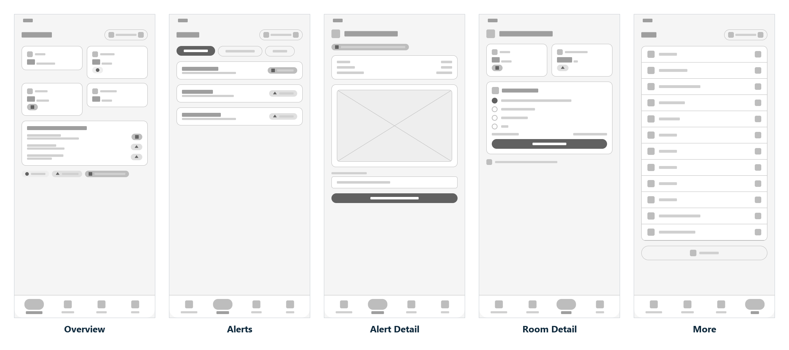</p>

### _5.4.2. Applications Wireflow Diagrams._

_**Web Application**_

**Admin onboarding:**

<p align="center">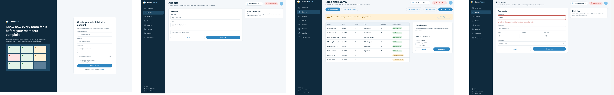</p>

<p align="center">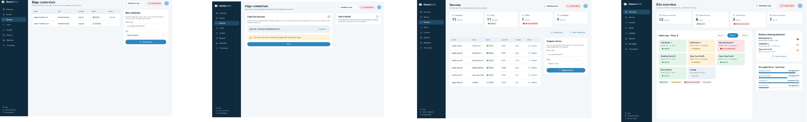</p>

**Administrador Gestiona una alerta de confort:**

<p align="center">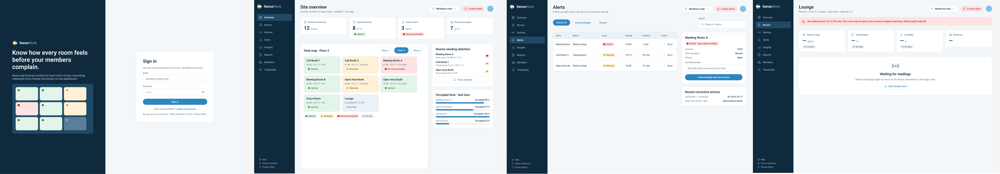</p>

<p align="center">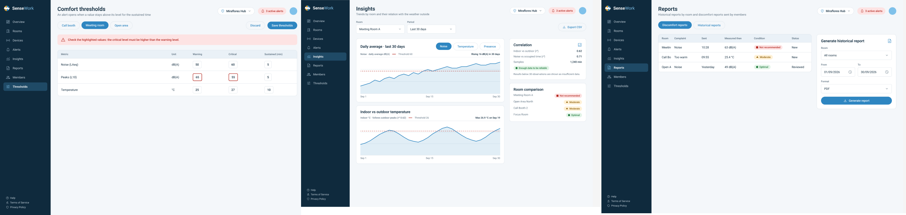</p>

**Miembros Informan sobre situaciones incomodas:**

<p align="center">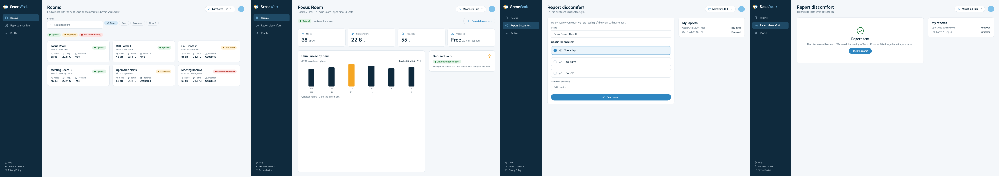</p>

_**Mobile Application**_

**Miembro informa molestias:**

<p align="center">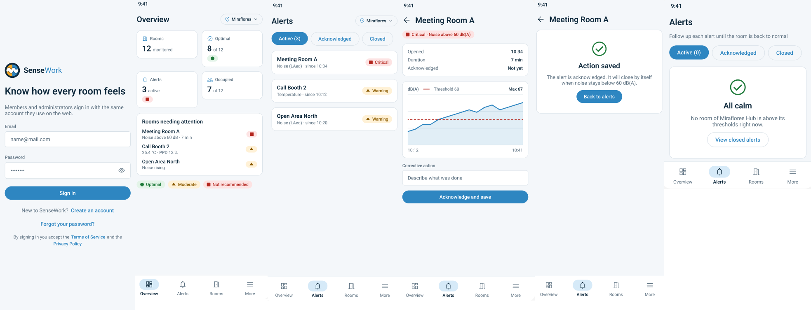</p>

**Administrador responde una alerta:**

<p align="center">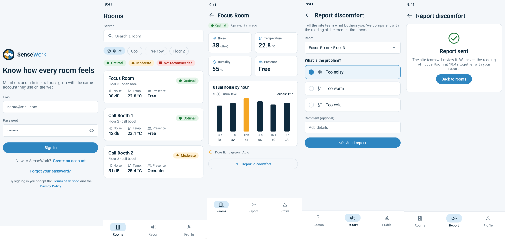</p>

**Configuración y gestión administrativa:**

<p align="center">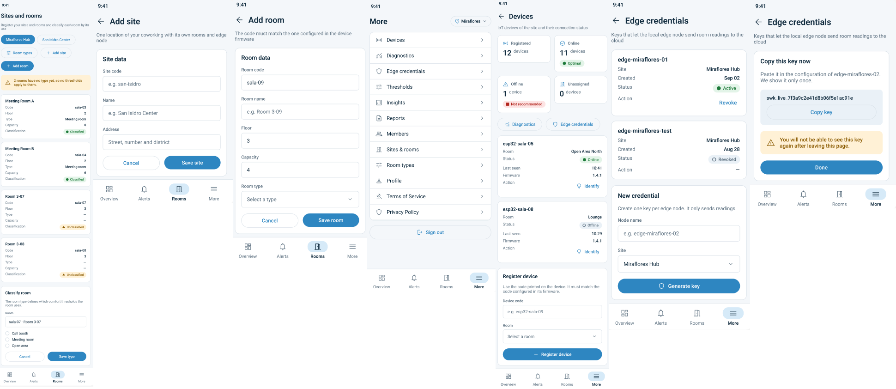</p>

**Administrador revisa los hallazgos y los umbrales:**

<p align="center">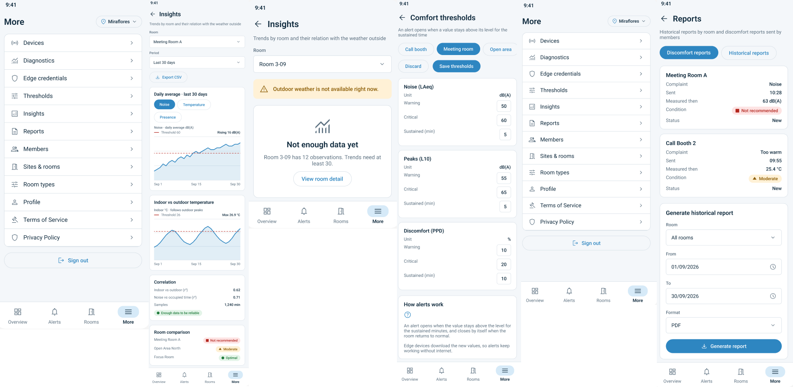</p>


### _5.4.3. Applications Mock-ups._

Los mock-ups llevan los wireframes a alta fidelidad sin cambiar su estructura: cada bloque está en el mismo lugar, así que lo que se revisó en los wireframes no cambia. Lo que se agrega es el Design System de SenseWork, que se armó sobre Material Design 3, y eso ayuda a que el diseño se pueda implementar casi igual. La arquitectura de información tampoco cambia: el menú, las etiquetas y el orden de los bloques son los de los wireframes, y el color se usa solo para reforzar lo que ya dice el texto.

Los colores salen del logotipo de la startup, el azul y el ámbar, con un azul marino para el texto y la navegación. Los tres colores de estado se eligieron oscuros para que el texto del chip se lea sobre su fondo claro.

| Token | Valor | Uso |
|:---|:---:|:---|
| Navy | #0F2A3D | Texto principal, menú lateral y títulos |
| Acoustic blue | #2E86C1 | Color primario: botones, enlaces, pestaña activa y series de los gráficos |
| Thermal amber | #F5A623 | Acento: valor máximo de un gráfico e indicador de la puerta |
| Gray | #5C7080 | Texto secundario y etiquetas |
| Surface / Background | #FFFFFF / #F4F7FA | Tarjetas y fondo de pantalla |
| Optimal | #1E7A3A | Estado óptimo, siempre con círculo y la palabra Optimal |
| Moderate | #8A5A00 | Estado moderado, siempre con triángulo y la palabra Moderate |
| Not recommended | #B3261E | Estado no recomendado, siempre con cuadrado y la palabra Not recommended |

La tipografía es Roboto, en Regular para el texto y Bold para títulos y valores, y los íconos son Material Symbols Outlined de 24 px. El isotipo de la startup va arriba del menú lateral en la web y en el inicio de sesión de las dos aplicaciones.

En todas las pantallas los gráficos se hicieron de la misma forma. Las series de tiempo son un área con línea y el umbral como línea punteada, así se ve de un vistazo cuándo la sala pasó el límite. Las comparaciones son barras con su valor escrito y la barra mayor en ámbar. Cada gráfico lleva además una línea de texto con el dato más importante, por ejemplo «Max 68 dB(A) at 10:25», para quien no puede leer el gráfico.

<p align="center"><a href="https://www.figma.com/design/xYSodRNszkA9kbobfyR6X2">Ver los mock-ups completos en Figma</a></p>

#### Web Application · Desktop Web Browser

##### Sign In

La propuesta de valor va sobre el azul marino y el formulario sobre blanco, con el botón Sign in como única acción rellena. Los Terms of Service y la Privacy Policy son enlaces en el texto de aceptación.

<p align="center"><em>Figura 83.</em> Mock-up de Sign In de la Web Application.</p>

<p align="center">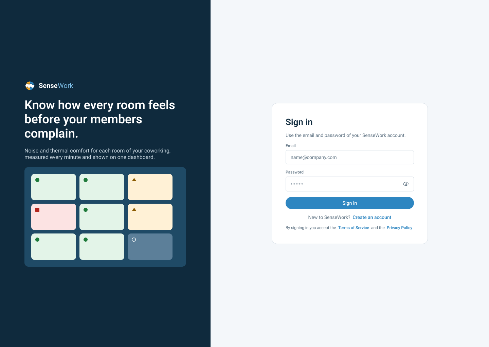</p>

##### Site Overview

El mapa de calor pinta cada tarjeta de sala con el fondo claro de su estado y repite el estado con forma y palabra. La sala sin lecturas recientes aparece en gris con «No data», en lugar de mostrar el último valor como si fuera actual. Debajo del mapa va la leyenda de los cuatro estados.

<p align="center"><em>Figura 84.</em> Mock-up de Site Overview de la Web Application.</p>

<p align="center">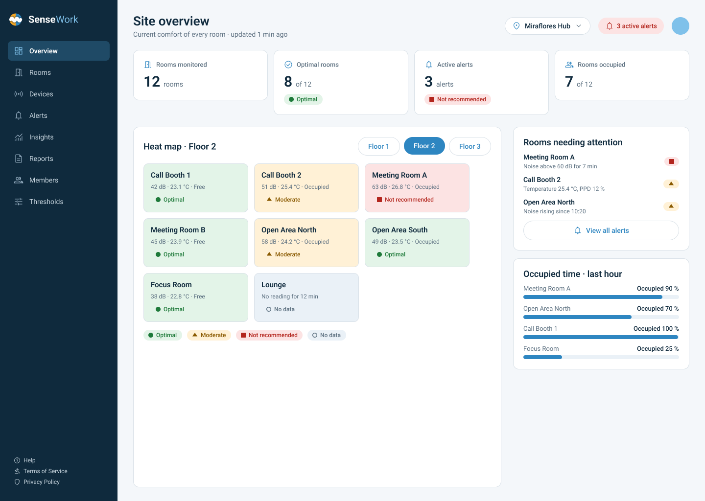</p>

##### Room Detail

Cada indicador tiene su chip de estado, y la serie de ruido muestra el umbral de 60 dB(A) punteado. En el panel Door indicator el administrador elige qué muestra la luz de la puerta (Auto, Do not disturb, Maintenance u Off) y ve si el último comando llegó al dispositivo.

<p align="center"><em>Figura 85.</em> Mock-up de Room Detail de la Web Application.</p>

<p align="center">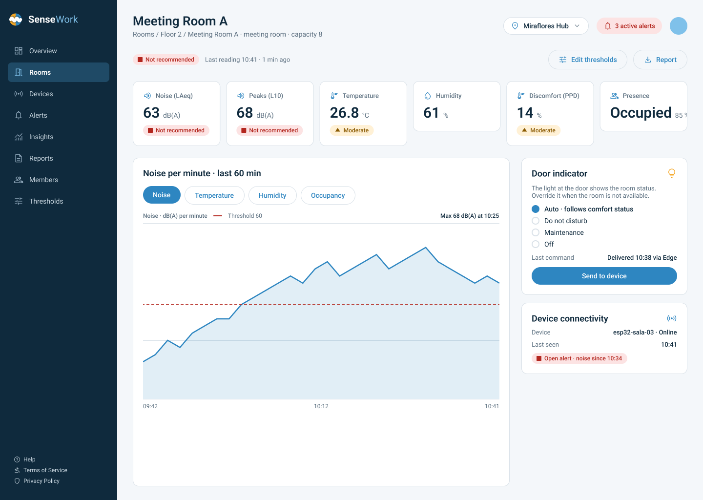</p>

##### Alerts

El nivel de cada alerta usa los mismos colores y formas de los estados: Critical en rojo con cuadrado y Warning en ámbar con triángulo. El detalle muestra cuándo se abrió, cuánto dura y si ya fue reconocida, y al lado queda el campo para escribir la acción correctiva.

<p align="center"><em>Figura 86.</em> Mock-up de Alerts de la Web Application.</p>

<p align="center">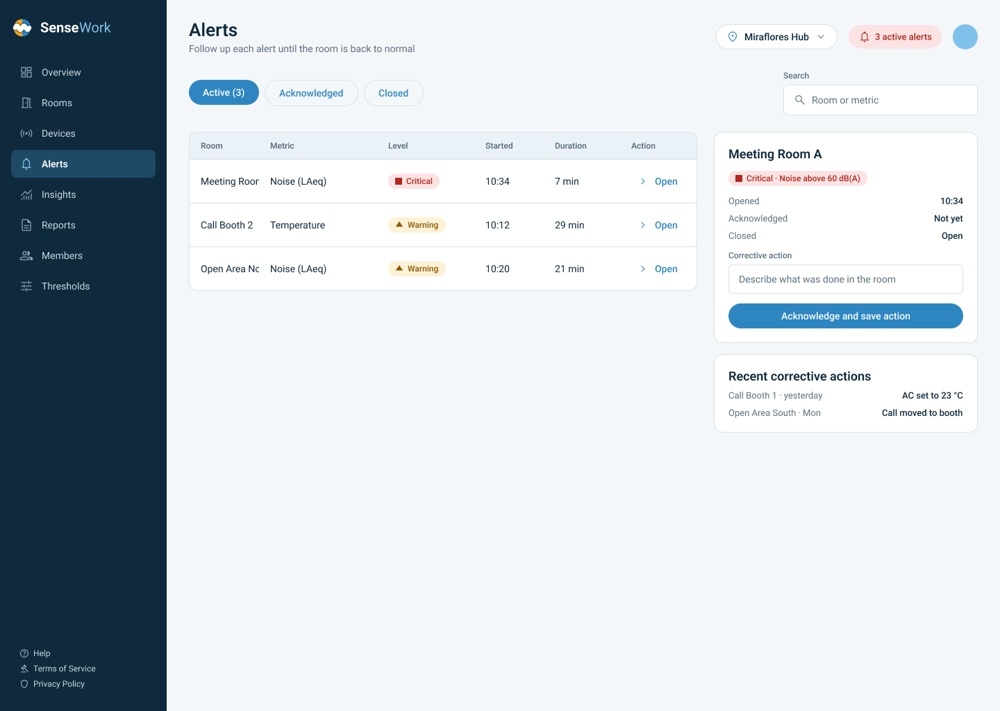</p>

##### Sites & Rooms

El aviso de salas sin tipo usa el color de advertencia y trae el botón Classify now, que abre el panel lateral para asignar el tipo sin salir de la tabla.

<p align="center"><em>Figura 87.</em> Mock-up de Sites & Rooms de la Web Application.</p>

<p align="center">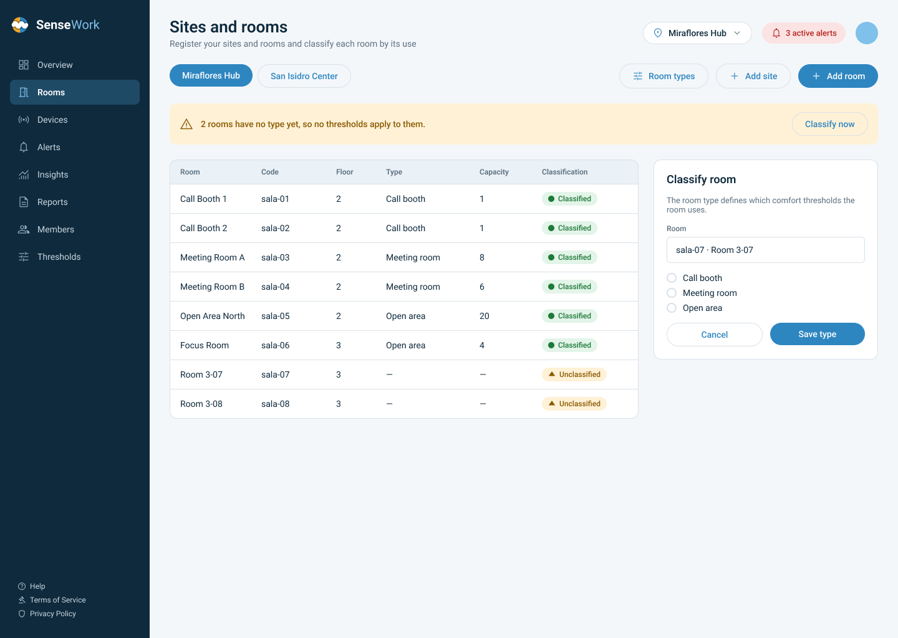</p>

##### Devices

Los indicadores de arriba cuentan dispositivos registrados, en línea, fuera de línea y sin asignar, y la tabla marca en rojo el que está fuera de línea con la hora de su última conexión.

<p align="center"><em>Figura 88.</em> Mock-up de Devices de la Web Application.</p>

<p align="center">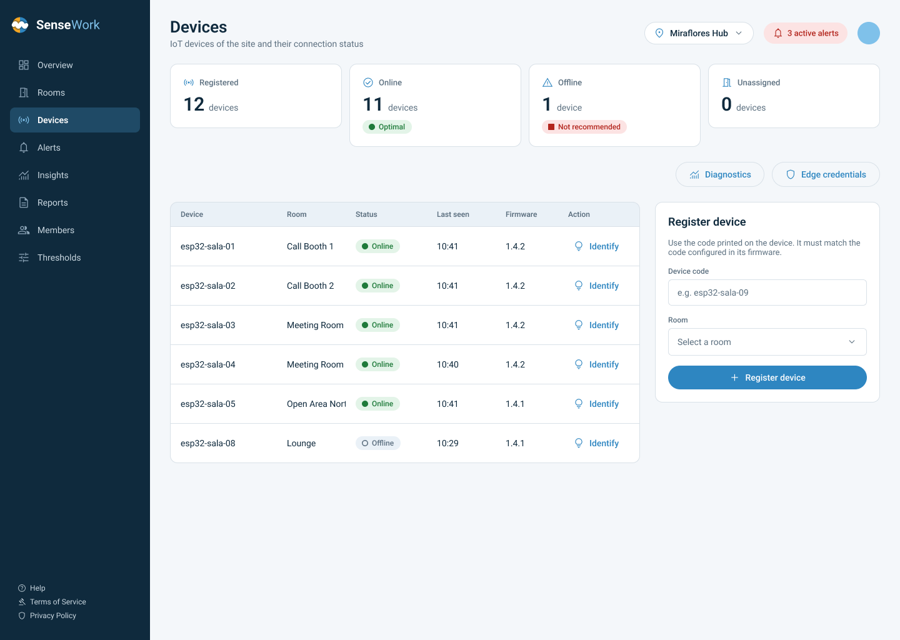</p>

##### Comfort Thresholds

Los tipos de sala son pestañas, cada métrica es una fila editable y los botones Discard y Save thresholds quedan arriba, a la vista mientras se edita.

<p align="center"><em>Figura 89.</em> Mock-up de Comfort Thresholds de la Web Application.</p>

<p align="center">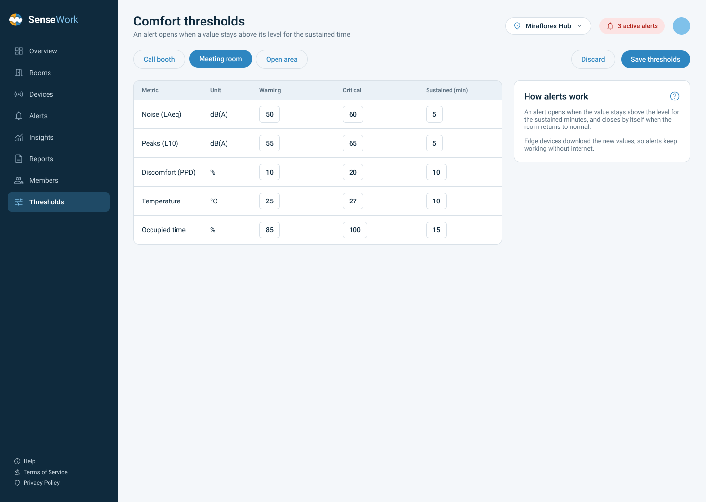</p>

##### Insights

La tendencia de ruido y la comparación de temperatura interior y exterior siguen la regla de los gráficos. El panel de correlación indica cuántas muestras hay detrás de cada número, porque con menos de 30 observaciones se muestra como datos insuficientes.

<p align="center"><em>Figura 90.</em> Mock-up de Insights de la Web Application.</p>

<p align="center">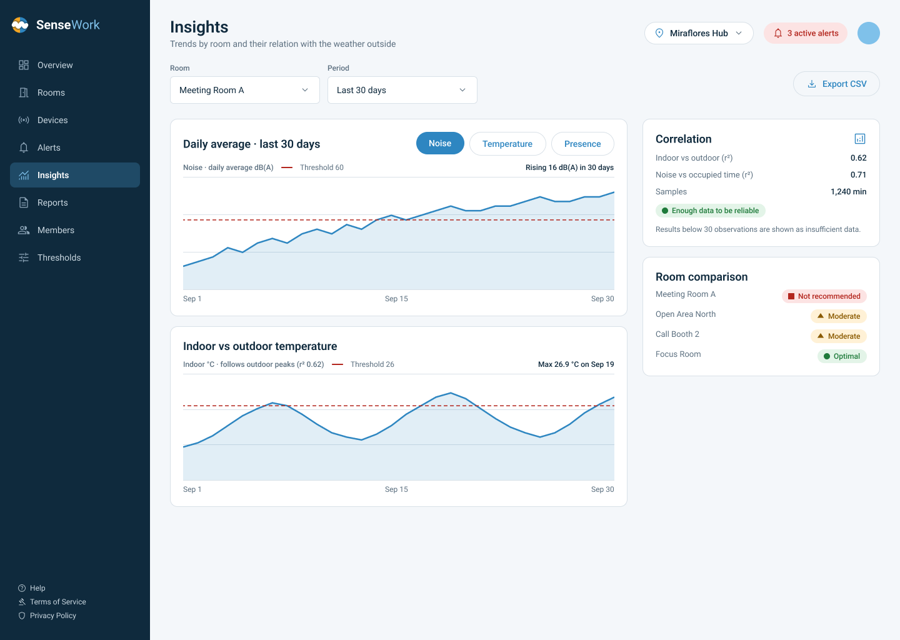</p>

##### Reports

Cada reporte de disconfort pone lado a lado la queja del miembro y lo que midió el sensor en ese momento, con su estado. Con eso el administrador ve si la queja coincide con lo que midió el sensor.

<p align="center"><em>Figura 91.</em> Mock-up de Reports de la Web Application.</p>

<p align="center">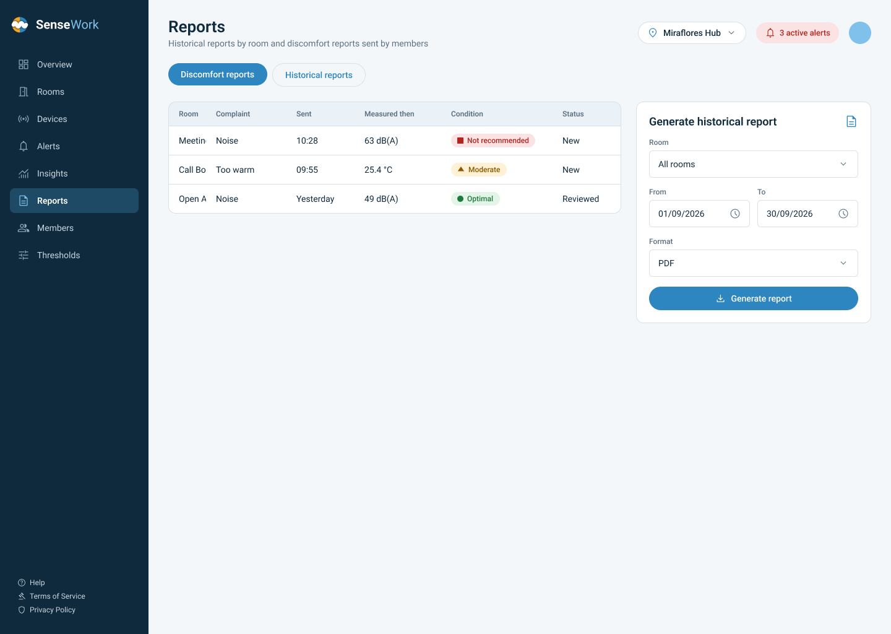</p>

##### Members

El estado de cada cuenta es un chip con texto, y la acción de la fila cambia según el estado: Deactivate para una cuenta activa y Reactivate para una desactivada.

<p align="center"><em>Figura 92.</em> Mock-up de Members de la Web Application.</p>

<p align="center">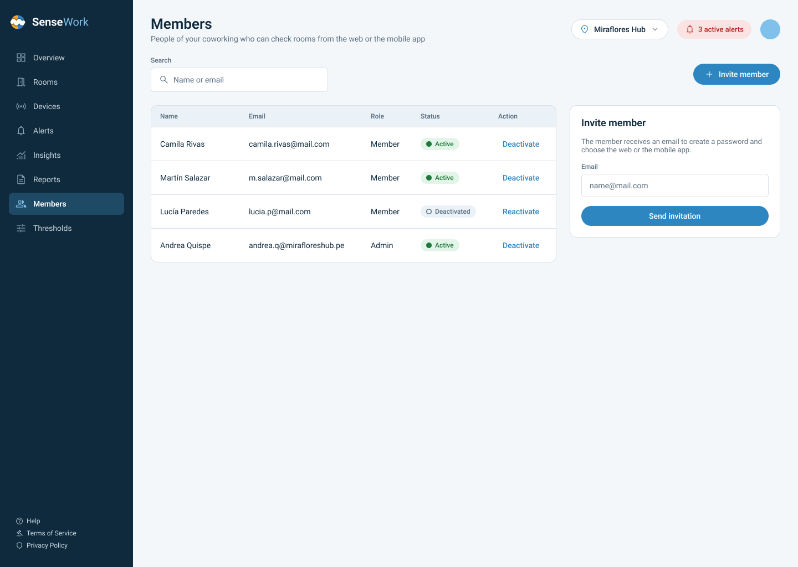</p>

##### Member · Rooms

El filtro activo se resalta en azul y las tarjetas de sala usan los mismos chips de estado que ve el administrador, para que los dos vean el mismo estado de la sala.

<p align="center"><em>Figura 93.</em> Mock-up de Rooms del miembro en la Web Application.</p>

<p align="center">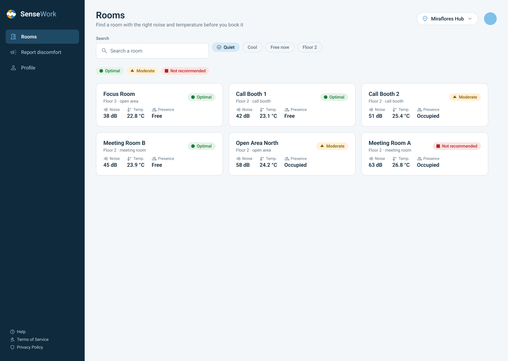</p>

##### Member · Room Detail

El ruido habitual por hora es un gráfico de barras con la hora más ruidosa en ámbar y una frase que lo resume, por ejemplo que la sala es más tranquila antes de las 10 y después de las 5. También se muestra qué color tiene la luz de la puerta.

<p align="center"><em>Figura 94.</em> Mock-up de Room Detail del miembro en la Web Application.</p>

<p align="center">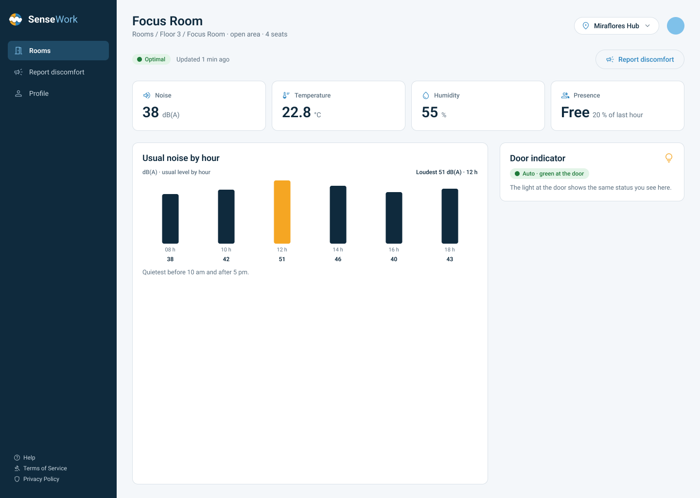</p>

##### Member · Report Discomfort

Los tipos de molestia son chips de selección única y el texto de arriba avisa que el reporte se compara con la lectura de la sala.

<p align="center"><em>Figura 95.</em> Mock-up de Report Discomfort del miembro en la Web Application.</p>

<p align="center">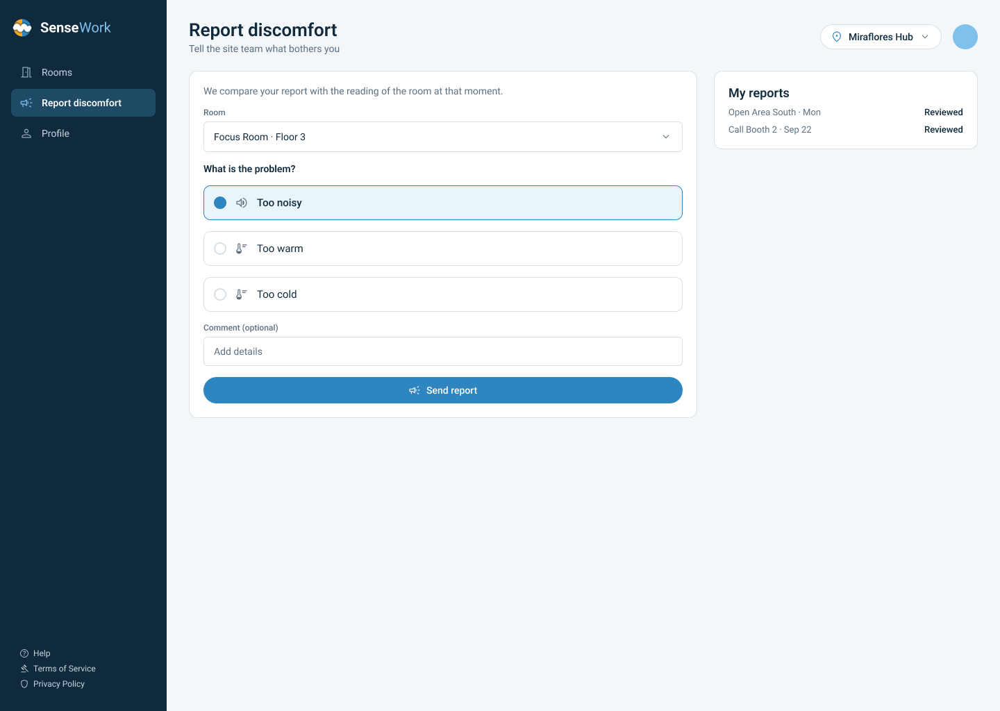</p>

##### Estados alternativos

En los estados de error se indica qué pasó y qué puede hacer el usuario: el inicio de sesión fallido marca el campo, la búsqueda sin resultados ofrece limpiar los filtros, la sala sin lecturas recientes dice desde cuándo no llega información y los umbrales inválidos señalan la fila que hay que corregir.

<p align="center"><em>Figura 96.</em> Mock-ups de los estados alternativos de la Web Application.</p>

<p align="center">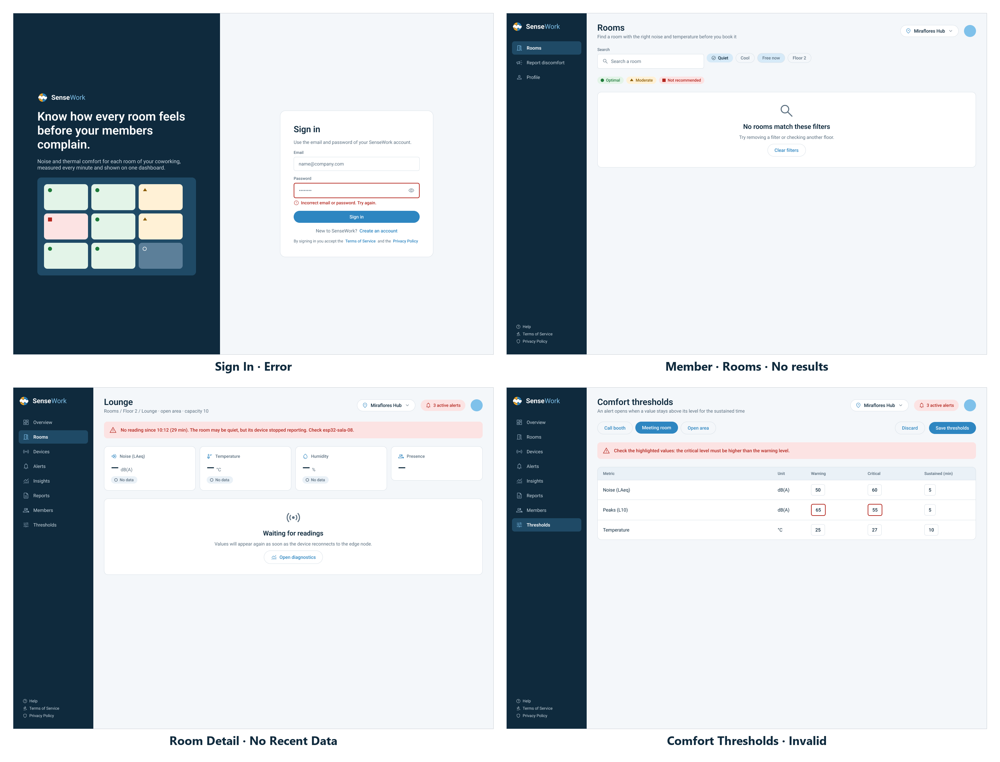</p>

#### Web Application · Mobile Web Browser

En el navegador del celular el drawer usa el mismo azul marino del menú lateral. Las tarjetas de sala del miembro mantienen el chip completo; en el mapa de calor, por espacio, cada tarjeta deja solo la forma y la leyenda de abajo da la palabra.

<p align="center"><em>Figura 97.</em> Mock-ups de la Web Application en el navegador del celular.</p>

<p align="center">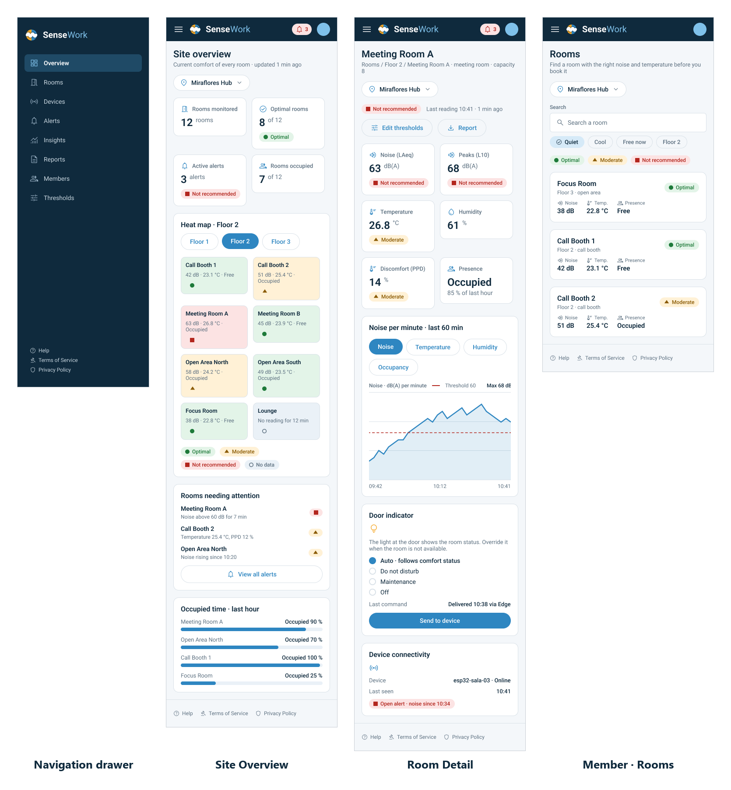</p>

#### Mobile Application

##### Recorrido del miembro

La pestaña activa de la barra inferior se marca con un fondo azul claro detrás del ícono. Después de enviar un reporte, la app confirma el envío y ofrece volver a las salas.

<p align="center"><em>Figura 98.</em> Mock-ups del recorrido del miembro en la Mobile Application.</p>

<p align="center">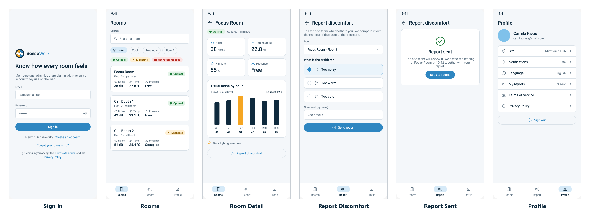</p>

##### Recorrido del administrador

En el celular el detalle de una alerta muestra la serie contra el umbral y el campo de acción correctiva en una sola columna. Al guardar, la app explica que la alerta se cierra sola cuando el valor vuelve a estar bajo el umbral.

<p align="center"><em>Figura 99.</em> Mock-ups del recorrido del administrador en la Mobile Application.</p>

<p align="center">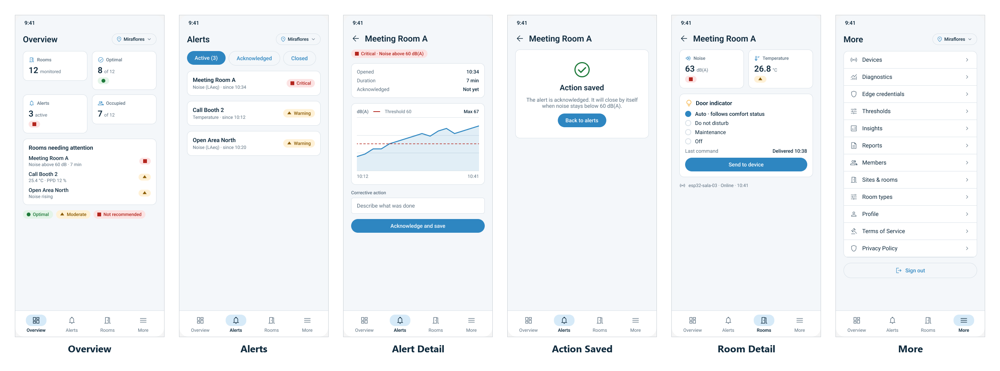</p>

### _5.4.4. Applications User Flow Diagrams._
En esta sección se presentan los **Applications User Flow Diagrams** correspondientes a la aplicación web de SenseWork. Estos diagramas describen la secuencia de interacción que siguen los usuarios para alcanzar objetivos específicos dentro del sistema, considerando los User Personas definidos y manteniendo consistencia con los **Applications Wireflow Diagrams** desarrollados previamente.

Cada User Flow Diagram representa las pantallas involucradas en el proceso, junto con los caminos esperados (**happy path**) y las rutas alternativas (**unhappy paths**) derivadas de validaciones, errores o condiciones particulares del sistema. Asimismo, cada flujo se acompaña de un **User Goal** y de una explicación detallada del recorrido realizado por el usuario.

Los diagramas presentados a continuación han sido construidos a partir de los mock-ups diseñados para la aplicación web, con el propósito de reflejar visualmente la navegación y la lógica de interacción definida para cada caso de uso.

---

#### 5.4.4.1. User Flow 1: Admin Onboarding

**User Persona:** Administrador

**User Goal:**  
El administrador desea completar la configuración inicial de SenseWork mediante la creación de su cuenta, el registro de un sitio y sus ambientes, y la generación de las credenciales necesarias para enlazar el sistema con los dispositivos del entorno.

**Explicación del flujo:**  

El flujo de onboarding del administrador comienza en la pantalla **Web · Sign Up**, donde el usuario crea su cuenta por primera vez en la plataforma. En esta vista, el administrador registra la información requerida para acceder a SenseWork y dar inicio al proceso de configuración.

Una vez completado el registro, el usuario es dirigido a **Web · Add Site**, pantalla en la que registra el sitio o sede que será monitoreado a través del sistema. Después de ello, el flujo continúa hacia **Web · Sites & Rooms**, donde el administrador puede visualizar la estructura general del sitio y gestionar sus ambientes.

A continuación, el administrador accede a **Web · Add Room**, donde registra una nueva habitación o espacio dentro del sitio. En esta etapa existe una validación importante: si el nombre o los datos ingresados corresponden a un ambiente ya registrado, el sistema muestra la pantalla **Web · Add Room · Duplicate**, indicando que no es posible continuar hasta corregir el conflicto detectado.

Cuando el ambiente es registrado correctamente, el flujo continúa hacia **Web · Edge Credentials**, pantalla donde el administrador genera las credenciales necesarias para vincular el componente Edge con la plataforma. Tras completar este proceso, el sistema muestra **Web · Edge Credential Created**, confirmando que las credenciales han sido generadas con éxito.

Posteriormente, el administrador puede dirigirse a **Web · Devices**, donde visualiza los dispositivos asociados al sitio, y finalmente llega a **Web · Site Overview**, pantalla que presenta un resumen general de la sede registrada y de sus principales indicadores.

En esta ruta alternativa, el sistema detecta que el ambiente ingresado ya existe, por lo que muestra el estado de error correspondiente y solicita al usuario corregir la información antes de continuar.

**Happy Path:** 

<p align="center">
  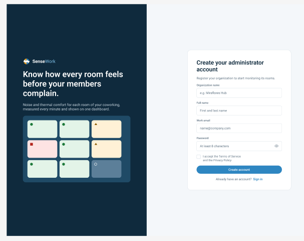
</p>
<p align="center">
  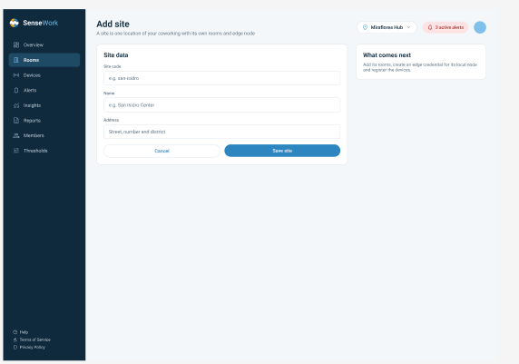
</p>
<p align="center">
  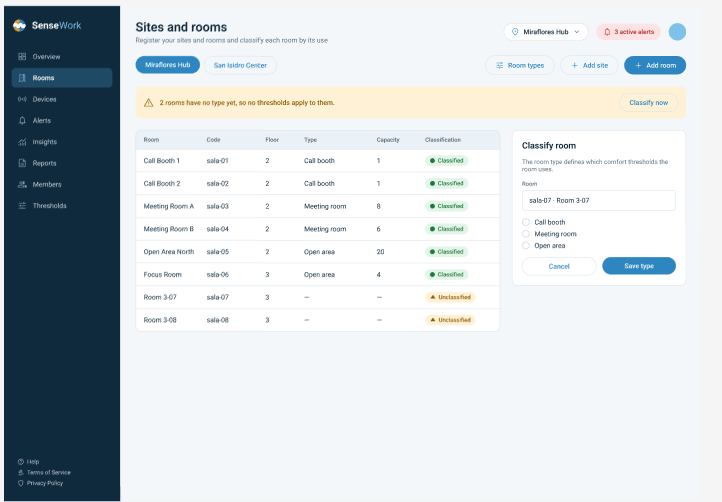
</p>
<p align="center">
  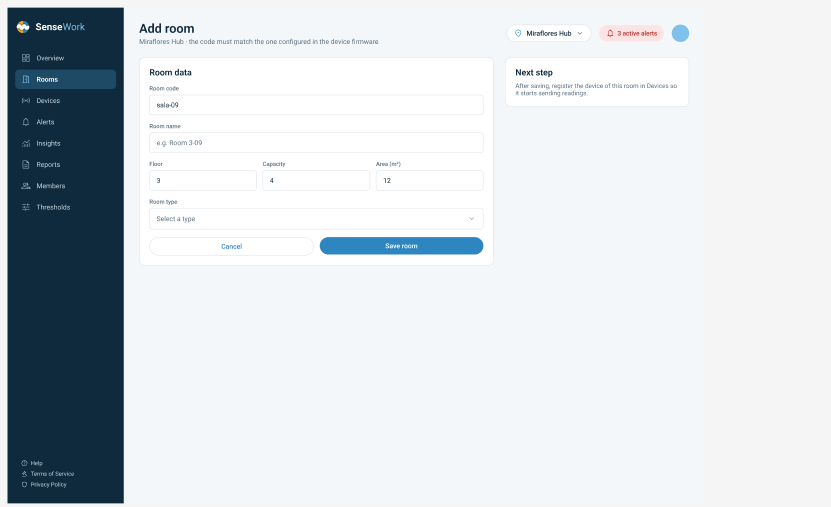
</p>
<p align="center">
  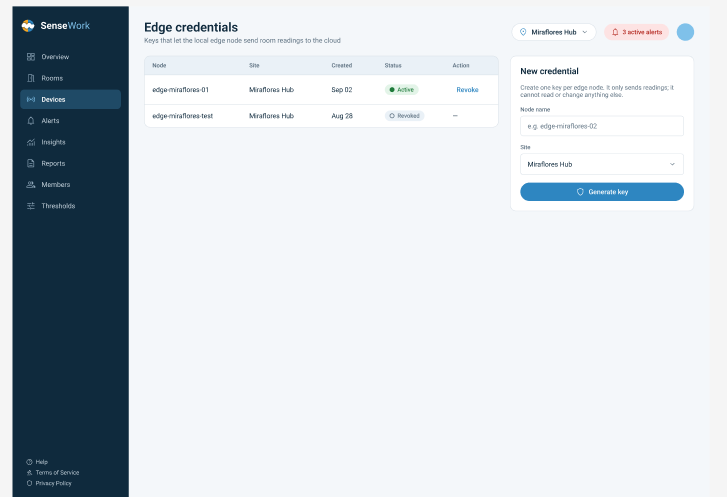
</p>
<p align="center">
  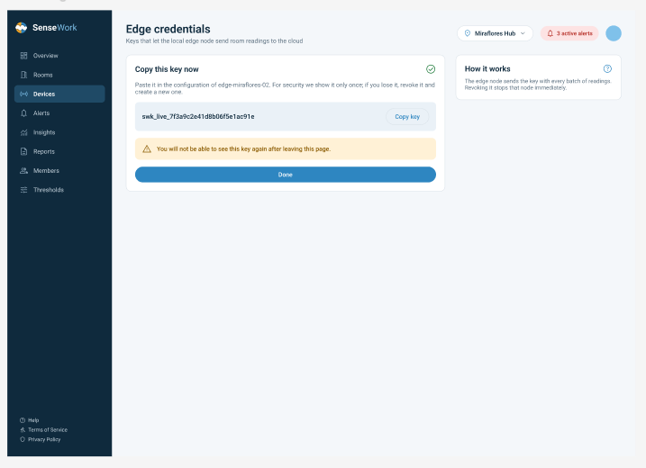
</p>
<p align="center">
  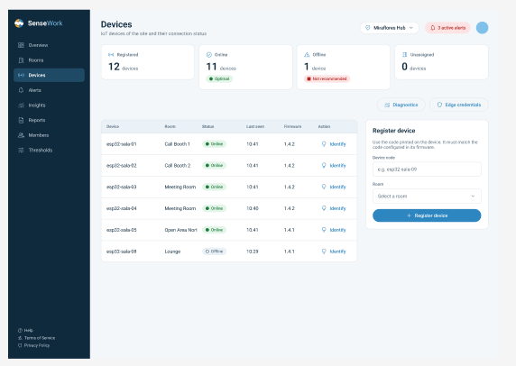
</p>
<p align="center">
  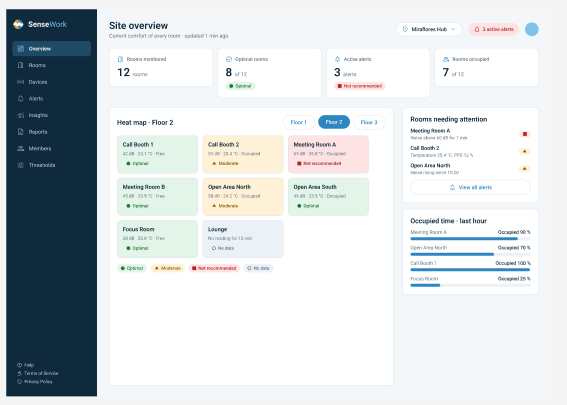
</p>

**Unhappy Path:**

<p align="center">
  
</p>
<p align="center">
  
</p>
<p align="center">
  
</p>

---

#### 5.4.4.2. User Flow 2: Admin Handles a Comfort Alert

**User Persona:** Administrador

**User Goal:**  
El administrador desea atender una alerta relacionada con el confort ambiental de una habitación para identificar el problema, revisar la información disponible, ajustar los umbrales definidos y consultar reportes que faciliten la toma de decisiones.

**Explicación del flujo:**  

Este flujo comienza en **Web · Sign In**, donde el administrador ingresa sus credenciales para acceder al sistema. Luego de autenticarse correctamente, el usuario visualiza **Web · Site Overview**, desde donde puede obtener una vista general del sitio y detectar eventos relevantes.

Desde allí, el administrador accede a **Web · Alerts**, pantalla en la que se listan las alertas generadas por el sistema. Al seleccionar una alerta específica, el flujo conduce a **Web · Room Detail**, donde se muestra la información detallada de la habitación afectada, incluyendo indicadores que permiten comprender la situación detectada.

Si el administrador requiere ajustar los parámetros asociados al confort de dicha habitación, continúa hacia **Web · Comfort Thresholds**, donde puede modificar los umbrales utilizados por el sistema para evaluar las condiciones ambientales. En este punto, existe una condición de validación: si los valores ingresados no son correctos o no cumplen con la lógica esperada por el sistema, se muestra la pantalla **Web · Comfort Thresholds · Invalid**.

Cuando los valores son válidos, el flujo prosigue hacia **Web · Insights**, donde el administrador puede consultar información analítica y tendencias relacionadas con el comportamiento del ambiente. Finalmente, el proceso concluye en **Web · Reports**, donde se presentan reportes consolidados que apoyan el análisis de la situación y la toma de decisiones.

En este caso, el administrador introduce valores inválidos al momento de configurar los umbrales de confort, por lo que el sistema muestra un mensaje de error y exige corregir la información antes de continuar.

**Happy Path:** 

<p align="center">
  
</p>
<p align="center">
  
</p>
<p align="center">
  
</p>
<p align="center">
  
</p>
<p align="center">
  
</p>
<p align="center">
  
</p>
<p align="center">
  
</p>

**Unhappy Path:**  

<p align="center">
  
</p>
<p align="center">
  
</p>
<p align="center">
  
</p>

---

#### 5.4.4.3. User Flow 3: Member Invitation to Discomfort Report

**User Persona:** Miembro

**User Goal:**  
El miembro desea aceptar su invitación a SenseWork y reportar una situación de incomodidad dentro de un ambiente, con el fin de comunicar su percepción sobre las condiciones del espacio monitoreado.

**Explicación del flujo:**  

El flujo comienza en la pantalla **Web · Accept Invitation**, donde el miembro acepta la invitación enviada por el sistema para formar parte de la plataforma. Esta etapa constituye el punto de ingreso inicial del usuario miembro.

Una vez que la invitación ha sido aceptada, el usuario accede a **Web · Member · Rooms**, donde se muestran los ambientes a los que tiene acceso. A partir de esta vista, el miembro selecciona un espacio determinado para consultar su información y continúa hacia **Web · Member · Room Detail**.

Desde esta pantalla, el usuario puede registrar una percepción de incomodidad accediendo a **Web · Member · Report Discomfort**. En esta vista, el sistema permite especificar el tipo de incomodidad o condición percibida dentro del ambiente.

Cuando el miembro completa y envía la información, el sistema muestra la pantalla **Web · Member · Report Sent**, confirmando que el reporte fue enviado correctamente. Posteriormente, el usuario puede acceder a **Web · Member · Profile**, donde visualiza su información personal y su historial básico dentro del sistema.

A diferencia de otros flujos, el wireflow base de este proceso no presenta explícitamente una pantalla de error. Por este motivo, el User Flow se mantiene alineado con las pantallas definidas originalmente, sin introducir estados adicionales que no hayan sido contemplados en el diseño.

**Happy Path:**  

<p align="center">
  
</p>
<p align="center">
  
</p>
<p align="center">
  
</p>
<p align="center">
  
</p>
<p align="center">
  
</p>
<p align="center">
  
</p>

---

#### 5.4.4.4. User Flow 4: Admin Manages Members

**User Persona:** Administrador

**User Goal:**  
El administrador desea gestionar los miembros registrados en SenseWork y desactivar a aquellos usuarios que ya no deban contar con acceso al sistema.

**Explicación del flujo:**  

El proceso de gestión de miembros inicia en **Web · Sign In**, donde el administrador intenta autenticarse para acceder a la plataforma. En esta etapa se contempla una ruta alternativa: si las credenciales ingresadas son incorrectas, el sistema muestra **Web · Sign In · Error**, notificando que el inicio de sesión no pudo completarse. En este caso, el administrador debe corregir la información y volver a intentar el acceso.

Cuando la autenticación se realiza correctamente, el usuario accede a **Web · Members**, sección donde puede visualizar a los miembros registrados y administrar su participación dentro del sistema.

Si el administrador necesita restringir el acceso de un usuario, selecciona la opción correspondiente y el flujo continúa hacia **Web · Members · Deactivate**, donde se ejecuta o confirma la desactivación del miembro seleccionado.

Asimismo, el wireflow contempla la posibilidad de que la sesión activa expire mientras el administrador usa la plataforma. En tal caso, el sistema presenta **Web · Session Expired**, indicando que la sesión ha finalizado y que es necesario autenticarse nuevamente para continuar.

La primera ruta alternativa ocurre cuando el administrador intenta iniciar sesión con credenciales inválidas. La segunda se produce cuando la sesión del usuario expira durante el uso del sistema, obligándolo a autenticarse nuevamente.

**Happy Path:** 

<p align="center">
  
</p>
<p align="center">
  
</p>
<p align="center">
  
</p>

**Unhappy Paths:** 

<p align="center">
  
</p>
<p align="center">
  
</p>
<p align="center">
  
</p>

---

<p align="center">
  
</p>
<p align="center">
  
</p>
<p align="center">
  
</p>

---

## 5.5. Applications Prototyping.

Los prototipos conectan los mock-ups de la sección 5.4.3, por eso las pantallas del prototipo son las mismas. Hay un prototipo para el navegador de escritorio (1440 px) y otro para el navegador del celular (390 px) de la Web Application, y uno para la Mobile Application. Cada uno tiene sus flujos con un punto de inicio, y los caminos siguen los User Flows de la sección 5.4.4 e incluyen los caminos con error.

Las decisiones de interacción salen del sistema de navegación de la sección 5.2.5, con el menú lateral para el administrador y la barra de tres secciones para el miembro:

1. Todo lo que se ve en el menú lateral, en el drawer o en la barra inferior es un enlace que funciona desde cualquier pantalla, así se puede volver a cualquier sección sin retroceder pantalla por pantalla.
2. Las tarjetas de sala, las filas de las tablas y las alertas son clicables y llevan a su detalle. En el celular el detalle tiene la flecha para volver a la lista desde donde se entró.
3. Cada formulario tiene una sola acción principal, y al enviarlo se llega a una confirmación que dice qué pasó y a dónde volver, por ejemplo Report Sent o Action Saved.
4. Los caminos que fallan también se navegan: contraseña incorrecta, filtros sin resultados, sala sin lecturas, umbrales inválidos, alertas en calma y sesión expirada. En cada uno se revisó que haya un botón o enlace para continuar.

El prototipo de escritorio y el del celular tienen cada uno un flujo del administrador y otro del miembro. La Mobile Application suma tres flujos más: la invitación de un miembro, la sesión expirada y el administrador sin alertas activas.

En los videos se recorren los user flows del core business, que son el monitoreo de las salas, la atención de alertas y el reporte de disconfort.

#### Web Application

El video empieza con el administrador: entra, revisa el mapa de calor, abre la sala en estado crítico, reconoce la alerta y pasa por Thresholds, Insights, Reports y Members. Después sigue el miembro, que busca una sala, revisa su detalle y reporta una molestia. Al final se muestra la versión para el navegador del celular.

<p align="center"><em>Figura 100.</em> Captura del video de navegación del prototipo de la Web Application.</p>

<p align="center"><a href="https://upcedupe-my.sharepoint.com/:v:/g/personal/u202322187_upc_edu_pe/IQApKdl_nCa5Sry5fl6EBTaIAUxUhTQcy5_xNagXYjsmesg?nav=eyJyZWZlcnJhbEluZm8iOnsicmVmZXJyYWxBcHAiOiJPbmVEcml2ZUZvckJ1c2luZXNzIiwicmVmZXJyYWxBcHBQbGF0Zm9ybSI6IldlYiIsInJlZmVycmFsTW9kZSI6InZpZXciLCJyZWZlcnJhbFZpZXciOiJNeUZpbGVzTGlua0NvcHkifX0&e=6A7k6J"></a></p>

<p align="center"><a href="https://www.figma.com/proto/xYSodRNszkA9kbobfyR6X2?node-id=55-725&starting-point-node-id=55%3A725">Abrir el prototipo de la Web Application en Figma</a></p>

El video cierra con la versión para el navegador del celular, donde el menú lateral pasa a un drawer. Ese flujo completo se recorre en el prototipo de 390 px.

<p align="center"><em>Figura 101.</em> Captura del video del prototipo de la Web Application en el navegador del celular.</p>

<p align="center"><a href="https://upcedupe-my.sharepoint.com/:v:/g/personal/u202322187_upc_edu_pe/IQApKdl_nCa5Sry5fl6EBTaIAUxUhTQcy5_xNagXYjsmesg?nav=eyJyZWZlcnJhbEluZm8iOnsicmVmZXJyYWxBcHAiOiJPbmVEcml2ZUZvckJ1c2luZXNzIiwicmVmZXJyYWxBcHBQbGF0Zm9ybSI6IldlYiIsInJlZmVycmFsTW9kZSI6InZpZXciLCJyZWZlcnJhbFZpZXciOiJNeUZpbGVzTGlua0NvcHkifX0&e=6A7k6J"></a></p>

<p align="center"><a href="https://www.figma.com/proto/xYSodRNszkA9kbobfyR6X2?node-id=55-2239&starting-point-node-id=55%3A2239">Abrir el prototipo de la Web Application para el navegador del celular en Figma</a></p>

<p align="center"><a href="https://upcedupe-my.sharepoint.com/:v:/g/personal/u202322187_upc_edu_pe/IQApKdl_nCa5Sry5fl6EBTaIAUxUhTQcy5_xNagXYjsmesg?nav=eyJyZWZlcnJhbEluZm8iOnsicmVmZXJyYWxBcHAiOiJPbmVEcml2ZUZvckJ1c2luZXNzIiwicmVmZXJyYWxBcHBQbGF0Zm9ybSI6IldlYiIsInJlZmVycmFsTW9kZSI6InZpZXciLCJyZWZlcnJhbFZpZXciOiJNeUZpbGVzTGlua0NvcHkifX0&e=6A7k6J">Ver el video de navegación de la Web Application en Microsoft Stream</a></p>

#### Mobile Application

El video muestra primero al miembro: entra, elige una sala, revisa sus condiciones, reporta una molestia y abre su perfil. Después muestra al administrador, que revisa el resumen del local, atiende una alerta, controla el indicador de la puerta de una sala y abre el menú More.

<p align="center"><em>Figura 102.</em> Captura del video de navegación del prototipo de la Mobile Application.</p>

<p align="center"><a href="https://upcedupe-my.sharepoint.com/:v:/g/personal/u202322187_upc_edu_pe/IQARuX3oebjMRYvuatooiXC3AdzcCuIQ4ueNtBSkStwst_U?nav=eyJyZWZlcnJhbEluZm8iOnsicmVmZXJyYWxBcHAiOiJPbmVEcml2ZUZvckJ1c2luZXNzIiwicmVmZXJyYWxBcHBQbGF0Zm9ybSI6IldlYiIsInJlZmVycmFsTW9kZSI6InZpZXciLCJyZWZlcnJhbFZpZXciOiJNeUZpbGVzTGlua0NvcHkifX0&e=t51WIq"></a></p>

<p align="center"><a href="https://www.figma.com/proto/xYSodRNszkA9kbobfyR6X2?node-id=63-90&starting-point-node-id=63%3A90">Abrir el prototipo de la Mobile Application en Figma</a></p>

<p align="center"><a href="https://upcedupe-my.sharepoint.com/:v:/g/personal/u202322187_upc_edu_pe/IQARuX3oebjMRYvuatooiXC3AdzcCuIQ4ueNtBSkStwst_U?nav=eyJyZWZlcnJhbEluZm8iOnsicmVmZXJyYWxBcHAiOiJPbmVEcml2ZUZvckJ1c2luZXNzIiwicmVmZXJyYWxBcHBQbGF0Zm9ybSI6IldlYiIsInJlZmVycmFsTW9kZSI6InZpZXciLCJyZWZlcnJhbFZpZXciOiJNeUZpbGVzTGlua0NvcHkifX0&e=t51WIq">Ver el video de navegación de la Mobile Application en Microsoft Stream</a></p>

## 5.6. IoT Device Design.

El dispositivo ZenRoom se instala en cada sala del coworking. Mide el ruido, la temperatura, la humedad y la presencia, envía las lecturas a la Edge API y muestra en la puerta el estado de confort de la sala. Su diseño responde a cinco criterios:

1. **Privacidad desde el hardware.** El micrófono calcula el nivel sonoro dentro del dispositivo y descarta el audio en el mismo ciclo; solo sale un número en dB(A). Responde al temor a que las conversaciones sean grabadas, identificado en la problemática como la principal barrera para el monitoreo acústico en espacios compartidos.
2. **Respuesta sin aplicación.** La luz de la puerta le dice a quien llega si la sala le conviene, sin abrir el celular. El dispositivo evalúa el estado por sí mismo, de modo que la luz sigue funcionando aunque se pierda la conexión con el Edge.
3. **Bajo costo por sala.** Cada módulo cuesta alrededor de S/ 150 con componentes de venta local, porque un coworking necesita un dispositivo por sala.
4. **Instalación no invasiva.** Se monta en la pared junto a la puerta, con una sola alimentación USB de 5 V y sin cableado de datos.
5. **Plataforma.** El controlador es el ESP32 DEVKIT V1 de 30 pines, programado en C++ con el framework de Arduino.

El diseño mantiene la coherencia con las decisiones de experiencia de las secciones anteriores. Los cuatro estados que muestra la luz de la puerta son los mismos de la sección 5.2.2 (*Optimal*, *Moderate*, *Not recommended* y *No data*), con los colores de la sección 5.1.1 y los patrones de luz de la sección 5.1.2, de manera que un miembro lee igual una sala en la aplicación que en la puerta.

#### Componentes

| Componente del diseño | Función | Componente en el montaje físico | Pin del ESP32 |
|:---|:---|:---|:---|
| ESP32 DEVKIT V1 (30 pines) | Controlador: lee los sensores, evalúa el confort, controla la luz y se comunica con el Edge por Wi-Fi | El mismo | — |
| INMP441 (I2S) | Nivel sonoro en dB(A), calculado dentro del dispositivo | Potenciómetro que fija un nivel de prueba entre 30 y 99,9 dB | GPIO 34 |
| SHT31 (I2C) | Temperatura y humedad relativa | DHT22 | GPIO 23 |
| LD2410C (UART) | Presencia de una persona, aunque esté quieta frente a una laptop | Sensor PIR y sensor ultrasónico HC-SR04 (presencia a menos de 150 cm) | GPIO 27 · TRIG 22 y ECHO 35 |
| LED verde, ámbar y rojo con resistencias de 220 Ω | Luz de la puerta | Los mismos | GPIO 21, 19 y 18 |
| Buzzer | Aviso sonoro al pasar a *Not recommended* | Módulo de buzzer que se activa en nivel bajo | GPIO 26 |
| Tres pulsadores | Prueba del buzzer, silencio de los avisos por 60 s y presencia manual (ocupada, vacía o automática) por 60 s | Pulsadores a GND con la resistencia de pull-up interna | GPIO 13, 25 y 32 |

El montaje físico usa componentes que entregan el mismo tipo de dato que los del diseño: el DHT22 mide temperatura y humedad como el SHT31, el potenciómetro fija el nivel sonoro que mediría el INMP441, y el PIR junto con el sensor ultrasónico indican la presencia que detectaría el LD2410C. El firmware separa la lectura de cada sensor en una función propia, de modo que pasar a los sensores del diseño cambia solo esas funciones y no la evaluación del confort ni el control de la luz.

#### Diseño del circuito

El circuito se diseñó y simuló en Wokwi con el mismo cableado del montaje físico. El sensor ultrasónico, el PIR y el DHT22 se ubican arriba del controlador; el buzzer, los tres pulsadores y el potenciómetro, a la izquierda; y la luz de la puerta, a la derecha, con una resistencia en serie por cada LED.

<p align="center"><em>Figura 103.</em> Circuito del montaje físico del dispositivo ZenRoom en Wokwi.</p>

<p align="center"></p>

La simulación del montaje, con los tres pulsadores, el sensor ultrasónico y el buzzer, se puede abrir y ejecutar en la siguiente dirección:

https://wokwi.com/projects/481710853765583873

| Pin del ESP32 | Componente | Uso |
|:---|:---|:---|
| GPIO 23 | DHT22 · datos | Temperatura y humedad |
| GPIO 34 | Potenciómetro · señal | Nivel sonoro de prueba |
| GPIO 27 | PIR · salida | Movimiento |
| GPIO 22 · GPIO 35 | HC-SR04 · TRIG y ECHO | Distancia para la presencia |
| GPIO 21 · GPIO 19 · GPIO 18 | LED verde, ámbar y rojo | Luz de la puerta |
| GPIO 26 | Buzzer | Aviso sonoro |
| GPIO 13 · GPIO 25 · GPIO 32 | Pulsadores de prueba, silencio y presencia manual | Controles locales |
| 3V3 · VIN · GND | Alimentación | Alimentación |

La simulación y el montaje físico usan los mismos pines. El potenciómetro va al GPIO 34, del ADC1, que sigue disponible con el Wi-Fi activo, y el ECHO del sensor ultrasónico al GPIO 35, que solo funciona como entrada. Ningún pin usado es de arranque (GPIO 0, 2, 5, 12 y 15), que alteran el inicio del controlador si un sensor los fuerza a un nivel.

#### Evaluación del confort

El dispositivo compara cada lectura con dos niveles de umbral, *warn* y *critical*, el mismo modelo que el administrador configura en Comfort Thresholds y que el cloud envía al Edge. Si un valor supera el primer nivel, la sala pasa a *Moderate*; si supera el segundo, a *Not recommended*. El estado de la sala es el peor de sus variables, y el ruido solo cuenta cuando la sala está ocupada, porque el ruido de una sala vacía no afecta a nadie. Si el sensor de temperatura no responde, la sala pasa a *No data* y la luz se apaga.

Los valores de la demostración son los siguientes; en producción llegan del cloud según el tipo de sala:

| Variable | *Moderate* | *Not recommended* |
|:---|:---|:---|
| Ruido (sala ocupada) | más de 55 dB(A) | más de 60 dB(A) |
| Temperatura | más de 26 °C o menos de 20 °C | más de 28 °C o menos de 18 °C |
| Humedad | más de 60 % o menos de 30 % | más de 70 % o menos de 25 % |

En cada lectura el dispositivo emite un mensaje JSON con los valores y el estado. Es el formato que se publica por MQTT hacia la Edge API:

```json
{"deviceId":"zenroom-demo-01","temperature":23.5,"humidity":45.0,"noiseDb":56.9,"occupied":false,"comfort":"optimal"}
```

#### Flujos de interacción

El dispositivo participa en tres flujos, uno por cada persona que interactúa con él.

**El miembro llega a una sala.** Antes de entrar mira la luz de la puerta. Si está verde, entra; si está ámbar, decide si las condiciones le sirven para su tarea; si está roja y parpadea, busca otra sala en la aplicación. Si después de entrar algo le molesta, lo reporta desde Report discomfort y el reporte se compara con la lectura de ese momento.

**El dispositivo actualiza su estado.** Es el flujo que se ejecuta en la simulación:

<p align="center"><em>Figura 104.</em> Estados de la luz de la puerta del dispositivo ZenRoom.</p>


**El técnico instala el dispositivo.** Antes de montarlo, define en la configuración del firmware la red Wi-Fi, la dirección del broker y los códigos del local, de la sala y del dispositivo. Luego lo fija junto a la puerta, entre 1,2 y 1,5 m de altura, con el sensor de presencia orientado hacia el interior de la sala y el sensor de temperatura lejos del calor del controlador. Al encenderlo, el dispositivo se conecta y publica sus lecturas, y la sala queda registrada en la Cloud API con el primer minuto que sube la Edge API.

#### Descripción del montaje físico

El montaje físico de ZenRoom es un nodo de monitoreo ambiental por sala sobre una protoboard, controlado por un ESP32 DevKit programado en C++ con el framework de Arduino. Se alimenta mediante USB de 5 V y reúne sensores, indicadores y controles locales para representar las condiciones de confort y transmitir los datos al sistema. Complementa el diseño objetivo de esta sección y permite comprobar la interacción entre el dispositivo y la Edge API.

**Sensores y detección de presencia.** El DHT22, conectado al GPIO 23, obtiene la temperatura en grados Celsius y la humedad relativa en porcentaje. La presencia combina un sensor PIR en el GPIO 27 con un sensor ultrasónico cuyas señales TRIG y ECHO se conectan a los GPIO 22 y 35. El firmware considera detección por movimiento o por una distancia inferior a 150 cm y mantiene el estado de ocupación durante 30 segundos desde la última detección. La ocupación se representa como presencia o ausencia dentro de la sala.

**Entrada acústica de prueba.** El potenciómetro conectado al GPIO 34 permite variar de forma controlada la entrada que representa el nivel de ruido. El firmware transforma su lectura analógica en valores de prueba entre 30 y 99,9 dB para reproducir escenarios y evaluar las reglas de confort. Los datos acústicos de este montaje proceden de esa entrada simulada, de modo que se comprueban el semáforo, los avisos y el recorrido de los datos sin captar ni almacenar conversaciones.

**Indicadores y controles locales.** Los LED verde, ámbar y rojo se conectan a los GPIO 21, 19 y 18 y muestran las condiciones óptimas, moderadas y no recomendadas. El estado corresponde a la condición más desfavorable de temperatura, humedad y ruido, y el ruido interviene cuando se detecta ocupación. Al entrar en rojo, el buzzer del GPIO 26 emite un aviso limitado a cuatro segundos. Los pulsadores de los GPIO 13, 25 y 32 permiten probar el sonido, silenciar los avisos automáticos durante 60 segundos y alternar temporalmente entre presencia automática, sala ocupada y sala vacía.

**Procesamiento y comunicación.** El firmware consulta el DHT22 cada 2,2 segundos aproximadamente y la presencia cada 250 milisegundos. La entrada acústica se muestrea cada 125 milisegundos y se resume en ventanas de diez segundos alineadas con la hora UTC. Cada lote JSON contiene los identificadores del dispositivo, la sala y el arranque, una secuencia, la fecha y hora UTC y las variables ambientales. Los lotes se publican por Wi-Fi y MQTT con confirmación QoS 1 hacia el broker que usa la Edge API, que prepara los agregados por minuto y los envía a la Cloud API por HTTP.

**Continuidad de funcionamiento.** La evaluación del confort y el control de los indicadores se ejecutan en el ESP32, mientras una tarea separada gestiona la comunicación. El firmware tiene una cola de reenvío en LittleFS y una alternativa en memoria RAM para los lotes que esperan envío, y reintenta su publicación al recuperar la conexión. Ante una lectura fallida aislada del DHT22, usa la última válida, y si el sensor deja de responder por más de diez segundos, omite las ventanas afectadas y apaga el semáforo para representar la ausencia de datos.

**Pronóstico local de temperatura.** El firmware incorpora una red neuronal de arquitectura 5-16-16-1, con 385 parámetros, entrenada con datos del simulador del equipo. Cuando tiene el historial necesario, estima la probabilidad de que una sala ocupada alcance su límite de temperatura en los siguientes 15 minutos. La inferencia se ejecuta en el ESP32 y genera un aviso anticipado con el parpadeo del LED ámbar cuando la probabilidad llega a 0,85. El estado rojo tiene prioridad sobre este aviso.

<!-- nav:start -->
<p align="center"><a href="capitulo-4.md">← Capítulo IV</a> · <a href="README.md#contenido">Contenido</a> · <a href="capitulo-6.md">Capítulo VI →</a></p>
<!-- nav:end -->
