<!-- nav:start -->
<p align="center"><a href="capitulo-5.md">← Capítulo V</a> · <a href="README.md#contenido">Contenido</a> · <a href="cierre.md">Conclusiones, Bibliografía y Anexos →</a></p>
<!-- nav:end -->

# Capítulo VI: Product Implementation, Validation & Deployment.

## 6.1. Software Configuration Management.

### _6.1.1. Software Development Environment Configuration._

En esta sección se especifican los productos de software que usan los integrantes del equipo en cada actividad del ciclo de vida de ZenRoom. Para cada uno se indica su propósito en el proyecto y la ruta de acceso, si es un servicio SaaS, o la ruta de descarga, si se instala en el computador del integrante. La selección respeta las restricciones del proyecto sobre frameworks y herramientas.

#### Project Management

| Producto | Propósito en el proyecto | Ruta |
|:---|:---|:---|
| Trello | Gestión del Product Backlog y de los Sprints: tablero con las historias, asignación de tareas y seguimiento de su estado. | https://trello.com/b/6aadd8838380f778bde98565/sensework-zenroom-product-backlog-av1 |
| GitHub | Organización `Grupo03-IOT`, que aloja los repositorios de todos los productos y del informe, y los *pull requests* con los que se revisa e integra el trabajo. | https://github.com/Grupo03-IOT |

#### Requirements Management

| Producto | Propósito en el proyecto | Ruta |
|:---|:---|:---|
| GitHub (Markdown) | Redacción de las User Stories, el Product Backlog y los Sprint Backlogs como texto dentro del informe, versionados junto con el resto de los capítulos. | https://github.com/Grupo03-IOT/Report |
| UXPressia | Elaboración de User Personas, Empathy Maps, Journey Maps e Impact Map. | https://uxpressia.com |

#### Product UX/UI Design

| Producto | Propósito en el proyecto | Ruta |
|:---|:---|:---|
| Figma | Sistema de diseño, wireframes, mock-ups y prototipos de la Landing Page y de las aplicaciones. | https://www.figma.com |
| Canva | Material gráfico y presentaciones del equipo. | https://www.canva.com |
| Wokwi | Diseño y simulación del circuito del dispositivo IoT. | https://wokwi.com |

#### Software Development

| Producto | Propósito en el proyecto | Ruta |
|:---|:---|:---|
| Git | Control de versiones local, con GitFlow y Conventional Commits. | https://git-scm.com/downloads |
| IntelliJ IDEA | IDE para el RESTful API, desarrollado con Spring Boot y Spring Data JPA. | https://www.jetbrains.com/idea/download/ |
| Eclipse Temurin JDK 21 | Entorno de ejecución y compilación de Java para el RESTful API. Gradle se usa mediante el *wrapper* incluido en el repositorio, por lo que no requiere instalación. | https://adoptium.net/temurin/releases/?version=21 |
| Docker Desktop | Ejecución local de PostgreSQL 18 y pgAdmin mediante Docker Compose, y construcción de la imagen del RESTful API. | https://www.docker.com/products/docker-desktop/ |
| Azure CLI | Creación y configuración de los recursos de Azure donde se despliega el RESTful API: Container Apps, PostgreSQL, Container Registry e identidades. | https://learn.microsoft.com/cli/azure/install-azure-cli |
| Python 3 | Lenguaje de la Edge API, desarrollada con Flask, Peewee y SQLite, y del simulador de dispositivos. | https://www.python.org/downloads/ |
| Eclipse Mosquitto | Broker MQTT entre el dispositivo y la Edge API. | https://mosquitto.org/download/ |
| Visual Studio Code | Editor para la Landing Page, la Web Application, la Edge API y el firmware. | https://code.visualstudio.com/download |
| Node.js | Entorno para instalar las dependencias y ejecutar el servidor de desarrollo de la Web Application. | https://nodejs.org/en/download |
| Flutter SDK | Framework de la Mobile Application. | https://docs.flutter.dev/get-started/install |
| Android Studio | Emulador de Android y SDK de la plataforma para la Mobile Application. | https://developer.android.com/studio |
| Arduino CLI | Compilación del firmware del ESP32 en C++ con el núcleo `esp32:esp32` de Espressif. | https://arduino.github.io/arduino-cli/latest/installation/ |
| Wokwi CLI | Ejecución del firmware compilado en el simulador de Wokwi desde la terminal, sin el dispositivo físico. | https://docs.wokwi.com/wokwi-ci/getting-started |
| OpenWeather | Servicio externo de terceros que provee la temperatura exterior; cada integrante usa su propia clave de desarrollo. | https://openweathermap.org/api |

#### Software Testing

| Producto | Propósito en el proyecto | Ruta |
|:---|:---|:---|
| Swagger UI (springdoc-openapi) | Documentación OpenAPI del RESTful API y prueba manual de sus endpoints desde el navegador. | https://springdoc.org |
| JUnit 5 | Pruebas unitarias y de integración del RESTful API; se incluye con Spring Boot. | https://junit.org/junit5/ |
| Flutter test | Pruebas de widgets de la Mobile Application; se incluye con el Flutter SDK. | https://docs.flutter.dev/testing/overview |
| Wokwi | Verificación del comportamiento del firmware ante distintos valores de los sensores simulados. | https://wokwi.com |

#### Software Deployment

| Producto | Propósito en el proyecto | Ruta |
|:---|:---|:---|
| GitHub Pages | Publicación de la Landing Page. | https://pages.github.com |
| Docker | Empaquetado del RESTful API en una imagen de dos etapas para su despliegue. | https://www.docker.com |
| Firebase App Distribution | Distribución de las versiones de prueba de la Mobile Application. | https://firebase.google.com/docs/app-distribution |

#### Software Documentation

| Producto | Propósito en el proyecto | Ruta |
|:---|:---|:---|
| GitHub (Markdown) | Redacción del informe en el repositorio `Report`; el PDF de cada entrega es una exportación. | https://github.com/Grupo03-IOT/Report |
| Mermaid | Diagramas como código —C4, clases y base de datos—, que GitHub muestra dentro del Markdown y se versionan con el informe. | https://mermaid.js.org |
| Microsoft Stream y Clipchamp | Grabación, edición y publicación de los videos de exposición y de los prototipos. | https://clipchamp.com |

### _6.1.2. Source Code Management._

El código fuente y la documentación de ZenRoom se gestionan con Git y se alojan en la organización Grupo03-IOT de GitHub. Cada producto del proyecto vive en su propio repositorio, de modo que el informe, el Landing Page, las dos aplicaciones y los servicios se desarrollan, se revisan y se despliegan de forma independiente. Todos los repositorios comparten el mismo modelo de ramificación, GitFlow, y la misma convención de mensajes de commit, Conventional Commits, para que cualquier integrante pueda trabajar en cualquiera de ellos sin aprender reglas distintas.

**Report**

El informe se redacta en Markdown en el repositorio Report. Entre el 1 y el 20 de septiembre de 2026 acumuló 63 commits de contenido y doce pull requests integrados en develop. Cada capítulo, perfil o corrección se trabaja en una rama propia (por ejemplo, `feature/chapter-2` o `fix/chapter-4-numbering`), y main recibe únicamente las versiones de entrega consignadas en el Registro de Versiones del Informe.

**Landing Page**

El sitio de presentación de ZenRoom se implementa con HTML5, CSS3 y JavaScript, sin frameworks, en el repositorio zenroom-landing. La versión integrada se publica en GitHub Pages, en https://grupo03-iot.github.io/zenroom-landing/. Al ser un sitio estático, cada cambio aprobado en una pull request puede verificarse en el navegador antes de llegar a la rama de publicación.

**Web Frontend**

La Web Application del administrador se desarrolla con TypeScript y React en su propio repositorio. En el Sprint 1 cubre el registro y el inicio de sesión (US08 y US09), el alta de locales, salas, tipos de sala y dispositivos (US11, US12 y US13) y la consulta del estado general del local (US40). Consume la API REST del repositorio cloud-api y no accede directamente a ninguna otra fuente de datos.

**Mobile Frontend**

La Mobile Application de los miembros del coworking se desarrolla con Flutter en un repositorio independiente. Su alcance es la consulta y el filtrado de salas mediante el semáforo de confort (óptimo, moderado o ruidoso) y se apoya en los mismos servicios REST que la Web Application, de modo que ambas aplicaciones muestran la misma información sobre cada sala.

**Backend**

El backend se divide en dos repositorios, según el lugar de la arquitectura donde se ejecutan. El repositorio cloud-api contiene el RESTful API interno, construido con Spring Boot 4 sobre Java 21, que aloja los cuatro bounded contexts de la solución (Alerting, IAM, Insights y Monitoring) como paquetes de una misma aplicación, con PostgreSQL como base de datos. El repositorio edge-api contiene el servicio de borde en Flask, que agrega las mediciones por minuto, evalúa los umbrales localmente y encola los datos cuando no hay conexión, junto con el simulador del dispositivo.

**Link de repositorios**

| Repositorio | Contenido | Tecnología | URL |
| :---- | :---- | :---- | :---- |
| Report | Informe del proyecto | Markdown | https://github.com/Grupo03-IOT/Report |
| zenroom-landing | Landing Page | HTML5, CSS3, JavaScript | https://github.com/Grupo03-IOT/zenroom-landing |
| zenroom-web-app | Aplicación web del administrador | TypeScript, React | https://github.com/Grupo03-IOT/zenroom-web-app |
| zenroom-mobile-app | Aplicación móvil del miembro y del administrador | Flutter | https://github.com/Grupo03-IOT/zenroom-mobile-app |
| cloud-api | RESTful API interno | Spring Boot 4, Java 21, PostgreSQL | https://github.com/Grupo03-IOT/cloud-api |
| edge-api | Edge API y simulador del dispositivo | Flask (Python) | https://github.com/Grupo03-IOT/edge-api |
| zenroom-embedded-app | Embedded Application del dispositivo ESP32 | C++ (Arduino y PlatformIO) | https://github.com/Grupo03-IOT/zenroom-embedded-app |

**Estructura de ramas**

El equipo aplica GitFlow con dos ramas permanentes y una rama efímera por unidad de trabajo. Ninguna rama efímera sobrevive a su integración: una vez fusionada en develop, se elimina.

| Rama | Naturaleza | Propósito | Se crea desde | Se integra en |
| :---- | :---- | :---- | :---- | :---- |
| `main` | Permanente | Versiones de entrega estables y desplegables. | — | — |
| `develop` | Permanente | Integración del trabajo en curso. | `main` | `main`, al cierre de cada entrega |
| `feature/*` | Efímera | Nueva funcionalidad, historia de usuario o capítulo del informe. | `develop` | `develop`, mediante pull request |
| `docs/*` | Efímera | Documentación independiente del código: perfiles, conclusiones, anexos. | `develop` | `develop`, mediante pull request |
| `fix/*` | Efímera | Corrección de un defecto o de un error de contenido. | `develop` | `develop`, mediante pull request |

**Flujo de trabajo aplicado**

El trabajo avanza siempre en el mismo orden, sea código o informe:

1. Se toma una historia del Product Backlog, mantenido en Trello, que corresponda al aspecto del que el integrante es líder o colaborador según la matriz LACX de la sección 6.2.1.2.
2. Se actualiza `develop` y se crea desde ella una rama con el nombre que corresponde a su propósito.
3. Se trabaja en commits pequeños, cada uno con un único propósito y un mensaje escrito según Conventional Commits.
4. Se publica la rama y se abre una pull request hacia `develop`, indicando qué cambia, qué historia atiende y cómo se comprobó.
5. La pull request queda abierta para la revisión de otro integrante, y los comentarios se resuelven en la misma rama.
6. Con las pruebas en verde, la rama se fusiona en `develop` mediante la pull request.
7. Al cierre de la entrega, `develop` se integra en `main` y la versión queda registrada en el Registro de Versiones del Informe.

Este esquema permite que varios integrantes trabajen en paralelo sobre partes distintas del mismo repositorio sin bloquearse, y deja en cada pull request la traza de qué cambió y por qué. En el repositorio Report se aplicó de esta manera durante la primera entrega, con una rama por capítulo y una corrección por autocrítica cuando una revisión detectó errores de numeración.

**Convenciones para nombres de ramas**

El nombre de una rama sigue el formato `<tipo>/<descripción-en-kebab-case>`, donde el tipo es `feature`, `docs` o `fix`. La descripción va en minúsculas, sin tildes ni espacios, con guiones como separador, y puede incluir el identificador de la historia o el apellido del autor cuando ayude a ubicar el trabajo.

| Nombre | Qué trabaja |
| :---- | :---- |
| `feature/chapter-2` | Capítulo II completo del informe. |
| `feature/cap1-huarcaya` | Capítulo I a cargo de un integrante. |
| `feature/chapter-2-entrevista-6` | Registro de una entrevista concreta. |
| `feature/chapter-4-eventstorming` | Sección de EventStorming del Capítulo IV. |
| `docs/conclusiones-y-anexos` | Conclusiones y anexos. |
| `docs/perfil-espino` | Perfil de un integrante. |
| `fix/chapter-4-numbering` | Corrección de la numeración del Capítulo IV. |
| `feature/ts7-authentication` | Ejemplo en código: autenticación y emisión de tokens (TS7). |
| `feature/us40-site-status` | Ejemplo en código: estado general del local (US40). |

**Convenciones de commits**

Los mensajes de commit siguen la especificación Conventional Commits 1.0.0, con la estructura siguiente:

```
<tipo>(<alcance>): <descripción>

<cuerpo opcional: explica el porqué del cambio>

<pie opcional: Refs: US08>
```

Las reglas aplicadas son:

* El tipo va en minúsculas y pertenece a la lista de la tabla siguiente.
* El alcance es opcional y nombra el módulo afectado: un bounded context (`iam`, `alerting`, `insights`, `monitoring`), un producto (`landing`, `web`, `mobile`) o un capítulo del informe (`chapter-4`).
* La descripción resume el cambio en modo imperativo, sin punto final y en no más de 72 caracteres.
* El cuerpo, cuando existe, explica por qué se hizo el cambio y no repite qué archivos se tocaron.
* El pie referencia la historia atendida (`Refs: US08`, `Refs: TS7`) y declara los cambios incompatibles con `BREAKING CHANGE:`.
* Cada commit contiene un solo cambio lógico y deja el repositorio en un estado que compila.

Ejemplo de mensaje completo:

```
feat(iam): add login endpoint with JWT issuance

The same error is returned for an unknown email and for a wrong
password so that the response does not reveal which accounts exist.

Refs: TS7
```

**Tipos de commits utilizados**

| Tipo | Se usa para | Ejemplo |
| :---- | :---- | :---- |
| `feat` | Una funcionalidad nueva o una sección nueva del informe. | `feat(monitoring): add current room status query` |
| `fix` | La corrección de un defecto o de un error de contenido. | `fix(chapter-4): correct heading numbering` |
| `docs` | Documentación: informe, README, comentarios de API. | `docs(chapter-3): add Gherkin acceptance criteria` |
| `style` | Formato, espacios o estilos que no cambian el comportamiento. | `style(landing): format stylesheet` |
| `refactor` | Reorganización del código sin cambiar su comportamiento. | `refactor(alerting): extract room profile mapper` |
| `test` | Creación o ajuste de pruebas. | `test(iam): cover login with wrong password` |
| `build` | Dependencias, Maven, Dockerfile y composición de contenedores. | `build: add multi-stage Dockerfile` |
| `chore` | Tareas de mantenimiento que no tocan el código de producción. | `chore: update .gitignore` |
| `revert` | Deshacer un commit anterior. | `revert: remove experimental heat map` |

### _6.1.3. Source Code Style Guide & Conventions._

Esta guía reúne las reglas que el equipo sigue al escribir código para que cualquier integrante pueda leer y modificar cualquier repositorio. Parte de las decisiones de diseño del Capítulo IV —la arquitectura por capas, la separación en bounded contexts y el esquema de persistencia propio de cada contexto— y las complementa con las convenciones habituales de cada lenguaje. Cuando una regla de la guía y el formato automático de la herramienta discrepan, prevalece la herramienta.

**Principios generales**

* **Legibilidad antes que ingenio.** Un nombre que revela la intención vale más que un comentario que lo explica. Las funciones y los métodos hacen una sola cosa y son lo bastante cortos para leerse completos.
* **Lenguaje ubicuo.** Las clases, tablas y variables usan los términos de la sección 2.5 (`Site`, `Room`, `Device`, `Threshold`, `RoomReading`) y no sinónimos locales.
* **Idioma.** El código, los identificadores y los mensajes de commit usan inglés técnico; el informe y la documentación del proyecto, español. Los textos de interfaz siguen los mock-ups, y el Landing Page ofrece inglés como idioma inicial y español latinoamericano como alternativa.
* **Privacidad por diseño.** Ningún componente captura, almacena ni transmite audio crudo. El microcontrolador calcula los indicadores acústicos y solo estos salen de la sala. Una modificación que contradiga esta regla no se acepta en una pull request.
* **Sin secretos en el repositorio.** Contraseñas, claves de API y credenciales de base de datos se leen de variables de entorno. Las contraseñas y las claves de máquina se persisten solo como hash.
* **Formato automatizado.** Cada lenguaje usa su formateador y su analizador estático, y el resultado se verifica antes de abrir una pull request.
* **Todo cambio entra por pull request.** Ningún código llega a `develop` sin una pull request.

**Arquitectura y organización del proyecto**

En el backend, cloud-api es una única aplicación en la que cada bounded context ocupa su propio paquete y no comparte clases con los demás. Dentro de cada contexto se aplican cuatro capas con dependencias dirigidas hacia el dominio: el dominio declara puertos, y la infraestructura los implementa. Cuando un contexto necesita información de otro, lo hace a través de una capa anticorrupción (por ejemplo, `ExternalMonitoringService` en Alerting, que implementa `RoomProfileProvider`) y nunca importando clases del otro contexto.

```
cloud-api/
└── src/main/java/…/
    ├── iam/
    │   ├── domain/            modelo, value objects y puertos
    │   ├── interfaces/        controladores REST
    │   ├── application/       casos de uso (command y query services)
    │   └── infrastructure/    JPA, seguridad y configuración
    ├── alerting/              misma estructura
    ├── insights/              misma estructura
    └── monitoring/            misma estructura
```

En los frontends se organiza el código por funcionalidad y no por tipo de archivo: cada pantalla o flujo agrupa sus componentes, su acceso a la API y sus pruebas. El Landing Page separa HTML, hojas de estilo, scripts y recursos gráficos en carpetas distintas. En todos los repositorios, el README indica cómo instalar, ejecutar y probar el proyecto.

**HTML**

* Se usa HTML5 semántico: `header`, `nav`, `main`, `section`, `footer`, en lugar de `div` genéricos, de modo que la estructura de la página la entiendan tanto los lectores de pantalla como los buscadores.
* Etiquetas y atributos en minúsculas, indentación de dos espacios y un solo `h1` por página, con los encabezados en orden jerárquico.
* El elemento `html` declara el atributo `lang`, que se actualiza al cambiar de idioma.
* El `head` incluye las etiquetas de la sección 5.2.3: título, descripción, palabras clave y la directiva `index, follow`.
* Toda imagen informativa lleva `alt`; toda imagen decorativa, `alt=""`. Los campos de formulario van asociados a su `label`.
* No se usan estilos ni manejadores de eventos en línea.

**CSS**

* Los colores, tipografías y espaciados se definen como propiedades personalizadas (`--color-*`, `--space-*`) tomadas de la guía de estilos del Capítulo V: fondo crema, verde oscuro y acentos suaves. No se escriben valores literales de color en las reglas.
* Los nombres de clase usan BEM en minúsculas con guiones (`room-card`, `room-card__title`, `room-card--noisy`).
* El diseño es *mobile-first*: se escribe primero para 390 px y se amplía con media queries `min-width` hasta los 1440 px de los mock-ups de escritorio.
* Se usan unidades relativas (`rem`, `%`) para tipografía y espaciado, y `flex` o `grid` para la distribución.
* No se usan `!important` ni selectores por identificador.
* El estado de una sala nunca se comunica solo con color: el semáforo siempre incluye una etiqueta de texto (óptimo, moderado o ruidoso).

**JavaScript**

* Se escribe JavaScript moderno (ES2015 o posterior), con módulos, `const` por defecto y `let` solo cuando el valor cambia. No se usa `var`.
* `camelCase` para variables y funciones, `PascalCase` para clases y `UPPER_SNAKE_CASE` para constantes; comillas simples, punto y coma al final de cada sentencia y comparación con `===`.
* Sin variables globales ni manejadores en línea: los eventos se registran desde el script, y los elementos se enlazan mediante atributos `data-*`.
* Los textos traducibles viven en un diccionario por idioma y se aplican por clave; no se escriben textos de interfaz dentro de la lógica.
* Los datos de formularios se validan en el cliente antes de enviarse, con mensajes específicos por campo.
* Las funciones públicas llevan un comentario JSDoc con parámetros y valor de retorno.

**TypeScript y React**

* Se activa `strict` en `tsconfig.json`. No se usa `any`; cuando el tipo no se conoce, se usa `unknown` y se acota.
* Los datos que viajan por la API se modelan con `interface` que reflejan el contrato REST, de modo que un cambio en el backend se detecte al compilar.
* Solo componentes de función con hooks. Un componente por archivo, nombrado en `PascalCase` (`RoomCard.tsx`); los hooks personalizados empiezan por `use` (`useRoomStatus.ts`); las props se tipan con una interfaz `<Componente>Props`.
* Los componentes no llaman directamente a la API: el acceso a datos va en una capa de servicios, y el componente recibe los datos o el estado de carga.
* Cada pantalla resuelve sus estados de carga, vacío y error, igual que los mock-ups del Capítulo V, y no solo el camino feliz.
* Las rutas se protegen por rol (`ADMIN` y `MEMBER`) y el token de sesión no se escribe en el código ni en el repositorio.
* Se usan ESLint y Prettier con la misma configuración en todo el repositorio.

**Flutter**

* Se sigue Effective Dart: archivos en `snake_case` (`room_card.dart`), tipos en `UpperCamelCase`, variables y métodos en `lowerCamelCase`.
* El código se organiza por funcionalidad y, dentro de cada una, en presentación, dominio y datos. Los widgets no llaman directamente a la red: los datos llegan a través de un repositorio.
* Los widgets son pequeños y componibles; los que no cambian usan constructor `const`. Cuando un `build` crece, se divide en widgets con nombre propio.
* Cada pantalla contempla los estados de carga, vacío y error, y el semáforo de confort muestra su etiqueta de texto además del color.
* Todo se formatea con `dart format` y debe pasar `flutter analyze` sin advertencias antes de abrir una pull request.

**Java y Spring Boot**

* Java 21 y Spring Boot 4. Cuatro espacios de indentación, llaves en la misma línea, línea máxima de 120 caracteres; paquetes en minúsculas, clases en `PascalCase`, métodos y variables en `camelCase`, constantes en `UPPER_SNAKE_CASE`.
* El nombre de la clase declara su rol en la arquitectura: `*Controller` en la capa de interfaz; `*UseCase` (interfaz) y `*UseCaseImpl` en la de aplicación; `*Repository` como puerto del dominio y `*RepositoryImpl` en infraestructura, apoyado en una `*Entity`, un `*Mapper` y un `*JpaRepository`; `*Configuration` para la configuración de Spring.
* El dominio no importa Spring ni JPA. Las entidades JPA existen solo en infraestructura y se traducen al modelo de dominio mediante mappers.
* Los value objects son inmutables y expresan una dimensión del negocio con su propio vocabulario (`AcousticMetrics`, `RoomReading`). La ausencia de datos es un resultado legítimo y no una excepción: se expresa con constructores estáticos como `insufficientData` y consultas como `isReliable()`.
* La inyección de dependencias es por constructor, nunca por campo.
* Cada contexto publica su catálogo de errores (`AlertingError`, `IamError`) como bean `ErrorCatalogSource`, de modo que los códigos de error sean resolubles globalmente.
* La seguridad usa BCrypt para las contraseñas, SHA-256 para las claves de máquina y JWT firmados con RS256 para los usuarios; una sola cadena de filtros autentica tanto usuarios como máquinas.

**Convenciones REST y datos**

* Todos los endpoints cuelgan de `/api/v1`. Los recursos se nombran con sustantivos en plural y en `kebab-case` (`/api/v1/room-types/{roomTypeId}/thresholds`, `/api/v1/room-thresholds`); las acciones que no son recursos, como la autenticación, usan un segmento descriptivo (`/api/v1/auth/login`).
* Los verbos HTTP se usan según su semántica: `GET` para consultar, `POST` para crear o emitir, `PUT` para configurar de forma idempotente (`PUT /{metric}` reajusta el umbral existente en lugar de crear uno nuevo). Las respuestas usan los códigos HTTP que corresponden al resultado.
* Cada endpoint declara quién puede invocarlo: roles `ADMIN` o `MEMBER` para las personas, y un *scope* para las máquinas (por ejemplo, `SCOPE_thresholds:read`).
* Los cuerpos viajan en JSON y los instantes en UTC con formato ISO 8601. Las respuestas de error usan los códigos del catálogo de cada contexto; el mensaje no revela datos sensibles, de modo que un correo inexistente y una contraseña incorrecta producen el mismo error.
* Cada contexto tiene su propio esquema de PostgreSQL (`iam`, `alerting`, `insights`, `monitoring`) y su propia migración de Flyway, nombrada `V<n>__<descripcion>.sql`. Una migración ya aplicada no se edita: se crea una nueva. No existen claves foráneas entre esquemas.
* Tablas y columnas en `snake_case` (`room_type_id`, `observed_at`, `password_hash`). Las claves primarias son UUID versión 7, y los identificadores que maneja el firmware (`sala-01`, `esp32-sala-01`) viajan en una columna `code` distinta de la clave primaria.
* Las columnas de auditoría `created_at`, `updated_at`, `deleted_at`, `created_by` y `updated_by` las gestiona Spring; el borrado es lógico mediante `deleted_at`.
* La entrega de mediciones del Edge al cloud es *at-least-once*, por lo que el cloud las deduplica por sala e instante. Cada lote lleva un número de secuencia, y la entidad `Device` descarta los lotes con un número inferior al último visto, lo que hace idempotente la sincronización.
* El servicio edge-api, escrito en Python, sigue PEP 8 y respeta el contrato de mensajería acordado con el cloud.

**YAML, Maven y Docker**

* **YAML.** Indentación de dos espacios y nunca tabuladores. La configuración de Spring vive en `application.yml`, con un archivo por perfil (`application-dev.yml`). Los valores sensibles no se escriben en el archivo: se leen de variables de entorno (`${DB_PASSWORD}`), y el archivo `.env` está excluido del control de versiones.
* **Maven.** Las versiones de dependencias y plugins se centralizan en `<properties>` y no se repiten. Las dependencias se agrupan por propósito (web, persistencia, seguridad, pruebas) y se elimina toda dependencia que deje de usarse. La versión de Java se declara una sola vez.
* **Dockerfile.** Se construye en dos etapas. La primera compila con el JDK 21 y resuelve las dependencias en una capa separada del código fuente, de modo que un cambio en el código no obliga a descargarlas de nuevo. La segunda parte de una imagen de solo ejecución, copia únicamente el artefacto y lo ejecuta con un usuario sin privilegios. La memoria se limita por porcentaje del contenedor, no por un valor fijo, para que la misma imagen sirva en máquinas distintas.
* **Docker Compose.** PostgreSQL se publica en el puerto 5433 para no chocar con una instalación local y persiste en un volumen con nombre. La aplicación espera a que la base de datos supere su comprobación de salud, porque Flyway aplica las migraciones de los cuatro esquemas antes de que acepte peticiones. El contenedor de administración queda tras un perfil de Compose y solo se levanta cuando se pide expresamente.
* Cada repositorio con imagen propia incluye un `.dockerignore` que excluye los archivos de entorno, la carpeta `.git` y todo lo que no forme parte del artefacto.

### _6.1.4. Software Deployment Configuration._

Esta sección especifica cómo se lleva cada producto de ZenRoom desde su repositorio de código fuente hasta un entorno en ejecución. Como la solución se reparte entre el dispositivo, un equipo de borde dentro del local y la nube, el despliegue no es único: cada producto tiene su propio destino y su propio procedimiento, y todos parten de la rama `main` del repositorio correspondiente, que según la sección 6.1.2 solo recibe versiones de entrega estables. Ninguna credencial se escribe en los repositorios; todas se entregan al momento del despliegue mediante variables de entorno.

**Resumen de productos, destinos y mecanismos**

| Producto | Repositorio | Destino de despliegue | Mecanismo de publicación |
| :---- | :---- | :---- | :---- |
| Landing Page | zenroom-landing | GitHub Pages | Publicación desde la rama `main` del repositorio |
| Web Application | zenroom-web-app | Vercel  | Compilación con Node.js y publicación de la carpeta de salida |
| RESTful Web Services (Cloud API) | cloud-api | Azure Container Apps y Azure Database for PostgreSQL, región North Central US | Imagen de dos etapas publicada en Azure Container Registry por GitHub Actions al publicar cada release |
| Edge API | edge-api | Equipo del local (en el coworking) | Entorno virtual de Python y servicio Flask junto al broker Mosquitto |
| Mobile Application | zenroom-mobile-app | Dispositivos Android | Compilación del APK con Flutter, publicación como release en GitHub y distribución por Firebase App Distribution |
| Embedded Application (firmware) | zenroom-embedded-app | ESP32 DevKit V1 en la sala | Compilación con Arduino CLI y carga por USB; verificación previa en Wokwi |

**Orden de despliegue**

Los productos dependen unos de otros, por lo que se despliegan en este orden: (1) base de datos y Cloud API, porque las demás piezas consumen o escriben en ella; (2) Web Application y Mobile Application, que solo consumen la API REST; (3) Edge API y Mosquitto en el local; (4) firmware del dispositivo; (5) Landing Page, que es independiente del resto y puede publicarse en cualquier momento.

**1. Cloud API (cloud-api)**

Es el único producto con infraestructura propia en la nube. Se despliega en Microsoft Azure, en la suscripción *Azure for Students*, dentro del grupo de recursos `rg-sensework-iot` y en la región **North Central US**. La universidad restringe las suscripciones a cinco regiones; de ellas se eligió la de menor costo, y todos los recursos comparten región para que la API y su base de datos se comuniquen con baja latencia.

| Recurso | Nombre | Configuración |
| :---- | :---- | :---- |
| Azure Database for PostgreSQL (Flexible Server) | `cafecito-pro` | PostgreSQL 18, nivel Burstable B1ms (1 vCore, 2 GiB), 32 GiB de almacenamiento, sin alta disponibilidad, base de datos `comfort` |
| Azure Container Registry | `cafecitoacr` | Nivel Basic, usuario administrador deshabilitado |
| Log Analytics workspace | `cafecito-logs` | Registro de la consola de la aplicación |
| Container Apps environment | `cafecito-env` | Perfil de cómputo Consumption |
| Container App | `cafecito-app` | 0,5 vCPU, 1 GiB, una réplica permanente, ingreso externo solo por HTTPS hacia el puerto 8080 |
| Managed Identity (asignada por el usuario) | `id-cafecito-app` | Rol `AcrPull` sobre `cafecitoacr` |

1. Se registran en la suscripción los proveedores de recursos que se van a usar:
   ```bash
   az provider register -n Microsoft.App
   az provider register -n Microsoft.DBforPostgreSQL
   az provider register -n Microsoft.ContainerRegistry
   az provider register -n Microsoft.OperationalInsights
   ```
2. Se crea el servidor PostgreSQL con acceso público restringido por firewall: se permite el tráfico de los servicios de Azure y se agrega la dirección IP de cada equipo que necesite administrarlo. Luego se crea la base de datos `comfort`. Las tablas no se crean a mano: Flyway aplica las migraciones de los cuatro esquemas en el primer arranque de la aplicación.
3. Se construye la imagen desde la rama `main` y se publica en el registro, autenticándose con la cuenta del integrante y no con una contraseña compartida:
   ```bash
   az acr login --name cafecitoacr
   docker build -t cafecitoacr.azurecr.io/cloud-api:<versión> .
   docker push cafecitoacr.azurecr.io/cloud-api:<versión>
   ```
4. Se crea la identidad administrada `id-cafecito-app` y se le asigna el rol `AcrPull` sobre el registro. Es la única forma en que la aplicación descarga su imagen: no existen credenciales del registro que puedan filtrarse.
   ```bash
   az identity create -g rg-sensework-iot -n id-cafecito-app
   az role assignment create --assignee <principalId> --role AcrPull --scope <id del registro>
   ```
5. Se crea el entorno y la aplicación, indicando la identidad con la que se descarga la imagen:
   ```bash
   az containerapp env create -g rg-sensework-iot -n cafecito-env --location northcentralus
   az containerapp create -g rg-sensework-iot -n cafecito-app --environment cafecito-env \
     --image cafecitoacr.azurecr.io/cloud-api:<versión> \
     --user-assigned <id de la identidad> --registry-server cafecitoacr.azurecr.io \
     --registry-identity <id de la identidad> --cpu 0.5 --memory 1.0Gi \
     --ingress external --target-port 8080 --min-replicas 1 --max-replicas 1
   ```
6. Se registran los secretos en la propia aplicación y se definen las variables de entorno. Las variables sensibles solo referencian a los secretos, de modo que su valor no aparece en la configuración:

   | Variable | Origen |
   | :---- | :---- |
   | `SPRING_PROFILES_ACTIVE` | `prod` |
   | `DB_URL` | `jdbc:postgresql://cafecito-pro.postgres.database.azure.com:5432/comfort?sslmode=require` |
   | `DB_USER` | Usuario administrador del servidor |
   | `DB_PASSWORD` | Secreto `db-password` |
   | `JWT_SIGNING_KEY` | Secreto `jwt-signing-key`: clave RSA en PKCS#8 codificada en base64 |
   | `OPENWEATHER_API_KEY` | Secreto `openweather-api-key` |
   | `CORS_ORIGINS` | Dirección de la Web Application desplegada |

   La clave de firma se genera con `openssl genpkey -algorithm RSA -pkeyopt rsa_keygen_bits:2048 | openssl pkcs8 -topk8 -nocrypt -outform DER | base64 -w0`. Si la variable contiene un valor que no es una clave válida, la aplicación no arranca, en lugar de firmar los tokens con una clave aleatoria.
7. Se verifica el despliegue en `https://cafecito-app.icywater-8ce04e92.northcentralus.azurecontainerapps.io/actuator/health`, que debe responder `UP`, y en la documentación OpenAPI publicada en `/swagger-ui.html`. Los registros de arranque se consultan en *Monitoring → Log stream* de la aplicación.

**Integración y despliegue continuos.** Los pasos 3 y 7 quedaron automatizados con dos flujos de GitHub Actions en el repositorio:

| Flujo | Se ejecuta | Qué hace |
|---|---|---|
| `ci.yml` | En cada pull request hacia `develop` o `main` y en cada push a `develop` | Levanta PostgreSQL 18 como servicio, ejecuta `./gradlew test` y conserva el informe de pruebas |
| `deploy.yml` | Al publicar un release en GitHub, o a mano desde la pestaña Actions | Inicia sesión en Azure, construye la imagen con la etiqueta de la versión, la sube al registro, actualiza la aplicación con `az containerapp update --image` y espera a que `/actuator/health` responda `UP` |

El flujo de despliegue no guarda ninguna contraseña. Inicia sesión mediante federación de identidades: GitHub emite un token firmado que declara el repositorio y el entorno del que procede, y Azure lo canjea por un token de una segunda identidad administrada, `id-github-cloud-api`, que solo acepta tokens del repositorio `cloud-api` en el entorno `production`. Esa identidad tiene los roles `AcrPush` sobre el registro y *Container Apps Contributor* sobre el grupo de recursos. En el entorno `production` del repositorio se registran como variables, y no como secretos, los identificadores `AZURE_CLIENT_ID`, `AZURE_TENANT_ID` y `AZURE_SUBSCRIPTION_ID`, porque no dan acceso por sí mismos.

Con ello, publicar una nueva versión consiste en integrar los cambios en `main` y publicar el release con su etiqueta (`vX.Y.Z`). Los pasos manuales de esta sección siguen siendo válidos para crear la infraestructura desde cero o desplegar sin GitHub. Después de cambiar secretos o variables de entorno se comprueba que la réplica se haya recreado; si no ocurre, se fuerza llevando el mínimo de réplicas a cero y de nuevo a uno. En el entorno de desarrollo la aplicación se sigue levantando con Docker Compose junto con PostgreSQL 18, como describe la sección 4.1.3.3.

**2. Landing Page (zenroom-landing)**

Es un sitio estático (HTML5, CSS3 y JavaScript sin frameworks), por lo que no requiere compilación.

1. En GitHub, dentro de *Settings > Pages*, se selecciona como fuente la rama `main` y la carpeta raíz.
2. Cada cambio aprobado e integrado en esa rama publica automáticamente una nueva versión.
3. Se verifica en https://grupo03-iot.github.io/zenroom-landing/ que el sitio carga, que el cambio de idioma entre inglés y español funciona, que los enlaces llevan a la Web Application y a la descarga del APK y que la etiqueta `robots` declara `index, follow`.

**3. Web Application (zenroom-web-app)**

1. Se clona el repositorio y se instalan las dependencias con Node.js:
   ```bash
   git clone https://github.com/Grupo03-IOT/zenroom-web-app.git
   cd zenroom-web-app
   npm ci
   ```
2. La aplicación publicada usa la ruta `/cloud`, que `vercel.json` reenvía a la Cloud API desplegada. En otro entorno, la base de la API se define con la variable `VITE_CLOUD_API_URL` en `.env.local`, que no se versiona.
3. Se genera el paquete de producción:
   ```bash
   npm run build
   ```
4. Vercel publica la rama `main` en https://zenroom-web-app.vercel.app a partir de la carpeta de salida `dist`.
5. Se verifica que el inicio de sesión y la consulta del estado del local respondan contra la Cloud API desplegada. Al pasar las peticiones por el proxy, quedan en el mismo origen de la Web Application.

**4. Edge API y broker MQTT (edge-api)**

Se despliegan en un equipo ubicado dentro del coworking, por ejemplo un mini PC o una Raspberry Pi, con el que el dispositivo comparte red local.

1. Se instalan Python 3 y Eclipse Mosquitto en el equipo.
2. Se clona el repositorio y se crea un entorno virtual:
   ```bash
   git clone https://github.com/Grupo03-IOT/edge-api.git
   cd edge-api
   python3 -m venv .venv
   source .venv/bin/activate
   pip install -r requirements.txt
   ```
3. Se configuran en variables de entorno las direcciones de la Cloud API desplegada (`CLOUD_URL`, `THRESHOLDS_URL`, `HEARTBEAT_URL` y `ALERTS_URL`), la clave de máquina que autentica al Edge (`CLOUD_API_KEY`), el código del local (`SITE_CODE`), el nombre del Edge (`EDGE_CODE`) y los datos del broker. Un administrador emite la clave de máquina desde la API con los permisos `readings:write`, `thresholds:read`, `edges:heartbeat` y `alerts:write`; una clave emitida sin `alerts:write` debe volver a crearse para que el Edge pueda subir las alertas.
4. Se inicia Mosquitto y luego el servicio Flask, idealmente como servicio del sistema para que se reinicien solos tras un corte de energía:
   ```bash
   mosquitto -c /etc/mosquitto/mosquitto.conf
   python edge/app.py
   ```
5. Se verifica el funcionamiento sin el dispositivo físico, usando el simulador incluido en el repositorio. Las mediciones deben aparecer agregadas por minuto en SQLite y, con conexión a internet, en la Cloud API. Si se corta internet, el Edge debe seguir evaluando umbrales y encolar los lotes hasta confirmar su entrega. Mientras funciona, el Edge envía un latido por minuto a la Cloud API, que lo muestra como `online` en `GET /api/v1/edges`.

**5. Mobile Application (zenroom-mobile-app)**

1. Se clona el repositorio y se resuelven las dependencias:
   ```bash
   git clone https://github.com/Grupo03-IOT/zenroom-mobile-app.git
   cd zenroom-mobile-app
   flutter pub get
   flutter analyze && flutter test
   ```
2. Se compila la versión de entrega indicando la URL de la Cloud API:
   ```bash
   flutter build apk --release --dart-define=DEMO_MODE=false \
     --dart-define=CLOUD_API_URL=https://cafecito-app.icywater-8ce04e92.northcentralus.azurecontainerapps.io
   ```
3. El APK se adjunta a un release del repositorio en GitHub, desde donde la Landing Page lo descarga. Además, se crea la aplicación en un proyecto de Firebase y se registra la versión en Firebase App Distribution, ya sea desde la consola o con la CLI:
   ```bash
   firebase appdistribution:distribute build/app/outputs/flutter-apk/app-release.apk \
     --app <FIREBASE_APP_ID> --groups "testers"
   ```
4. Los testers del grupo reciben la invitación por correo, instalan la versión en su dispositivo Android y validan el semáforo de confort contra los datos reales de la API.

**6. Embedded Application (firmware del ESP32)**

1. Se instala Arduino CLI, el núcleo de Espressif y las librerías `ArduinoMqttClient`, `DHT sensor library` y `Adafruit Unified Sensor`:
   ```bash
   arduino-cli core install esp32:esp32
   ```
2. Se verifica primero el firmware sin hardware en el simulador Wokwi, con el circuito del repositorio. La variante de PlatformIO envía el mismo contrato de lotes:
   ```bash
   pio run -e zenroom -e zenroom-sim
   ```
3. Se copia `DeviceSecrets.example.h` a `DeviceSecrets.h`, que no se versiona, y se completan la red Wi-Fi, la dirección y las credenciales del broker y los códigos del local, la sala y el dispositivo.
4. Se compila para la placa ESP32 DevKit V1 y se carga por USB:
   ```bash
   arduino-cli compile --fqbn esp32:esp32:esp32doit-devkit-v1 arduino/zenroom_esp32
   arduino-cli upload -p <PUERTO> --fqbn esp32:esp32:esp32doit-devkit-v1 arduino/zenroom_esp32
   ```
5. La aceptación sobre la placa sigue la lista de comprobación `docs/ACTA-DISPOSITIVO-REAL.md` del repositorio. El firmware solo envía indicadores calculados en el microcontrolador, nunca audio crudo.

**Verificación posterior al despliegue**

Tras desplegar, el equipo comprueba de extremo a extremo que una medición del dispositivo (o del simulador) recorra todo el camino: el dispositivo publica al Edge, el Edge agrega y sube a la Cloud API, y la Web Application y la Mobile Application muestran el estado actualizado de la sala con su etiqueta de texto (óptimo, moderado o ruidoso). Esta comprobación se documenta en las evidencias de ejecución y despliegue de cada sprint.

**Deployment Diagram (C4 Model)**

El diagrama muestra la topología de producción: qué nodo físico o lógico aloja a cada container y por qué protocolo se comunican. La Cloud API y su base de datos se ejecutan en Azure; el Edge y el dispositivo permanecen en el local del coworking. Extiende el diagrama de la sección 4.1.3.3, que cubre el entorno de desarrollo.

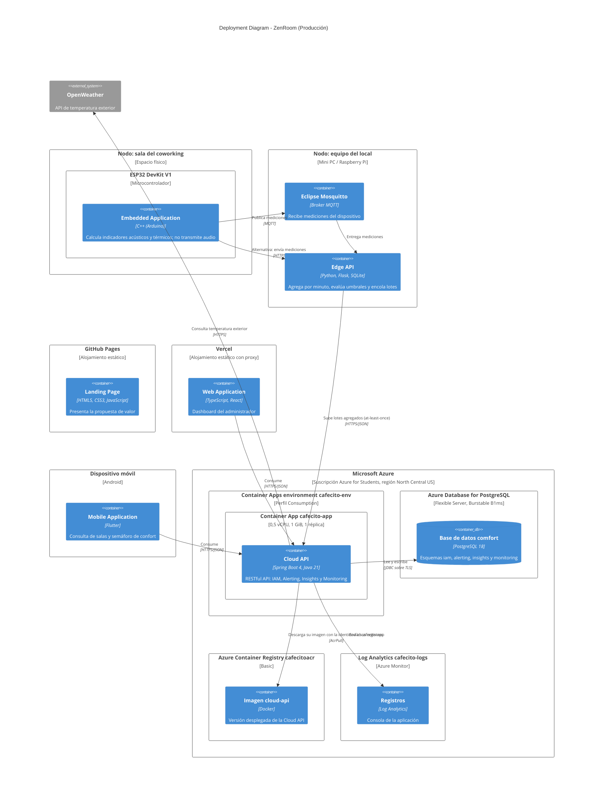

El dispositivo, el Edge y el broker comparten la red local del coworking, de modo que una caída de internet solo interrumpe la subida de datos a la nube y no la evaluación local de umbrales. La Cloud API es el único container que habla con la base de datos y con el proveedor meteorológico, y las dos aplicaciones cliente dependen únicamente de ella. La base de datos solo acepta conexiones cifradas y desde los servicios de Azure o las direcciones registradas en su firewall, y la aplicación descarga su imagen del registro con una identidad administrada que únicamente tiene permiso de lectura. La Landing Page se publica en GitHub Pages y la Web Application en Vercel, y la Landing Page no se comunica con la API.

<a id="62-landing-page-services--applications-implementation"></a>
## 6.2. Landing Page, Services & Applications Implementation.

### _6.2.1. Sprint 1_

#### 6.2.1.1. Sprint Planning 1.

El Sprint Planning 1 es la reunión en la que el equipo de SenseWork acordó qué entregaría en el primer sprint de ZenRoom y qué historias del Product Backlog se comprometía a completar para lograrlo. Al ser el primer sprint, no existe un Sprint anterior que revisar: el punto de partida es la primera entrega del informe, con los Capítulos I a IV, y los diseños del Capítulo V, entre ellos la Landing Page ya publicada en GitHub Pages. El alcance del sprint se concentra en tres productos, la Landing Page, la primera versión de la Web Application del administrador y los RESTful Web Services que esta necesita, y deja para sprints posteriores la cadena de telemetría del dispositivo y de la Edge API, que el Product Backlog ordena a continuación. A continuación se presenta el cuadro resumen de la reunión. 

| Sprint \# | Sprint 1 |
| :---- | :---- |
| **Sprint Planning Background**  | — |
| Date | 2026-09-26 |
| Time | 10:40 PM |
| Location | Google Meets |
| Prepared By | Giancarlo Solis |
| Attendees (to planning meeting)  | Espino Flores, Alejandro / Huarcaya Matias, Gilbert Alonso / Lang Nassi, Werner Khalil / Llamccaya Arone, Juan Paul / Luyo Correa, Sandra Paula / Solis Santa Cruz, Giancarlo Rafael  |
| Sprint 0 Review Summary  | No aplica, porque este es el primer sprint del proyecto. El resultado previo es la primera entrega del informe (Capítulos I a IV), con el Product Backlog de 65 historias estimadas y ordenado por valor de negocio, y los diseños del Capítulo V, que incluyen los wireframes y mock-ups de la Landing Page, de la Web Application y de la Mobile Application. La Landing Page ya se encuentra publicada en GitHub Pages.  |
| Sprint 0 Retrospective Summary  | No aplica. Como antecedente del modo de trabajo, durante la elaboración del informe el equipo aplicó GitFlow con una rama por capítulo y revisión de pull requests, y detectó mediante autocrítica errores de numeración del Capítulo IV y rutas de imágenes rotas, que se corrigieron en el repositorio. De ahí se toma la decisión de revisar cada pull request antes de integrarla en develop.  |
| **Sprint Goal & User Stories**  | — |
| Sprint 1 Goal  | Nuestro enfoque es que el administrador de un coworking conozca ZenRoom y pueda poner su espacio en la plataforma: que un visitante comprenda la propuesta de valor, la privacidad y los planes, y solicite una demostración; que un administrador se registre, inicie sesión, dé de alta sus locales, salas, tipos de sala y dispositivos, y consulte el estado general de su local; y que la Web Application disponga de servicios REST seguros y documentados que le permitan hacerlo. Creemos que esto entrega claridad y confianza para decidir sobre la solución a los visitantes administradores, y una base de configuración del espacio que habilita la medición continua, al administrador. A los desarrolladores de la Web Application y de la Mobile Application les entrega un contrato de API estable sobre el cual construir. Esto se confirmará cuando un visitante pueda llegar desde la Landing Page publicada hasta la solicitud de demostración, un administrador pueda registrarse, iniciar sesión y registrar un local con una sala y un dispositivo desde la Web Application desplegada, y vea el estado del local consultado desde la Cloud API.  |
| Sprint 1 Velocity  | 42 Story Points. Al ser el primer sprint no hay velocity histórica; el equipo fijó este valor como su compromiso inicial y lo recalibrará con la velocity real al cierre del sprint. |
| Sum of Story Points  | 42 Story Points, de las 17 historias del Sprint Backlog 1, descompuestas en 47 tareas con 194 horas estimadas.  |


#### 6.2.1.2. Aspect Leaders and Collaborators.

El Sprint 1 tiene como alcance el Landing Page desplegado, la primera versión de la Web Application del administrador y el diseño de la experiencia de las dos aplicaciones. Para repartir ese trabajo, el equipo lo dividió en siete aspectos y asignó a cada uno un líder, que responde por la entrega, y colaboradores que lo apoyan en la implementación y la revisión. La matriz de liderazgo y colaboración (Leadership-and-Collaboration Matrix, LACX) que se muestra más abajo recoge ese reparto.

Tres de los aspectos son productos que se construyen y despliegan durante el sprint, y sus historias salen de las primeras posiciones del Product Backlog:

1. Landing Page: presenta la propuesta de valor, las funcionalidades, la privacidad, los planes, la solicitud de demostración y las preguntas frecuentes (US01 a US07).
2. Web Application: el administrador se registra, inicia sesión, da de alta sus locales, salas y dispositivos, y consulta el estado general del local (US08, US09, US11, US12, US13 y US40).
3. RESTful Web Services: los endpoints de autenticación, de gestión de locales, salas y dispositivos, y de consulta de mediciones y del estado actual de una sala, que la Web Application necesita para funcionar (TS7, TS8, TS10 y TS23).

Los otros cuatro aspectos sostienen esa implementación. En Applications UX/UI Design están los wireframes, wireflows, mock-ups, user flows y prototipos de la Web Application y de la Mobile Application. Style Guidelines & IoT Device Design junta la guía de estilos que siguen el Landing Page y las aplicaciones con el diseño físico y de circuito del dispositivo. Configuration & Deployment se encarga del entorno de desarrollo, la gestión del código fuente y la configuración de despliegue de los productos del sprint, y Testing Suite, de las pruebas de aceptación de las historias del sprint.

Cada integrante lidera al menos un aspecto y colabora en los tres productos, así todos participan en la implementación del Landing Page, de los servicios y de la aplicación web. Las tareas del Sprint Backlog 1 se asignan siguiendo esta matriz: el líder de un aspecto toma las tareas principales de sus historias y los colaboradores se quedan con las de apoyo y revisión.

| Team Member (Last Name, First Name) | GitHub Username | Landing Page | Web Application | RESTful Web Services | Applications UX/UI Design | Style Guidelines & IoT Device Design | Configuration & Deployment | Testing Suite |
|:---|:---|:---:|:---:|:---:|:---:|:---:|:---:|:---:|
| Espino Flores, Alejandro | CafecitoSKR | C | C | L | C | L | C | C |
| Huarcaya Matias, Gilbert Alonso | GilbertHuarcaya | C | C | C | L | C | C | C |
| Lang Nassi, Werner Khalil | 00WernerLang | C | C | C | C | — | L | C |
| Llamccaya Arone, Juan Paul | JuanPaulLlaA | L | C | C | C | C | — | — |
| Luyo Correa, Sandra Paula | Paulu27 | C | L | C | C | — | — | — |
| Solis Santa Cruz, Giancarlo Rafael | LucidVoid10 | C | C | C | C | — | C | L |

L: Leader (líder del aspecto). C: Collaborator (colaborador). Una celda vacía indica que el integrante no participa en ese aspecto durante el Sprint 1.

#### 6.2.1.3. Sprint Backlog 1.

El objetivo del Sprint 1 es que el administrador de un coworking conozca ZenRoom y pueda poner su espacio en la plataforma: que un visitante comprenda la propuesta de valor, la privacidad y los planes y solicite una demostración desde la Landing Page; que un administrador se registre, inicie sesión, dé de alta sus locales, salas, tipos de sala y dispositivos y consulte el estado general de su local desde la Web Application; y que ambos productos se apoyen en servicios REST seguros y documentados. Para lograrlo, el equipo comprometió 17 historias (42 Story Points) y las descompuso en 47 tareas con 194 horas estimadas, repartidas entre el frontend (Landing Page y Web Application) y el backend (cloud-api), junto con las tareas generales de despliegue y pruebas.

El seguimiento del sprint se realiza en un tablero de Trello con las columnas To-Do, In-Process, To-Review y Done. La siguiente figura muestra el estado del tablero al iniciar el sprint.

<p align="center"><em>Figura 105.</em> Tablero de Trello del Sprint 1 al iniciar el sprint.</p>

<p align="center">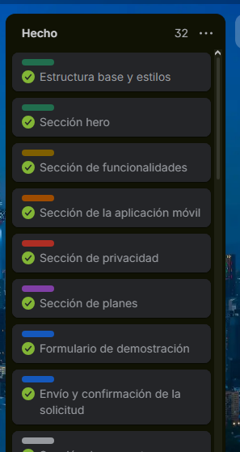</p>

URL del Board: https://trello.com/b/6ac5df06fd8b13362fc43983

La siguiente tabla especifica las historias asignadas al Sprint 1 y las tareas resultantes de su descomposición. Las filas de la sección "Tareas generales" corresponden a tareas que no dependen de una historia en particular, sino de una restricción general del proyecto, como el despliegue, la documentación de la API o las pruebas. Cada tarea se asignó según la matriz de líderes y colaboradores de la sección 6.2.1.2, y su estado parte en To-Do.

**Tabla 1**

*Sprint Backlog 1: historias y tareas del sprint.*

| Sprint \# | Story Id | Story Title | Task Id | Task Title | Task Description | Estimation (Hours) | Assigned To | Status |
| :---- | :---- | :---- | :---- | :---- | :---- | :---: | :---- | :---- |
| Sprint 1 | US01 | Comprender la propuesta de valor | T01 | Estructura base y estilos | Crear la estructura HTML5 semántica (header, nav, main, section, footer) y las propiedades CSS personalizadas (`--color-*`, `--space-*`) de la guía de estilos del Capítulo V. | 4 | Llamccaya, Juan Paul | To-Do |
|  |  |  | T02 | Sección hero | Implementar el hero con el nombre del producto, el mensaje de propuesta de valor y la llamada a la acción visibles al cargar, y el bloque de la problemática sin requerir registro. | 3 | Llamccaya, Juan Paul | To-Do |
|  | US02 | Explorar funcionalidades del producto | T03 | Sección de funcionalidades | Presentar el monitoreo acústico y térmico por sala, las alertas y la analítica histórica, con el detalle desplegable de cada funcionalidad. | 3 | Solis, Giancarlo | To-Do |
|  | US03 | Conocer la aplicación móvil | T04 | Sección de la aplicación móvil | Describir el mapa de salas con el semáforo de confort y el histórico de tranquilidad por hora, e incluir la garantía de privacidad en la aplicación. | 3 | Luyo, Sandra | To-Do |
|  | US04 | Verificar el compromiso de privacidad | T05 | Sección de privacidad | Declarar que el audio se procesa en el dispositivo y nunca se graba, almacena ni transmite, y dejar un acceso permanente a la declaración desde el pie de página. | 3 | Espino, Alejandro | To-Do |
|  | US05 | Consultar los planes disponibles | T06 | Sección de planes | Mostrar los planes con sus características y condiciones de contratación, e identificar las diferencias entre ellos para compararlos. | 3 | Lang, Werner | To-Do |
|  | US06 | Solicitar una demostración | T07 | Formulario de demostración | Construir el formulario de contacto con validación en el cliente (correo con formato válido y campos obligatorios) y mensajes de error específicos por campo. | 5 | Llamccaya, Juan Paul | To-Do |
|  |  |  | T08 | Envío y confirmación de la solicitud | Enviar la solicitud, mostrar la confirmación de recepción y resolver los estados de carga y error. | 3 | Huarcaya, Gilbert | To-Do |
|  | US07 | Resolver dudas frecuentes | T09 | Sección de preguntas frecuentes | Agrupar las preguntas por temática (instalación, costo, privacidad y medición) y desplegar la respuesta al seleccionar una pregunta. | 3 | Huarcaya, Gilbert | To-Do |
|  | Transversal | Tareas generales de la Landing Page | T10 | Selector de idioma | Implementar el diccionario de textos por idioma (inglés inicial y español latinoamericano), aplicarlo por clave y actualizar el atributo lang del documento. | 5 | Llamccaya, Juan Paul | To-Do |
|  |  |  | T11 | Diseño responsive y SEO | Aplicar el diseño mobile-first de 390 a 1440 px, las etiquetas SEO y meta tags de la sección 5.2.3 y el texto del semáforo junto al color. | 4 | Solis, Giancarlo | To-Do |
|  |  |  | T12 | Publicación en GitHub Pages | Configurar la fuente de GitHub Pages en el repositorio zenroom-landing y verificar el sitio publicado. | 2 | Lang, Werner | To-Do |
| | |  | | | | | | |
|  | US08 | Registrarse como administrador | T13 | Pantalla de registro | Construir el formulario de registro con validación y los mensajes por correo ya registrado o campos incompletos, y el acceso al panel tras el registro exitoso. | 5 | Luyo, Sandra | To-Do |
|  | US09 | Iniciar sesión en la plataforma | T14 | Pantalla de inicio de sesión | Construir el formulario de acceso y guardar el token con su rol; ante credenciales inválidas, mostrar un único mensaje sin indicar cuál dato falló. | 5 | Luyo, Sandra | To-Do |
|  |  |  | T15 | Rutas protegidas por rol | Proteger las rutas según el rol (ADMIN y MEMBER) y resolver el cierre de sesión y la expiración del token. | 4 | Llamccaya, Juan Paul | To-Do |
|  | US11 | Registrar locales y salas | T16 | Alta de locales | Implementar el formulario y el listado de locales del administrador. | 4 | Luyo, Sandra | To-Do |
|  |  |  | T17 | Alta y listado de salas | Implementar el registro de salas dentro de un local y su listado, con estados de carga, vacío y error, e indicar los umbrales por defecto de una sala sin clasificar. | 5 | Llamccaya, Juan Paul | To-Do |
|  | US12 | Clasificar salas por tipo | T18 | Gestión de tipos de sala | Implementar la pantalla de tipos de sala (cabina de llamadas, sala de reuniones y área abierta). | 4 | Solis, Giancarlo | To-Do |
|  |  |  | T19 | Clasificación de salas | Permitir asignar y cambiar el tipo de una sala, y listar las salas no clasificadas. | 3 | Solis, Giancarlo | To-Do |
|  | US13 | Registrar dispositivos y asociarlos a salas | T20 | Registro de dispositivos | Implementar el formulario de registro de un dispositivo y su asociación a una sala. | 4 | Luyo, Sandra | To-Do |
|  |  |  | T21 | Reemplazo de dispositivo | Permitir asociar un nuevo dispositivo a una sala que ya tiene uno y mostrar el resultado. | 3 | Lang, Werner | To-Do |
|  | US40 | Consultar el estado general del local | T22 | Vista del estado general del local | Mostrar una tarjeta por sala con su estado de confort (óptimo, moderado o ruidoso), siempre con la etiqueta de texto además del color. | 6 | Luyo, Sandra | To-Do |
|  |  |  | T23 | Salas fuera de condición y sin datos | Destacar las salas con indicadores fuera de umbral e indicar las salas sin mediciones vigentes. | 3 | Huarcaya, Gilbert | To-Do |
|  | Transversal | Tareas generales de la Web Application | T24 | Proyecto base de la Web Application | Crear el proyecto React con TypeScript en modo strict, ESLint y Prettier, el enrutamiento y la capa de servicios de acceso a la API. | 6 | Luyo, Sandra | To-Do |
|  |  |  | T25 | Cliente HTTP de la Cloud API | Implementar el cliente que adjunta el token de sesión, traduce los códigos de error del catálogo de la API y modela los contratos REST como interfaces. | 4 | Luyo, Sandra | To-Do |
|  |  |  | T26 | Publicación de la Web Application | Generar el paquete de producción, configurar la URL de la Cloud API y publicarlo en el alojamiento estático. | 3 | Lang, Werner | To-Do |
| | |  | | | | | | |
|  | TS7 | Autenticación y emisión de tokens | T27 | Migración del esquema iam | Crear la migración de Flyway del esquema iam (usuarios y credenciales de máquina) con claves UUID v7 y columnas de auditoría. | 3 | Espino, Alejandro | To-Do |
|  |  |  | T28 | Registro de usuarios | Implementar POST /api/v1/users con unicidad de correo y contraseña con BCrypt, que responde 201. | 5 | Espino, Alejandro | To-Do |
|  |  |  | T29 | Autenticación y emisión de token | Implementar POST /api/v1/auth/login que responde 200 con un JWT RS256 con el rol del usuario y un único error para credencial inválida. | 5 | Espino, Alejandro | To-Do |
|  |  |  | T30 | Cadena de seguridad y roles | Configurar la cadena de filtros que autentica usuarios con JWT y máquinas con clave (SHA-256), y la protección de los endpoints por rol. | 5 | Huarcaya, Gilbert | To-Do |
|  | TS8 | Gestión de locales, salas y dispositivos | T31 | Migración del esquema monitoring | Crear la migración de Flyway del esquema monitoring (locales, tipos de sala, salas y dispositivos) con borrado lógico y sin claves foráneas entre esquemas. | 4 | Espino, Alejandro | To-Do |
|  |  |  | T32 | Endpoints de locales y tipos de sala | Implementar en SitesController el alta y listado de locales y de tipos de sala en /api/v1/sites. | 5 | Huarcaya, Gilbert | To-Do |
|  |  |  | T33 | Endpoints de salas | Implementar en RoomsController el alta, el listado (incluidas las no clasificadas), la consulta y la clasificación de salas en /api/v1/rooms. | 5 | Espino, Alejandro | To-Do |
|  |  |  | T34 | Registro de dispositivos | Implementar el alta de dispositivos y su asociación a una sala, incluido el reemplazo, y las respuestas 404 para recursos inexistentes. | 5 | Lang, Werner | To-Do |
|  |  |  | T35 | Umbrales por defecto por tipo de sala | Registrar los umbrales por defecto de una sala sin clasificar y aplicar los del tipo al clasificarla, consultando el perfil de la sala mediante la capa anticorrupción. | 4 | Espino, Alejandro | To-Do |
|  | TS10 | Consulta de mediciones y series por minuto | T36 | Consulta de la serie por minuto | Exponer la serie de agregados por sala en un rango temporal, con respuesta 200 y rechazo del rango inválido. | 5 | Huarcaya, Gilbert | To-Do |
|  | TS23 | Consulta del estado actual de una sala | T37 | Consulta del estado actual de una sala | Exponer la última lectura vigente de la sala con sus indicadores ambientales y de ocupación, y 404 si la sala no existe. | 4 | Espino, Alejandro | To-Do |
|  |  |  | T38 | Estado ambiental por sala frente a umbrales | Determinar el estado de cada sala (óptimo, moderado o ruidoso) a partir de sus indicadores y umbrales vigentes, para el estado general del local (US40). | 5 | Espino, Alejandro | To-Do |
|  | Transversal | Tareas generales de los RESTful Web Services | T39 | Datos de prueba para las consultas | Preparar datos de prueba para validar TS10 y TS23, porque la ingesta desde la Edge (TS6) queda fuera de este sprint. | 3 | Solis, Giancarlo | To-Do |
|  |  |  | T40 | Documentación OpenAPI | Documentar con Swagger UI los endpoints del sprint, con sus roles, ejemplos y códigos de respuesta. | 4 | Huarcaya, Gilbert | To-Do |
|  |  |  | T41 | Catálogo de errores | Definir los códigos de error de IAM y Monitoring como beans ErrorCatalogSource y el manejo global de errores. | 3 | Espino, Alejandro | To-Do |
|  |  |  | T42 | Imagen Docker y composición | Escribir el Dockerfile de dos etapas y el Docker Compose con PostgreSQL en el puerto 5433, comprobación de salud, volumen con nombre y pgAdmin en un perfil. | 5 | Lang, Werner | To-Do |
|  |  |  | T43 | Despliegue de la Cloud API | Levantar la composición en el servidor, definir las variables de entorno y habilitar CORS para el origen de la Web Application. | 4 | Lang, Werner | To-Do |
|  |  |  | T44 | Pruebas de autenticación | Escribir pruebas JUnit 5 del registro y del login: cuenta creada, correo duplicado, credenciales inválidas y token con rol. | 5 | Solis, Giancarlo | To-Do |
|  |  |  | T45 | Pruebas de integración de la API | Escribir pruebas de integración de locales, salas, dispositivos, serie por minuto y estado actual, incluido el 404 y el rango inválido. | 6 | Solis, Giancarlo | To-Do |
|  | Transversal | Tareas generales de pruebas | T46 | Pruebas del frontend | Probar la validación de los formularios del Landing Page y de la Web Application y los estados de carga, vacío y error. | 4 | Solis, Giancarlo | To-Do |
|  |  |  | T47 | Validación de criterios de aceptación | Verificar manualmente los escenarios Gherkin de las 17 historias sobre las aplicaciones desplegadas y registrar el resultado. | 5 | Solis, Giancarlo | To-Do |
| | | | | **Total** | | **194** | | |

Al cierre del Sprint 1, el Product Backlog registraba 15 historias en Done, 11 en In Progress y 39 sin iniciar. De las 17 historias del sprint quedaron en Done US01, US02, US04, US07 y TS23; en In Progress TS7, TS8, TS10, US03, US05, US06, US08, US11, US12, US13 y US40; y US09 sin iniciar. El tablero se puede consultar en https://trello.com/b/nn477GGQ.

<p align="center"><em>Figura 106.</em> Estado del Product Backlog al cierre del Sprint 1.</p>

<p align="center">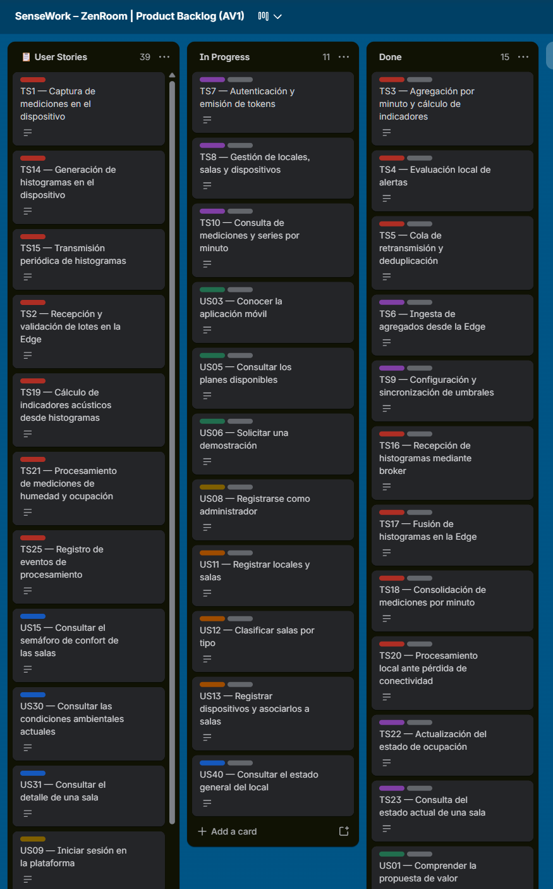</p>

#### 6.2.1.4. Development Evidence for Sprint Review.
Durante el desarrollo del Sprint se realizaron diferentes avances relacionados con la implementación de los principales componentes de SenseWork. Como evidencia del trabajo desarrollado, se registraron commits en los repositorios correspondientes a la **Landing Page**, la **aplicación móvil** y la **aplicación web**.

Los commits realizados permiten evidenciar la incorporación inicial de las aplicaciones, así como mejoras visuales y actualizaciones de recursos de la Landing Page. En la siguiente tabla se detallan los principales commits considerados como evidencia para el Sprint Review.

| Repository | Branch | Commit Id | Commit | Message Body | Committed on (Date) |
|---|---|---|---|---|---|
| SenseWork Landing Page | main | `d8478bd` | style: align landing page colors with SenseWork web app | - | 06/10/2026 |
| SenseWork Landing Page | main | `7bb4d33` | Add files via upload | - | 03/10/2026 |
| SenseWork Landing Page | main | `07a5dda` | Update SenseWork logo. | - | 03/10/2026 |
| SenseWork Landing Page | main | `44a01e1` | Add ZenRoom landing page | - | 03/10/2026 |
| SenseWork Mobile App | main | `9c17e0a` | feat: Add Zenroom Flutter mobile app | - | 06/10/2026 |
| SenseWork Web App | develop | `e643314` | feat: Initial SenseWork web app | - | 06/10/2026 |

La evidencia presentada muestra el progreso realizado durante el Sprint en los diferentes productos que forman parte de la solución. En el repositorio correspondiente a la **Landing Page**, se incorporó inicialmente la página de ZenRoom junto con los archivos necesarios para su funcionamiento. Asimismo, se actualizó el logotipo de SenseWork y posteriormente se ajustó la paleta de colores de la Landing Page para mantener consistencia visual con la aplicación web.

Por otro lado, en el repositorio de la **aplicación móvil**, se incorporó la implementación inicial de la aplicación desarrollada con Flutter, estableciendo la base sobre la cual se continuará desarrollando la experiencia móvil de SenseWork.

Finalmente, en el repositorio correspondiente a la **aplicación web**, se registró la implementación inicial de SenseWork en la rama `develop`. Este commit representa la incorporación de la estructura base de la aplicación web sobre la cual se desarrollarán las funcionalidades definidas para los siguientes avances del producto.


#### 6.2.1.5. Testing Suite Evidence for Sprint Review.

En el Sprint 1 las pruebas se concentraron en los RESTful Web Services del repositorio cloud-api, que son la base sobre la que trabajan la Web Application y la Mobile Application. La suite cubre tres niveles. Las pruebas unitarias revisan las reglas del dominio en los agregados Site, Room, Device y User. Las pruebas de integración de la capa web levantan los controladores con su configuración de seguridad real y comprueban el inicio de sesión (TS7) y el registro de locales (TS8). Las pruebas de aceptación están escritas en Gherkin y se ejecutan con Cucumber sobre la historia US11, registrar locales y salas.

La suite entró por pull request a la rama dev y después a main del repositorio https://github.com/Grupo03-IOT/cloud-api, y está dentro de src/test/java/com/pe/cloudapi, y la especificación en Gherkin está en src/test/resources/features/us11_register_sites.feature. Se ejecuta con ./gradlew test; la prueba contextLoads que ya existía necesita la base de datos del proyecto, que se levanta con docker compose up -d db.

| Nivel | Clase de prueba | Qué comprueba | Pruebas |
|---|---|---|---|
| Unitaria | SiteTest | Un local sin zona horaria toma America/Lima | 1 |
| Unitaria | RoomTest | Una sala nueva nace sin tipo y queda clasificada al asignarle uno | 2 |
| Unitaria | DeviceTest | Un dispositivo se registra ligado a su sala e ignora reportes atrasados | 2 |
| Unitaria | UserTest | Una cuenta activa puede iniciar sesión y una desactivada no | 2 |
| Integración | AuthControllerTest | POST /api/v1/auth/login devuelve el token Bearer (TS7) | 1 |
| Integración | SitesControllerTest | POST /api/v1/sites: 201 para el administrador y 403 para un miembro (TS8) | 2 |
| Aceptación | us11_register_sites.feature | Escenarios de la US11 | 3 |

La especificación de la US11 tiene tres escenarios: el administrador registra un local nuevo y recibe 201 con la zona horaria por defecto America/Lima, el mismo código de local no se puede registrar dos veces (409) y un miembro no puede registrar locales (403).

```
Feature: US11 - Register sites
  As a coworking administrator
  I want to register my site in the platform
  So that its rooms and devices can be monitored

  Scenario: The administrator registers a new site
    Given no site with code "coworking-lima-centro" is registered
    And I am signed in as "ADMIN"
    When I register the site "coworking-lima-centro" named "Coworking Lima Centro" without a timezone
    Then the response status is 201
    And the registered site has code "coworking-lima-centro" and timezone "America/Lima"
```

La ejecución completa dio 14 pruebas aprobadas, ninguna fallida y ninguna omitida.

<p align="center"><em>Figura 107.</em> Resultado de la suite de pruebas de cloud-api.</p>

<p align="center">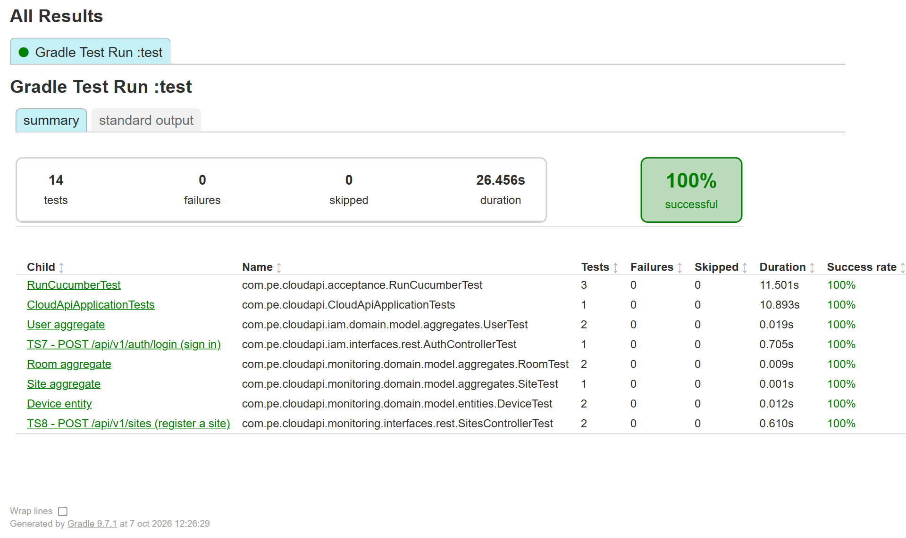</p>

<p align="center"><em>Figura 108.</em> Escenarios de aceptación de la US11 ejecutados con Cucumber.</p>

<p align="center">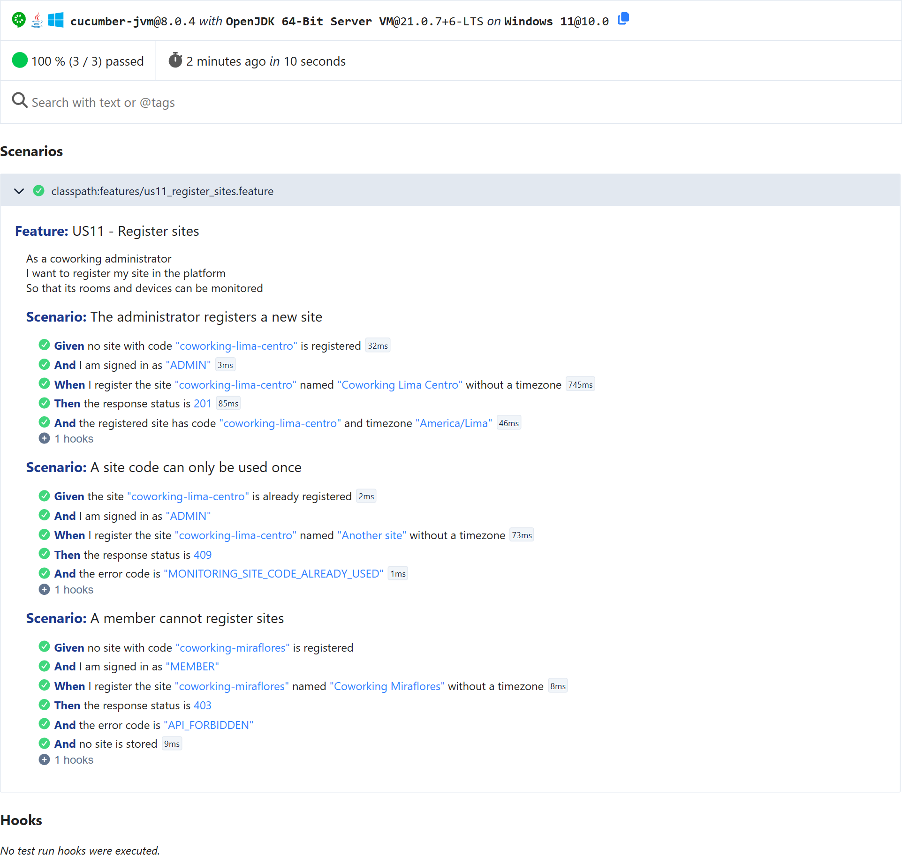</p>

Los commits de la suite son los siguientes:

| Repository | Branch | Commit Id | Message | Message Body | Committed on |
|---|---|---|---|---|---|
| cloud-api | test/sprint-1-testing-suite | 29833cb | test(domain): add unit tests for site, room, device and user aggregates | — | 07/10/2026 |
| cloud-api | test/sprint-1-testing-suite | 5a3d538 | test(api): add web layer tests for sign-in and site registration endpoints | — | 07/10/2026 |
| cloud-api | test/sprint-1-testing-suite | 43b84e3 | test(acceptance): add cucumber scenarios for US11 site registration | — | 07/10/2026 |

#### 6.2.1.6. Execution Evidence for Sprint Review.
Durante el Sprint 1 se logró implementar y desplegar la Landing Page de SenseWork, la cual representa uno de los primeros componentes funcionales de la solución.

La Landing Page permite presentar la propuesta de valor de SenseWork, sus principales características y la información relevante del producto para los usuarios interesados en conocer la solución.

Como evidencia de ejecución del Sprint, la Landing Page fue desplegada mediante GitHub Pages y se encuentra disponible públicamente en el siguiente enlace:

**Enlace SenseWork Landing Page:**  
https://grupo03-iot.github.io/zenroom-landing/

En esta primera iteración, la evidencia de ejecución se concentra en la Landing Page, debido a que los demás componentes de la solución, como la aplicación web, la aplicación móvil, Cloud API y Edge API, aún se encuentran en proceso de implementación e integración y no cuentan con un despliegue público correspondiente al Sprint 1.

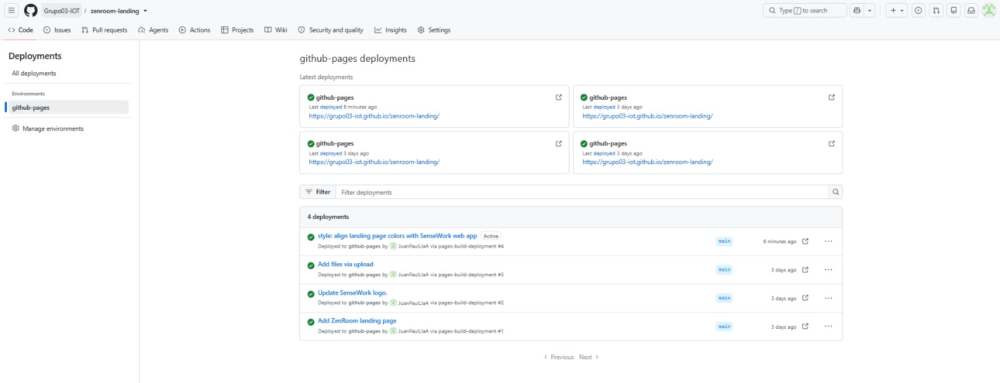

Video de navegación del sprint: —

#### 6.2.1.7. Services Documentation Evidence for Sprint Review.

Durante el Sprint 1 se avanzó en la implementación de los servicios backend que forman parte de la arquitectura de SenseWork. La solución cuenta con dos componentes principales de servicios: **Cloud API** y **Edge API**.

La **Cloud API** centraliza funcionalidades relacionadas con autenticación, usuarios, credenciales para dispositivos, gestión de sitios y habitaciones, telemetría, configuración de umbrales e insights. Asimismo, este componente cuenta con documentación mediante OpenAPI/Swagger, permitiendo visualizar y probar los endpoints implementados.

Por otro lado, la **Edge API** se ejecuta dentro del entorno monitoreado y funciona como intermediario entre los dispositivos IoT y la Cloud API. Esta recibe las mediciones enviadas por los dispositivos, genera agregados locales, mantiene información temporal de las habitaciones y alertas, y posteriormente sincroniza la información con los servicios en la nube.

A continuación, se presentan los servicios implementados durante el Sprint.

##### Cloud API

###### Authentication Management

| Método HTTP | Endpoint | Descripción | Ejemplo de uso |
|---|---|---|---|
| POST | `/api/v1/auth/login` | Autentica a un usuario mediante correo electrónico y contraseña y retorna un token de acceso. | Iniciar sesión en la aplicación web o móvil de SenseWork. |

###### User Management

| Método HTTP | Endpoint | Descripción | Ejemplo de uso |
|---|---|---|---|
| POST | `/api/v1/users` | Registra una nueva cuenta de usuario en la plataforma. | Crear la cuenta de un nuevo miembro de SenseWork. |

###### Credentials Management

| Método HTTP | Endpoint | Descripción | Ejemplo de uso |
|---|---|---|---|
| POST | `/api/v1/credentials` | Genera una credencial para que una máquina o componente Edge pueda autenticarse ante la Cloud API. | Generar las credenciales necesarias para conectar una instalación Edge con SenseWork. |

###### Sites Management

| Método HTTP | Endpoint | Descripción | Ejemplo de uso |
|---|---|---|---|
| POST | `/api/v1/sites` | Registra un nuevo sitio dentro de la plataforma. | Crear una nueva sede o espacio de coworking durante el onboarding del administrador. |
| GET | `/api/v1/sites` | Obtiene la lista de sitios registrados. | Mostrar las sedes disponibles para el usuario. |
| POST | `/api/v1/sites/{siteId}/room-types` | Registra un nuevo tipo de habitación asociado a un sitio. | Crear tipos de ambientes como sala de reuniones, oficina o área común. |
| GET | `/api/v1/sites/{siteId}/room-types` | Obtiene los tipos de habitación registrados para un sitio. | Mostrar los tipos de ambientes disponibles durante la configuración de una sala. |

###### Rooms Management

| Método HTTP | Endpoint | Descripción | Ejemplo de uso |
|---|---|---|---|
| GET | `/api/v1/rooms` | Obtiene las habitaciones activas junto con el resumen de su lectura más reciente. | Mostrar las habitaciones y su estado actual en la aplicación. |
| GET | `/api/v1/rooms/unclassified` | Obtiene las habitaciones detectadas automáticamente que todavía no cuentan con una clasificación. | Mostrar al administrador las habitaciones pendientes de configuración. |
| GET | `/api/v1/rooms/{roomId}` | Obtiene la información de una habitación específica. | Mostrar el detalle de una habitación seleccionada. |
| GET | `/api/v1/rooms/{roomId}/readings` | Obtiene las mediciones por minuto de una habitación dentro de un rango de tiempo determinado mediante los parámetros `from` y `to`. | Consultar el historial de temperatura, ruido, humedad u otras métricas de una sala. |
| GET | `/api/v1/rooms/{roomId}/readings/latest` | Obtiene la medición más reciente registrada para una habitación. | Mostrar las condiciones ambientales actuales de una sala. |
| PATCH | `/api/v1/rooms/{roomId}` | Asigna un tipo de habitación a una sala previamente detectada. | Clasificar una habitación pendiente como sala de reuniones, oficina u otro tipo. |

###### Readings Management

| Método HTTP | Endpoint | Descripción | Ejemplo de uso |
|---|---|---|---|
| POST | `/api/v1/readings` | Recibe desde la capa Edge un conjunto de mediciones ambientales agregadas por minuto. | Enviar periódicamente a la nube las lecturas recopiladas por los dispositivos IoT. |

###### Threshold Management

| Método HTTP | Endpoint | Descripción | Ejemplo de uso |
|---|---|---|---|
| PUT | `/api/v1/room-types/{roomTypeId}/thresholds/{metric}` | Configura o actualiza el umbral correspondiente a una métrica para un tipo de habitación. | Definir los niveles de advertencia y valores críticos de ruido o temperatura. |
| GET | `/api/v1/room-types/{roomTypeId}/thresholds` | Obtiene los umbrales configurados para un tipo de habitación. | Mostrar al administrador la configuración actual de confort. |
| GET | `/api/v1/room-thresholds` | Obtiene los umbrales efectivos para cada habitación. | Permitir que el componente Edge descargue las reglas que debe utilizar para evaluar las condiciones ambientales localmente. |

###### Insights Management

| Método HTTP | Endpoint | Descripción | Ejemplo de uso |
|---|---|---|---|
| GET | `/api/v1/insights/rooms/{roomId}` | Analiza las mediciones de una habitación dentro de un periodo especificado mediante `from` y `to`. | Consultar tendencias, correlaciones y patrones relacionados con las condiciones de confort de una habitación. |

La Cloud API dispone de documentación mediante **OpenAPI**, con una interfaz Swagger configurada para facilitar la revisión y prueba de los servicios implementados.

**Swagger UI:** `/swagger-ui.html`  
**OpenAPI Specification:** `/v3/api-docs`

---

##### Edge API

La Edge API constituye la capa intermedia entre los dispositivos IoT instalados en los ambientes y la Cloud API. Este servicio puede ejecutarse localmente dentro del espacio monitoreado y está encargado de recibir mediciones, procesarlas, mantener información temporal y posteriormente sincronizar los datos con la nube.

###### Edge Readings Management

| Método HTTP | Endpoint | Descripción | Ejemplo de uso |
|---|---|---|---|
| POST | `/api/v1/readings` | Recibe un lote de mediciones enviado por un dispositivo IoT. | Permitir que un ESP32 envíe periódicamente mediciones ambientales hacia el Edge. |

###### Edge Rooms Management

| Método HTTP | Endpoint | Descripción | Ejemplo de uso |
|---|---|---|---|
| GET | `/api/v1/rooms` | Obtiene las habitaciones detectadas por el Edge junto con su última medición disponible. | Consultar localmente las habitaciones y verificar su última actividad. |
| GET | `/api/v1/rooms/{roomId}/minutes` | Obtiene la serie de agregados por minuto de una habitación. Admite el parámetro `limit` para limitar la cantidad de registros retornados. | Consultar las últimas mediciones almacenadas localmente para una habitación. |

###### Edge Alerts Management

| Método HTTP | Endpoint | Descripción | Ejemplo de uso |
|---|---|---|---|
| GET | `/api/v1/alerts` | Obtiene las alertas que permanecen abiertas en el Edge. | Revisar condiciones de ruido o temperatura que hayan excedido los umbrales configurados. |

###### Edge Health Management

| Método HTTP | Endpoint | Descripción | Ejemplo de uso |
|---|---|---|---|
| GET | `/api/v1/health` | Obtiene el estado actual del servicio Edge y diferentes indicadores internos, como dispositivos registrados, mediciones almacenadas, información pendiente de sincronización y alertas abiertas. | Verificar que el componente Edge se encuentra funcionando correctamente y conectado al flujo de monitoreo. |

De esta manera, los servicios implementados durante el Sprint 1 establecen la base de comunicación entre los dispositivos IoT, la capa Edge y los servicios Cloud de SenseWork. La arquitectura permite recibir y procesar información ambiental de forma local, sincronizarla posteriormente con la nube y exponerla a las aplicaciones web y móvil para su visualización y análisis.

#### 6.2.1.8. Software Deployment Evidence for Sprint Review.

Durante el Sprint 1 se realizó el despliegue de la **Landing Page de SenseWork** con el objetivo de disponer de una versión públicamente accesible del producto y permitir la visualización de la propuesta de valor, características y demás información relacionada con la solución.

Para realizar el despliegue se utilizó **GitHub Pages**, servicio que permite publicar contenido web directamente a partir de un repositorio de GitHub. La Landing Page se encuentra almacenada en el repositorio `zenroom-landing` de la organización **Grupo03-IOT**.

El proceso de deployment consistió en mantener el código fuente de la Landing Page dentro del repositorio y configurar GitHub Pages para publicar la versión correspondiente del sitio. Una vez completada la configuración y procesado el deployment, GitHub proporciona una URL pública desde la cual la aplicación puede ser consultada.

La versión desplegada de la Landing Page de SenseWork se encuentra disponible en:

**URL de deployment:**  
https://grupo03-iot.github.io/zenroom-landing/

Cada actualización realizada sobre la versión utilizada para el deployment permite actualizar posteriormente el contenido publicado, manteniendo sincronizada la Landing Page con los avances realizados durante el desarrollo.

En este primer Sprint, la evidencia de deployment corresponde únicamente a la Landing Page y aplicación web, debido a que los demás componentes de SenseWork, como la aplicación móvil, Cloud API y Edge API, aún no cuentan con un despliegue público correspondiente a esta iteración.

##### Evidencia de deployment 1


  
**Fuente:** Elaboración propia.

##### Evidencia de deployment 2

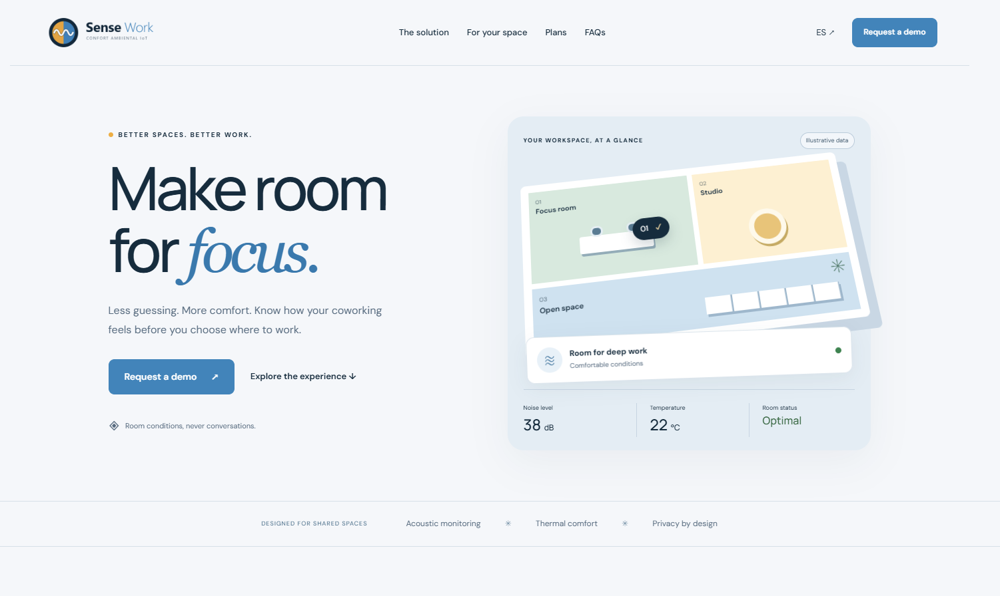


**Fuente:** Elaboración propia.

##### Evidencia de deployment 3


**Fuente:** Elaboración propia.

##### Evidencia de deployment 4

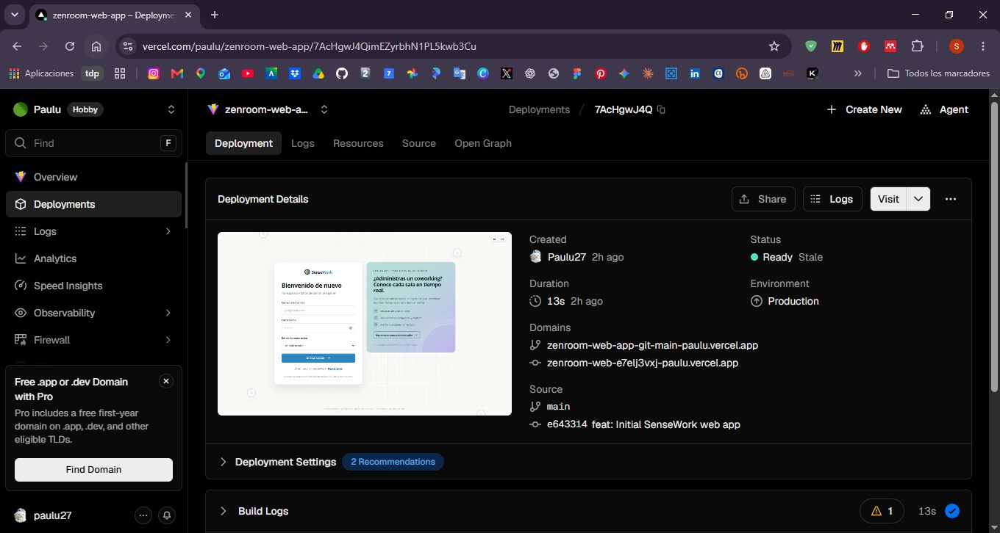


**Fuente:** Elaboración propia.

#### 6.2.1.9. Team Collaboration Insights during Sprint.

En el Sprint 1 cada producto se trabajó en su propio repositorio de la organización Grupo03-IOT: zenroom-landing para el Landing Page, cloud-api para los RESTful Web Services, zenroom-web-app para la Web Application y zenroom-mobile-app para la Mobile Application. La primera mitad del sprint se dedicó al diseño de las pantallas, al informe y a la planificación, y la implementación de las aplicaciones se hizo al final, cuando los wireframes y los mock-ups del Capítulo V ya estaban cerrados. Las capturas siguientes son los analíticos de colaboración de cada repositorio, que cuentan los commits a main por integrante sin contar los merges.

##### Landing Page

El repositorio tiene cuatro commits de Llamccaya Arone entre el 3 y el 6 de octubre: la primera versión publicada, el cambio del logotipo por el de SenseWork y el ajuste de colores para que el Landing Page use la misma paleta que la Web Application. El sitio se publica desde la rama main, así que cada uno de esos commits cambió la versión que se ve en línea.

<p align="center"><em>Figura 109.</em> Analíticos de colaboración del repositorio zenroom-landing.</p>

<p align="center">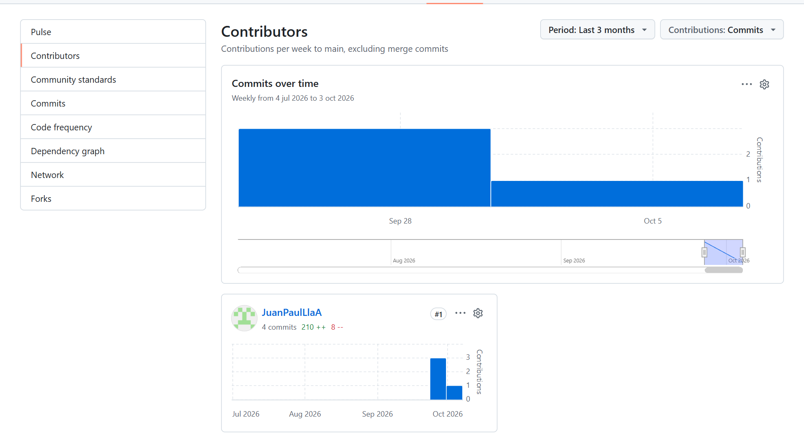</p>

##### RESTful Web Services

cloud-api concentra 63 commits de Espino Flores (GitHub atribuye 58 a su usuario y los otros 5 se hicieron con otra dirección de correo), de finales de agosto y del 1 de septiembre, cuando se construyó el servicio con sus cuatro bounded contexts. En el Sprint 1 se sumaron los tres commits de Huarcaya Matias con la suite de pruebas de la sección 6.2.1.5, que entraron por pull request a dev y después a main. Las aplicaciones se diseñaron sobre los endpoints que ya existían y, en su modo real, apuntan a esa misma API ejecutándose en local.

<p align="center"><em>Figura 110.</em> Analíticos de colaboración del repositorio cloud-api.</p>

<p align="center">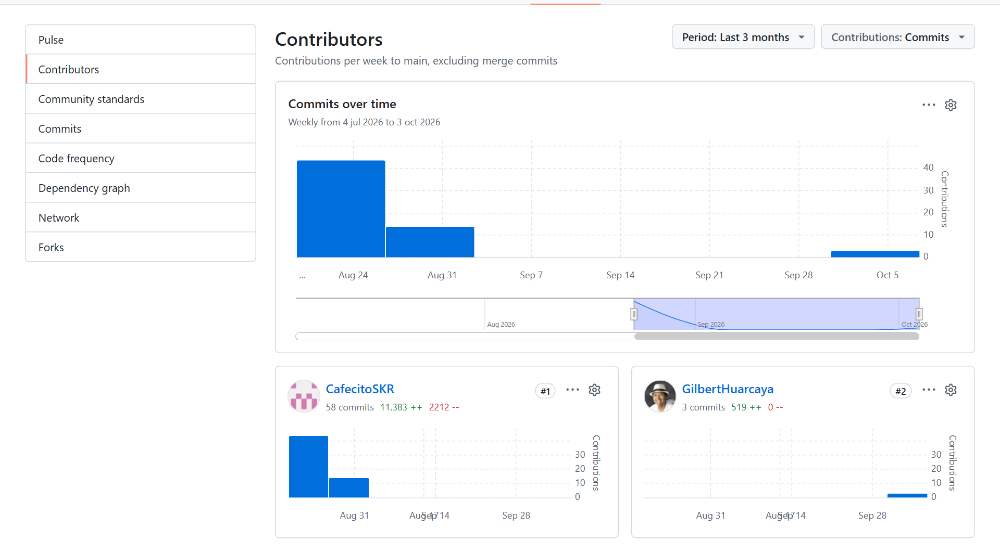</p>

##### Web Application

La primera versión entró en un solo commit de Luyo Correa el 6 de octubre. Sigue la misma organización por bounded context del Capítulo IV (identity, monitoring, alerting e insights) y arranca en modo demostración con datos de muestra, porque las alertas, los miembros y los dispositivos todavía no tienen endpoint en cloud-api.

<p align="center"><em>Figura 111.</em> Analíticos de colaboración del repositorio zenroom-web-app.</p>

<p align="center"></p>

##### Mobile Application

También entró en un solo commit de Luyo Correa el 6 de octubre, con la misma separación por contexto, el mismo modo demostración y dos pruebas unitarias del dominio de salas.

<p align="center"><em>Figura 112.</em> Analíticos de colaboración del repositorio zenroom-mobile-app.</p>

<p align="center">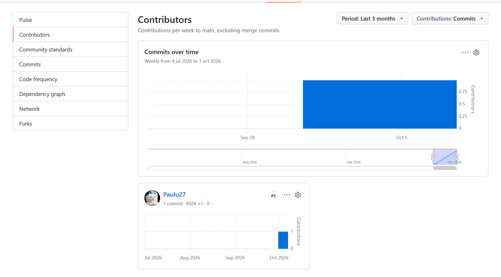</p>

Lo que muestran los analíticos es que el Landing Page, la Web Application y la Mobile Application tienen hoy un solo autor cada uno, y cloud-api suma a Espino Flores y a Huarcaya Matias. El aporte del resto del equipo en este sprint está en lo que esas aplicaciones implementan, los wireframes, mock-ups, wireflows y user flows del Capítulo V, y en la planificación del sprint, pero no aparece en el historial de código porque cada versión inicial se subió completa en un commit. Para el Sprint 2 cada repositorio va a trabajar como ya trabaja el informe, con ramas feature y pull requests revisados por otro integrante, así el aporte de cada uno queda registrado por autor y la revisión queda en GitHub.

<hr>

### _6.2.2. Sprint 2_

#### 6.2.2.1. Sprint Planning 2.

El Sprint Planning 2 es la reunión en la que el equipo de SenseWork acordó qué entregaría en el segundo sprint de ZenRoom y qué historias del Product Backlog se comprometía a completar. El punto de partida es el cierre del Sprint 1: la Landing Page publicada, la primera versión de la Web Application y de la Mobile Application funcionando con datos de demostración, y una Cloud API con la autenticación, la gestión del espacio y la consulta de mediciones, todavía sin despliegue público. El Sprint 2 lleva las mediciones por toda la cadena de la solución, desde el dispositivo y la Edge API hasta la Cloud API desplegada en la nube, y pone sobre esos datos la analítica que el administrador necesita para decidir y las consultas que el miembro usa para elegir una sala. A continuación se presenta el cuadro resumen de la reunión.

| Sprint \# | Sprint 2 |
| :---- | :---- |
| **Sprint Planning Background**  | — |
| Date | 2026-10-09 |
| Time | 07:00 PM |
| Location | Sesión virtual de la clase del curso 1ASI0572, en el tiempo que el docente asigna para la organización de los equipos |
| Prepared By | Espino Flores, Alejandro |
| Attendees (to planning meeting)  | Espino Flores, Alejandro / Huarcaya Matias, Gilbert Alonso / Lang Nassi, Werner Khalil / Llamccaya Arone, Juan Paul / Luyo Correa, Sandra Paula / Solis Santa Cruz, Giancarlo Rafael |
| Sprint 1 Review Summary  | El Sprint 1 cerró con la Landing Page publicada en GitHub Pages, con las secciones de propuesta de valor, funcionalidades, aplicación móvil, privacidad, planes, solicitud de demostración y preguntas frecuentes (US01 a US07). La Web Application y la Mobile Application entregaron su primera versión, organizadas por bounded context, pero funcionan en modo demostración con datos de muestra, porque la Cloud API todavía no estaba desplegada. La Cloud API implementó la autenticación con tokens y roles, la gestión de locales, salas, tipos de sala y dispositivos, y la consulta de la serie por minuto y del estado actual de una sala (TS7, TS8, TS10 y TS23), documentadas con OpenAPI. Los integrantes coincidieron en que el backend avanzó más que las aplicaciones cliente, y en que el sprint siguiente debía conectar ambos con datos reales. |
| Sprint 1 Retrospective Summary  | Como acierto, el equipo mantuvo el trabajo por ramas y pull requests revisados, y una rebanada vertical por commit en la Cloud API. Como oportunidades de mejora, identificó tres. La integración de develop en main de la entrega TB1 se hizo con squash, lo que separó las historias de ambas ramas y provocó conflictos en la siguiente integración; se acordó integrar en main solo con merge commit y se configuró así en las reglas del repositorio. La Web Application y la Mobile Application quedaron en modo demostración porque la Cloud API no se desplegó a tiempo para integrarlas; en este sprint la Cloud API se despliega al inicio, para que las aplicaciones la consuman desde el principio. Por último, el Sprint Planning 1 registró como velocity las horas estimadas en lugar de los Story Points; desde este sprint se mide en Story Points y las horas quedan solo en las tareas del Sprint Backlog.  |
| **Sprint Goal & User Stories**  | — |
| Sprint 2 Goal  | Nuestro enfoque es que las mediciones de cada sala recorran la cadena completa de ZenRoom y lleguen a las aplicaciones: que el dispositivo capture el sonido, la temperatura y la humedad, que la Edge API consolide los agregados por minuto y los envíe a la Cloud API desplegada en la nube sin perderlos ante un corte de conexión, que el administrador analice cada sala por periodo, compare sus salas, relacione las condiciones interiores con el clima exterior y sepa si sus dispositivos y su Edge siguen en línea, y que el miembro consulte desde la Mobile Application el semáforo de confort, el detalle de una sala y su comportamiento por hora. Creemos que esto entrega información real para decidir dónde intervenir al administrador, y criterios para elegir una sala al miembro, en lugar de los datos de demostración del Sprint 1. Esto se confirmará cuando, al cierre del Sprint 2 y antes de la entrega AV2 de la semana 12, la Web Application y la Mobile Application, conectadas a la Cloud API desplegada, muestren mediciones que llegaron desde la Edge API. Métrica de cumplimiento: 17 de 17 historias con sus criterios de aceptación verificados sobre las aplicaciones desplegadas.  |
| Sprint 2 Velocity  | 85 Story Points. El Sprint 1 comprometió 42 Story Points. El equipo amplía el compromiso porque la autenticación, la gestión del espacio y la consulta de mediciones ya están construidas, de modo que las historias del Sprint 2 extienden bounded contexts existentes en lugar de crearlos, y porque el despliegue de la Cloud API se automatiza al inicio del sprint. |
| Sum of Story Points  | 85 Story Points, de 17 historias: TS1, TS2, TS3, TS5 y TS6 (dispositivo y Edge API, 31), TS12, US17, US24, US25 y US38 (analítica e histórico, 31), TS24, US34 y US35 (estado de los dispositivos y de la conectividad, 9), US15, US30 y US31 (consultas del miembro, 11) y US10 (cuentas de miembros, 3).  |

#### 6.2.2.2. Aspect Leaders and Collaborators.

El Sprint 2 lleva las mediciones por toda la cadena de la solución: el dispositivo y la Edge API las producen, la Cloud API las analiza y las dos aplicaciones las presentan con datos reales. Para repartir ese trabajo, el equipo lo dividió en seis aspectos y asignó a cada uno un líder, que responde por la entrega, y colaboradores que lo apoyan en la implementación y la revisión. La matriz de liderazgo y colaboración (Leadership-and-Collaboration Matrix, LACX) que se muestra más abajo recoge ese reparto.

Cuatro de los aspectos son productos que se construyen durante el sprint, y sus historias salen del Product Backlog:

1. IoT Device & Edge API: el dispositivo captura el sonido, la temperatura y la humedad de la sala, y la Edge API consolida los agregados por minuto y los envía a la Cloud API sin perderlos ante un corte de conexión (TS1, TS2, TS3, TS5 y TS6).
2. RESTful Web Services: los endpoints de análisis por periodo con veredictos, perfil horario y comparación de salas (TS12), de estado de dispositivos y de conectividad de los Edge (TS24), el latido que reporta cada Edge, las credenciales de máquina revocables y el listado de cuentas que sostienen las historias del sprint.
3. Web Application: el administrador analiza cada sala por periodo, compara las salas de su local, relaciona las condiciones interiores con el clima exterior, revisa el estado de sus dispositivos y de sus Edge, y gestiona las cuentas de los miembros (US17, US24, US25, US34, US35, US38 y US10).
4. Mobile Application: el miembro consulta con datos reales el semáforo de confort, el detalle de una sala y su comportamiento por hora (US15, US30 y US31).

Los otros dos aspectos sostienen esa implementación. Configuration & Deployment automatiza la integración continua con GitHub Actions y el despliegue continuo del RESTful API en Azure Container Apps a partir de cada release publicado. Testing Suite acompaña cada rebanada vertical con pruebas unitarias y de integración, que se ejecutan automáticamente en cada pull request. A diferencia del Sprint 1, no hay aspectos de diseño: los wireframes, los mock-ups, los prototipos y la guía de estilos que las aplicaciones consumen en este sprint se cerraron en el Sprint 1.

Cada integrante lidera un aspecto y colabora en los demás productos, así todos participan en la implementación de la cadena de mediciones y de las aplicaciones. Las tareas del Sprint Backlog 2 se asignan siguiendo esta matriz: el líder de un aspecto toma las tareas principales de sus historias y los colaboradores se quedan con las de apoyo y revisión.

| Team Member (Last Name, First Name) | GitHub Username | IoT Device & Edge API | RESTful Web Services | Web Application | Mobile Application | Configuration & Deployment | Testing Suite |
|:---|:---|:---:|:---:|:---:|:---:|:---:|:---:|
| Espino Flores, Alejandro | CafecitoSKR | C | L | C | — | C | C |
| Huarcaya Matias, Gilbert Alonso | GilbertHuarcaya | — | C | C | L | C | C |
| Lang Nassi, Werner Khalil | 00WernerLang | C | C | — | C | L | C |
| Llamccaya Arone, Juan Paul | JuanPaulLlaA | L | C | C | C | — | — |
| Luyo Correa, Sandra Paula | Paulu27 | — | C | L | C | — | — |
| Solis Santa Cruz, Giancarlo Rafael | LucidVoid10 | — | C | C | C | C | L |

L: Leader (líder del aspecto). C: Collaborator (colaborador). Una celda vacía indica que el integrante no participa en ese aspecto durante el Sprint 2.

<a id="6223-sprint-backlog-2"></a>
#### 6.2.2.3. Sprint Backlog 2.

Con el Sprint 2 se busca que una lectura del dispositivo físico pase por la Edge API del local, llegue al RESTful API en Azure y se vea en la Web Application y en la Mobile Application, que dejan de usar datos de muestra. Para eso el equipo se comprometió con las 17 historias del Sprint Planning 2 (85 Story Points), divididas en 51 tareas con 231 horas estimadas. La tabla también agrupa tareas que no suman Story Points al sprint: las que conectan con la Cloud API seis historias del Sprint 1 (US08, US09, US11, US12, US19 y US40) y la del broker MQTT del local (TS16), que necesita la recepción de lotes de TS2.

El seguimiento se hace en un tablero de Trello con las columnas To-Do, In-Process, To-Review y Done, igual que en el Sprint 1.

<p align="center"><em>Figura 113.</em> Tablero de Trello del Sprint 2 al cierre del sprint.</p>

<p align="center">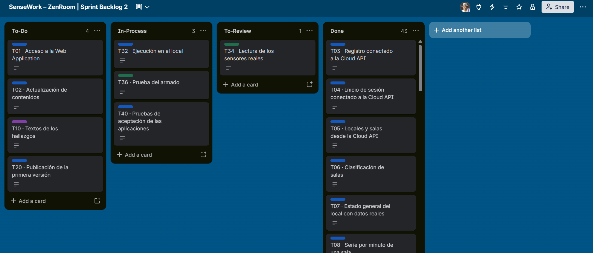</p>

El tablero del sprint se puede consultar en https://trello.com/b/WcwRBQlk

En la tabla están las historias del Sprint 2 con sus tareas. Las filas de "Tareas generales" son tareas que el proyecto necesita aunque no correspondan a una historia, como el despliegue, las pruebas o las entrevistas de validación.

**Tabla 2**

*Sprint Backlog 2: historias y tareas del sprint.*

| Sprint \# | Story Id | Story Title | Task Id | Task Title | Task Description | Estimation (Hours) | Assigned To | Status |
| :---- | :---- | :---- | :---- | :---- | :---- | :---: | :---- | :---- |
| Sprint 2 | Transversal | Tareas generales de la Landing Page | T01 | Acceso a la Web Application | Agregar en la cabecera el acceso al inicio de sesión de la Web Application desplegada y enlazar la descarga de la Mobile Application. | 2 | Llamccaya, Juan Paul | To-Do |
|  |  |  | T02 | Actualización de contenidos | Reemplazar las imágenes de la sección de la aplicación móvil y de funcionalidades por capturas de las versiones del Sprint 2, en inglés y en español. | 3 | Llamccaya, Juan Paul | To-Do |
|  | US08 | Registrarse como administrador | T03 | Registro conectado a la Cloud API | Enviar el formulario de registro a POST /api/v1/users y mostrar los errores del catálogo, como el correo ya registrado. | 3 | Luyo, Sandra | Done |
|  | US09 | Iniciar sesión en la plataforma | T04 | Inicio de sesión conectado a la Cloud API | Autenticar con POST /api/v1/auth/login, guardar el token con su rol y su expiración, y cerrar la sesión al vencer el token. | 4 | Luyo, Sandra | Done |
|  | US11 | Registrar locales y salas | T05 | Locales y salas desde la Cloud API | Listar y registrar locales en /api/v1/sites y listar las salas de cada local desde /api/v1/rooms, con los estados de carga, vacío y error. | 5 | Luyo, Sandra | Done |
|  | US12 | Clasificar salas por tipo | T06 | Clasificación de salas | Listar las salas sin tipo desde /api/v1/rooms/unclassified y asignar el tipo con PATCH /api/v1/rooms/{roomId}. | 3 | Solis, Giancarlo | Done |
|  | US40 | Consultar el estado general del local | T07 | Estado general del local con datos reales | Construir las tarjetas de Site Overview a partir de GET /api/v1/rooms y de los umbrales de cada tipo de sala, y marcar las salas sin lectura vigente. | 5 | Luyo, Sandra | Done |
|  | US19 | Consultar la serie por minuto de una sala | T08 | Serie por minuto de una sala | Mostrar en Room Detail la serie de GET /api/v1/rooms/{roomId}/readings con selector de rango y la línea del umbral. | 5 | Huarcaya, Gilbert | Done |
|  | US24 | Consultar tendencias históricas por sala | T09 | Análisis de una sala por periodo | Implementar en Insights el selector de mes, semana o día, la cobertura de datos, los hallazgos y las medidas con su veredicto de GET /api/v1/insights/rooms/{roomId}. | 6 | Solis, Giancarlo | Done |
|  |  |  | T10 | Textos de los hallazgos | Traducir al inglés y al español cada clave de hallazgo y de veredicto que devuelve el servicio. | 2 | Llamccaya, Juan Paul | To-Do |
|  | US38 | Comparar condiciones entre salas | T11 | Comparación de salas del local | Mostrar el ranking de GET /api/v1/insights/sites/{siteId}/rooms con el porcentaje de cumplimiento de cada sala frente a su umbral. | 4 | Lang, Werner | Done |
|  | US34 | Consultar el estado de los dispositivos | T12 | Estado de los dispositivos | Conectar la pantalla Devices a GET /api/v1/devices y destacar los dispositivos que llevan más de cinco minutos sin reportar. | 3 | Lang, Werner | Done |
|  | US35 | Consultar el estado de conectividad de una sala | T13 | Conectividad de las salas | Mostrar el estado de cada Edge (online, stale u offline) de GET /api/v1/edges y diferenciar una sala sin datos por falla de comunicación de una sala en silencio. | 4 | Huarcaya, Gilbert | Done |
|  | Transversal | Tareas generales de la Web Application | T14 | Publicación conectada a Azure | Apuntar la variable VITE_CLOUD_API_URL al servicio desplegado en Azure, desactivar el modo de demostración en producción y volver a publicar en Vercel. | 3 | Lang, Werner | Done |
|  | US15 | Consultar el semáforo de confort de las salas | T15 | Lista de salas con semáforo | Construir la pantalla Rooms con el estado de confort de cada sala a partir de GET /api/v1/rooms, siempre con la etiqueta de texto junto al color. | 5 | Llamccaya, Juan Paul | Done |
|  | US30 | Consultar las condiciones ambientales actuales | T16 | Condiciones actuales de una sala | Mostrar el ruido, la temperatura, la humedad y la presencia de la última lectura de GET /api/v1/rooms/{roomId}/readings/latest. | 4 | Luyo, Sandra | Done |
|  | US31 | Consultar el detalle de una sala | T17 | Detalle de una sala | Completar Room Detail con el tipo de sala, sus umbrales y la hora de la última lectura. | 3 | Luyo, Sandra | Done |
|  | US17 | Consultar el histórico de tranquilidad por hora | T18 | Histórico de tranquilidad por hora | Graficar las 24 franjas de GET /api/v1/insights/rooms/{roomId}/hourly-profile y resaltar las horas de menor ruido. | 5 | Llamccaya, Juan Paul | Done |
|  | Transversal | Tareas generales de la Mobile Application | T19 | Cliente HTTP de la Cloud API | Implementar el cliente que adjunta el token, apunta a la URL de Azure y traduce los códigos de error del catálogo. | 3 | Llamccaya, Juan Paul | Done |
|  |  |  | T20 | Publicación de la primera versión | Generar el APK firmado de la primera versión y publicarlo como release del repositorio zenroom-mobile-app. | 3 | Lang, Werner | To-Do |
|  | TS6 | Ingesta de agregados desde la Edge | T21 | Ingesta de lotes del Edge real | Comprobar POST /api/v1/readings con lotes enviados por el Edge del local: lecturas aceptadas, insertadas y repetidas, y rechazo sin el permiso readings:write. | 4 | Huarcaya, Gilbert | Done |
|  | TS12 | Cálculo de tendencias y correlaciones | T22 | Análisis por periodo | Resolver el periodo en la zona horaria del local y calcular la cobertura, los episodios de ruido, los percentiles frente al umbral y la comparación con el periodo anterior, con un veredicto por medida. | 10 | Espino, Alejandro | Done |
|  |  |  | T23 | Perfil horario y comparativa de salas | Exponer el perfil de 24 franjas de una sala y la comparativa de las salas de un local ordenada por cumplimiento. | 6 | Espino, Alejandro | Done |
|  | TS24 | Consulta del estado de los dispositivos | T24 | Dispositivos callados | Exponer GET /api/v1/devices con la última conexión de cada dispositivo y el indicador silent tras cinco minutos sin reportar. | 4 | Espino, Alejandro | Done |
|  | Transversal | Tareas generales de los RESTful Web Services | T25 | Latido de los Edge | Recibir el latido de cada Edge con el permiso edges:heartbeat y calcular su estado online, stale u offline según el tiempo sin latido. | 5 | Espino, Alejandro | Done |
|  |  |  | T26 | Cuentas y credenciales de máquina | Listar las cuentas para el administrador y listar o revocar las credenciales de máquina sin exponer la clave. | 4 | Espino, Alejandro | Done |
|  |  |  | T27 | Configuración de producción | Leer la clave de firma de los tokens desde el entorno, resolver CORS antes de la autorización y publicar Swagger en producción. | 3 | Espino, Alejandro | Done |
|  | TS2 | Recepción y validación de lotes en la Edge | T28 | Validación de lecturas del dispositivo | Validar el formato, los rangos físicos y el identificador de cada lectura recibida del ESP32 antes de guardarla. | 4 | Espino, Alejandro | Done |
|  | TS16 | Recepción de histogramas mediante broker | T29 | Broker MQTT del local | Levantar Mosquitto en el equipo del local y suscribir la Edge API al tópico de lecturas de las salas. | 4 | Huarcaya, Gilbert | Done |
|  | TS3 | Agregación por minuto y cálculo de indicadores | T30 | Agregado por minuto con datos reales | Contrastar el LAeq, los percentiles L10, L50 y L90 y el PMV y PPD del agregado por minuto con las lecturas del dispositivo físico. | 6 | Espino, Alejandro | Done |
|  | Transversal | Tareas generales de la Edge API | T31 | Latido hacia la Cloud API | Enviar cada minuto el latido del Edge con su versión, la cantidad de minutos pendientes de subir y las salas que atiende. | 3 | Espino, Alejandro | Done |
|  |  |  | T32 | Ejecución en el local | Instalar la Edge API en el equipo del local con su credencial de máquina y verificar la subida de agregados a Azure. | 4 | Lang, Werner | In-Process |
|  | TS1 | Captura de mediciones en el dispositivo | T33 | Armado del prototipo físico | Ensamblar en protoboard el ESP32 DEVKIT V1 con el DHT22, el potenciómetro que simula el micrófono, el sensor de presencia PIR, el sensor ultrasónico, los LED de la puerta, el buzzer y los tres pulsadores según la Guía de conexiones. | 6 | Huarcaya, Gilbert | Done |
|  |  |  | T34 | Lectura de los sensores reales | Leer el DHT22 por GPIO 23, el potenciómetro por GPIO 34 como nivel de ruido y el PIR por GPIO 27, y publicar lotes de 10 segundos con histograma, sin cambiar la evaluación del confort. | 8 | Huarcaya, Gilbert | To-Review |
|  |  |  | T35 | Publicación de lecturas y luz de la puerta | Publicar cada lectura por MQTT hacia la Edge API y encender la luz de la puerta según los umbrales vigentes. | 5 | Espino, Alejandro | Done |
|  |  |  | T36 | Prueba del armado | Comprobar la alimentación, las conexiones y las lecturas básicas de cada sensor, y registrar fotografías y video del armado. | 3 | Huarcaya, Gilbert | In-Process |
|  | Transversal | Tareas generales de despliegue | T37 | Despliegue de la Cloud API en Azure | Crear la base de datos PostgreSQL 18, el registro de contenedores, la identidad administrada y la Container App, y verificar el servicio desplegado. | 8 | Espino, Alejandro | Done |
|  |  |  | T38 | Integración y despliegue continuos | Ejecutar la suite de pruebas en cada pull request y desplegar en Azure cada release publicado con GitHub Actions. | 5 | Espino, Alejandro | Done |
|  | Transversal | Tareas generales de pruebas | T39 | Pruebas de los servicios del Sprint 2 | Escribir las pruebas unitarias y de integración de cada endpoint nuevo, con los códigos de respuesta por rol y por permiso de máquina. | 8 | Espino, Alejandro | Done |
|  |  |  | T40 | Pruebas de aceptación de las aplicaciones | Verificar los escenarios Gherkin de las historias de la Web Application y de la Mobile Application sobre las versiones desplegadas. | 6 | Solis, Giancarlo | In-Process |
|  |  |  | T41 | Pruebas de la cadena de telemetría | Seguir una lectura desde el dispositivo hasta la Cloud API y comprobar que aparece en la serie por minuto de la sala. | 4 | Solis, Giancarlo | Done |
|  | Transversal | Tareas generales de las entrevistas de validación | T42 | Diseño de la sesión de validación | Preparar por segmento el guion, las tareas y las preguntas, y definir los flujos del Landing Page y de las aplicaciones que se evaluarán. | 4 | Huarcaya, Gilbert | Done |
|  |  |  | T43 | Convocatoria de participantes | Contactar y agendar de tres a cinco participantes por segmento objetivo. | 3 | Luyo, Sandra | Done |
|  |  |  | T44 | Entrevistas del segmento de miembros | Conducir y grabar las sesiones con miembros de coworking. | 5 | Llamccaya, Juan Paul | Done |
|  |  |  | T45 | Entrevistas del segmento de administradores | Conducir y grabar las sesiones con administradores de coworking. | 5 | Huarcaya, Gilbert | Done |
|  |  |  | T46 | Video de las entrevistas | Editar en un solo video las sesiones grabadas y publicarlo en Microsoft Stream. | 4 | Lang, Werner | Done |
|  |  |  | T47 | Registro y evaluación heurística | Redactar el resumen de cada entrevista y consolidar los problemas encontrados con el formato de evaluación heurística. | 6 | Solis, Giancarlo | Done |
|  | US10 | Gestionar cuentas de miembros | T48 | Desactivar y reactivar cuentas de miembros | Exponer PATCH /api/v1/users/{id} para desactivar y reactivar cuentas de miembro sin permitir desactivar a un administrador, y agregar la acción en la pantalla Members de la Web Application. | 4 | Huarcaya, Gilbert | Done |
|  | US25 | Correlacionar condiciones interiores con el clima exterior | T49 | Correlación con el clima exterior | Muestrear el clima de Lima con OpenWeather cada diez minutos y emparejar cada observación con las lecturas interiores a menos de cinco minutos para calcular la correlación. | 6 | Espino, Alejandro | Done |
|  | TS5 | Cola de retransmisión y deduplicación | T50 | Reenvío de minutos pendientes | Conservar en la Edge API los minutos que no pudieron subirse y reenviarlos al recuperar la conexión con la Cloud API. | 4 | Espino, Alejandro | Done |
|  |  |  | T51 | Deduplicación de lotes y minutos tardíos | Descartar los lotes repetidos por dispositivo, arranque y secuencia, y recalcular el minuto cuando llega un lote tardío. | 5 | Luyo, Sandra | Done |
| | | | | **Total** | | **231** | | |

Al cierre del Sprint 2 el tablero registra 43 tareas en Done, 3 en In-Process, 1 en To-Review y 4 en To-Do. Las tareas T03 a T08 conectan con la Cloud API las historias US08, US09, US11, US12, US40 y US19 del Sprint 1, que hasta TB1 usaban datos de muestra, y por eso se agrupan como tareas generales de la Web Application. Las tareas T48 a T51 detallan las historias US10, US25 y TS5 del Sprint Planning 2.

Lo que sigue abierto y pasa al siguiente sprint es la prueba del armado del dispositivo físico (T36) y la revisión de la lectura de sus sensores (T34), la instalación de la Edge API en el equipo del local (T32), la publicación de la primera versión de la Mobile Application (T20), los textos de los hallazgos de Insights en la Web Application (T10), los contenidos de la Landing Page (T01 y T02) y las pruebas de aceptación sobre las aplicaciones desplegadas (T40).

Al cierre del Sprint 2, el Product Backlog registraba 38 historias en Done, 13 en In Progress y 14 sin iniciar. El tablero se puede consultar en https://trello.com/b/nn477GGQ.

<p align="center"><em>Figura 114.</em> Estado del Product Backlog al cierre del Sprint 2.</p>

<p align="center">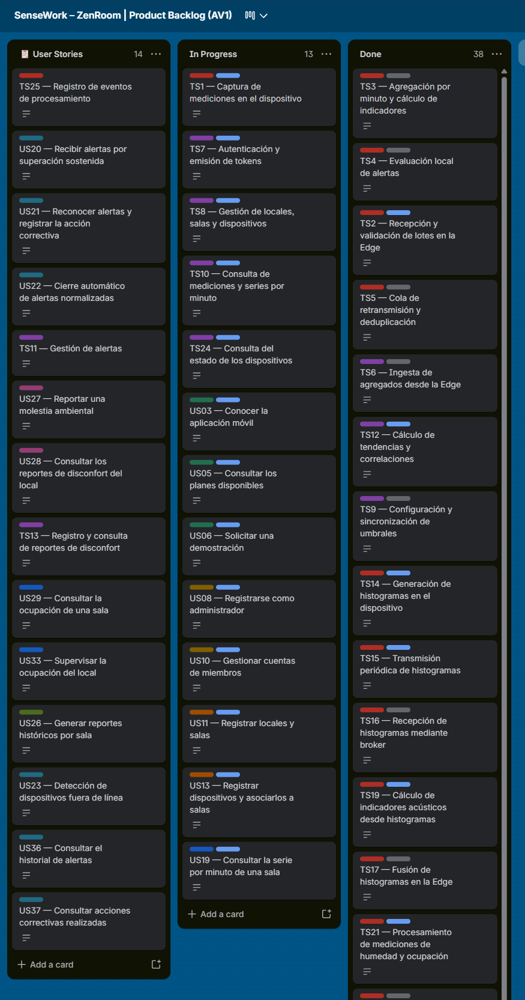</p>

**Alcance del siguiente sprint**

Con la cadena de mediciones integrada, el siguiente sprint cierra lo que el producto todavía no muestra. El equipo ordenó ese trabajo en un plan por tema, con el contrato, los cambios por repositorio y las pruebas de cada uno. Los cuatro primeros temas cierran el sprint, y el resto queda con su plan para el sprint posterior.

| Tema | Historias | Qué incluye | Punto de partida |
| :---- | :---- | :---- | :---- |
| Dispositivo físico | TS1 | Acta de aceptación con el ESP32 armado: firmware por MQTT, lecturas del DHT22, el potenciómetro y el PIR, registro serie y fotografías. | El firmware compila y funciona en el simulador con el mismo código y los mismos pines; falta la prueba sobre la placa. |
| Alertas | US20, US21, US22, US36, US37 | Abrir una alerta cuando el ruido sostenido supera el umbral, mostrarla en web y móvil, reconocerla con una acción correctiva y cerrarla al normalizarse. | El Edge ya evalúa y cierra alertas en el local; falta subirlas a la Cloud API y mostrarlas. |
| Reportes de incomodidad | US27, US28 | El miembro envía un reporte y el administrador lo ve junto con la lectura del momento. | La pantalla existe sin función. |
| Clima exterior desplegado | US25 | Definir la clave de OpenWeather en Azure y publicar un release con lo integrado en develop. | La Cloud API guarda una observación cada diez minutos en el entorno local. |
| Ocupación | US29, US32, US33, US39 | Consultas de ocupación actual, por supervisión e histórica, con su visualización. | La ocupación ya llega en cada lectura. |
| Reportes históricos | US26 | Exportar el resumen de un periodo en PDF. | La exportación en CSV existe. |
| Luz de la puerta | US35 | Ordenar el modo de la luz desde la Web Application. | El dispositivo ya recibe el límite de temperatura por MQTT. |
| Hardware | Prototipo físico | TLS en MQTT, configuración de la red sin recompilar, y pruebas del sensor ultrasónico y de los pulsadores. | El sketch del montaje real ya incluye ultrasonido, pulsadores y buzzer. |
| Invitaciones y alta de salas | US10, US08, US11, US13 | Invitar miembros por correo, administrador inicial, alta manual de salas y pre-registro de dispositivos. | Las cuentas se crean con contraseña desde el registro. |
| Pruebas automáticas | Calidad | Pruebas automáticas de la Web Application, la Mobile Application y el Edge dentro de la integración continua. | La Cloud API ya corre su suite en cada pull request. |

El orden propuesto es el acta del dispositivo real, los reportes de incomodidad, las alertas sin correo y el despliegue con la clave de OpenWeather; después las invitaciones y el correo de las alertas, la ocupación, los reportes históricos y la luz de la puerta junto con el hardware, y las pruebas automáticas desde el inicio. El sprint se da por cerrado cuando el dispositivo real tiene su acta, las alertas y los reportes de incomodidad funcionan de punta a punta en web y móvil, el servicio desplegado usa la clave de OpenWeather y la prueba de humo de la cadena pasa sobre el despliegue.

#### 6.2.2.4. Development Evidence for Sprint Review.

En el Sprint 2 el trabajo de los Web Services se concentró en completar el RESTful API para que la Web Application y la Mobile Application puedan dejar de usar datos de demostración, y en desplegarlo en la nube. En el bounded context Insights se rehízo el análisis de una sala: ahora se consulta por un periodo con nombre (un mes, una semana ISO o un día) resuelto en la zona horaria del local, cada cálculo indica si su resultado es concluyente, los minutos de ruido anómalo se agrupan en episodios y se agregan los percentiles del nivel sonoro frente al umbral del tipo de sala, la comparación con el periodo anterior, el perfil por hora del día y la comparativa entre las salas de un local. En Monitoring la sala informa su local y su tipo, se listan los dispositivos con su estado y la Edge API reporta un latido cada minuto para saber si sigue en línea. En IAM se listan las cuentas y las credenciales de máquina, que ahora pueden revocarse, y la clave de firma de los tokens se lee de una variable de entorno para que los tokens sobrevivan a los reinicios del servicio desplegado.

| Repository | Branch | Commit Id | Commit Message | Commit Message Body | Committed on (Date) |
|---|---|---|---|---|---|
| Grupo03-IOT/cloud-api | dev | `539997a` | feat(insights): analyse rooms by named period with verdicts and rankings | — | 12/10/2026 |
| Grupo03-IOT/cloud-api | dev | `a343636` | feat(monitoring): tell each room's site and type | — | 12/10/2026 |
| Grupo03-IOT/cloud-api | dev | `1f19b57` | feat(monitoring): list devices and whether they are silent | — | 12/10/2026 |
| Grupo03-IOT/cloud-api | dev | `7aa752f` | feat(monitoring): know whether each edge is alive from its heartbeat | — | 12/10/2026 |
| Grupo03-IOT/cloud-api | dev | `b35a77d` | feat(iam): list users and list or revoke machine credentials | — | 12/10/2026 |
| Grupo03-IOT/cloud-api | dev | `31a64a3` | build: move the local database to postgres 18 | — | 12/10/2026 |
| Grupo03-IOT/cloud-api | dev | `f6a782c` | feat(iam): read the token signing key from the environment | — | 12/10/2026 |
| Grupo03-IOT/cloud-api | dev | `28b0b84` | fix(iam): resolve cors before authorization | — | 12/10/2026 |
| Grupo03-IOT/cloud-api | dev | `6d326f9` | build: expose swagger in production | — | 12/10/2026 |
| Grupo03-IOT/cloud-api | hotfix/1.2.1 | `4f634b4` | fix(insights): keep the openweather key out of the logs | — | 13/10/2026 |
| Grupo03-IOT/cloud-api | hotfix/1.2.2 | `57c8758` | fix(shared): point the api documentation at the server that serves it | — | 13/10/2026 |
| Grupo03-IOT/cloud-api | hotfix/1.2.3 | `5402da7` | fix(shared): declare bearer and api key authentication in the api documentation | — | 13/10/2026 |
| Grupo03-IOT/cloud-api | feature/ci-cd | `76b9676` | ci: run the test suite on every pull request | — | 13/10/2026 |
| Grupo03-IOT/cloud-api | feature/ci-cd | `6fb41b2` | ci: deploy to azure on every published release | — | 13/10/2026 |
| Grupo03-IOT/edge-api | dev | `496ecb4` | feat(edge): send a heartbeat to the cloud every minute | — | 12/10/2026 |
| Grupo03-IOT/cloud-api | feature/harden-deploy | `1208b6c` | ci: deploy only from release tags | — | 28/10/2026 |
| Grupo03-IOT/cloud-api | fix/period-description | `df28d83` | fix(insights): describe the period parameter in english | — | 28/10/2026 |
| Grupo03-IOT/edge-api | fix/simulator-timezone | `a4c67e4` | fix(simulator): schedule occupancy in the site's time zone | — | 28/10/2026 |
| Grupo03-IOT/cloud-api | feature/room-temperature-forecast | `ce32351` | feat: persist temperature forecasts with room readings | — | 05/11/2026 |
| Grupo03-IOT/cloud-api | feature/room-temperature-forecast | `17d87de` | feat: include forecasts in latest room summaries | — | 05/11/2026 |
| Grupo03-IOT/edge-api | feature/device-forecast-mqtt | `df404d8` | feat: ingest and forward device temperature forecasts | — | 05/11/2026 |
| Grupo03-IOT/edge-api | feature/windows-tzdata-simulator | `7db14a6` | fix(edge): add Windows time zone data for simulator | — | 05/11/2026 |
| Grupo03-IOT/cloud-api | fix/ci-develop | `19973d1` | ci: run the test suite on the develop branch | — | 07/11/2026 |
| Grupo03-IOT/cloud-api | fix/device-state-reboot | `52f2714` | feat(iam): disable and re-enable member accounts; fix device state after a reboot | — | 08/11/2026 |
| Grupo03-IOT/cloud-api | integracion/iot-connection | `f9c7af9` | feat(monitoring): resolve the site by the code the Edge declares and update late minutes | — | 08/11/2026 |
| Grupo03-IOT/edge-api | integracion/iot-connection | `5e8b83e` | feat(edge): validate batches, deduplicate retries and recalculate late minutes | — | 08/11/2026 |
| Grupo03-IOT/edge-api | integracion/iot-connection | `71a0f8c` | test(edge): the device forecast reaches the minute aggregate and an invalid one is rejected | — | 08/11/2026 |

Cada funcionalidad se integró como una rebanada vertical —dominio, aplicación, persistencia, interfaz REST y sus pruebas en el mismo commit—, siguiendo la convención de la sección 6.1.2. En la segunda mitad del sprint se integró la cadena con el dispositivo: el Edge recibe por MQTT el pronóstico de temperatura que calcula el ESP32 y lo reenvía con cada minuto, la Cloud API lo guarda y lo devuelve en el resumen de la sala, el Edge valida los lotes, descarta los reintentos duplicados y recalcula los minutos que llegan tarde, y la Cloud API resuelve el local por el código que declara el Edge. También se añadió la desactivación de cuentas de miembros (US10), se corrigió el estado de un dispositivo después de reiniciarse (TS24), el despliegue quedó restringido a las etiquetas de versión y la integración continua pasó a la rama develop. Las versiones se publicaron en `main` como `v1.1.0`, `v1.2.0`, `v1.2.1`, `v1.2.2`, `v1.2.3`, `v1.3.0` y `v1.4.0` del repositorio cloud-api, y `v1.1.0` y `v1.2.0` del repositorio edge-api.

#### 6.2.2.5. Testing Suite Evidence for Sprint Review.

Las pruebas del Sprint 2 acompañan a cada rebanada vertical del RESTful API y se agregan a la suite del Sprint 1. Las pruebas unitarias cubren los cálculos del servicio de dominio de Insights, que no necesitan base de datos, y las reglas de los agregados nuevos o modificados. Las pruebas de integración levantan cada controlador con su configuración de seguridad real y comprueban los códigos de respuesta por rol y por permiso de máquina. La suite está en `src/test/java/com/pe/cloudapi` del repositorio https://github.com/Grupo03-IOT/cloud-api y se ejecuta con `./gradlew test`.

| Nivel | Clase de prueba | Qué comprueba | Historias | Pruebas |
|---|---|---|---|---|
| Unitaria | ComfortAnalyticsServiceTest | Picos de ruido comparados con el estado de ocupación de la sala, episodios, emparejamiento con la temperatura exterior dentro de cinco minutos, veredictos y hallazgos, percentiles y tiempo sobre el umbral, comparación con el periodo anterior, perfil horario con promedio energético y orden de la comparativa entre salas | TS12, US17, US24, US25, US26, US38 | 28 |
| Unitaria | PeriodTest | Los tres formatos de periodo, el mes resuelto en la zona horaria de Lima, la semana 53 y el periodo anterior | TS12 | 6 |
| Unitaria | GatewayTest | El Edge pasa de en línea a degradado y a caído según el tiempo sin latido, y no retrocede ante un latido atrasado | US35 | 3 |
| Unitaria | DeviceTest | Un dispositivo se considera callado tras cinco minutos sin reportar | TS24, US34 | 1 |
| Unitaria | ApiCredentialTest | Una credencial revocada deja de poder usarse | TS7 | 1 |
| Unitaria | JwtConfigurationTest | La clave de firma se lee en PKCS#8 con un identificador estable y se rechaza un valor inválido | TS7 | 3 |
| Unitaria | OpenWeatherAdapterTest | Un fallo del proveedor se registra sin exponer la clave del servicio | US25 | 1 |
| Integración | RoomAnalyticsControllerTest | Análisis de un periodo sin lecturas, periodo inválido o ausente, perfil de 24 horas, comparativa reservada al administrador y acceso sin token | TS12, US17, US38 | 6 |
| Integración | EdgesControllerTest | El latido se acepta con el permiso `edges:heartbeat` y se rechaza con otro permiso | US35 | 2 |
| Integración | CredentialsControllerTest | Listado sin la clave, revocación, credencial inexistente y revocación por un miembro | TS7 | 4 |
| Integración | UsersControllerTest | Listado de cuentas para el administrador y rechazo para un miembro | US10 | 2 |

<p align="center"><em>Figura 115.</em> Ejecución de las pruebas en Visual Studio Code.</p>

<p align="center">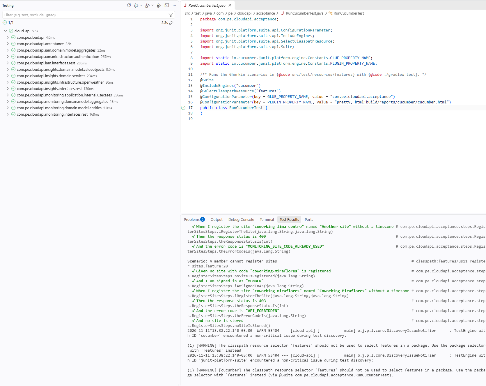</p>

<p align="center"><em>Figura 116.</em> Ejecución del workflow de integración continua en GitHub Actions.</p>

<p align="center">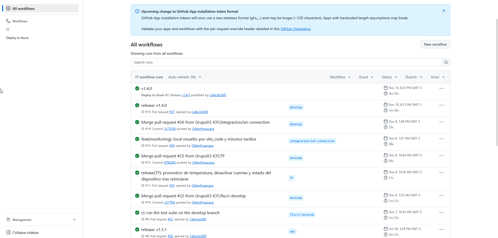</p>

Los commits que incorporaron estas pruebas son los siguientes:

| Repository | Branch | Commit Id | Message | Message Body | Committed on |
|---|---|---|---|---|---|
| cloud-api | dev | `539997a` | feat(insights): analyse rooms by named period with verdicts and rankings | — | 12/10/2026 |
| cloud-api | dev | `1f19b57` | feat(monitoring): list devices and whether they are silent | — | 12/10/2026 |
| cloud-api | dev | `7aa752f` | feat(monitoring): know whether each edge is alive from its heartbeat | — | 12/10/2026 |
| cloud-api | dev | `b35a77d` | feat(iam): list users and list or revoke machine credentials | — | 12/10/2026 |
| cloud-api | dev | `f6a782c` | feat(iam): read the token signing key from the environment | — | 12/10/2026 |
| cloud-api | hotfix/1.2.1 | `4f634b4` | fix(insights): keep the openweather key out of the logs | — | 13/10/2026 |

Las pruebas de la tabla suman 57; con las del Sprint 1, la suite completa tiene 71 pruebas. Desde la versión `v1.3.0` la suite se ejecuta automáticamente en GitHub Actions en cada pull request hacia `dev` o `main`, contra un servicio PostgreSQL 18, y el informe de resultados queda disponible como artefacto de la ejecución. La primera ejecución terminó con las 71 pruebas aprobadas.

Además de la suite automatizada, cada endpoint se verificó contra la aplicación en ejecución con una base de datos PostgreSQL 18 y un día simulado de tres salas, y después contra el servicio desplegado en Azure.

<a id="6226-execution-evidence-for-sprint-review"></a>
#### 6.2.2.6. Execution Evidence for Sprint Review.

La evidencia de ejecución del Sprint 2 muestra que una lectura recorre la cadena completa de ZenRoom. El dispositivo mide el ruido, la temperatura, la humedad y la presencia de la sala, y cada 10 segundos publica por MQTT un lote con el nivel sonoro de cada segundo y un histograma de 70 casillas. El audio nunca sale del dispositivo. La Edge API del local valida los lotes, los agrega por minuto y los sube a la Cloud API, y la Web Application y la Mobile Application consultan la Cloud API y presentan el estado de cada sala.

El firmware se ejecutó en el simulador Wokwi con el mismo código y los mismos pines del montaje físico, acompañado de dispositivos de prueba que publican con el mismo contrato de lotes. En la figura siguiente el simulador ya conectó a la red y al broker, superó la autoprueba de la red neuronal frente a Keras y quedó suscrito al tópico de comandos de su sala.

<p align="center"><em>Figura 117.</em> Firmware del dispositivo en ejecución: autoprueba del modelo, conexión a la red y suscripción al broker MQTT.</p>

<p align="center">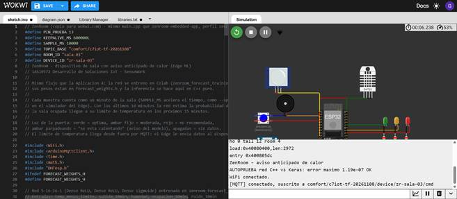</p>

La Web Application del administrador muestra las salas con su estado de confort, su última lectura y su ocupación. Cada sala toma su estado de las lecturas que llegaron por la cadena, y las que no tienen una lectura reciente se marcan como tales.

<p align="center"><em>Figura 118.</em> Resumen del local en la Web Application con tres salas alimentadas por el dispositivo y por dispositivos de prueba.</p>

<p align="center">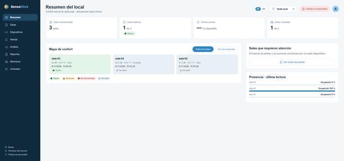</p>

La pantalla de dispositivos lista cada dispositivo con su sala, su estado de conexión, su última conexión, la versión de firmware y los lotes perdidos. El estado conectado se calcula con el último mensaje retenido de cada dispositivo, que el broker actualiza solo cuando el dispositivo se cae.

<p align="center"><em>Figura 119.</em> Dispositivos del local con su estado de conexión, firmware y lotes perdidos.</p>

<p align="center">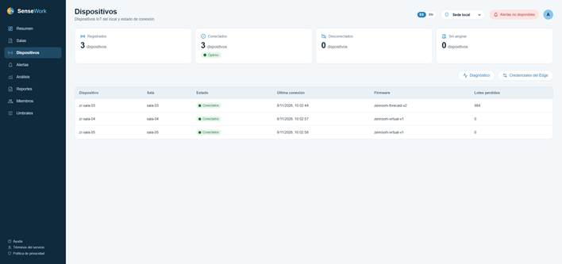</p>

El análisis de una sala combina el ruido, la temperatura y la presencia del periodo elegido con la temperatura exterior, y marca cuándo los datos son suficientes para que una correlación sea confiable.

<p align="center"><em>Figura 120.</em> Análisis de una sala por periodo en la Web Application, con correlación y comparación de salas.</p>

<p align="center">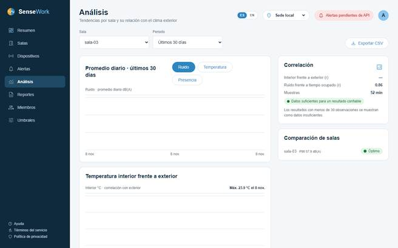</p>

La Mobile Application del miembro lista las salas con el semáforo de confort y sus filtros, y muestra el ruido, la temperatura y la presencia de cada una con los mismos datos que la Web Application.

<p align="center"><em>Figura 121.</em> Lista de salas en la Mobile Application del miembro.</p>

<p align="center">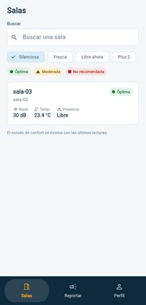</p>

Video de navegación del sprint: —

#### 6.2.2.7. Services Documentation Evidence for Sprint Review.

En el Sprint 2 la documentación OpenAPI del RESTful API quedó publicada junto con el servicio desplegado, por lo que ya no se consulta en una dirección local. Cada endpoint declara en la documentación su propósito, los roles o permisos que exige y los códigos de respuesta posibles. Todas las respuestas usan nombres de propiedad en *snake_case*, y los errores devuelven un código estable del catálogo de su bounded context.

- **Documentación desplegada:** https://cafecito-app.icywater-8ce04e92.northcentralus.azurecontainerapps.io/swagger-ui.html
- **Especificación OpenAPI:** https://cafecito-app.icywater-8ce04e92.northcentralus.azurecontainerapps.io/v3/api-docs
- **Repositorio:** https://github.com/Grupo03-IOT/cloud-api

| Verbo | Endpoint | Acción | Parámetros | Acceso | Respuesta |
|---|---|---|---|---|---|
| POST | `/api/v1/auth/login` | Inicia sesión | Cuerpo: `email`, `password` | Público | 200 con `access_token`, `token_type` y `expires_in` |
| POST | `/api/v1/users` | Registra una cuenta | Cuerpo: `email`, `password`, `display_name` | Público | 201 con la cuenta, siempre como MEMBER |
| GET | `/api/v1/users` | Lista las cuentas con sus roles | — | ADMIN | 200 con la lista, sin contraseñas |
| POST | `/api/v1/credentials` | Emite una credencial de máquina | Cuerpo: `code`, `scopes` | ADMIN | 201 con la clave, que solo se muestra esta vez |
| GET | `/api/v1/credentials` | Lista las credenciales de máquina | — | ADMIN | 200 con código, estado y permisos, sin la clave |
| DELETE | `/api/v1/credentials/{credentialId}` | Revoca una credencial | Ruta: `credentialId` | ADMIN | 204; 404 si no existe |
| GET | `/api/v1/sites` | Lista los locales | — | ADMIN, MEMBER | 200 con código, nombre y zona horaria |
| POST | `/api/v1/sites` | Registra un local | Cuerpo: `code`, `name`, `address`, `timezone` | ADMIN | 201; 409 si el código ya existe |
| GET | `/api/v1/sites/{siteId}/room-types` | Lista los tipos de sala | Ruta: `siteId` | ADMIN, MEMBER | 200 con la lista |
| POST | `/api/v1/sites/{siteId}/room-types` | Registra un tipo de sala | Ruta: `siteId`; cuerpo: `code`, `display_name` | ADMIN | 201 |
| GET | `/api/v1/rooms` | Lista las salas con su última lectura | — | ADMIN, MEMBER | 200 con el local, el tipo y el resumen de la última lectura |
| GET | `/api/v1/rooms/unclassified` | Lista las salas sin tipo | — | ADMIN, MEMBER | 200 con la lista |
| GET | `/api/v1/rooms/{roomId}` | Consulta una sala | Ruta: `roomId` | ADMIN, MEMBER | 200; 404 si no existe |
| PATCH | `/api/v1/rooms/{roomId}` | Asigna un tipo a una sala | Ruta: `roomId`; cuerpo: `room_type_id` | ADMIN | 200 con la sala clasificada |
| GET | `/api/v1/rooms/{roomId}/readings` | Serie por minuto de una sala | Ruta: `roomId`; consulta: `from`, `to` | ADMIN, MEMBER | 200 con las lecturas del rango |
| GET | `/api/v1/rooms/{roomId}/readings/latest` | Última lectura de una sala | Ruta: `roomId` | ADMIN, MEMBER | 200; 404 si aún no reporta |
| POST | `/api/v1/readings` | Recibe un lote de lecturas del Edge | Cuerpo: `readings` | Máquina, `readings:write` | 202 con las lecturas aceptadas, insertadas y repetidas |
| GET | `/api/v1/devices` | Lista los dispositivos y si están callados | Consulta: `roomId` (opcional) | ADMIN | 200 con la última conexión y `silent` |
| POST | `/api/v1/edges/heartbeat` | Registra el latido de un Edge | Cuerpo: `code`, `site_code`, `version`, `pending_upload`, `rooms` | Máquina, `edges:heartbeat` | 204; 404 si el local no existe |
| GET | `/api/v1/edges` | Lista los Edge y si siguen en línea | — | ADMIN | 200 con `status`: `online`, `stale` u `offline` |
| GET | `/api/v1/room-types/{roomTypeId}/thresholds` | Umbrales de un tipo de sala | Ruta: `roomTypeId` | ADMIN, MEMBER | 200 con la lista |
| PUT | `/api/v1/room-types/{roomTypeId}/thresholds/{metric}` | Configura el umbral de una métrica | Ruta: `roomTypeId`, `metric`; cuerpo: `warn_value`, `critical_value`, `sustained_minutes`, `enabled` | ADMIN | 200 con el umbral |
| GET | `/api/v1/room-thresholds` | Umbrales vigentes por sala | — | Máquina, `thresholds:read` | 200 con los umbrales de cada sala |
| GET | `/api/v1/insights/rooms/{roomId}` | Analiza una sala en un periodo | Ruta: `roomId`; consulta: `period` | ADMIN, MEMBER | 200 con cobertura, hallazgos, medidas con veredicto, episodios, distribución y comparación; 400 si el periodo no es válido |
| GET | `/api/v1/insights/rooms/{roomId}/hourly-profile` | Perfil de la sala por hora del día | Ruta: `roomId`; consulta: `period` | ADMIN, MEMBER | 200 con 24 franjas horarias |
| GET | `/api/v1/insights/sites/{siteId}/rooms` | Compara las salas de un local | Ruta: `siteId`; consulta: `period` | ADMIN | 200 con las salas ordenadas de menor a mayor cumplimiento |

El parámetro `period` acepta un mes (`2026-10`), una semana ISO (`2026-W42`) o un día (`2026-10-12`), y se resuelve en la zona horaria del local. Un periodo sin lecturas no produce un error: la respuesta indica una cobertura nula y cada medida con el veredicto `no_data`. Por ejemplo, el análisis de una sala para el mes de octubre devuelve, entre otros campos:

```json
{
  "period": "2026-10",
  "timezone": "America/Lima",
  "data_quality": { "expected_minutes": 44640, "received_minutes": 1440, "coverage_pct": 3.2 },
  "findings": [
    { "code": "noise_follows_occupancy", "value": 0.997, "unit": "pearson_r", "direction": "positive" },
    { "code": "often_above_threshold", "value": 35.8, "unit": "pct_of_time" }
  ],
  "measures": {
    "thermal_drift": { "verdict": "not_enough_evidence", "unit": "degc_per_hour",
                       "confidence": { "sample_size": 1440, "r_squared": 0.301 } }
  },
  "noise_distribution": { "p50": 36.5, "p90": 57.9, "p95": 58.2, "threshold": 55.0, "pct_over": 35.8 }
}
```

Las figuras siguientes muestran las respuestas del servicio desplegado, obtenidas desde la documentación publicada con el usuario administrador. En la comparación de salas, cada sala se mide contra el umbral de su propio tipo: la cabina telefónica registra el ruido más alto, pero no ocupa el primer lugar porque su umbral es más estricto.

<p align="center"><em>Figura 122.</em> Inicio de sesión del administrador en el servicio desplegado.</p>

<p align="center">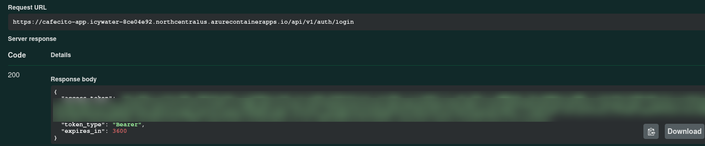</p>

<p align="center"><em>Figura 123.</em> Consulta de los locales registrados.</p>

<p align="center">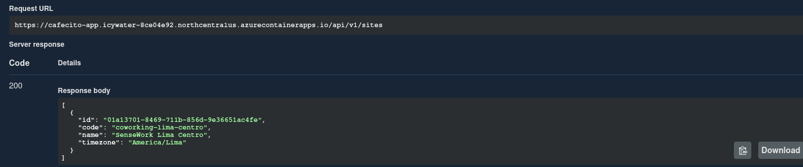</p>

<p align="center"><em>Figura 124.</em> Consulta de las salas con su última lectura.</p>

<p align="center">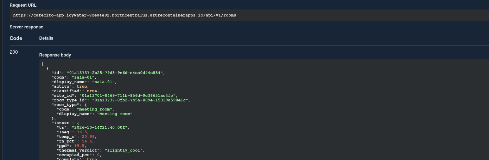</p>

<p align="center"><em>Figura 125.</em> Consulta de los dispositivos de una sala.</p>

<p align="center">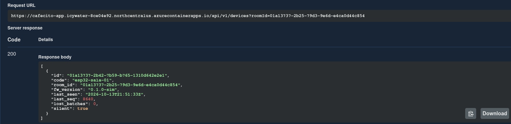</p>

<p align="center"><em>Figura 126.</em> Consulta de los Edge y su latido.</p>

<p align="center">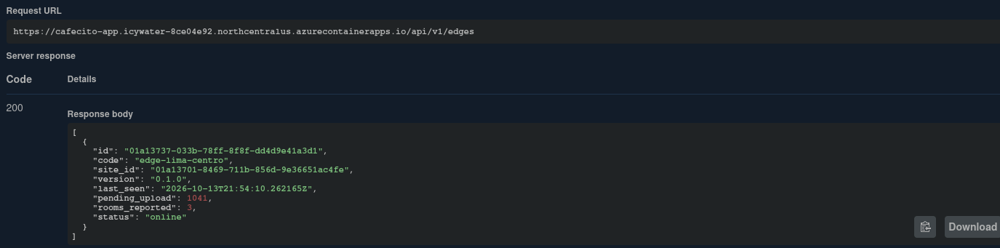</p>

<p align="center"><em>Figura 127.</em> Análisis de una sala en un periodo: cobertura y hallazgos.</p>

<p align="center">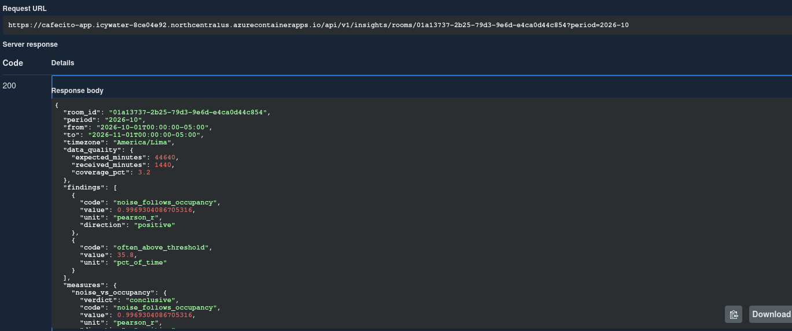</p>

<p align="center"><em>Figura 128.</em> Análisis de una sala en un periodo: medidas, episodios y distribución.</p>

<p align="center">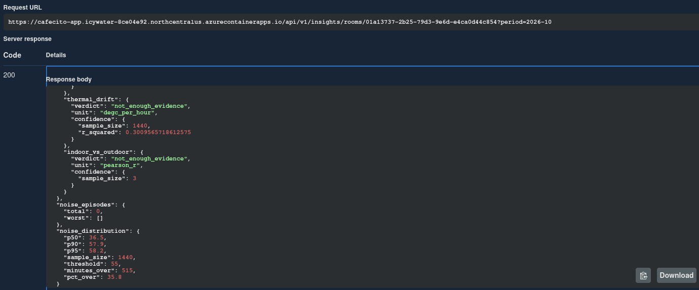</p>

<p align="center"><em>Figura 129.</em> Perfil horario de una sala: primeras franjas.</p>

<p align="center">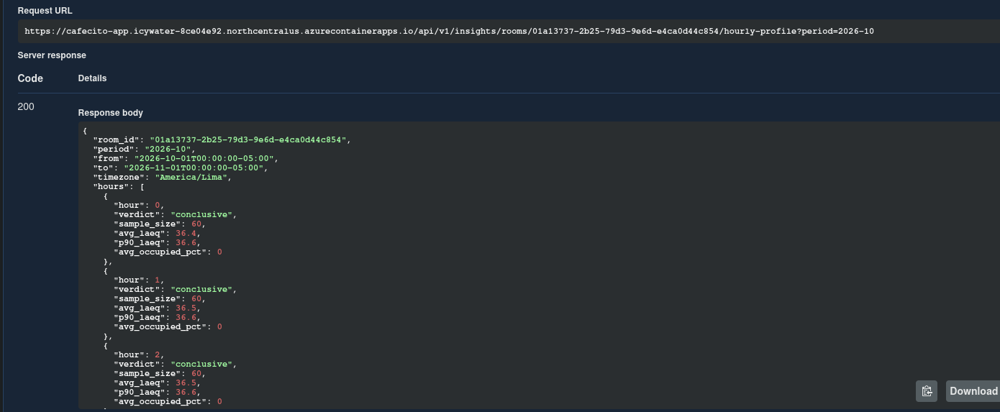</p>

<p align="center"><em>Figura 130.</em> Perfil horario de una sala: últimas franjas.</p>

<p align="center">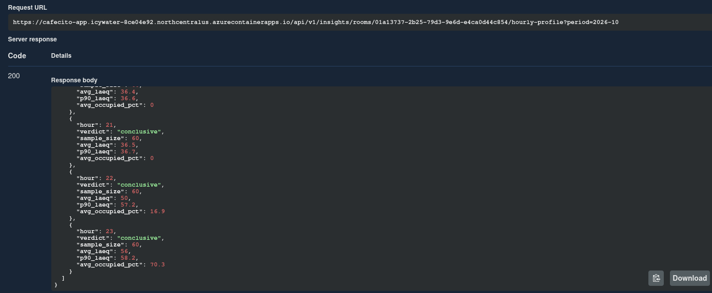</p>

<p align="center"><em>Figura 131.</em> Comparación de las salas de un local: primeras posiciones.</p>

<p align="center">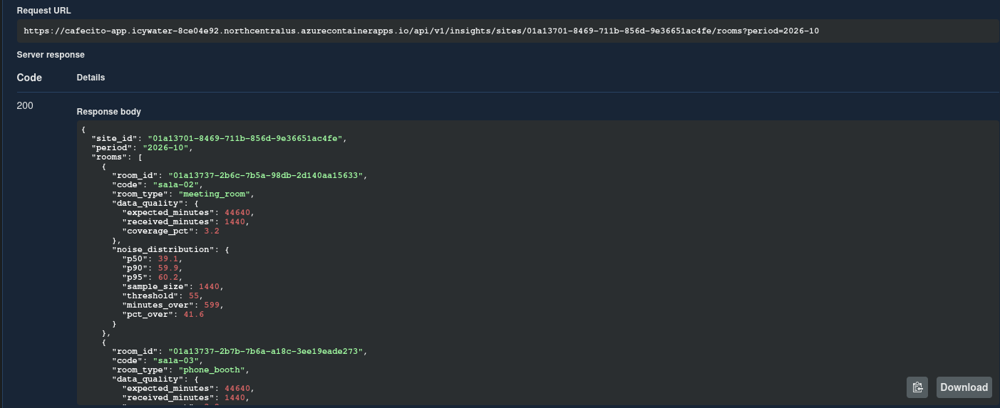</p>

<p align="center"><em>Figura 132.</em> Comparación de las salas de un local: últimas posiciones.</p>

<p align="center">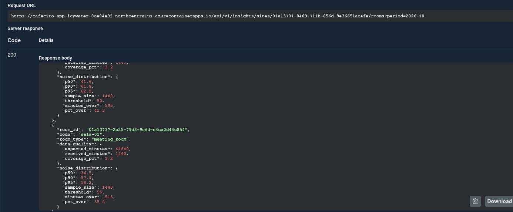</p>

<p align="center"><em>Figura 133.</em> Respuesta de error con el código del catálogo.</p>

<p align="center">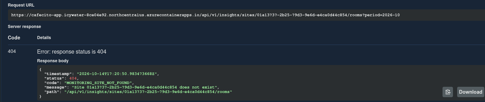</p>

Los textos de las conclusiones no se generan en el servidor: cada hallazgo trae una clave estable, como `noise_follows_occupancy`, que las aplicaciones traducen a inglés y a español.

Los commits relacionados con la documentación de este Sprint son `539997a`, `1f19b57`, `7aa752f` y `b35a77d`, que incorporan la descripción OpenAPI de cada endpoint nuevo, y `6d326f9`, que publica la documentación en el entorno de producción.

#### 6.2.2.8. Software Deployment Evidence for Sprint Review.

En el Sprint 2 se desplegó el RESTful API en Microsoft Azure, con lo que la solución cuenta por primera vez con sus servicios en la nube accesibles públicamente. El despliegue se realizó sobre la suscripción *Azure for Students* de la universidad, en el grupo de recursos `rg-sensework-iot` y en la región North Central US, siguiendo el procedimiento de la sección 6.1.4. La dirección del servicio desplegado es https://cafecito-app.icywater-8ce04e92.northcentralus.azurecontainerapps.io.

Las actividades realizadas fueron las siguientes:

1. **Preparación de la suscripción.** Se registraron los proveedores de recursos de Container Apps, PostgreSQL, Container Registry y Log Analytics. La suscripción solo permite desplegar en cinco regiones; de ellas se eligió North Central US por su menor costo.
2. **Base de datos.** Se creó un servidor de Azure Database for PostgreSQL 18 en el nivel Burstable B1ms, con 32 GiB de almacenamiento y sin alta disponibilidad, y la base de datos `comfort`. El acceso queda restringido por firewall a los servicios de Azure y a las direcciones registradas, y las conexiones son cifradas.
3. **Registro de imágenes.** Se creó un Azure Container Registry de nivel Basic con el usuario administrador deshabilitado, y se publicó en él la imagen del RESTful API construida con el Dockerfile de dos etapas.
4. **Identidad y permisos.** Se creó una identidad administrada asignada por el usuario y se le otorgó el rol `AcrPull` sobre el registro, el mínimo necesario para descargar la imagen. Los entornos de Container Apps de la suscripción no admiten identidades asignadas por el sistema, por lo que la aplicación se creó con la identidad propia desde Azure CLI.
5. **Entorno y aplicación.** Se creó el entorno de Container Apps con el perfil Consumption, conectado a un Log Analytics workspace, y la aplicación con una réplica permanente —necesaria porque el muestreo del servicio meteorológico se ejecuta cada diez minutos— e ingreso externo solo por HTTPS.
6. **Configuración.** Se registraron como secretos la contraseña de la base de datos, la clave de firma de los tokens y la clave del servicio meteorológico, y se definieron las variables de entorno del perfil de producción.
7. **Verificación.** El servicio responde `UP` en `/actuator/health`, Flyway aplicó las migraciones de los cuatro esquemas en la base de datos de Azure, la documentación OpenAPI está publicada y las pruebas de humo confirmaron el registro, el inicio de sesión, el rechazo de peticiones sin token (401), el rechazo por rol (403) y la redirección de HTTP a HTTPS.
8. **Despliegue continuo.** Se creó la identidad `id-github-cloud-api`, con los roles `AcrPush` sobre el registro y *Container Apps Contributor* sobre el grupo de recursos, y una credencial federada que solo acepta al repositorio `cloud-api` en su entorno `production`. Con ella, el flujo `deploy.yml` desplegó el release `v1.3.0` sin intervención manual y comprobó el estado `UP` del servicio.

<p align="center"><em>Figura 134.</em> Cómputo y almacenamiento del servidor de Azure Database for PostgreSQL.</p>

<p align="center">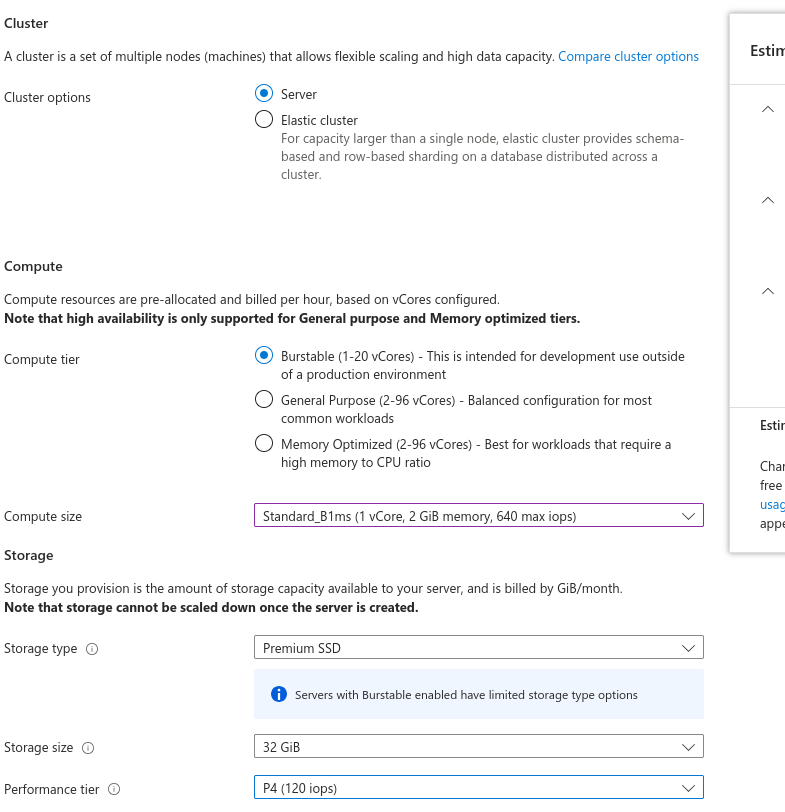</p>

<p align="center"><em>Figura 135.</em> Reglas de red del servidor PostgreSQL.</p>

<p align="center">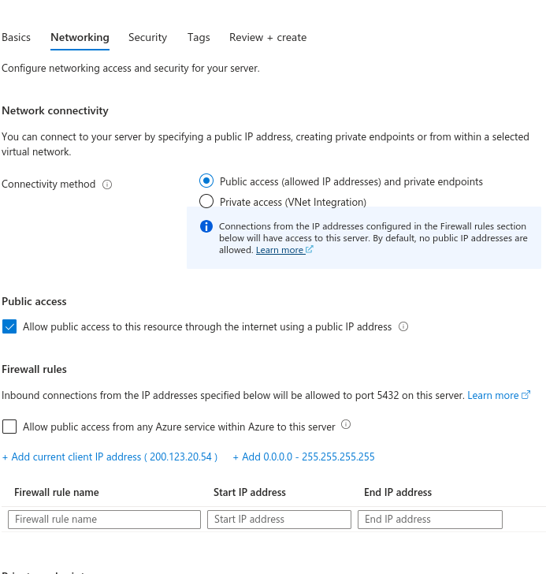</p>

<p align="center"><em>Figura 136.</em> Modo de permisos del Azure Container Registry.</p>

<p align="center">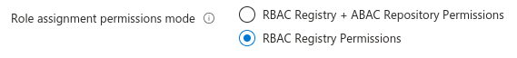</p>

<p align="center"><em>Figura 137.</em> Creación del entorno de Container Apps.</p>

<p align="center">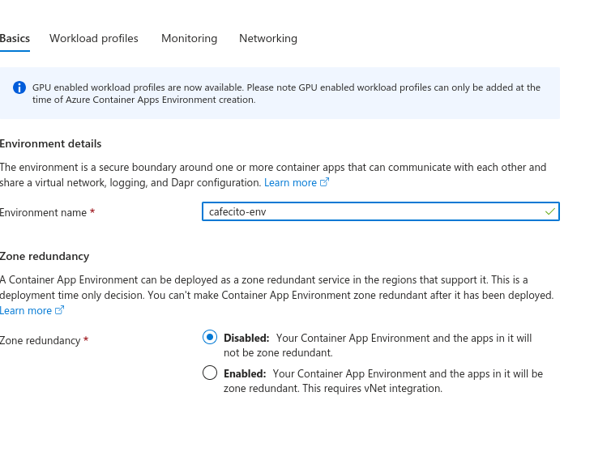</p>

<p align="center"><em>Figura 138.</em> Red del entorno de Container Apps.</p>

<p align="center">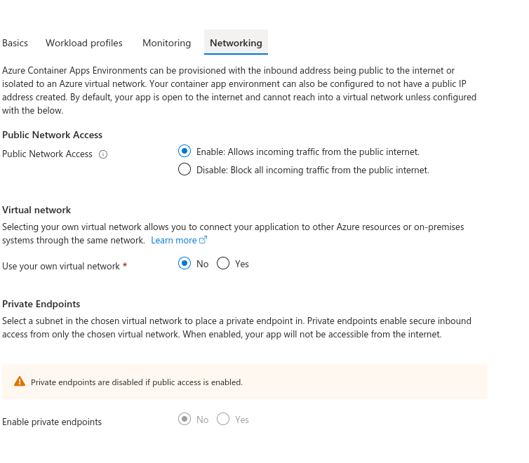</p>

<p align="center"><em>Figura 139.</em> Creación de la identidad administrada de la aplicación.</p>

<p align="center">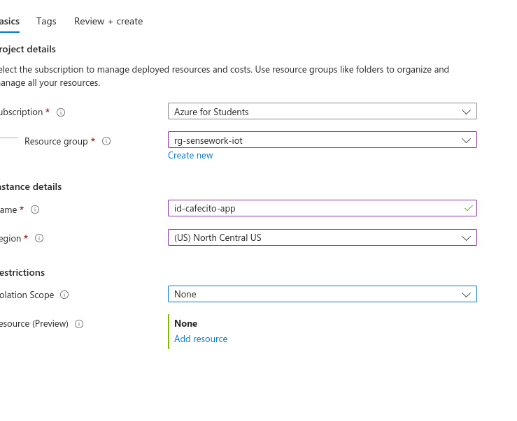</p>

<p align="center"><em>Figura 140.</em> Asignación del rol AcrPull a la identidad administrada.</p>

<p align="center">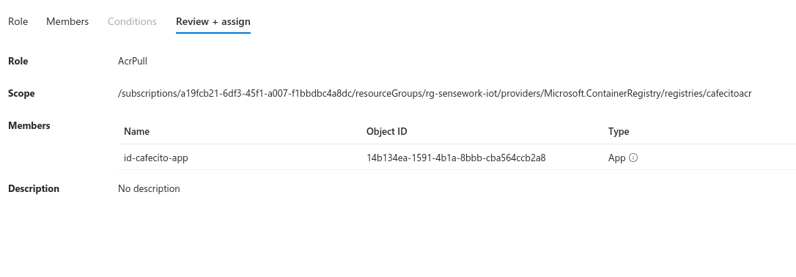</p>

<p align="center"><em>Figura 141.</em> Revisiones y réplicas de la aplicación desplegada.</p>

<p align="center">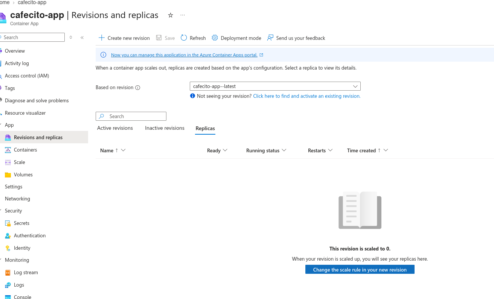</p>

Durante el despliegue se documentaron cuatro incidencias y su solución. El primer intento de crear la aplicación desde el portal falló porque el entorno no admite identidades asignadas por el sistema, y se resolvió con la identidad asignada por el usuario. Tras cambiar las variables de entorno, la réplica en ejecución conservaba la configuración anterior, y se forzó su reemplazo llevando el mínimo de réplicas a cero y de nuevo a uno. Por último, la clave de firma generada en formato PKCS#1 fue rechazada por la validación de la aplicación, que exige PKCS#8, y se regeneró en el formato correcto. Finalmente, el primer despliegue automático fue rechazado por Azure con el error `AADSTS700213`, porque el sujeto que emite GitHub incluye los identificadores numéricos de la organización y del repositorio; se corrigió la credencial federada para que coincida exactamente.

Al cierre del sprint, la versión `v1.4.0` del RESTful API se desplegó con el flujo de despliegue continuo, sin pasos manuales: al publicar el release, GitHub Actions construyó la imagen `cloud-api:1.4.0`, la subió al registro, actualizó la aplicación y esperó a que respondiera `UP`. Al arrancar, Flyway aplicó la migración `V3__temperature_forecast` sobre la base de datos de Azure, que añade las columnas del pronóstico de temperatura sin modificar las mediciones existentes. Desde esta versión, el entorno `production` del repositorio solo acepta despliegues que parten de una etiqueta `v*`, y las ramas `develop` y `main` de los repositorios cloud-api y edge-api están protegidas: no se pueden borrar ni reescribir, todo cambio entra por pull request, en cloud-api la suite de pruebas debe pasar antes de integrarlo y a `main` solo se integra con merge commit. La Edge API publicó su versión `v1.2.0`, que se ejecuta en el equipo del local junto al broker MQTT.

<a id="6229-team-collaboration-insights-during-sprint"></a>
#### 6.2.2.9. Team Collaboration Insights during Sprint


En el Sprint 2 cada producto tuvo de nuevo su propio repositorio de la organización `Grupo03-IOT`: `zenroom-landing`, `zenroom-web-app`, `zenroom-mobile-app`, `cloud-api`, `edge-api` y, desde el 5 de noviembre, `zenroom-embedded-app` para el firmware. El flujo siguió siendo una rama por unidad de trabajo, pull request hacia `develop` y, para reunir cambios de varios integrantes sin perder su autoría, ramas de integración que se revisaron antes de fusionar.

La tabla cuenta los commits de contenido de cada integrante en la rama `develop` de cada repositorio entre el 9 de octubre y el 10 de noviembre de 2026, sin contar las fusiones. El Landing Page solo tiene la rama `main` y se cuenta hasta el 11 de noviembre. Los commits de Sandra Paula en la Edge API, la Cloud API y la Web Application llegaron a `develop` mediante pull requests de integración, y la Mobile Application recibió dos commits de Giancarlo Solis.

**Tabla 3**  
*Commits por integrante y repositorio durante el Sprint 2.*

| Integrante | Report | Landing | Web | Móvil | cloud-api | edge-api | embedded | Total |
|---|---:|---:|---:|---:|---:|---:|---:|---:|
| Espino Flores, Alejandro | 9 | 0 | 0 | 0 | 17 | 2 | 0 | 28 |
| Huarcaya Matias, Gilbert Alonso | 0 | 0 | 6 | 7 | 3 | 3 | 13 | 32 |
| Lang Nassi, Werner Khalil | 3 | 0 | 0 | 0 | 0 | 0 | 0 | 3 |
| Llamccaya Arone, Juan Paul | 0 | 3 | 0 | 0 | 0 | 0 | 0 | 3 |
| Luyo Correa, Sandra Paula | 5 | 0 | 1 | 0 | 1 | 1 | 0 | 8 |
| Solis Santa Cruz, Giancarlo Rafael | 3 | 0 | 0 | 2 | 0 | 0 | 0 | 5 |
| **Total** | **20** | **3** | **7** | **9** | **21** | **6** | **13** | **79** |

El conteo es menor que el de Project Report Collaboration Insights de AV2 porque cubre solo las fechas del sprint y la rama `develop`. Lo que muestran los commits es que el Sprint 2 se concentró en la integración de la cadena: la Cloud API, el firmware y las dos aplicaciones suman la mayor parte de los commits de código. El Landing Page recibió el 11 de noviembre los tres commits de Llamccaya Arone, con el enlace a la Web Application y el video del producto. Repartir las historias de las aplicaciones entre más integrantes haría visibles sus contribuciones en cada repositorio.

Las figuras siguientes muestran los analíticos de colaboración de GitHub de cada repositorio entre el 9 de octubre y el 10 de noviembre de 2026. Los analíticos cuentan los commits de la rama por defecto de cada repositorio, que es `main` en todos salvo en el firmware, cuya rama por defecto es `TF`, y no incluyen las fusiones. Como la Web Application todavía no integra `develop` en `main`, de ella se muestra el historial de commits de `develop`.

**Figura 142**  
*Analíticos de colaboración del repositorio `zenroom-landing` en el Sprint 2.*

<p align="center"></p>

**Figura 143**  
*Historial de commits de la rama `develop` del repositorio `zenroom-web-app` en el Sprint 2.*

<p align="center"></p>

**Figura 144**  
*Analíticos de colaboración del repositorio `zenroom-mobile-app` en el Sprint 2.*

<p align="center"></p>

**Figura 145**  
*Analíticos de colaboración del repositorio `cloud-api` en el Sprint 2.*

<p align="center"></p>

**Figura 146**  
*Analíticos de colaboración del repositorio `edge-api` en el Sprint 2.*

<p align="center"></p>

**Figura 147**  
*Analíticos de colaboración del repositorio `zenroom-embedded-app` en el Sprint 2.*

<p align="center"></p>


### _6.2.3. Sprint 3_

#### 6.2.3.1. Sprint Planning 3.

El Sprint Planning 3 fija lo que SenseWork se propuso entregar en el tercer sprint de ZenRoom. El punto de partida es el cierre del Sprint 2, con la cadena de mediciones integrada y el RESTful API desplegado en Azure. El Sprint 3 pone sobre esa cadena las funciones que faltaban para intervenir en una sala: las alertas que la Edge API detecta, su atención por el administrador y los reportes de incomodidad de los miembros. A continuación se presenta el cuadro resumen.

| Sprint \# | Sprint 3 |
| :---- | :---- |
| **Sprint Planning Background**  | — |
| Date | — |
| Time | — |
| Location | — |
| Prepared By | — |
| Attendees (to planning meeting)  | — |
| Sprint 2 Review Summary  | El Sprint 2 cerró con la cadena de mediciones integrada: la Edge API consolida y sube los agregados por minuto, la Cloud API desplegada en Azure los analiza y la Web Application y la Mobile Application consultan esos datos. Pasaron al Sprint 3 el armado y la prueba del dispositivo físico (T34 y T36), la instalación de la Edge API en el equipo del local (T32), la publicación de la Mobile Application (T20), los textos de los hallazgos (T10), los contenidos de la Landing Page (T01 y T02) y las pruebas de aceptación sobre las aplicaciones desplegadas (T40). |
| Sprint 2 Retrospective Summary  | — |
| **Sprint Goal & User Stories**  | — |
| Sprint 3 Goal  | Nuestro enfoque es que una superación sostenida de un umbral y una molestia de un miembro lleguen al administrador y se puedan atender: que la Edge API suba sus alertas a la Cloud API, que el administrador las reconozca con una acción correctiva y revise su historial desde la Web Application y la Mobile Application, que el miembro reporte ruido, calor o frío y el administrador vea el reporte junto con la lectura de ese momento, y que la aplicación móvil se pueda descargar desde la Landing Page. Creemos que esto permite al administrador intervenir antes de que el problema se repita y le da al miembro un canal para informar lo que percibe. Esto se confirmará cuando las versiones publicadas de la Cloud API, la Edge API y las dos aplicaciones recorran el ciclo de una alerta y de un reporte de incomodidad. |
| Sprint 3 Velocity  | 21 Story Points. Se calcula sumando los Story Points del Product Backlog de las historias del sprint que quedaron en Done: TS7 (5), TS11 (5), US20 (5), US21 (3), US36 (3). Las historias en In-Process no suman puntos. |
| Sum of Story Points  | 93 Story Points, de 26 historias: 18 de usuario (55 puntos) y 8 técnicas (38 puntos). Incluye las historias terminadas (TS7 (5), TS11 (5), US20 (5), US21 (3), US36 (3)) y las que quedaron en In-Process (TS1 (8), TS8 (5), TS10 (5), TS13 (5), TS24 (3), TS25 (2), US03 (1), US05 (1), US06 (2), US08 (2), US10 (3), US11 (3), US19 (3), US22 (5), US23 (5), US26 (5), US27 (3), US28 (3), US29 (2), US33 (3), US37 (3)). |

#### 6.2.3.2. Aspect Leaders and Collaborators.

El Sprint 3 mantiene los seis aspectos y la asignación de líderes y colaboradores de la sección 6.2.2.2. IoT Device & Edge API agrupa la subida de alertas y los lotes del firmware; RESTful Web Services, los servicios de alertas, reportes de incomodidad y autenticación; Web Application y Mobile Application, las pantallas que los consumen; Configuration & Deployment, las versiones publicadas, y Testing Suite, las pruebas de cada función nueva.

| Team Member (Last Name, First Name) | GitHub Username | IoT Device & Edge API | RESTful Web Services | Web Application | Mobile Application | Configuration & Deployment | Testing Suite |
|:---|:---|:---:|:---:|:---:|:---:|:---:|:---:|
| Espino Flores, Alejandro | CafecitoSKR | C | L | C | — | C | C |
| Huarcaya Matias, Gilbert Alonso | GilbertHuarcaya | — | C | C | L | C | C |
| Lang Nassi, Werner Khalil | 00WernerLang | C | C | — | C | L | C |
| Llamccaya Arone, Juan Paul | JuanPaulLlaA | L | C | C | C | — | — |
| Luyo Correa, Sandra Paula | Paulu27 | — | C | L | C | — | — |
| Solis Santa Cruz, Giancarlo Rafael | LucidVoid10 | — | C | C | C | C | L |

L: Leader (líder del aspecto). C: Collaborator (colaborador). Una celda vacía indica que el integrante no participa en ese aspecto.

#### 6.2.3.3. Sprint Backlog 3.

El Sprint Backlog 3 reúne las 26 historias del sprint y 31 tareas obtenidas de los pull requests de cada repositorio, junto con las tareas que pasaron del Sprint 2. Una tarea está en Done cuando su cambio forma parte de una versión publicada, y en In-Process cuando su pull request sigue en revisión o todavía no tiene entrega. Las historias sin tarea asignada permanecen en In-Process. El avance de las historias se sigue en el Product Backlog, con la etiqueta Sprint 3, cuyo estado al cierre muestra la figura siguiente.

<p align="center"><em>Figura 148.</em> Historias del Sprint 3 en el tablero del Product Backlog al cierre del sprint.</p>

<p align="center">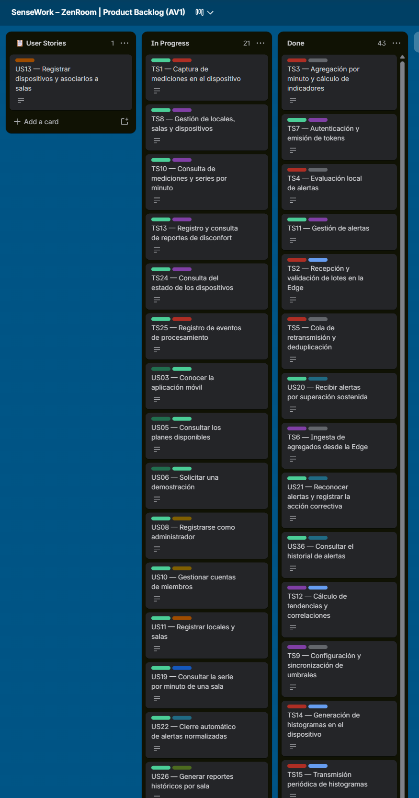</p>

URL del tablero: https://trello.com/b/nn477GGQ

**Tabla 4**

*Sprint Backlog 3: historias y tareas del sprint.*

| Sprint \# | Story Id | Story Title | Task Id | Task Title | Task Description | Estimation (Hours) | Assigned To | Status |
| :---- | :---- | :---- | :---- | :---- | :---- | :---: | :---- | :---- |
| Sprint 3 | US03 | Conocer la aplicación móvil | T01 | Descarga y capturas en la Landing Page | Enlazar el inicio de sesión de la Web Application y la descarga del APK, y mostrar capturas reales de las aplicaciones. | — | Huarcaya, Gilbert | Done |
|  |  |  | T02 | Sección de la aplicación móvil | Describir la lista de salas, el histórico de tranquilidad por hora y la garantía de que no se graba audio. | — | Huarcaya, Gilbert | In-Process |
|  | US05 | Consultar los planes disponibles | — | — | — | — | — | In-Process |
|  | US06 | Solicitar una demostración | T03 | Recepción de solicitudes de demostración | Guardar en la Cloud API las solicitudes enviadas desde la Landing Page con validación, consentimiento y límite por dirección. | — | Huarcaya, Gilbert | In-Process |
|  |  |  | T04 | Envío del formulario y redes sociales | Enviar el formulario de demostración a la Cloud API y agregar los enlaces a redes sociales. | — | Huarcaya, Gilbert | In-Process |
|  | TS7 | Autenticación y emisión de tokens | T05 | Rechazo de credenciales y cuentas desactivadas | Responder 401 ante credenciales inválidas y rechazar el inicio de sesión y los tokens de cuentas desactivadas. | — | Huarcaya, Gilbert | Done |
|  | US08 | Registrarse como administrador | — | — | — | — | — | In-Process |
|  | US10 | Gestionar cuentas de miembros | T06 | Cierre de sesión de cuentas desactivadas | Mostrar el motivo del rechazo y cerrar la sesión en la Web Application y la Mobile Application cuando la cuenta está desactivada. | — | Huarcaya, Gilbert | Done |
|  | TS11 | Gestión de alertas | T07 | Alertas en la Cloud API | Registrar los eventos de la Edge sin duplicados, listar y consultar alertas, reconocerlas con una acción correctiva y cerrarlas automáticamente. | — | Huarcaya, Gilbert | Done |
|  | US20 | Recibir alertas por superación sostenida | T08 | Subida de alertas desde la Edge API | Enviar cada alerta abierta o cerrada a la Cloud API con una clave de origen y reintentar ante cortes de conexión. | — | Huarcaya, Gilbert | Done |
|  | US21 | Reconocer alertas y registrar la acción correctiva | T09 | Atención de alertas en la Web Application | Pantalla de alertas con contador, filtros y diálogo para registrar la acción correctiva. | — | Huarcaya, Gilbert | Done |
|  |  |  | T10 | Atención de alertas en la Mobile Application | Lista de alertas con contador y registro de la acción correctiva desde el celular. | — | Huarcaya, Gilbert | Done |
|  | US22 | Cierre automático de alertas normalizadas | T11 | Cierre sostenido de alertas | Cerrar una alerta solo después de una ventana continua de minutos normales según el umbral de la sala. | — | Huarcaya, Gilbert | In-Process |
|  | US36 | Consultar el historial de alertas | T12 | Historial de alertas | Consultar las alertas atendidas y cerradas con filtros por sala y fechas en la web y en el móvil. | — | Huarcaya, Gilbert | Done |
|  | US37 | Consultar acciones correctivas realizadas | T13 | Responsable de la atención | Mostrar el nombre de quien atendió cada alerta junto con la acción correctiva. | — | Huarcaya, Gilbert | In-Process |
|  | TS13 | Registro y consulta de reportes de disconfort | T14 | Reportes de incomodidad en la Cloud API | Registrar el reporte con la lectura de la sala en ese momento, listar, resumir por sala y limitar los envíos repetidos. | — | Huarcaya, Gilbert | Done |
|  |  |  | T15 | Marca de discrepancia | Señalar los reportes cuya lectura se encuentra dentro de los umbrales vigentes. | — | Huarcaya, Gilbert | In-Process |
|  | US27 | Reportar una molestia ambiental | T16 | Envío de reportes de incomodidad | Permitir que el miembro reporte ruido, calor o frío desde la Web Application y la Mobile Application. | — | Huarcaya, Gilbert | Done |
|  | US28 | Consultar los reportes de disconfort del local | T17 | Consulta de reportes del local | Mostrar al administrador los reportes y el resumen por sala en la web y en el móvil. | — | Huarcaya, Gilbert | Done |
|  | US19 | Consultar la serie por minuto de una sala | T18 | Selector de rango de la serie | Elegir el rango de la serie por minuto en el detalle de una sala, con la línea del umbral. | — | Huarcaya, Gilbert | In-Process |
|  | US26 | Generar reportes históricos por sala | T19 | Comparación contra umbrales en el reporte | Incluir en el reporte histórico los minutos y el porcentaje sobre el umbral. | — | Huarcaya, Gilbert | In-Process |
|  | TS25 | Registro de eventos de procesamiento | T20 | Registro de eventos de procesamiento | Registrar cada lote procesado, fallido o rechazado con su sala y su minuto. | — | Huarcaya, Gilbert | In-Process |
|  | TS1 | Captura de mediciones en el dispositivo | T21 | Lotes alineados del firmware | Publicar seis lotes por minuto alineados a la hora UTC, conservar el lote ante una lectura fallida y documentar la lista de aceptación del dispositivo. | — | Huarcaya, Gilbert | Done |
|  |  |  | T22 | Prueba del dispositivo físico | Armar y probar el dispositivo según la lista de aceptación, con registro fotográfico y en video. | — | — | In-Process |
|  | TS8 | Gestión de locales, salas y dispositivos | — | — | — | — | — | In-Process |
|  | TS10 | Consulta de mediciones y series por minuto | — | — | — | — | — | In-Process |
|  | TS24 | Consulta del estado de los dispositivos | — | — | — | — | — | In-Process |
|  | US11 | Registrar locales y salas | — | — | — | — | — | In-Process |
|  | US23 | Detección de dispositivos fuera de línea | — | — | — | — | — | In-Process |
|  | US29 | Consultar la ocupación de una sala | — | — | — | — | — | In-Process |
|  | US33 | Supervisar la ocupación del local | — | — | — | — | — | In-Process |
|  | Transversal | Tareas generales de las aplicaciones | T23 | Textos de los hallazgos | Mostrar en inglés y en español cada hallazgo y veredicto del análisis de una sala. | — | Huarcaya, Gilbert | Done |
|  |  |  | T24 | Estado de sala con alerta activa | Impedir que una sala con una alerta activa aparezca como óptima y ajustar las pantallas del sprint a la guía de estilos. | — | Huarcaya, Gilbert | Done |
|  |  |  | T25 | Correcciones de la Mobile Application | Corregir el motivo de atención, las unidades de los reportes, el diálogo de atención y la hora local. | — | Huarcaya, Gilbert | Done |
|  |  |  | T26 | Publicación de la Mobile Application | Publicar el APK como release del repositorio, apuntando a la Cloud API desplegada. | — | Huarcaya, Gilbert | Done |
|  |  |  | T27 | Idioma por defecto | Iniciar las aplicaciones en inglés (en_US) y conservar el idioma que elija el usuario. | — | Huarcaya, Gilbert | In-Process |
|  | Transversal | Tareas generales de la Edge API y el dispositivo | T28 | Límite de temperatura al dispositivo | Enviar a cada dispositivo el límite de temperatura según los umbrales de su sala. | — | Huarcaya, Gilbert | Done |
|  |  |  | T29 | Ejecución en el local | Instalar la Edge API en el equipo del local con su credencial de máquina y verificar la subida a Azure. | — | — | In-Process |
|  | Transversal | Tareas generales de documentación y pruebas | T30 | Guías de ejecución por repositorio | Documentar la ejecución, las variables de entorno y el contrato de alertas en los README. | — | Huarcaya, Gilbert | Done |
|  |  |  | T31 | Pruebas de aceptación | Verificar los escenarios Gherkin de las historias sobre las versiones publicadas. | — | — | In-Process |
| | | | | **Total** | | — | | |

De las 31 tareas, 18 están en **Done** y 13 en **In-Process**. En el tablero, 5 historias del sprint quedaron en Done y 21 en In Progress. US13, el registro de dispositivos por el administrador, no formó parte del sprint.

#### 6.2.3.4. Development Evidence for Sprint Review.

En el Sprint 3 el desarrollo se concentró en las alertas, los reportes de incomodidad y la autenticación. En la Cloud API se creó el ciclo de una alerta y el registro de reportes con la lectura del momento. La Edge API empezó a subir las alertas que abre y cierra, la Web Application y la Mobile Application incorporaron sus pantallas, el firmware alineó sus lotes y la Landing Page enlazó las dos aplicaciones. La tabla siguiente muestra los commits de contenido desde el 12 de noviembre de 2026 integrados en la rama `main` de cada repositorio. La Edge API incluye además el envío del límite de temperatura a los dispositivos, confirmado el 11 de noviembre e integrado en este sprint.

| Repository | Branch | Commit Id | Commit Message | Commit Message Body | Committed on (Date) |
|---|---|---|---|---|---|
| Grupo03-IOT/cloud-api | feature/sprint-3-alerts-and-discomfort | `087b24d` | feat(iam): add the alerts:write machine scope | Edge credentials need it to upload alert events. | 26/11/2026 |
| Grupo03-IOT/cloud-api | feature/sprint-3-alerts-and-discomfort | `a0de9a2` | feat(monitoring): resolve a room by its Edge code through the facade | An unknown room fails with MONITORING_ROOM_NOT_FOUND. | 26/11/2026 |
| Grupo03-IOT/cloud-api | feature/sprint-3-alerts-and-discomfort | `129b284` | feat(alerting): record, list and acknowledge alerts raised by the Edge | V2__alerts.sql creates alerting.alert, idempotent by source_key. | 26/11/2026 |
| Grupo03-IOT/cloud-api | feature/sprint-3-alerts-and-discomfort | `fdca09a` | feat(monitoring): let members file discomfort reports with the reading of the moment | V5__discomfort_reports.sql creates monitoring.discomfort_report. | 26/11/2026 |
| Grupo03-IOT/cloud-api | feature/sprint-3-alerts-and-discomfort | `cf31b8e` | docs: document the alerts:write scope and the alert upload contract | — | 26/11/2026 |
| Grupo03-IOT/cloud-api | fix/sprint-3-auth-gaps | `fcf98c8` | fix(iam): answer 401 to bad sign-ins and reject tokens of deactivated accounts | The JWT converter checks the account is still active on every request. | 27/11/2026 |
| Grupo03-IOT/edge-api | feature/sprint-3-alert-upload | `a2e43da` | feat(edge): upload opened and closed alerts to Cloud with source_key idempotency | Network errors leave the alert queued for the next cycle. | 26/11/2026 |
| Grupo03-IOT/edge-api | feature/sprint-3-alert-upload | `3944b05` | fix(edge): follow the Cloud alert events contract on permanent rejections | Unknown rooms and invalid events are marked as failed. | 26/11/2026 |
| Grupo03-IOT/zenroom-web-app | feature/sprint-3-alerts-and-discomfort | `90276d9` | feat(web): manage alerts and discomfort reports from Cloud | Alerts and discomfort report screens with filters. | 26/11/2026 |
| Grupo03-IOT/zenroom-web-app | feature/sprint-3-alerts-and-discomfort | `943a617` | feat(insights): show every finding and verdict in both languages | Findings are rendered as sentences with their value. | 26/11/2026 |
| Grupo03-IOT/zenroom-web-app | feature/sprint-3-alerts-and-discomfort | `32df3df` | docs(readme): add run locally, environment variables and deployed URL | — | 26/11/2026 |
| Grupo03-IOT/zenroom-web-app | feature/sprint-3-alerts-and-discomfort | `f6326b5` | fix(auth): map 401 login errors and deactivated accounts; wrap discomfort summary counters | — | 27/11/2026 |
| Grupo03-IOT/zenroom-web-app | fix/sprint-3-ui-design-review | `cfab170` | style(web): align Sprint 3 filters, summary counters and header with the design system | Filters, summary counters and header. | 27/11/2026 |
| Grupo03-IOT/zenroom-web-app | fix/sprint-3-ui-design-review | `430173a` | fix(monitoring): raise room status when the room has an open alert | An open alert sets a floor on the room traffic light. | 27/11/2026 |
| Grupo03-IOT/zenroom-web-app | fix/sprint-3-ui-design-review | `ebbb07d` | fix(monitoring): keep acknowledged alerts in the room status until they close | An acknowledged alert stays active until the Edge closes it. | 27/11/2026 |
| Grupo03-IOT/zenroom-mobile-app | feature/sprint-3-alerts-and-discomfort | `e1d779c` | feat: add Cloud alerts and discomfort reports | Alerts by status and discomfort reports. | 26/11/2026 |
| Grupo03-IOT/zenroom-mobile-app | feature/sprint-3-alerts-and-discomfort | `699c3af` | docs: add run, build and download instructions | — | 26/11/2026 |
| Grupo03-IOT/zenroom-mobile-app | feature/sprint-3-alerts-and-discomfort | `9188a16` | fix: align alerts and discomfort reports with the Cloud contract | Maps the Cloud error codes to readable messages. | 26/11/2026 |
| Grupo03-IOT/zenroom-mobile-app | feature/sprint-3-alerts-and-discomfort | `b141921` | fix(auth): handle 401 login codes and sign out on deactivated accounts | — | 27/11/2026 |
| Grupo03-IOT/zenroom-mobile-app | feature/sprint-3-alerts-and-discomfort | `cbc2997` | fix(mobile): correct attention reason, report units, empty alerts text, ack dialog and UTC times | Shows times in device local time. | 27/11/2026 |
| Grupo03-IOT/zenroom-embedded-app | fix/sprint-3-batches-and-acceptance | `4e81f77` | fix(firmware): start PlatformIO batches on UTC 10-second slots and send boot_id | — | 26/11/2026 |
| Grupo03-IOT/zenroom-embedded-app | fix/sprint-3-batches-and-acceptance | `43a7f55` | fix(sketch): keep the 10-second batch on a single failed DHT22 read | — | 26/11/2026 |
| Grupo03-IOT/zenroom-embedded-app | fix/sprint-3-batches-and-acceptance | `3b834df` | docs: add the real-device acceptance checklist and build and flash steps | — | 26/11/2026 |
| Grupo03-IOT/zenroom-landing | feature/sprint-3-app-download | `cf7e1eb` | feat(landing): add web app login, Android app download and real app screenshots | — | 26/11/2026 |

Los commits siguientes pertenecen a pull requests en revisión al 27 de noviembre de 2026 y todavía no forman parte de una versión publicada.

| Repository | Branch | Commit Id | Commit Message | Commit Message Body | Committed on (Date) |
|---|---|---|---|---|---|
| Grupo03-IOT/cloud-api | feature/sprint-3-r2-acknowledger-discrepancy-report | `ca09342` | feat(alerting): expose the name of who acknowledged an alert | Alert resources carry acknowledged_by_name. | 27/11/2026 |
| Grupo03-IOT/cloud-api | feature/sprint-3-r2-acknowledger-discrepancy-report | `0d3df71` | feat(monitoring): flag discomfort reports that the reading does not back | Reports carry discrepancy and discrepancy_reason. | 27/11/2026 |
| Grupo03-IOT/cloud-api | feature/sprint-3-demo-requests | `88927b1` | feat(iam): accept public demo requests from the landing page | POST /api/v1/demo-requests stores the request. | 27/11/2026 |
| Grupo03-IOT/edge-api | feature/sprint-3-r2-sustained-close-and-log | `44cb81c` | feat(edge): close alerts after a sustained normal window and log processing events | Processing events carry room_id and the measurement minute. | 27/11/2026 |
| Grupo03-IOT/edge-api | feature/sprint-3-r2-sustained-close-and-log | `5083390` | fix(edge): close alerts with the room's sustained window | The close window follows the room threshold. | 27/11/2026 |
| Grupo03-IOT/zenroom-web-app | feature/sprint-3-r2-range-acknowledger-discrepancy | `fb9a5f5` | feat: add series range selector, alert acknowledger, discrepancies and threshold comparison | — | 27/11/2026 |
| Grupo03-IOT/zenroom-web-app | feature/sprint-3-r2-range-acknowledger-discrepancy | `a8a4f0c` | fix(web): word alert acknowledgement as "Atendida" like mobile | — | 27/11/2026 |
| Grupo03-IOT/zenroom-web-app | fix/default-language-en | `0db0426` | fix(i18n): use English as the default interface language | — | 27/11/2026 |
| Grupo03-IOT/zenroom-mobile-app | feature/sprint-3-r2-acknowledger-discrepancy | `b4e54b5` | feat: show alert acknowledger name and flag discomfort discrepancies | — | 27/11/2026 |
| Grupo03-IOT/zenroom-mobile-app | fix/default-language-en | `7b5d9bb` | fix(i18n): use en_US as the default app language | — | 27/11/2026 |
| Grupo03-IOT/zenroom-landing | feature/sprint-3-r2-app-section | `d4a2c33` | feat(landing): describe room map, hourly quiet history and no-audio guarantee in mobile app section | — | 27/11/2026 |
| Grupo03-IOT/zenroom-landing | feature/sprint-3-r2-app-section | `158caeb` | fix(landing): describe the mobile room list accurately | — | 27/11/2026 |
| Grupo03-IOT/zenroom-landing | feature/sprint-3-demo-form-social | `1c379d8` | feat(landing): send demo requests to the Cloud API and add social links | — | 27/11/2026 |

Las versiones publicadas en el sprint son `v1.5.0` de cloud-api, `v1.3.0` de edge-api, `v1.0.0` de zenroom-web-app, `v1.0.0` y `v1.1.0` de zenroom-mobile-app y `v1.0.0` de zenroom-embedded-app.

#### 6.2.3.5. Testing Suite Evidence for Sprint Review.

Cada función del Sprint 3 se integró con sus pruebas. En la Cloud API las pruebas unitarias cubren las reglas de las alertas, de los reportes de incomodidad y de la autenticación, y las de integración levantan los controladores con su seguridad real y comprueban el ciclo de una alerta y el registro de un reporte sobre PostgreSQL. La suite de la versión `v1.5.0` tiene 157 pruebas y todas aprobaron en la integración continua, incluidos los tres escenarios de aceptación de US11. La Edge API tiene 41 pruebas aprobadas en `v1.3.0` y la Mobile Application 41 en `v1.1.0`. La Web Application se verifica con la comprobación de tipos y la compilación de producción (`npm run build`), que terminó sin errores en `v1.0.0`.

| Producto | Herramienta | Pruebas en la versión | Pruebas incorporadas en el Sprint 3 |
|---|---|---:|---:|
| Cloud API `v1.5.0` | JUnit 5 y Cucumber | 157 | 69 |
| Edge API `v1.3.0` | unittest y pytest | 41 | 21 |
| Mobile Application `v1.1.0` | flutter test | 41 | 34 |
| Web Application `v1.0.0` | TypeScript y Vite (compilación) | — | — |

Las clases de prueba incorporadas en la Cloud API son las siguientes.

| Nivel | Clase de prueba | Qué comprueba | Historias | Pruebas |
|---|---|---|---|---:|
| Unitaria | AlertTest | Estados de la alerta, reconocimiento, cierre y eventos repetidos | US20, US21, US22 | 10 |
| Unitaria | AlertUseCasesTest | Registro, consulta y atención de alertas con un repositorio en memoria | TS11 | 7 |
| Integración | AlertLifecycleIntegrationTest | Ciclo de una alerta sobre PostgreSQL | US20, US21, US22 | 2 |
| Integración | AlertEventsControllerTest | Recepción de eventos de la Edge y permisos de máquina | TS11 | 6 |
| Integración | AlertsControllerTest | Listado, consulta y reconocimiento por el administrador | TS11, US36 | 9 |
| Unitaria | DiscomfortReportTest | Lectura copiada y límite de envíos repetidos | US27, TS13 | 6 |
| Unitaria | DiscomfortReportUseCasesTest | Registro y listado de reportes | US27, US28 | 4 |
| Integración | DiscomfortReportIntegrationTest | Reportes sobre PostgreSQL | US27, US28 | 1 |
| Integración | DiscomfortReportsControllerTest | Códigos de respuesta por rol | TS13 | 10 |
| Unitaria | AuthenticateUserUseCaseImplTest | Credenciales inválidas y cuentas desactivadas | TS7, US10 | 6 |
| Unitaria | UserStatusCacheTest | Caché del estado de las cuentas | US10 | 2 |
| Integración | AuthControllerTest (casos nuevos) | Respuestas del inicio de sesión | TS7 | 3 |
| Integración | DeactivatedAccountTokenTest | Rechazo del token de una cuenta desactivada | US10 | 3 |

En la Edge API, `tests/test_alert_upload.py` (14 pruebas) comprueba la subida de alertas, los reintentos y los rechazos definitivos, y `tests/test_device_commands.py` (7 pruebas) el envío del límite de temperatura. En la Mobile Application, las pruebas nuevas cubren las alertas, los reportes de incomodidad, los errores de inicio de sesión y la conversión a la hora local.

<p align="center"><em>Figura 149.</em> Informe de pruebas de la Cloud API v1.5.0 en la integración continua.</p>

<p align="center">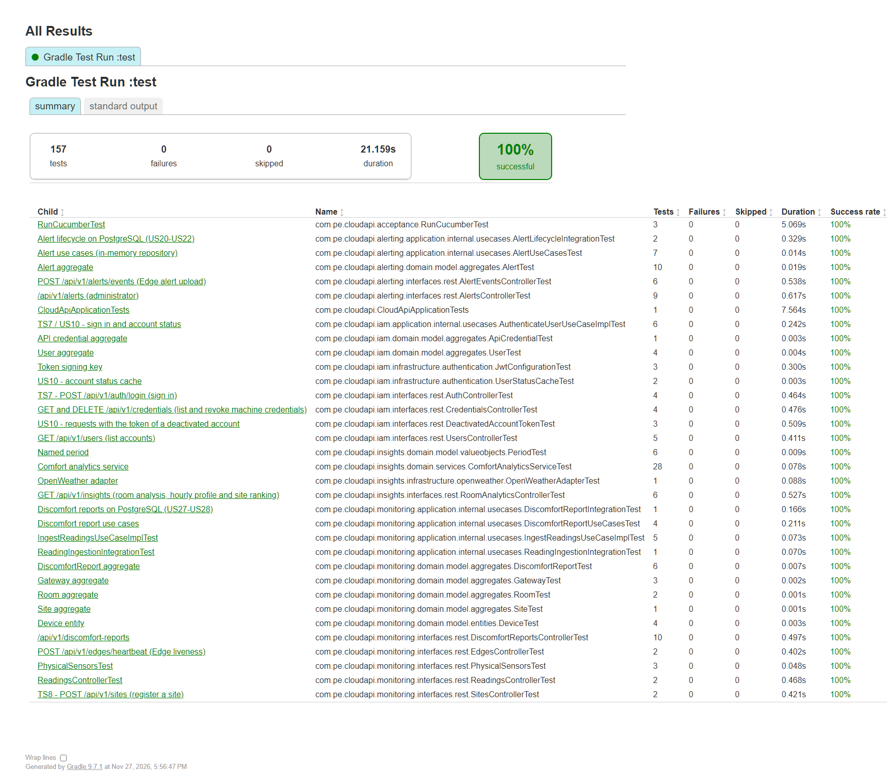</p>

| Repository | Branch | Commit Id | Message | Message Body | Committed on |
|---|---|---|---|---|---|
| cloud-api | feature/sprint-3-alerts-and-discomfort | `129b284` | feat(alerting): record, list and acknowledge alerts raised by the Edge | Domain, use case, web layer and PostgreSQL lifecycle tests. | 26/11/2026 |
| cloud-api | feature/sprint-3-alerts-and-discomfort | `fdca09a` | feat(monitoring): let members file discomfort reports with the reading of the moment | Domain, use case, web layer and PostgreSQL tests. | 26/11/2026 |
| cloud-api | fix/sprint-3-auth-gaps | `fcf98c8` | fix(iam): answer 401 to bad sign-ins and reject tokens of deactivated accounts | Unit and web layer tests. | 27/11/2026 |
| edge-api | feature/sprint-3-alert-upload | `a2e43da` | feat(edge): upload opened and closed alerts to Cloud with source_key idempotency | — | 26/11/2026 |
| zenroom-mobile-app | feature/sprint-3-alerts-and-discomfort | `e1d779c` | feat: add Cloud alerts and discomfort reports | — | 26/11/2026 |

#### 6.2.3.6. Execution Evidence for Sprint Review.

La evidencia de ejecución del Sprint 3 corresponde a las aplicaciones en funcionamiento con dispositivos de prueba. Recorre el ciclo de una alerta, desde que aparece en el resumen del local hasta que se atiende y se cierra, y el de un reporte de incomodidad, desde que el miembro lo envía hasta que el administrador lo consulta.

<p align="center"><em>Figura 150.</em> Resumen del local en la Web Application con una alerta activa en una sala.</p>

<p align="center">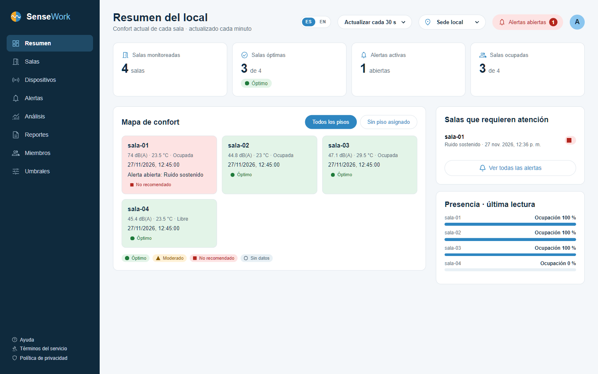</p>

<p align="center"><em>Figura 151.</em> Alertas activas con su sala, regla, severidad y valor medido.</p>

<p align="center">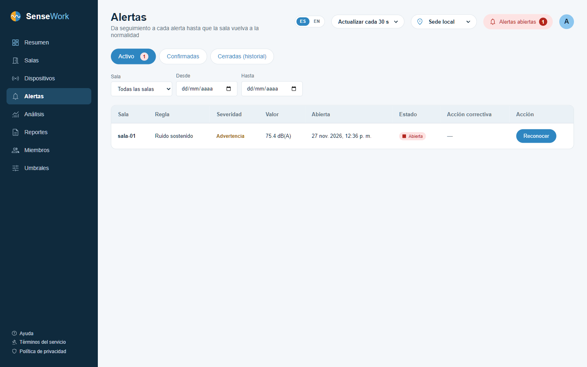</p>

<p align="center"><em>Figura 152.</em> Alerta reconocida con su acción correctiva.</p>

<p align="center">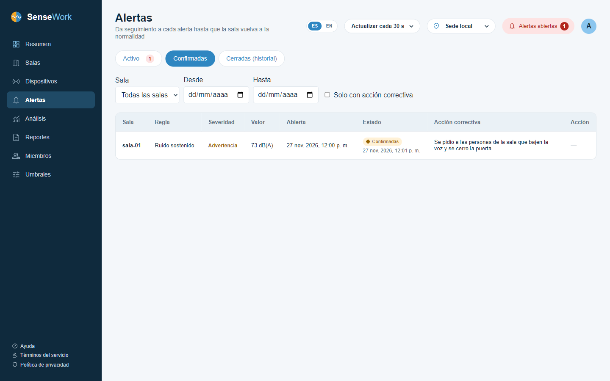</p>

<p align="center"><em>Figura 153.</em> Historial de alertas cerradas automáticamente.</p>

<p align="center">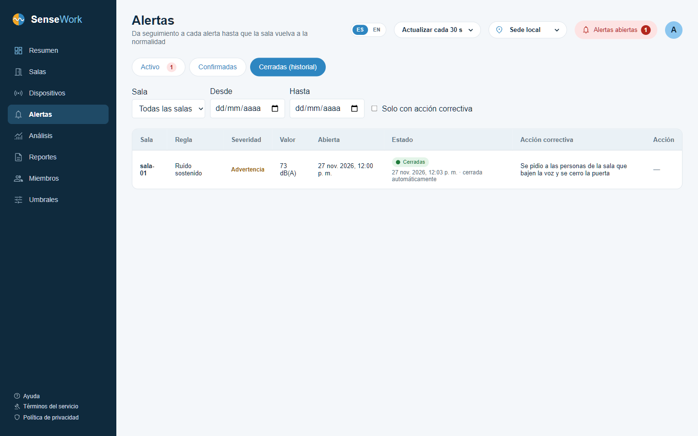</p>

<p align="center"><em>Figura 154.</em> Reporte de incomodidad del miembro y la lista de sus reportes.</p>

<p align="center">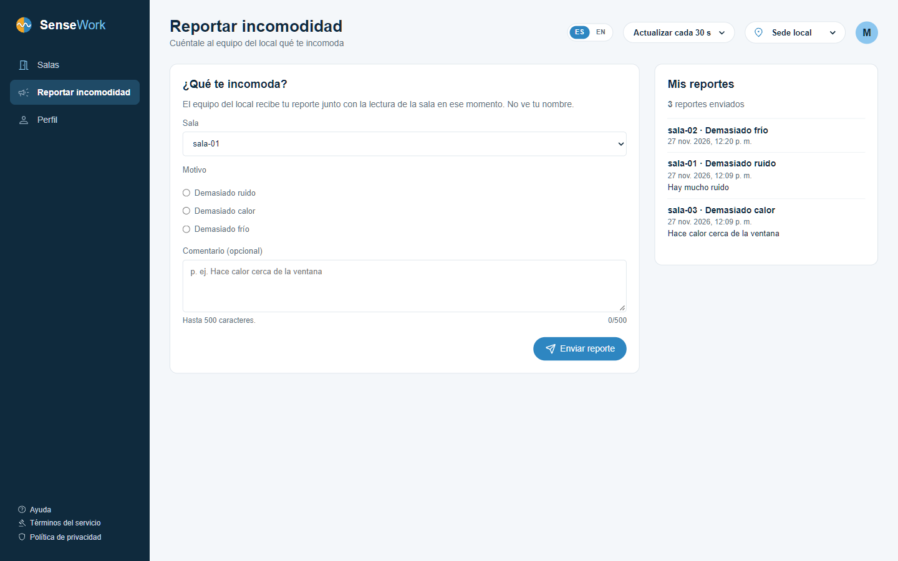</p>

<p align="center"><em>Figura 155.</em> Reportes de incomodidad del local con el resumen por sala y la lectura de cada momento.</p>

<p align="center">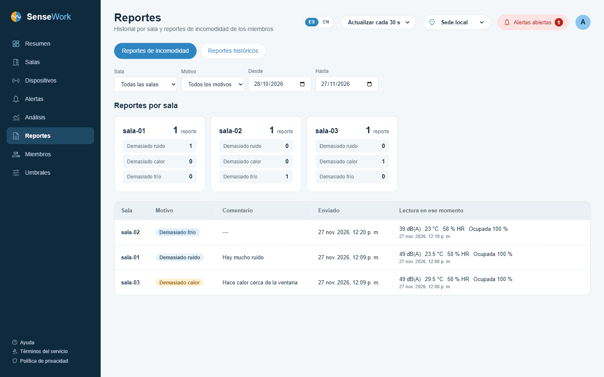</p>

<p align="center"><em>Figura 156.</em> Rechazo del inicio de sesión de una cuenta desactivada.</p>

<p align="center">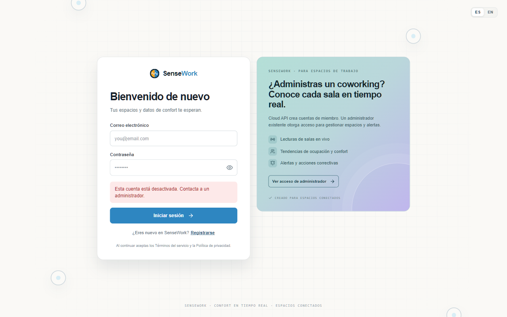</p>

<p align="center"><em>Figura 157.</em> Alertas en la Mobile Application: activa, atendida y cerrada.</p>

<p align="center">
  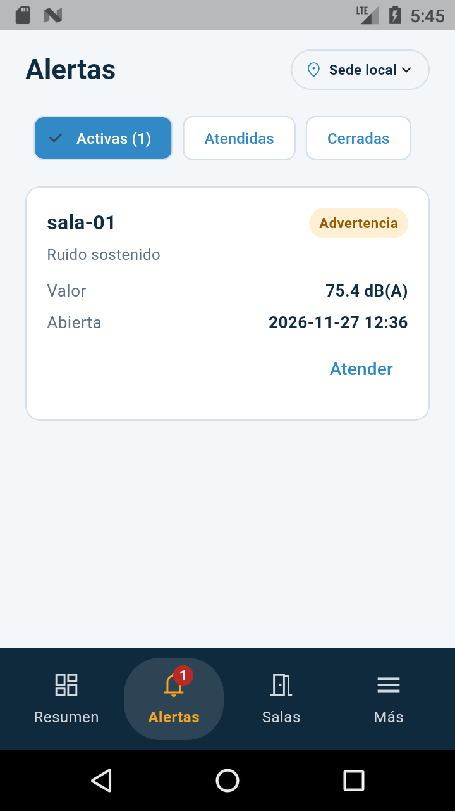
  
  
</p>

<p align="center"><em>Figura 158.</em> Detalle de una sala y reportes de incomodidad en la Mobile Application.</p>

<p align="center">
  
  
  
</p>

Video de navegación del sprint: —

#### 6.2.3.7. Services Documentation Evidence for Sprint Review.

La versión `v1.5.0` del RESTful API añade los servicios de alertas y de reportes de incomodidad. La documentación OpenAPI publicada junto con el servicio describe 29 rutas y 35 operaciones.

- **Documentación desplegada:** https://cafecito-app.icywater-8ce04e92.northcentralus.azurecontainerapps.io/swagger-ui.html
- **Especificación OpenAPI:** https://cafecito-app.icywater-8ce04e92.northcentralus.azurecontainerapps.io/v3/api-docs
- **Repositorio:** https://github.com/Grupo03-IOT/cloud-api

| Verbo | Endpoint | Acción | Parámetros | Acceso | Respuesta |
|---|---|---|---|---|---|
| POST | `/api/v1/alerts/events` | Registra los eventos de alerta de la Edge API | Cuerpo: `site_code`, `events` (`source_key`, `room_id`, `rule`, `severity`, `message`, `value`, `opened_at`, `closed_at`) | Máquina, `alerts:write` | 200 con `accepted`; 400, 401, 403; 404 si una sala no existe |
| GET | `/api/v1/alerts` | Lista las alertas de la más reciente a la más antigua | Consulta: `status`, `room_id`, `from`, `to`, `has_action` (opcionales) | ADMIN | 200 con la lista; 400, 403 |
| GET | `/api/v1/alerts/{alertId}` | Consulta una alerta | Ruta: `alertId` | ADMIN | 200; 403, 404 |
| PATCH | `/api/v1/alerts/{alertId}/acknowledge` | Reconoce una alerta abierta | Ruta: `alertId`; cuerpo: `corrective_action` (3 a 500 caracteres) | ADMIN | 200 con la alerta; 400, 403, 404; 409 si no está abierta |
| POST | `/api/v1/discomfort-reports` | Registra una molestia en una sala | Cuerpo: `room_id`, `category` (`NOISE`, `WARM`, `COLD`), `comment` | ADMIN, MEMBER | 201 con la lectura del momento; 400, 401, 404; 409 si se repite antes de 10 minutos |
| GET | `/api/v1/discomfort-reports` | Lista los reportes | Consulta: `room_id`, `category`, `from`, `to` (opcionales) | ADMIN | 200 con la lista; 400, 403 |
| GET | `/api/v1/discomfort-reports/mine` | Lista los reportes del usuario autenticado | — | ADMIN, MEMBER | 200 con la lista; 401 |
| GET | `/api/v1/discomfort-reports/summary` | Cuenta los reportes por sala y categoría | Consulta: `from`, `to` (opcionales) | ADMIN | 200 con las salas con más reportes primero; 400, 403 |

Además, el inicio de sesión cambió: un correo desconocido o una contraseña incorrecta responden 401 con `IAM_INVALID_CREDENTIALS`, y una cuenta desactivada recibe 401 con `IAM_ACCOUNT_DISABLED`. Con las operaciones de las secciones 6.2.1.7 y 6.2.2.7 y `PATCH /api/v1/users/{userId}`, que desactiva o reactiva una cuenta, se completan las 35 operaciones.

Una alerta cerrada se consulta así:

```json
{
  "room_code": "sala-01",
  "rule": "sustained_noise",
  "severity": "warning",
  "message": "Noise above 65 dBA for 2 min",
  "value": 73.0,
  "status": "CLOSED",
  "opened_at": "2026-11-27T17:00:06Z",
  "closed_at": "2026-11-27T17:03:07Z",
  "closed_by": "AUTO",
  "acknowledged_at": "2026-11-27T17:01:09.313192Z",
  "corrective_action": "Se pidio a las personas de la sala que bajen la voz y se cerro la puerta"
}
```

El registro de un reporte responde 201 con la lectura de la sala, y un segundo envío del mismo motivo antes de diez minutos responde 409:

```json
{
  "room_code": "sala-01",
  "category": "NOISE",
  "comment": "Hay mucho ruido",
  "created_at": "2026-11-27T17:09:42.829634569Z",
  "reading": { "ts": "2026-11-27T17:08:00Z", "laeq": 48.7, "temp_c": 23.49, "rh_pct": 57.9, "occupied_pct": 100.0 }
}
```

```json
{ "status": 409, "code": "MONITORING_DISCOMFORT_TOO_FREQUENT", "path": "/api/v1/discomfort-reports" }
```

Las figuras siguientes muestran la documentación publicada de cada operación nueva.

<p align="center"><em>Figura 159.</em> Registro de eventos de alerta de la Edge API.</p>

<p align="center"></p>

<p align="center"><em>Figura 160.</em> Listado de alertas con sus filtros.</p>

<p align="center"></p>

<p align="center"><em>Figura 161.</em> Consulta de una alerta.</p>

<p align="center"></p>

<p align="center"><em>Figura 162.</em> Reconocimiento de una alerta con su acción correctiva.</p>

<p align="center"></p>

<p align="center"><em>Figura 163.</em> Registro de un reporte de incomodidad.</p>

<p align="center"></p>

<p align="center"><em>Figura 164.</em> Listado de reportes de incomodidad.</p>

<p align="center"></p>

<p align="center"><em>Figura 165.</em> Reportes del usuario autenticado.</p>

<p align="center"></p>

<p align="center"><em>Figura 166.</em> Resumen de reportes por sala y categoría.</p>

<p align="center"></p>

Los commits que documentan estas operaciones son `129b284`, `fdca09a`, `087b24d`, `cf31b8e` y `fcf98c8`.

#### 6.2.3.8. Software Deployment Evidence for Sprint Review.

En el Sprint 3 se publicó una versión de cada producto. La tabla resume el destino de cada una.

| Producto | Versión | Publicación | Dirección |
|---|---|---|---|
| Cloud API | `v1.5.0` | Azure Container Apps | https://cafecito-app.icywater-8ce04e92.northcentralus.azurecontainerapps.io |
| Web Application | `v1.0.0` | Vercel | https://zenroom-web-app.vercel.app |
| Mobile Application | `v1.1.0` | GitHub Releases y Firebase App Distribution | https://github.com/Grupo03-IOT/zenroom-mobile-app/releases/tag/v1.1.0 |
| Landing Page | rama `main` | GitHub Pages | https://grupo03-iot.github.io/zenroom-landing/ |
| Edge API | `v1.3.0` | Release para el equipo del local | https://github.com/Grupo03-IOT/edge-api/releases/tag/v1.3.0 |
| Embedded Application | `v1.0.0` | Release para la placa ESP32 | https://github.com/Grupo03-IOT/zenroom-embedded-app/releases/tag/v1.0.0 |

Las actividades realizadas fueron las siguientes:

1. **Integración.** Cada repositorio integró su trabajo del sprint en la rama `main` mediante un pull request.
2. **Cloud API.** La publicación del release `v1.5.0` ejecutó el flujo `deploy.yml`, que construyó la imagen, la subió a Azure Container Registry, actualizó la Container App y esperó a que el servicio respondiera `UP`. La versión incorpora las migraciones `V2__alerts` de Alerting y `V5__discomfort_reports` de Monitoring.
3. **Credenciales de la Edge.** La subida de alertas exige el permiso `alerts:write`, por lo que las credenciales emitidas antes de esta versión deben volver a crearse.
4. **Web Application.** Vercel publicó la rama `main` con la versión `v1.0.0`, que consume la Cloud API a través de la ruta `/cloud`.
5. **Mobile Application.** El APK se compiló con el modo de demostración desactivado y apuntando a la Cloud API desplegada, se adjuntó al release `v1.1.0` y se distribuye a los testers con Firebase App Distribution. La versión mínima es Android 7.0.
6. **Landing Page.** GitHub Pages publicó la rama `main`, con el acceso a la Web Application y la descarga del APK.
7. **Edge API y firmware.** Las versiones `v1.3.0` y `v1.0.0` quedaron publicadas como releases, con las guías de instalación en cada repositorio.

<p align="center"><em>Figura 167.</em> Flujo de despliegue en Azure disparado por el release v1.5.0.</p>

<p align="center"></p>

<p align="center"><em>Figura 168.</em> Release v1.5.0 de la Cloud API.</p>

<p align="center"></p>

<p align="center"><em>Figura 169.</em> Web Application publicada en Vercel.</p>

<p align="center"></p>

<p align="center"><em>Figura 170.</em> Release v1.0.0 de la Web Application.</p>

<p align="center"></p>

<p align="center"><em>Figura 171.</em> Release v1.1.0 de la Mobile Application con las instrucciones de instalación.</p>

<p align="center"></p>

<p align="center"><em>Figura 172.</em> Landing Page publicada en GitHub Pages.</p>

<p align="center"></p>

<p align="center"><em>Figura 173.</em> Sección de la aplicación móvil con el enlace de descarga.</p>

<p align="center"></p>

<p align="center"><em>Figura 174.</em> Release v1.3.0 de la Edge API.</p>

<p align="center"></p>

<p align="center"><em>Figura 175.</em> Release v1.0.0 del firmware del dispositivo.</p>

<p align="center"></p>

#### 6.2.3.9. Team Collaboration Insights during Sprint.

En el Sprint 3 el trabajo de código siguió el mismo flujo de los sprints anteriores: una rama por unidad de trabajo, pull request hacia `develop` y, al cierre, un pull request de `develop` a `main` en cada repositorio antes de publicar la versión. La Landing Page integra directamente en `main`. La tabla cuenta los commits de contenido de cada integrante entre el 12 y el 27 de noviembre de 2026, sin fusiones, en todas las ramas publicadas de cada repositorio, incluidas las de los pull requests en revisión.

**Tabla 5**

*Commits por integrante y repositorio durante el Sprint 3.*

| Integrante | Report | cloud-api | edge-api | Web | Móvil | embedded | Landing | Total |
|---|---:|---:|---:|---:|---:|---:|---:|---:|
| Espino Flores, Alejandro | 0 | 0 | 0 | 0 | 0 | 0 | 0 | 0 |
| Huarcaya Matias, Gilbert Alonso | 8 | 9 | 4 | 10 | 7 | 3 | 4 | 45 |
| Lang Nassi, Werner Khalil | 0 | 0 | 0 | 0 | 0 | 0 | 0 | 0 |
| Llamccaya Arone, Juan Paul | 0 | 0 | 0 | 0 | 0 | 0 | 0 | 0 |
| Luyo Correa, Sandra Paula | 2 | 0 | 0 | 0 | 0 | 0 | 0 | 2 |
| Solis Santa Cruz, Giancarlo Rafael | 2 | 0 | 0 | 0 | 0 | 0 | 0 | 2 |
| **Total** | **12** | **9** | **4** | **10** | **7** | **3** | **4** | **49** |

<p align="center"><em>Figura 176.</em> Commits por integrante y repositorio durante el Sprint 3, obtenidos del historial de cada repositorio.</p>

<p align="center"></p>

Los 37 commits de los repositorios de código del sprint son de Huarcaya Matias, y los pull requests del sprint no registran revisiones de otros integrantes. En el repositorio del informe, Luyo Correa y Solis Santa Cruz cerraron el 12 de noviembre las secciones About-the-Team y de evaluación heurística, y Huarcaya Matias integró el informe final. La concentración del código en un integrante es el punto que el equipo debe corregir: repartir las historias según la matriz de la sección 6.2.3.2 y revisar cada pull request desde otra cuenta haría visible la participación de todos en cada producto.

Los pull requests del sprint fueron los siguientes:

| Repositorio | Pull request integrado | Pull request en revisión |
|---|---|---|
| cloud-api | #29, #30, #31 | #32, #33 |
| edge-api | #10, #11, #12 | #13 |
| zenroom-web-app | #10, #11, #12, #13 | #14, #15 |
| zenroom-mobile-app | #7, #8 | #9, #10 |
| zenroom-embedded-app | #9, #10 | — |
| zenroom-landing | #1 | #2, #3 |

<a id="63--Validation-Interviews"></a>
## 6.3. Validation Interviews.

### 6.3.1 Diseño de Entrevistas


**Objetivo de las entrevistas**

Validar la usabilidad, comprensión y utilidad de ZenRoom mediante la interacción de representantes de ambos segmentos objetivo con las aplicaciones y prototipos disponibles. Se busca identificar dificultades de navegación, evaluar las funcionalidades propuestas y recopilar oportunidades de mejora.

**Segmento Objetivo #1: Miembros y Usuarios del Coworking**

**Preguntas de presentación**

1. ¿Podrías presentarte brevemente indicando tu nombre, edad y ocupación?
2. ¿Con qué frecuencia utilizas espacios de coworking y qué actividades realizas en ellos?

**Preguntas de validación**

3. Al observar las salas disponibles, ¿cómo identificarías cuál tiene mejores condiciones para trabajar?
4. ¿Te resultan claros los indicadores de ruido, temperatura y colores que muestra la aplicación?
5. ¿Consideras suficiente la información presentada para elegir una sala antes de reservarla? ¿Por qué?
6. ¿Qué tan fácil te resultó navegar por la aplicación y consultar los detalles de una sala?
7. Si experimentaras ruido excesivo o una temperatura incómoda, ¿cómo lo reportarías mediante la aplicación?
8. ¿Qué tan confiable te parece el monitoreo ambiental considerando que se utilizan sensores de sonido?
9. ¿Qué mejorarías de la aplicación para utilizarla habitualmente?

**Segmento Objetivo #2: Administradores y Gestores de Coworking**

**Preguntas de presentación**

1. ¿Podrías presentarte brevemente indicando tu nombre, cargo y experiencia en la gestión de espacios de coworking?
2. ¿Cuáles son tus principales responsabilidades en la administración del coworking?

**Preguntas de validación**

3. Después de revisar la Landing Page, ¿qué entiendes sobre la solución y los beneficios que ofrece ZenRoom?
4. ¿Qué tan fácil te resultó encontrar los planes disponibles y la opción para solicitar una demostración?
5. ¿Qué tan sencillo te parece el proceso para registrar una sede y sus salas en la aplicación web?
6. Al observar el panel de monitoreo, ¿cómo identificarías una sala con problemas de confort ambiental?
7. Si recibieras una alerta de ruido o temperatura, ¿qué acción tomarías con la información presentada?
8. ¿Los indicadores y las opciones de configuración te resultan claros para gestionar las condiciones de las salas?
9. ¿Qué mejorarías de la plataforma para implementarla en tu coworking?

<a id="632-registro-de-entrevistas"></a>
### 6.3.2. Registro de entrevistas.

**<ins>Segmento #1: Miembros y Usuarios del Coworking</ins>**

**Entrevista #1**

| Campo | Contenido                                                                                                  |
| :---- |:-----------------------------------------------------------------------------------------------------------|
| Nombre y apellidos | Mathias Bueno                                                                                              |
| Edad | 20 años                                                                                                    |
| Cargo | Practicante de Product Manager                                                                             |
| Distrito | Miraflores / San Isidro                                                                                    |
| Fecha | 09/11/2026                                                                                                 |
| Duración | 07:03 |
| Captura de la sesión |  |
| Enlace de la grabación | [Ver video en YouTube](https://youtu.be/PM8U96r0DIk?si=sAW8AcfWuoa7MJdM) |
| Inicio | 00:06 |
| Fin | 07:09 |


*Resumen:* Mathias es un practicante de Product Manager de 20 años que trabaja de manera remota y utiliza espacios de coworking entre 3 y 4 veces por semana, principalmente para realizar videollamadas, reuniones y actividades laborales. Considera importante contar con ambientes silenciosos y una temperatura agradable para mantener su concentración. Durante la evaluación de la aplicación, destacó la utilidad de los indicadores visuales de ruido, temperatura y colores, ya que permiten identificar rápidamente las salas con mejores condiciones antes de reservar. Asimismo, señaló que la navegación es sencilla, intuitiva y que la información presentada es suficiente para tomar una decisión. Valora positivamente la posibilidad de reportar inconvenientes desde la aplicación y considera confiable el uso de sensores IoT, siempre que se garantice la privacidad de las conversaciones. Como mejora, sugirió incorporar notificaciones ante cambios importantes en las condiciones ambientales. En general, mostró una opinión favorable y consideró que la aplicación sería útil para mejorar su experiencia en espacios de coworking

**Entrevista #2**

| Campo | Contenido |
| :---- | :---- |
| Nombre y apellidos | Daniela Gómez |
| Edad | 22 años |
| Cargo | Diseñadora UX/UI freelance |
| Distrito | Miraflores / Barranco |
| Fecha | 10/11/2026 |
| Duración | 07:41 |
| Captura de la sesión |  |
| Enlace de la grabación | [Ver video en YouTube](https://youtu.be/PM8U96r0DIk?si=sAW8AcfWuoa7MJdM) |
| Inicio | 07:09 |
| Fin | 14:50 |

*Resumen:* Daniela Gómez es una diseñadora UX/UI freelance de 22 años que utiliza coworkings entre tres y cuatro veces por semana, valora positivamente la facilidad de navegación de ZenRoom y la claridad de sus indicadores de ruido, temperatura y colores. Considera que esta información le permitiría comparar salas y elegir un ambiente adecuado para sus videollamadas y actividades de concentración. También destaca la sencillez del recorrido para reportar incomodidades sin interrumpir su trabajo para buscar al personal. Su confianza en el monitoreo depende de que los sensores midan únicamente el nivel de ruido y no graben conversaciones. Como mejora, propone incorporar una opción para guardar salas favoritas y consultarlas con mayor rapidez.

**Entrevista #3**

| Campo | Contenido |
| :---- | :---- |
| Nombre y apellidos | Franklin Segovia |
| Edad | 25 años |
| Cargo | Desarrollador de software |
| Distrito | Miraflores / San Isidro |
| Duración | 06:24 |
| Captura de la sesión |  |
| Enlace de la grabación | [Ver video en YouTube](https://youtu.be/PM8U96r0DIk?si=sAW8AcfWuoa7MJdM) |
| Inicio | 14:50 |
| Fin | 21:14 |

*Resumen:* Franklin Segovia, desarrollador de software de 25 años que trabaja de forma híbrida, usa espacios de coworking unas tres veces por semana para realizar videollamadas, asistir a reuniones y programar.

Franklin entendió que ZenRoom permite monitorear el ruido y la temperatura de cada sala y detectar problemas antes de que los usuarios los reporten. Encontró fácilmente la opción para solicitar una demostración, aunque le quedó la duda de si el precio de los planes depende del número de salas o de sensores. Consideró sencillo registrar una sede y sus salas, y sugirió mostrar juntos el nombre de la sala y el código del sensor antes de confirmar la vinculación.

Ante una alerta, revisaría el indicador afectado y la hora de la última lectura para decidir si necesita intervenir. Como mejoras, propuso añadir etiquetas que faciliten la interpretación de los decibeles, configurar límites de ruido según el tipo de espacio, consultar un historial por sala y marcar las alertas como «en revisión» para coordinar su atención.

**<ins>Segmento #2: Administradores y Gestores de Coworking</ins>**

**Entrevista #4**

| Campo | Contenido |
| :---- |:----------|
| Nombre y apellidos | Kelita Betsabet Sánchez Fernández |
| Edad | 23 años |
| Cargo | Administradora de espacios de una biblioteca (seis salas de reuniones y dos cabinas privadas) |
| Distrito | Los Olivos |
| Fecha | 09/11/2026 |
| Duración | 04:59 |
| Captura de la sesión |  |
| Enlace de la grabación | [Ver video en YouTube](https://youtu.be/PM8U96r0DIk?si=sAW8AcfWuoa7MJdM) |
| Inicio | 21:18 |
| Fin | 26:17 |

*Resumen:* Kelita administra desde hace unos tres años los espacios de una biblioteca con seis salas de reuniones y dos cabinas privadas. Se encarga de las reservas, la atención a los usuarios, la coordinación del mantenimiento y el control del gasto de energía, y señala que las quejas más frecuentes son por calor y por ruido en las salas. Tras revisar la Landing Page, entendió que ZenRoom monitorea en tiempo real la temperatura y el ruido de cada sala y lo consideró útil para detectar los problemas antes de que lleguen las quejas; mencionó también la calidad del aire, que ZenRoom no mide, lo que indica que la Landing Page debe dejar más claro qué variables se miden. En la Web Application registró una sala indicando su código, nombre, piso, capacidad y tipo, y describió el proceso como sencillo e intuitivo. Identificó las salas con problemas en la sección de reportes gracias a los estados de colores (verde, amarillo y rojo), que le resultaron familiares. Ante un exceso de alertas por ruido, indicó que ajustaría la sección de umbrales para reducir la sensibilidad del aviso. Como mejoras, propuso mostrar rangos recomendados por defecto para quienes no conocen los valores ideales, recibir las alertas en el celular, integrar la plataforma con su sistema de reservas y permitir descargar reportes del estado de las salas.

**Entrevista #5**

| Campo | Contenido                                                                                                  |
| :---- |:-----------------------------------------------------------------------------------------------------------|
| Nombre y apellidos | Ayrton Briceño                                                                                              |
| Edad | 41 años                                                                                                    |
| Cargo | Administrador de sede de coworking                                                                            |
| Distrito | Miraflores / San Isidro                                                                                    |
| Fecha | 13/09/2026                                                                                                 |
| Duración | 09:05 |
| Captura de la sesión |  |
| Enlace de la grabación | [Ver video en YouTube](https://youtu.be/PM8U96r0DIk?si=sAW8AcfWuoa7MJdM) |
| Inicio | 26:17 |
| Fin | 35:22 |

*Resumen:* Ayrton es un administrador de sede de 41 años, con seis años de experiencia en coworkings (cuatro en San Isidro y dos en Miraflores), que gestiona reservas, mantenimiento y coordinación del equipo de recepción, y que eleva al dueño y al contador las decisiones de mayor inversión. Valora positivamente la claridad de la Landing Page, en especial la aclaración de que ZenRoom no graba audio, lo que podría comunicar a los clientes con un cartel en la puerta, y la posibilidad de contar con datos antes de invertir, a diferencia de lo ocurrido con los paneles de la sala de reuniones 1. Considera fácil encontrar el botón de demostración y los planes, y su principal criterio de decisión es el precio: si el plan completo ronda los cien soles por local, puede aprobarlo él mismo; si son varios cientos, debe consultarlo con el dueño. Encuentra sencillo el registro de la sede y las salas, y destaca la clasificación por tipo de sala y el aviso de salas sin clasificar. Del panel de monitoreo valora el sistema de colores tipo semáforo y la lista de salas que necesitan atención, que le permite actuar antes de que haya quejas. También aprecia que el cierre de alertas exija registrar la acción realizada, pues generaría un historial útil para sustentar inversiones ante el dueño. Le resultó menos claro configurar los rangos de aviso, crítico y minutos sostenidos, y sugiere incluir referencias comprensibles para los decibeles. Como mejoras, propone enviar alertas por WhatsApp o celular, usar un lenguaje totalmente en español sin términos técnicos como LAeq o PPD, y ofrecer un sensor de fácil instalación junto con material que indique que no graba. Finalmente, recomienda cobrar por local y no por sala, ya que un cobro por sensor de sus doce salas superaría su capacidad de decisión y retrasaría el proceso.

**Entrevista #6**

| Campo | Contenido |
| :---- | :---- |
| Nombre y apellidos | Fiorella Grisel Cordova Pinchi |
| Edad | 29 años |
| Cargo | Coordinadora administrativa |
| Distrito | Pueblo Libre |
| Duración | 12:10 |
| Captura de la sesión |  |
| Enlace de la grabación | [Ver video en YouTube](https://youtu.be/PM8U96r0DIk?si=sAW8AcfWuoa7MJdM) |
| Inicio | 35:22 |
| Fin | 47:32 |

*Resumen:* Fiorella Grisel Cordova Pinchi, de 29 años, coordinadora administrativa, planea con su hermano alquilar por horas dos salas de su casa en Pueblo Libre y todavía no tiene un coworking abierto. El entrevistador compartió pantalla y le mostró la página de presentación y la aplicación web del administrador, mientras ella opinaba sin manejar nada. En la página de presentación entendió que ZenRoom le permite saber cómo está una sala sin ir a escuchar, algo que antes hacía caminando y apuntando en el celular. Valoró el mensaje de privacidad, porque quiere tener por escrito que no se graba la conversación y lo pondría en un cartel en la sala. En los planes echó de menos un precio aproximado, ya que necesita un número para conversar con su hermano. En la aplicación identificó rápido los colores de las salas y atendería primero la sala en rojo, la Meeting Room A, con 63 dB y ocupada. Le gustó que cada alerta muestre desde cuándo está abierta y que se pueda registrar la acción correctiva. Destacó los reportes de incomodidad de los miembros, porque sus clientes no reclaman y simplemente no vuelven. También valoró el correo de aviso cuando un dispositivo se desconecta. El análisis del mes le sirve para decidir dónde invertir en aislamiento, pero quisiera elegir un rango de dos semanas. No entendió términos como LAeq, umbral, lotes perdidos y Edge, y prefiere "límite de ruido" y "equipo caído". Con la luz de la puerta entendió de inmediato los tres estados, aunque el ámbar le dejó dudas y sugirió un cartel que lo explicara. Concluyó que lo recomendaría para empezar, con tres condiciones: conocer el precio, tener la privacidad por escrito y poder usarlo durante la obra. Al final se acordó darle acceso para que revise la aplicación sola y escriba lo que vea distinto, y esa revisión se registrará como complemento de la entrevista.

<a id="633-evaluaciones-segun-heuristicas"></a>
### 6.3.3. Evaluaciones según heurísticas.

**Usability – Inclusive Design – Information Architecture**

**CARRERA:** Ingeniería de Software  
**CURSO:** Desarrollo de Soluciones IoT  
**SECCIÓN:** 8721  
**PROFESORES:** Javier Antonio Prudencio Vidal  
**AUDITOR:** SenseWork  
**CLIENTE(S):** Participantes de las entrevistas de validación de ZenRoom

---

**SITE O APP A EVALUAR**

**ZenRoom – Plataforma web de monitoreo inteligente de espacios de coworking mediante sensores IoT.**

ZenRoom es una solución que permite monitorear las condiciones ambientales de espacios de coworking, principalmente los niveles de ruido y temperatura. La plataforma presenta indicadores visuales para identificar el estado de las salas, gestionar alertas y facilitar la toma de decisiones tanto para usuarios como para administradores.

La evaluación se realizó a partir de las entrevistas de validación con Mathias Bueno, Daniela Gómez, Franklin Segovia, Kelita Sánchez, Ayrton Briceño y Fiorella Grisel Cordova Pinchi, considerando sus comentarios sobre la Landing Page y las aplicaciones.

**TAREAS A EVALUAR**

El alcance de esta evaluación incluye la revisión de la usabilidad de las siguientes tareas:

1. Comprender la propuesta de valor de ZenRoom mediante la landing page.
2. Consultar los planes disponibles y encontrar la opción para solicitar una demostración.
3. Registrar una sede de coworking y configurar sus respectivas salas.
4. Consultar los indicadores de ruido y temperatura mediante el panel de monitoreo.
5. Interpretar los estados ambientales de las salas a través de colores y métricas.
6. Configurar los límites de ruido y temperatura para generar alertas.
7. Revisar las alertas activas y registrar las acciones correctivas realizadas.

**No están incluidas en esta versión de la evaluación las siguientes tareas:**

1. Instalación física y calibración de sensores IoT.
2. Procesamiento interno y almacenamiento de los datos obtenidos por los sensores.
3. Integración de notificaciones externas mediante WhatsApp u otros servicios.
4. Evaluación del rendimiento de la plataforma bajo una carga elevada de usuarios.

---

**ESCALA DE SEVERIDAD**

Los problemas identificados serán puntuados tomando en cuenta la siguiente escala de severidad:

| Nivel | Descripción |
|:---:|---|
| **1** | **Problema superficial:** Puede ser fácilmente superado por el usuario y ocurre con poca frecuencia. |
| **2** | **Problema menor:** Genera ciertas dificultades durante la interacción, pero permite continuar utilizando la plataforma. |
| **3** | **Problema mayor:** Afecta significativamente la comprensión o ejecución de una tarea y requiere una corrección de prioridad alta. |
| **4** | **Problema muy grave:** Impide continuar utilizando una funcionalidad importante y debe corregirse antes del lanzamiento. |

**TABLA RESUMEN**

| # | Problema | Escala de severidad | Heurística/Principio vulnerado |
|:---:|---|:---:|---|
| 1 | Uso de términos técnicos poco comprensibles para los administradores. | **3** | Usability: Relación entre el sistema y el mundo real. |
| 2 | Información insuficientemente clara sobre los precios y el modelo de contratación de los planes. | **3** | Information Architecture: Is it understandable? |
| 3 | Dificultad para interpretar y configurar los límites de ruido y las condiciones de activación de alertas. | **2** | Usability: Prevención de errores y ayuda y documentación. |

---

**DESCRIPCIÓN DE PROBLEMAS**

**PROBLEMA #1: Uso de términos técnicos poco comprensibles para los administradores**

**Severidad:** 3  
**Heurística violada:** Usabilidad – Relación entre el sistema y el mundo real.

**Problema**

Durante las entrevistas de validación se identificó que algunos términos técnicos utilizados en la plataforma ZenRoom pueden dificultar la comprensión de la información presentada. Ayrton Briceño y Fiorella Cordova señalaron que expresiones como "LAeq", "PPD", "umbral", "Edge" y "lotes perdidos" no resultan suficientemente claras para usuarios que administran espacios de coworking sin conocimientos especializados en tecnología IoT.

Esta situación puede generar confusión al consultar los indicadores ambientales, revisar el estado de los dispositivos o interpretar las alertas. Aunque la plataforma presenta una interfaz visual sencilla, el uso de terminología especializada puede obligar a los administradores a buscar explicaciones adicionales para comprender determinadas funciones.

El problema vulnera la heurística de relación entre el sistema y el mundo real, debido a que la plataforma debería comunicarse mediante palabras y conceptos familiares para sus usuarios.

**Evidencia**

En las entrevistas #5 y #6, ambos participantes manifestaron dificultades para comprender determinados términos técnicos. Fiorella propuso utilizar expresiones como "límite de ruido" y "equipo caído", mientras que Ayrton recomendó emplear un lenguaje completamente en español y evitar abreviaturas técnicas.

**Recomendación**

Se recomienda reemplazar los términos técnicos por expresiones sencillas y relacionadas con el contexto del coworking. Por ejemplo, utilizar "Nivel promedio de ruido" en lugar de "LAeq", "Límite de ruido" en lugar de "Umbral" y "Dispositivo desconectado" en lugar de mensajes técnicos sobre fallos de conexión.

Asimismo, se sugiere incorporar pequeños íconos de ayuda junto a las métricas, que permitan consultar una explicación breve cuando sea necesario. De esta manera, los administradores podrán interpretar la información con mayor facilidad y tomar decisiones sin requerir conocimientos técnicos.

<p align="center"><em>Figura 177.</em> Detalle de sala con términos sencillos, como el ruido habitual por hora.</p>

<p align="center"></p>


---

**PROBLEMA #2: Información insuficientemente clara sobre los precios y el modelo de contratación de los planes**

**Severidad:** 3  
**Principio vulnerado:** Arquitectura de la información – *Is it understandable?* (¿Es comprensible?).

**Problema**

Durante la evaluación de la landing page de ZenRoom se identificaron dudas relacionadas con los precios de los planes y la forma en que se calcula el costo del servicio. Si bien los participantes lograron encontrar la sección de planes, la información presentada no permitió comprender completamente si el cobro se realiza por sede, sala o sensor instalado.

Franklin Segovia expresó dudas sobre si el precio depende de la cantidad de salas o dispositivos. Por su parte, Ayrton Briceño explicó que el costo es un factor determinante para contratar la plataforma, debido a que puede aprobar inversiones pequeñas, mientras que los montos mayores requieren autorización del propietario. De manera similar, Fiorella Cordova señaló que necesitaba conocer un precio aproximado para evaluar la implementación del servicio junto con su hermano.

Esta falta de claridad puede dificultar que los potenciales clientes calculen el presupuesto necesario y comparen las alternativas disponibles antes de solicitar una demostración.

**Evidencia**

En las entrevistas #3, #5 y #6 se identificaron dudas respecto al precio y las condiciones de contratación. Los participantes coincidieron en la importancia de contar con información económica más precisa para evaluar la viabilidad del servicio.

**Recomendación**

Se recomienda mejorar la sección de planes de la landing page incorporando información clara sobre el modelo de cobro y las características de cada alternativa.

Sería conveniente especificar si la tarifa corresponde a una sede completa, a una cantidad determinada de salas o a los sensores utilizados. También se sugiere mostrar precios referenciales, cuando estén definidos, e incluir ejemplos sencillos que permitan estimar el costo de implementación según las necesidades de cada coworking.

De esta manera, los administradores podrán comprender mejor la propuesta comercial y tomar decisiones con mayor confianza.

<p align="center"><em>Figura 178.</em> Pantalla de perfil de la Web Application.</p>

<p align="center"></p>


---

**PROBLEMA #3: Dificultad para interpretar y configurar los límites de ruido y las condiciones de activación de alertas**

**Severidad:** 2  
**Heurísticas violadas:** Usabilidad – Prevención de errores y ayuda y documentación.

**Problema**

Durante la entrevista de validación, Ayrton Briceño manifestó dificultades para comprender la configuración de los rangos de advertencia, nivel crítico y minutos sostenidos utilizados para generar alertas en ZenRoom.

Aunque el sistema permite configurar estas condiciones, la interpretación de los valores puede resultar complicada para administradores que no están familiarizados con mediciones acústicas o parámetros de monitoreo ambiental.

Asimismo, Franklin Segovia sugirió incorporar referencias que ayuden a interpretar los decibeles y permitan establecer límites diferentes según el tipo de espacio. Esto resulta importante porque una sala de reuniones puede tener condiciones de ruido aceptables distintas a las de una cabina destinada a videollamadas o un espacio de trabajo silencioso.

La falta de orientación durante esta configuración podría ocasionar que los administradores establezcan límites poco adecuados y reciban alertas innecesarias o no detecten oportunamente situaciones de incomodidad.

**Evidencia**

En la entrevista #5, Ayrton indicó que no le resultaba completamente clara la configuración de los rangos de aviso, nivel crítico y duración sostenida. En la entrevista #3, Franklin propuso utilizar referencias comprensibles para los decibeles y permitir límites adaptados a cada tipo de sala.

**Recomendación**

Se recomienda incorporar explicaciones breves y ejemplos prácticos dentro de la sección de configuración de alertas. Por ejemplo, mostrar referencias que permitan comprender qué representa un nivel de ruido determinado, diferenciando ambientes silenciosos, conversaciones normales y espacios ruidosos.

También sería conveniente ofrecer configuraciones predeterminadas según el tipo de sala, como cabinas individuales, salas de reuniones o áreas de trabajo compartidas, permitiendo que el administrador modifique los valores cuando sea necesario.

Finalmente, se sugiere incluir una explicación del parámetro "minutos sostenidos", indicando que representa el tiempo durante el cual una condición debe mantenerse antes de generar una alerta.

Estas mejoras facilitarían la configuración inicial de la plataforma y reducirían la posibilidad de establecer parámetros incorrectos.

<p align="center"><em>Figura 179.</em> Formulario de reporte de incomodidad.</p>

<p align="center"></p>

---

**CONCLUSIONES DE LA EVALUACIÓN**

A partir de los cinco resúmenes de entrevistas de validación disponibles, se identificó que ZenRoom presenta una percepción general favorable en términos de facilidad de navegación, organización visual y utilidad de sus funcionalidades.

Los participantes destacaron especialmente el uso de colores para identificar las condiciones ambientales, la posibilidad de monitorear las salas sin necesidad de desplazarse físicamente y la gestión de alertas para atender inconvenientes de manera oportuna.

Sin embargo, se identificaron tres aspectos que podrían afectar la experiencia de uso: la presencia de terminología técnica, la falta de precisión en la información comercial y la dificultad para comprender determinados parámetros de configuración.

Los problemas identificados no representan un impedimento general para utilizar la plataforma, pero sí pueden afectar la comprensión de ciertas funciones y la toma de decisiones de los administradores.

Por ello, se recomienda priorizar el uso de un lenguaje más accesible, mejorar la presentación de la información sobre los planes y añadir orientaciones dentro de las configuraciones técnicas. Estas modificaciones permitirían que ZenRoom ofrezca una experiencia más intuitiva, comprensible y adaptada a las necesidades reales de sus usuarios.

<a id="64-video-about-the-product"></a>
## 6.4. Video About-the-Product.

El video About-the-Product de ZenRoom está dirigido a los visitantes de la Landing Page que desean conocer el modelo de negocio y las características principales de la solución, así como a los usuarios de sus aplicaciones web y móvil que necesitan consultar las condiciones ambientales y gestionar los espacios de coworking. Con un tono claro, cercano y orientado a los beneficios, se presenta la propuesta de SenseWork: convertir las mediciones de ruido, temperatura y humedad en información útil para elegir dónde trabajar y decidir qué salas requieren atención.

**Resumen del video:**

El video se organiza en seis intervenciones de los miembros del equipo: el problema ambiental, la solución de monitoreo, los beneficios de consultar y comparar salas desde la aplicación móvil, la revisión de mediciones, historial y límites de confort desde el panel web, el modelo comercial y la invitación a solicitar una demostración. La propuesta comercial combina dispositivos por sala con una suscripción mensual según los espacios monitoreados y destaca la privacidad mediante la medición del nivel de ruido sin grabar conversaciones. También contempla testimonios de un miembro y un administrador participantes en las entrevistas de validación, ambos brindan una opinión positiva sobre la utilidad de la solución.

**Figura 180**

*Participación del equipo SenseWork en el video About-the-Product de ZenRoom*

<p align="center">
  
</p>

**Duración:** 00:02:39.

**Microsoft Stream/Clipchamp:** https://bit.ly/3XjIFs3

**YouTube:** https://www.youtube.com/watch?v=D1iJ6fi7vr4

<!-- nav:start -->
<p align="center"><a href="capitulo-5.md">← Capítulo V</a> · <a href="README.md#contenido">Contenido</a> · <a href="cierre.md">Conclusiones, Bibliografía y Anexos →</a></p>
<!-- nav:end -->
