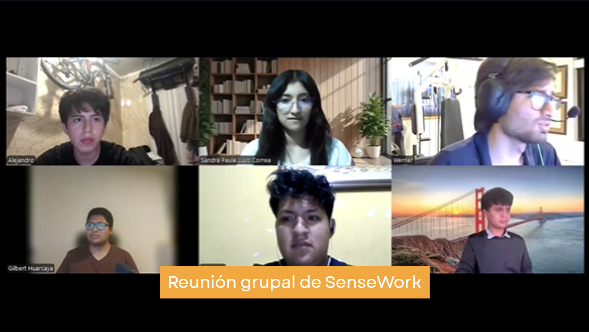

<!-- nav:start -->

<a href="capitulo-6.md">← Capítulo VI</a> · <a href="README.md#contenido">Contenido</a>

<!-- nav:end -->

# Conclusiones

Al cierre de AV2, SenseWork consolidó el segundo incremento de ZenRoom mediante la integración del prototipo IoT, la Edge API, los servicios en la nube y las aplicaciones web y móvil. La entrega articuló la implementación, las pruebas, el despliegue y la validación con usuarios, dando continuidad a los artefactos de diseño y arquitectura desarrollados en las entregas anteriores.

En relación con los Problem Statements, ZenRoom proporcionó al administrador una visión centralizada de las condiciones ambientales y al miembro una forma de comparar las salas antes de elegir dónde trabajar. El procesamiento de las mediciones y su presentación mediante indicadores visuales conectaron la información técnica con las tareas de ambos segmentos. La medición del nivel de ruido sin grabar conversaciones atendió la preocupación por la privacidad identificada durante el needfinding.

El contraste entre los assumptions y los resultados de validación respaldó la importancia de la claridad visual, la facilidad de navegación y la privacidad en la aceptación de la propuesta. Daniela Gómez valoró la consulta de las condiciones de las salas y el recorrido para reportar incomodidades; Ayrton Briceño destacó el monitoreo y el historial de acciones para apoyar la gestión. Estas respuestas aportaron evidencia favorable sobre los mecanismos de valor planteados en las hipótesis de Lean UX: facilitar la elección de espacios y apoyar decisiones de gestión mediante datos.

Las entrevistas también definieron oportunidades de evolución del producto. La sugerencia de guardar salas favoritas mostró el interés por agilizar las consultas recurrentes, mientras que las observaciones sobre los umbrales y los términos técnicos permitieron identificar mejoras en la comprensión del panel. La preferencia de Ayrton por una tarifa por local aportó un criterio concreto para el desarrollo comercial de ZenRoom.

Las evidencias de desarrollo, pruebas, ejecución y despliegue del Sprint 2 sustentaron el incremento presentado en AV2. El despliegue de los servicios REST en Azure, la documentación OpenAPI y la automatización de pruebas facilitaron la integración y la revisión técnica de la solución. La actualización de la Landing Page y de las aplicaciones permitió presentar la propuesta y sus funcionalidades a los segmentos definidos.

La distribución de responsabilidades mediante la matriz de líderes y colaboradores y el Sprint Backlog 2 organizó el trabajo del equipo y relacionó los aportes con los resultados de la entrega. Las entrevistas y las evaluaciones de usabilidad vincularon el desarrollo con la experiencia de los usuarios, mientras que los videos About-the-Product y About-the-Team comunicaron el valor de ZenRoom y el proceso de colaboración de SenseWork.

Al cierre de TB2, ZenRoom completó el ciclo que motivó el proyecto: una condición que supera el umbral de una sala de forma sostenida se convierte en una alerta que el administrador ve en la web y en el celular, atiende con una acción correctiva y consulta después en el historial, y la alerta se cierra cuando la sala vuelve a la normalidad. El miembro puede informar ruido, calor o frío, y el administrador ve ese reporte junto con la lectura de la sala en ese momento.

Frente al primer Problem Statement, el administrador deja de enterarse por la queja: la Edge API detecta la superación y la Cloud API la muestra con su sala, su valor y su estado. Frente al segundo, el miembro descarga la aplicación desde la Landing Page, consulta el semáforo de cada sala y reporta lo que percibe. El tercero se mantiene resuelto desde el diseño, porque el dispositivo solo envía niveles e histogramas calculados en la placa. El cuarto se sostiene con un montaje de componentes de venta local; su aceptación sobre la placa sigue en curso con la lista de comprobación del repositorio del firmware.

Las hipótesis de Lean UX plantean resultados de negocio, como el aumento de las renovaciones o el uso diario de la aplicación, que solo se pueden medir con un piloto en operación. Lo que sí respaldan las entrevistas de validación es el mecanismo: los participantes entendieron el semáforo, valoraron el historial de acciones y la posibilidad de reportar una molestia, y la privacidad del audio fue un argumento a favor de la adopción. Las funciones del Sprint 3 responden a esas observaciones.

La entrega se cerró con versiones publicadas de los seis productos, 157 pruebas automatizadas en la Cloud API, 41 en la Edge API y 41 en la Mobile Application, y el despliegue continuo en Azure. Quedaron en curso historias que el Product Backlog conserva para el siguiente release, como la marca de discrepancia de los reportes, el cierre sostenido de las alertas en la Edge API, la invitación de miembros y el registro de dispositivos por el administrador.

# Recomendaciones

Para las siguientes iteraciones del roadmap, priorizar las mejoras de experiencia identificadas en la validación, especialmente las salas favoritas y las notificaciones en el celular. Organizar estas funcionalidades según su valor para miembros y administradores, manteniendo la sencillez de los recorridos de consulta y gestión.

Perfeccionar la configuración de umbrales mediante ejemplos, referencias comprensibles de los niveles de ruido y explicaciones sobre la duración de una condición ambiental. Mantener un lenguaje uniforme en español y evaluar las nuevas interfaces con usuarios de ambos segmentos para orientar su evolución.

Extender la evaluación de ZenRoom a pilotos de mayor duración y a coworkings con distintas características. Incorporar indicadores de frecuencia de uso, satisfacción, renovación de membresías y consumo de recursos para contrastar, en condiciones de operación sostenida, los resultados de negocio previstos en las hipótesis de Lean UX.

Evaluar alternativas comerciales por local y por cantidad de salas monitoreadas, considerando las observaciones de los administradores sobre el precio y su capacidad de aprobación. Utilizar los resultados de nuevos pilotos para definir planes que relacionen el costo del servicio con el valor que cada tipo de coworking obtiene.

Fortalecer la escalabilidad y la facilidad de mantenimiento del ecosistema IoT conforme aumenten las sedes y los dispositivos. Ampliar las pruebas en diferentes condiciones de ocupación, revisar periódicamente la consistencia de las mediciones y mejorar la instalación y supervisión del hardware para acompañar la expansión del producto.

Mantener la automatización de pruebas y despliegues como parte de la evolución de ZenRoom. En cada nueva versión, ampliar la cobertura de los escenarios incorporados, conservar la trazabilidad entre funcionalidades y evidencias y actualizar de manera coordinada la documentación, la Landing Page y los materiales de comunicación del producto.

Para el siguiente release, cerrar primero las historias que quedaron en In Progress y que ya tienen su pull request: el nombre de quien atiende una alerta, la marca de discrepancia de los reportes, el cierre sostenido en la Edge API, el selector de rango de la serie por minuto, la solicitud de demostración desde la Landing Page y el inglés como idioma por defecto de las aplicaciones. Cada pull request debe pasar por la revisión de otro integrante antes de integrarse.

Completar la aceptación del dispositivo sobre la placa e instalar la Edge API en el equipo de un local real, para medir durante varias semanas con sensores del diseño y contrastar las hipótesis de negocio con datos de operación. Después, incorporar las notificaciones por correo de las alertas (TS27), la recuperación de contraseña (US41 y TS28) y la rotación de credenciales de máquina (TS29).

# Video About-the-Team

El video About-the-Team presenta el proceso de trabajo de SenseWork durante el desarrollo de ZenRoom y los aprendizajes alcanzados como equipo. Se organiza en una retroalimentación grupal, narrada por Sandra Paula Luyo Correa, seguida de los testimonios individuales de los seis integrantes en orden alfabético de apellido. Las intervenciones describen las actividades realizadas, el liderazgo compartido, la colaboración y el desarrollo de competencias vinculadas con el Student Outcome 5.

**Figura 181**

*Reunión grupal de SenseWork incluida en el video About-the-Team*

  

**Retroalimentación grupal**

En la retroalimentación, el equipo menciona que organizó el proyecto a partir de la necesidad de mejorar las condiciones de trabajo en los espacios de coworking. Explica que distribuyó responsabilidades entre investigación, diseño, desarrollo y documentación, con líderes y colaboradores por aspecto. El backlog, Trello y GitHub sirvieron como referencias compartidas para coordinar las tareas y reconocer las dependencias entre los aportes de los integrantes.

El grupo describe la continuidad entre las entregas: las entrevistas con miembros y administradores orientaron los requisitos y la arquitectura; posteriormente, los wireframes, mockups, prototipos y guías de estilo trasladaron esas necesidades a las interfaces. En AV2, el trabajo se centró en el dispositivo IoT, el procesamiento de mediciones y la comunicación entre los servicios y las aplicaciones. También menciona las pruebas con Wokwi y dispositivos virtuales, así como la resolución de ajustes de permisos y configuración durante el despliegue en Azure.

Como aprendizaje, SenseWork destaca la importancia de mantener coherencia entre el diseño, la implementación y la documentación, y de revisar el recorrido completo de la información. El equipo propone integrar y revisar los componentes con mayor anticipación en futuras entregas. La reflexión relaciona estos aprendizajes con el Student Outcome 5 mediante la comunicación, la escucha de propuestas, la planificación de tareas y el cumplimiento de objetivos comunes.

**Testimonios individuales**

- **Espino Flores, Alejandro**

  Alejandro menciona que se encargó del backend y de la infraestructura en la nube de ZenRoom. Explica que diseñó la arquitectura mediante Domain-Driven Design, organizada en bounded contexts y basada en principios SOLID para facilitar su crecimiento y mantenimiento. Sobre esta base, construyó la API REST que conecta las aplicaciones web y móvil. También configuró pipelines para automatizar las pruebas y los despliegues, definió políticas de seguridad y protegió las ramas para que los cambios se integraran mediante pull requests y superaran las pruebas. Como aprendizaje, destaca que la automatización y las reglas claras permitieron a los seis integrantes trabajar sobre el mismo código sin sobrescribir los cambios de sus compañeros.

- **Huarcaya Matias, Gilbert Alonso**

  Gilbert menciona que demostró liderazgo al integrar las aplicaciones con la Cloud API, el dispositivo de la sala y la Edge API. También señala que construyó el firmware con el pronóstico de temperatura y la publicación mediante MQTT. Explica que colaboró en la integración de cambios de tres repositorios mediante pull requests, respetando la autoría de sus compañeros, y que dejó guías de instalación y prueba para dar continuidad al trabajo. Además, indica que documentó el estado del Sprint Backlog 2 y las responsabilidades de cada tarea. Relaciona estos aportes con el liderazgo compartido y la creación de un entorno colaborativo.

- **Lang Nassi, Werner Khalil**

  Werner menciona que investigó y definió la problemática del proyecto mediante la técnica de las 5W y 2H, utilizando fuentes oficiales. También organizó los requisitos en Epics y User Stories con criterios de aceptación en formato Gherkin para proporcionar al equipo una base clara y verificable para planificar el desarrollo de ZenRoom. Señala que elaboró los wireflow diagrams de las aplicaciones, documentó la gestión del código fuente, la guía de estilo y las convenciones de programación, y definió la configuración de despliegue. Además, indica que preparó el Sprint Planning y colaboró con Giancarlo en el Sprint Backlog y las evidencias de la suite de pruebas.

- **Llamccaya Arone, Juan Paul**

  Juan Paul menciona que desarrolló la Landing Page, elaboró mockups y participó en la edición del informe. Explica que uno de sus retos fue comunicar de forma sencilla cómo el monitoreo de ruido y temperatura beneficia a los miembros y administradores de coworkings. Para ello, organizó la presentación alrededor de un ejemplo concreto de una sala ruidosa y coordinó los ajustes de la Landing Page, los mockups y la documentación. Señala que fortaleció su capacidad de comunicar una solución técnica con claridad y de coordinar con el equipo.

- **Luyo Correa, Sandra Paula**

  Sandra menciona que en AV1 organizó el repositorio del informe, participó en las entrevistas y documentó las capas de la arquitectura de ZenRoom. En TB1 trabajó con Gilbert en los wireframes, mockups y prototipos, e implementó el frontend web y móvil; también elaboró el Student Outcome, actualizó el registro de versiones y redactó las conclusiones. En AV2 participó en el armado del dispositivo IoT y en la elaboración de los videos del producto y del equipo, las conclusiones y las recomendaciones. Explica que estas actividades fortalecieron su comunicación, la organización de aportes y la capacidad de relacionar las necesidades de los usuarios con la construcción de la solución, contribuyendo al Student Outcome 5.

- **Solís Santa Cruz, Giancarlo Rafael**

  Giancarlo menciona que definió los segmentos objetivo, participó en el registro y análisis de una entrevista del primer segmento y elaboró el Impact Mapping para relacionar las necesidades de los usuarios con los objetivos del negocio. También describe su trabajo en los User Flow Diagrams de las aplicaciones web y móvil y en la documentación del Sprint 1, con evidencias de desarrollo, ejecución, servicios y despliegue. Como reflexión, señala que el proyecto le permitió aplicar los conocimientos del curso, mejorar la organización y fortalecer el trabajo colaborativo, vinculando el diseño y la implementación con las necesidades de los usuarios.

**Pauta de secuencias del video**

**Tabla 6**

*Orden de las secciones del video About-the-Team*

| Orden | Sección | Inicio (hh:mm:ss) |
| :---: | :--- | :---: |
| 1 | Retroalimentación grupal | 00:00:00 |
| 2 | Testimonio de Espino Flores, Alejandro | 00:04:32 |
| 3 | Testimonio de Huarcaya Matias, Gilbert Alonso | 00:05:37 |
| 4 | Testimonio de Lang Nassi, Werner Khalil | 00:06:41 |
| 5 | Testimonio de Llamccaya Arone, Juan Paul | 00:07:52 |
| 6 | Testimonio de Luyo Correa, Sandra Paula | 00:08:45 |
| 7 | Testimonio de Solís Santa Cruz, Giancarlo Rafael | 00:09:37 |

**Duración total:** 10 minutos y 55 segundos (00:10:55).

**Microsoft Stream/Clipchamp:** [https://bit.ly/48RHQt4](https://bit.ly/48RHQt4).

**YouTube:** [https://www.youtube.com/watch?v=8f-APZ_YvV0](https://www.youtube.com/watch?v=8f-APZ_YvV0).

# Bibliografía

Airthings. (2026a). *Airthings for Business: indoor air quality monitoring*. https://www.airthings.com/business

Airthings. (2026b). *How does the ambient noise sensor work?* https://help.airthings.com/en/articles/9739502-how-does-the-ambient-noise-sensor-work

Autoridad de Transporte Urbano para Lima y Callao. (2024). *Monitoreo de ruido ambiental en la red de transporte de Lima y Callao*. ATU.

Berglund, B., Lindvall, T., & Schwela, D. H. (Eds.). (1999). *Guidelines for community noise*. World Health Organization. https://iris.who.int/handle/10665/66217

Binswanger Perú. (2026). *Reporte de mercado de oficinas y espacios flexibles en Lima Metropolitana*. Binswanger.

Eclipse Foundation. (2026). *Eclipse Mosquitto: An open source MQTT broker*. https://mosquitto.org/

Espressif Systems. (2026). *ESP32 series datasheet*. https://www.espressif.com/sites/default/files/documentation/esp32_datasheet_en.pdf

Google. (2026a). *Firebase App Distribution*. https://firebase.google.com/docs/app-distribution

Google. (2026b). *Flutter documentation*. https://docs.flutter.dev/

International Organization for Standardization. (2005). *ISO 7730:2005. Ergonomics of the thermal environment — Analytical determination and interpretation of thermal comfort using calculation of the PMV and PPD indices and local thermal comfort criteria*. ISO.

International Organization for Standardization. (2016). *ISO 1996-1:2016. Acoustics — Description, measurement and assessment of environmental noise — Part 1: Basic quantities and assessment procedures*. ISO.

Kaiterra. (2026). *Indoor air quality monitors and data platform*. https://www.kaiterra.com/

Leifer, C. (2026). *Peewee documentation*. https://docs.peewee-orm.com/

Microsoft. (2026). *Azure Container Apps documentation*. https://learn.microsoft.com/azure/container-apps/

Ministerio de Trabajo y Promoción del Empleo. (2023). *Registro de empresas con trabajadores en modalidad de teletrabajo*. MTPE.

NTi Audio. (2026). *XL2 Sound Level Meter & Acoustic Analyzer*. https://www.nti-audio.com/en/products/xl2-sound-level-meter

OASIS. (2019). *MQTT version 5.0*. OASIS Standard. https://docs.oasis-open.org/mqtt/mqtt/v5.0/mqtt-v5.0.html

OpenAPI Initiative. (2021). *OpenAPI Specification v3.1.0*. https://spec.openapis.org/oas/v3.1.0

OpenWeather. (2026). *Current weather data API*. https://openweathermap.org/current

Pallets Projects. (2026). *Flask documentation*. https://flask.palletsprojects.com/

Presidencia del Consejo de Ministros. (2003). *Decreto Supremo N.º 085-2003-PCM. Reglamento de Estándares Nacionales de Calidad Ambiental para Ruido*. Diario Oficial El Peruano.

Spring. (2026). *Spring Boot reference documentation*. https://docs.spring.io/spring-boot/

Wokwi. (2026). *Wokwi simulator documentation*. https://docs.wokwi.com/

# Anexos.

**Anexo A.** Videos de Exposiciones

La relación de videos se amplía con cada entrega del proyecto.

| Entrega | Título del video | Enlace |
|:---|:---|:---|
| AV1 | 1asi0572-8721-SenseWork-expo-av1 | [https://bit.ly/3VF7MVo](https://bit.ly/3VF7MVo) |
| TB1 | 1asi0572-8721-SenseWork-expo-tb1 | [https://bit.ly/4jtPoJl](https://bit.ly/4jtPoJl) |
| AV2 | 1asi0572-8721-SenseWork-expo-av2 | — |
| TB2 | 1asi0572-8721-SenseWork-expo-tb2 | — |

**Anexo B.** Repositorios del proyecto

| Repositorio | Contenido | URL |
|:---|:---|:---|
| `Report` | el informe en Markdown | [https://github.com/Grupo03-IOT/Report](https://github.com/Grupo03-IOT/Report) |
| `cloud-api` | RESTful API interno — Spring Boot 4, Java 21 | [https://github.com/Grupo03-IOT/cloud-api](https://github.com/Grupo03-IOT/cloud-api) |
| `edge-api` | Edge API — Flask, y el simulador del dispositivo | [https://github.com/Grupo03-IOT/edge-api](https://github.com/Grupo03-IOT/edge-api) |
| `zenroom-landing` | Landing Page de ZenRoom | [https://github.com/Grupo03-IOT/zenroom-landing](https://github.com/Grupo03-IOT/zenroom-landing) |
| `zenroom-web-app` | Web Application de ZenRoom | [https://github.com/Grupo03-IOT/zenroom-web-app](https://github.com/Grupo03-IOT/zenroom-web-app) |
| `zenroom-mobile-app` | Mobile Application de ZenRoom | [https://github.com/Grupo03-IOT/zenroom-mobile-app](https://github.com/Grupo03-IOT/zenroom-mobile-app) |
| `zenroom-embedded-app` | Embedded Application del dispositivo ZenRoom (ESP32) | [https://github.com/Grupo03-IOT/zenroom-embedded-app](https://github.com/Grupo03-IOT/zenroom-embedded-app) |

*Nota.* Todos pertenecen a la organización [Grupo03-IOT](https://github.com/Grupo03-IOT).

**Anexo C.** Video de entrevistas de needfinding

| Título del video | Enlace |
|:---|:---|
| upc-pre-202620-1asi0572-8721-SenseWork-needfinding-sprint-1 | [https://bit.ly/4yOxHbD](https://bit.ly/4yOxHbD) |

**Anexo D.** Videos de navegación y productos publicados

| Título | Enlace |
|:---|:---|
| upc-pre-202620-1asi0572-8721-SenseWork-prototype-navigation-web-app-sprint-1 | [Video en Microsoft Stream](https://upcedupe-my.sharepoint.com/:v:/g/personal/u202322187_upc_edu_pe/IQApKdl_nCa5Sry5fl6EBTaIAUxUhTQcy5_xNagXYjsmesg) |
| upc-pre-202620-1asi0572-8721-SenseWork-prototype-navigation-mobile-app-sprint-1 | [Video en Microsoft Stream](https://upcedupe-my.sharepoint.com/:v:/g/personal/u202322187_upc_edu_pe/IQARuX3oebjMRYvuatooiXC3AdzcCuIQ4ueNtBSkStwst_U) |
| upc-pre-202620-1asi0572-8721-SenseWork-navigation-sprint-2 | — |
| upc-pre-202620-1asi0572-8721-SenseWork-navigation-sprint-3 | — |
| Landing Page | [https://grupo03-iot.github.io/zenroom-landing/](https://grupo03-iot.github.io/zenroom-landing/) |
| Web Application | [https://zenroom-web-app.vercel.app](https://zenroom-web-app.vercel.app) |
| Mobile Application (APK) | [https://github.com/Grupo03-IOT/zenroom-mobile-app/releases/latest](https://github.com/Grupo03-IOT/zenroom-mobile-app/releases/latest) |
| Documentación de la Cloud API | [https://cafecito-app.icywater-8ce04e92.northcentralus.azurecontainerapps.io/swagger-ui.html](https://cafecito-app.icywater-8ce04e92.northcentralus.azurecontainerapps.io/swagger-ui.html) |
| Simulación del dispositivo | [https://wokwi.com/projects/481710853765583873](https://wokwi.com/projects/481710853765583873) |
| Product Backlog | [https://trello.com/b/nn477GGQ](https://trello.com/b/nn477GGQ) |
| Sprint Backlog 2 | [https://trello.com/b/WcwRBQlk](https://trello.com/b/WcwRBQlk) |

<!-- nav:start -->

<a href="capitulo-6.md">← Capítulo VI</a> · <a href="README.md#contenido">Contenido</a>

<!-- nav:end -->
